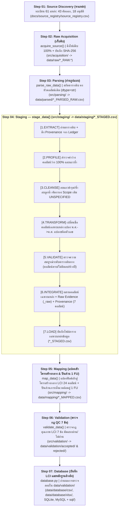

# CN230 Final Project: Data Engineering Pipeline (Source to Validated LCI)
**Industrial Domain:** Petroleum, Natural Gas & Fuels (Upstream E&P & Midstream Refinery / GSP)  
**Team:** G02 MarianDB  
**Course:** CN230 Data Engineering Pipeline

**Project webpages:** [Main](https://cn-230-s1-g02-ma-rian-db.vercel.app/) · [Sub](https://prefix-efficient-slacked.ngrok-free.dev/)

ระบบไปป์ไลน์วิศวกรรมข้อมูลแบบครบวงจร **Step 01 ถึง Step 07 (Source to Validated LCI Schema & Relational Database)** สำหรับสำรวจแหล่งข้อมูล ดึงไฟล์ดิบ สกัดโครงสร้างตาราง จัดเตรียมตารางชั่วคราวเฉพาะแหล่ง (Staging) แปลงและจับคู่ฟิลด์เข้าสู่โครงสร้างกลาง (Mapping) พร้อมคำนวณการปันส่วนพลังงาน (Energy-Based Allocation) สู่ 1 Functional Unit (1 FU) ตรวจสอบกฎคุณภาพ (Validation) โหลดสู่ฐานข้อมูลเชิงสัมพันธ์ (CSV, XLSX, SQLite, MySQL) และแสดงผลโครงข่าย LCI แบบอินเทอร์แอกทีฟใน `web/`

---

## 📌 บทนำและวัตถุประสงค์โครงการ (Project Overview & Purpose)

โครงการนี้มุ่งเน้นการออกแบบและสร้างระบบ Data Engineering Pipeline มาตรฐานองค์กร เพื่อบูรณาการข้อมูลด้านปิโตรเลียม ก๊าซธรรมชาติ การกลั่นน้ำมัน และสิ่งแวดล้อมของประเทศไทยที่มีโครงสร้างแตกต่างกันตามแต่ละหน่วยงาน ให้เข้าสู่โครงสร้างกลางมาตรฐาน **Life Cycle Inventory (LCI)** เพื่อส่งมอบให้กับขั้นตอนการประกอบฐานข้อมูลเชิงสัมพันธ์ โดยมีเสาหลักสำคัญดังนี้:

1. **บูรณาการข้อมูลพลังงานและสิ่งแวดล้อมข้ามหน่วยงาน (Cross-Agency LCI Integration)**:
   * **กรมเชื้อเพลิงธรรมชาติ (DMF):** ปริมาณการผลิตปิโตรเลียมต้นน้ำ (`Upstream - E&P`) รายแปลงสำรวจและแหล่งผลิต ทั้งบนบกและในอ่าวไทย (น้ำมันดิบ `SRC-044`, ก๊าซธรรมชาติ `SRC-045`, คอนเดนเสท `SRC-046`)
   * **บมจ. ปตท.สำรวจและผลิตปิโตรเลียม (PTTEP):** ข้อมูลผลการดำเนินงานด้านสิ่งแวดล้อม (`SRC-047`) ได้แก่ ปริมาณการผลิตไฮโดรคาร์บอนรวม, การใช้พลังงานทางตรง (`Direct Energy Consumption`), และการปลดปล่อยก๊าซเรือนกระจก/มลพิษทางอากาศ (`Scope 1 GHG`, `Methane`, `VOCs`, `NOx`, `SOx`)
   * **สำนักงานนโยบายและแผนพลังงาน (EPPO):** ข้อมูลปิโตรเลียมกลางน้ำ (`Midstream - Refinery & GSP`) ได้แก่ ปริมาณการผลิตผลิตภัณฑ์ปิโตรเลียมสำเร็จรูป (`SRC-048`), ปริมาณการนำน้ำมันดิบเข้ากลั่นแยกตามบริษัทโรงกลั่น (`SRC-049`), และปริมาณก๊าซธรรมชาติที่ป้อนเข้าโรงแยกก๊าซธรรมชาติ (`SRC-050`)
2. **สถาปัตยกรรมไปป์ไลน์ที่จับคู่โฟลเดอร์และฟังก์ชันแบบ 1-to-1 (Strict Layered Architecture)**:
   * แยกความรับผิดชอบอย่างชัดเจนระหว่าง **Step 04 Staging** (`src/staging/staging.py` $\rightarrow$ `data/staging/*_STAGED.csv` รักษาคอลัมน์เฉพาะของแต่ละแหล่งข้อมูลคู่กับ Provenance) และ **Step 05 Mapping** (`src/mapping/mapping.py` $\rightarrow$ `data/mapping/*_MAPPED.csv` แปลงทุกแหล่งเข้าสู่โครงสร้างกลาง LCI พร้อมดำเนินการปันส่วนตามฐานพลังงาน (Energy-Based Allocation) และปรับฐานสู่ 1 Functional Unit (1 FU)) ก่อนส่งเข้าตรวจ **Step 06 Validation** (7 QC Rules) เพื่อคัดแยกข้อมูลที่ผ่านเกณฑ์เข้าสู่จุดส่งมอบ
3. **ธรรมาภิบาลข้อมูลและการตรวจสอบย้อนกลับ (Data Governance & Cryptographic Lineage)**:
   * **Approved Source Gate:** ประมวลผลเฉพาะชุดข้อมูลที่มีสถานะ `approved` ในทะเบียน [`docs/source_registry/source_registry.csv`](docs/source_registry/source_registry.csv)
   * **Raw Preservation & SHA-256 Ledger:** เก็บไฟล์ดิบสภาพเดิมใน `data/raw/` พร้อมสมุดคุม [`_provenance_ledger.jsonl`](data/raw/_provenance_ledger.jsonl)
   * **Data Quality Separation:** แยกผลลัพธ์ข้อมูลผ่านเกณฑ์ (`data/validation/accepted/`) และข้อมูลกักกัน (`data/validation/rejected/`) พร้อมบันทึก `error_type` เพื่อส่งต่อเข้าสู่ตาราง `REJECTED_RECORD`

---

## 🏛️ สถาปัตยกรรมไปป์ไลน์ (Pipeline Architecture)



### ตารางสรุปความสอดคล้องของโมดูล ฟังก์ชัน และโฟลเดอร์ข้อมูล (1-to-1 Stage Alignment)

| ขั้นตอน (Stage) | โมดูลโค้ดต้นฉบับ (`src/`) | ฟังก์ชันหลัก (Entry Function) | โฟลเดอร์ข้อมูลปลายทาง (`data/` / `docs/`) | รูปแบบไฟล์ผลลัพธ์ |
|:---|:---|:---|:---|:---|
| **Step 01: Source Discovery** | `src/acquisition/acquisition.py` | `get_approved_sources()` | `data/registry/` | `source_registry.csv` |
| **Step 02: Raw Acquisition** | `src/acquisition/acquisition.py` | `acquire_source(source_id)` | `data/raw/` | `*_RAW.*`, `_provenance_ledger.jsonl` |
| **Step 03: Parsing** | `src/parsing/parsing.py` | `parse_raw_data(source_id)` | `data/parsed/` | `*_PARSED_RAW.csv` |
| **Step 04: Staging** | `src/staging/staging.py` | `stage_data(source_id)` | `data/staging/` | `*_STAGED.csv` (Source-Specific) |
| **Step 05: Mapping** | `src/mapping/mapping.py` | `map_data(source_id)` | `data/mapping/` | `*_MAPPED.csv` (24 คอลัมน์มาตรฐาน) |
| **Step 06: Validation** | `src/validation/validation.py` | `validate_data(source_id)` | `data/validation/accepted/` & `rejected/` | `*_VALID.csv`, `*_ERR.csv` |
| **Step 07: Database & SQL** | `src/database/database.py` | `python src/database/database.py` (หรือผ่านไปป์ไลน์) | `data/database/` (รวม `sql/`) และ MySQL | `data/database/csv/*.csv`, `data/database/xlsx/*.xlsx`, `petroleum_database.xlsx`, `petroleum.db`, `01_schema.sql`, `02_insert_data.sql`, `03_fr_queries.sql` |

---

### รายละเอียดการทำงานของแต่ละขั้นตอน (Detailed Stage Breakdown)

#### 🟠 Step 01: Source Discovery (`data/registry/`)
* ทะเบียนปัจจุบันมี 61 แหล่ง: `SRC-001`–`SRC-043` เป็นประวัติการคัดกรองที่ไม่ผ่าน และ `SRC-044`–`SRC-061` เป็นแหล่งที่อนุมัติ 18 แหล่ง
* **แหล่งข้อมูล LCI 18 ชุด:**
  1. `SRC-044`: ปริมาณการผลิตน้ำมันดิบรายเดือน (DMF)
  2. `SRC-045`: ปริมาณการผลิตก๊าซธรรมชาติรายเดือน (DMF)
  3. `SRC-046`: ปริมาณการผลิตคอนเดนเสทรายเดือน (DMF)
  4. `SRC-047`: ข้อมูลผลการดำเนินงานด้านสิ่งแวดล้อม 2025 (PTTEP)
  5. `SRC-048`: การผลิตน้ำมันสำเร็จรูป (EPPO)
  6. `SRC-049`: การใช้น้ำมันดิบในการกลั่นแยกตามโรงกลั่น (EPPO)
  7. `SRC-050`: การใช้ก๊าซธรรมชาติรายสาขา — โรงแยกก๊าซธรรมชาติ GSP (EPPO)
  8. `SRC-052`: หลักเกณฑ์การรายงานและวิธีการคำนวณปริมาณการปล่อยก๊าซเรือนกระจกจากการประกอบกิจการปิโตรเลียม (DMF)
  9. `SRC-051`, `SRC-053`–`SRC-061`: รายงานความยั่งยืนและ MD&A/One Report ของโรงกลั่นน้ำมัน (`BCP`, `BSRC`, `IRPC`, `SPRC`, `TOP`, `PTTGC`)

#### 🔵 Step 02: Raw Acquisition (`src/acquisition/` $\rightarrow$ `data/raw/`)
* **โมดูลและฟังก์ชันหลัก:** `src/acquisition/acquisition.py` (`acquire_source`) และ `src/acquisition/provenance.py`
* **หน้าที่:** ดึงไฟล์ข้อมูลดิบจากแหล่งต้นทางและจัดเก็บลงใน `data/raw/*_RAW.*` โดยไม่ดัดแปลงเนื้อหา
* **กลไกสำคัญ:**
  * **Modular Strategy Extractors:** รองรับทั้ง CKAN Open Data API พร้อมระบบสำรอง 4 ชั้น (`portal_extractor.py`), เว็บแอปพลิเคชันแบบฟอร์มสืบค้น (`form_extractor.py`), เว็บสแครปปิ้งสกัดเอกสาร PDF รายงานสิ่งแวดล้อม (`web_extractor.py`), ลิงก์ตรงสำหรับ CSV/PDF (`direct_extractor.py`), และตัวคัดเลือกกลยุทธ์อัตโนมัติ (`router.py`)
  * **SHA-256 Immutability & Idempotency:** คำนวณค่าแฮช `SHA-256` บันทึกลงใน `data/raw/_provenance_ledger.jsonl` หากมีไฟล์เดิมที่แฮชตรงกันจะข้ามการดาวน์โหลดซ้ำโดยอัตโนมัติ

#### ⚪ Step 03: Parsing (`src/parsing/` $\rightarrow$ `data/parsed/`)
* **โมดูลและฟังก์ชันหลัก:** `src/parsing/parsing.py` (`parse_raw_data`)
* **หน้าที่:** สกัดตารางจากไฟล์ดิบ (`.csv`, `.pdf`, `.xlsx`, `.html`) ให้อยู่ในรูปตารางดิบ `data/parsed/*_PARSED_RAW.csv`
* **กลไกสำคัญ:**
  * **High-Fidelity String Preservation (`dtype=str`):** อ่านข้อมูลทุกเซลล์เป็นข้อความ คงชื่อคอลัมน์และค่าตัวเลขตามต้นฉบับ 100%
  * **PDF:** `SRC-047` สกัดข้อมูลจากตารางในรายงาน PTTEP ด้วย `pypdf` พร้อมระบุหน้า ส่วน `SRC-051`–`SRC-061` ใช้เฉพาะค่าที่ตรวจเทียบกับหน้าใน PDF ฉบับที่ระบุ URL และ SHA-256 ใน [pdf_evidence.json](data/registry/pdf_evidence.json) หาก PDF เปลี่ยนฉบับ ระบบจะแจ้งให้ตรวจฉบับใหม่ก่อนนำเข้า

#### ⚫ Step 04: Staging (`src/staging/` $\rightarrow$ `data/staging/`)
* **โมดูลและฟังก์ชันหลัก:** `src/staging/staging.py` (`stage_data`, `stage_all_approved`)
* **หน้าที่:** ทำความสะอาดและจัดมาตรฐานข้อมูลเฉพาะของแต่ละแหล่ง (**Source-Specific Staging Schema**) โดยยังไม่บังคับรวมคอลัมน์ข้ามแหล่งข้อมูล ผ่าน **7 กระบวนการย่อย (`7 Sub-Processes`)**:
  1. **`[1.EXTRACT]` Data Extraction:** อ่านตารางจาก `data/parsed/` และดึง Provenance จากสมุดคุม
  2. **`[2.PROFILE]` Data Profiling:** วิเคราะห์ค่าว่างรายคอลัมน์, คอลัมน์ว่าง 100%, และแถวซ้ำ
  3. **`[3.CLEANSE]` Data Cleansing:** ลบช่องว่างซ้ำ, แปลงสัญลักษณ์ค่าว่าง (`-`, `N/A`) เป็น `NaN`, ลบลูกน้ำหลักพัน, ลบแถวชำรุด, เติม `UNSPECIFIED` ให้รหัสแปลงสำรวจบนบก และคัดกรองเฉพาะขอบเขตโครงงาน (`SRC-047` ตัดแถว Intensity ออก; `SRC-050` คัดเฉพาะ `sector == 'GSP'`)
  4. **`[4.TRANSFORM]` Data Transformation:** เปลี่ยนชื่อคอลัมน์เป็นชื่อมาตรฐานประจำแหล่งข้อมูล, แปลงปี พ.ศ. $\rightarrow$ ค.ศ. (`year` คู่กับ `year_raw`), แปลงชื่อเดือนอังกฤษและเลขเดือน (`month`, `month_num` คู่กับ `month_raw`), และแปลงชนิดข้อมูลตัวเลข
  5. **`[5.VALIDATE]` Staging Integrity Check:** ตรวจสอบคอลัมน์บังคับของแหล่งข้อมูลนั้น, ค่าตัวเลขไม่ติดลบ, และช่วงปี ค.ศ.
  6. **`[6.INTEGRATE]` Data Integration:** จัดเรียงคอลัมน์ `Source Columns` + `Raw Evidence (_raw)` + `Provenance (7 คอลัมน์)`
  7. **`[7.LOAD]` Data Loading:** บันทึกไฟล์ลงใน `data/staging/*_STAGED.csv`

#### 🔴 Step 05: Mapping (`src/mapping/` $\rightarrow$ `data/mapping/`)
* **โมดูลและฟังก์ชันหลัก:** `src/mapping/mapping.py` (`map_data`, `map_staged_dataframe`, `map_all_staged`)
* **หน้าที่:** แปลงตารางเฉพาะแหล่งจาก `data/staging/*_STAGED.csv` เข้าสู่ **โครงสร้างกลาง LCI (`MAPPED_COLUMNS` $\rightarrow$ `data/mapping/*_MAPPED.csv`)** พร้อมดำเนินการปันส่วนและปรับฐานตามมาตรฐานสากล ISO 14044:
  * **คอลัมน์ข้อมูล LCI 16 คอลัมน์:** `record_id`, `year`, `month`, `month_num`, `domain`, `process_name`, `location_name`, `country`, `flow_name`, `flow_type`, `compartment`, `direction`, `amount`, `unit`, `allocation`, `is_reference`
  * **คอลัมน์ Provenance 8 คอลัมน์:** `_source_id`, `_subtrack`, `_extraction_batch_id`, `_source_url`, `_source_sha256`, `_raw_file`, `_staged_at`, `_mapped_at`

##### การปันส่วนต้นน้ำสำหรับเว็บเดโม

- ใช้ตัวชี้วัดและยอดผลิต BOE ของ PTTEP ในไทยจากไฟล์ PDF ของ `SRC-047` ส่วน `SRC-044`–`SRC-046` ใช้ประมาณสัดส่วน BOE และอัตราแปลงหน่วยของผลิตภัณฑ์แต่ละชนิด
- ปริมาณผลิตภัณฑ์โดยประมาณ = ยอดผลิต PTTEP (BOE) × สัดส่วน BOE ของผลิตภัณฑ์ × ปริมาณต่อ BOE จาก DMF
- ภาระต่อหน่วย = ภาระ PTTEP ที่จัดสรรตามสัดส่วน ÷ ปริมาณผลิตภัณฑ์โดยประมาณ ผลลัพธ์เป็นค่าประมาณสำหรับเดโมและใช้หน่วยอ้างอิง 1 BBL หรือ 1 scf ตามชนิดผลิตภัณฑ์
- ไฟล์ Mapping เก็บสัดส่วนที่ใช้จริงใน `_allocation_share` และระบุ batch ของทั้งสี่แหล่ง ฐานข้อมูลเว็บมี `upstream_allocation.csv` สำหรับตรวจตัวเลขและ `run_manifest.json` สำหรับตรวจไฟล์ Validation ที่ใช้ส่งออก
- เมื่อ Staging ยังไม่ครบ ระบบจบด้วยสถานะ `BLOCKED` และเก็บผลถึง Staging สำหรับแหล่งที่รันได้ ปีที่ข้อมูลการผลิตหรือตัวชี้วัดไม่ครบจะถูกแจ้งใน log และไม่ถูกนำไปสร้างค่า LCI

#### 🟢 Step 06: Validation (`src/validation/` $\rightarrow$ `data/validation/`)
* **โมดูลและฟังก์ชันหลัก:** `src/validation/validation.py` (`validate_data`, `validate_dataframe`, `validate_all_mapped`)
* **หน้าที่:** ตรวจสอบความถูกต้องของข้อมูลในโครงสร้างกลางด้วย **7 กฎคุณภาพ (7 QC Rules)**:
  1. `Check_Null_URL`: ลิงก์อ้างอิง `_source_url` ต้องไม่ว่างและขึ้นต้นด้วย `http://` หรือ `https://`
  2. `Validate_Unit`: หน่วยวัด (`unit`) ต้องอยู่ในรายการหน่วยมาตรฐาน 27 หน่วยของตาราง `UNIT` (รวม `BBL`, `scf`, `MMSCF`)
  3. `Check_Non_Negative`: ปริมาณสาร (`amount`) ต้องไม่ติดลบ ($\ge 0$)
  4. `Validate_Direction`: ทิศทางสายไหล (`direction`) ต้องเป็น `'IN'` หรือ `'OUT'` เท่านั้น
  5. `Check_Process_Year`: ปีของกระบวนการ (`year`) ต้องอยู่ในช่วง ค.ศ. 1950–2035
  6. `Validate_Product_Flow`: ชื่อสาร (`flow_name`), ประเภทสาร (`flow_type`), และสิ่งแวดล้อม (`compartment`) ต้องถูกต้องครบถ้วน
  7. `Check_Allocation_Burdens`: สำหรับ SRC-044–046 ตรวจหน่วยอ้างอิง ตัวชี้วัด และหลักฐานการปันส่วนที่ Mapping สร้างจากข้อมูลจริงตามรายปี
* **ผลลัพธ์ (ส่งต่อให้ Step 07):**
  * ข้อมูลผ่านเกณฑ์: `data/validation/accepted/*_VALID.csv`
  * ข้อมูลไม่ผ่านเกณฑ์: `data/validation/rejected/*_ERR.csv`

#### 🟣 Step 07: Database Layer & SQL Verification (`src/database/` & `data/database/` & `sql/`)
* **บทบาทตาม Mental Model:** เปลี่ยน **"Database-ready Dataset"** ให้กลายเป็น **"Relational Tables (CSV, XLSX, SQLite, MySQL) & SQL Queries"** ตามที่สอนในรายวิชา CN230 (Cell 22)
* **โมดูลและสคริปต์:** `src/database/` แบ่งเป็น:
  * `database.py`: ตัวสั่งการหลัก (all | export | files | create | load)
  * `connection.py`: path ไฟล์ + เชื่อมต่อ MySQL/SQLite
  * `schema.py` สร้าง DDL สำหรับตาราง LCI และหลักฐานอ้างอิง
  * `loader.py` โหลดผลตรวจสอบจาก CSV และ JSON แล้วส่งออกเป็น CSV, XLSX, SQLite และ MySQL
  * `queries.py`: query ทดสอบ FR/BR (`03_fr_queries.sql`)
* **วิธีรัน:**
  * รันอัตโนมัติเมื่อสั่ง `python run_pipeline.py` (จะรัน Step 07 ต่อท้ายให้ทันที)
  * หรือรันแยกเฉพาะฐานข้อมูล: `python src/database/database.py` (หรือ `export` เฉพาะไฟล์ CSV/XLSX/SQLite)
  * หากต้องการโหลดลง MySQL ให้ตั้งค่า `.env` จาก `.env.example` (host, port, user, password, database)
* **ผลลัพธ์ฐานข้อมูล**
  1. `data/database/csv/*.csv` มีตาราง LCI 10 ตาราง และ `SOURCE_EVIDENCE_CARD.csv` กับ `SOURCE_EVIDENCE_ASSET.csv`
  2. `data/database/xlsx/*.xlsx` มีไฟล์ Excel รายตารางและ `all_tables.xlsx` สำหรับทั้งฐานข้อมูล
  3. `data/database/petroleum.db`: ฐานข้อมูล SQLite แบบ Standalone พร้อมใช้งานทันทีโดยไม่ต้องติดตั้งเซิร์ฟเวอร์
  4. ไฟล์ SQL ใน `data/database/sql/`: `01_schema.sql`, `01_schema_sqlite.sql`, `02_insert_data.sql`, `03_fr_queries.sql`. ใช้ `python src/database/database.py files` เพื่อสร้างเฉพาะไฟล์ SQL ใน `sql/` ที่ root
  5. ฐานข้อมูล MySQL `petroleum` (เมื่อเชื่อมต่อสำเร็จ)
* **Snapshot สำหรับส่งมอบ (`docs/database/`):** ผลลัพธ์รันไทม์ใน `data/database/` ถูก ignore ใน Git (คง `.gitkeep` ไว้สำหรับรันไพป์ไลน์ใหม่) ส่วนชุดไฟล์ส่งมอบที่ commit ไว้ในรีโปจะเก็บอยู่ที่ `docs/database/` (`csv/`, `xlsx/`, `all_tables.xlsx`, `petroleum.db`)
* **หมายเหตุ:** แหล่งข้อมูลรันตามรหัสจากน้อยไปมาก การปันส่วนต้นน้ำจะเริ่มหลัง Staging ของรอบนั้นพร้อม Step 07 ส่งออกเฉพาะผล Validation ของแหล่งที่รันในรอบนี้ และข้ามเมื่อข้อมูลขาด, มีขั้นตอนล้มเหลว หรือเลือก `--no-db` Terminal และเว็บเดโมตรวจ SQLite แล้วเผยแพร่ไฟล์เป็นชุดเดียวใต้ `data/database/` และ `data/database/` ตามลำดับ ไฟล์ `run_manifest.json` ระบุชุดข้อมูลที่ใช้ และ `pdf_evidence.csv` ระบุหน้า ขอบเขต งวด และค่าก่อนแปลงหน่วยของตัวเลขจาก PDF ที่ตรวจด้วยมือ
* **อินพุตที่รับมอบจากไปป์ไลน์:**
  1. `data/validation/accepted/*_VALID.csv` (ชุดข้อมูลที่ผ่านการตรวจสอบคุณภาพ 7 กฎ พร้อมนำเข้าตาราง)
  2. `data/validation/rejected/*_ERR.csv` (ชุดข้อมูลที่ถูกกักกัน พร้อมนำเข้าตาราง `REJECTED_RECORD`)
  3. `docs/source_registry/source_registry.csv` (ข้อมูลอ้างอิงแหล่งที่มาสำหรับตาราง `SOURCE`)
  4. `data/raw/_provenance_ledger.jsonl` (หลักฐานเวลาและ SHA-256 สำหรับตาราง `EXTRACTION_BATCH`)
  5. `data/validation/accepted/*_EVIDENCE_VALID.json` (ข้อมูลจากการ์ดอ้างอิงพร้อม SHA-256 ของเอกสารและภาพหลักฐาน)
* **แนวทางการทำงานของ Database Layer:**
  1. **Execute DDL Schema** สร้างตาราง LCI และหลักฐานอ้างอิงบน MySQL 8 และ SQLite พร้อม Primary Keys, Foreign Keys และ `CHECK` constraints
  2. **Relational Ingestion & Export:** อ่านข้อมูลจาก `accepted/*_VALID.csv` และกระจายลงสู่ 10 ตารางตาม ERD:
     * แตกมิติข้อมูลสู่ตารางหลัก: `LOCATION`, `SOURCE`, `REFERENCE`, `PROCESS`, `UNIT`, `FLOW`, `EXTRACTION_BATCH`
     * บันทึกรายการแลกเปลี่ยนลงตาราง: `LCI_EXCHANGE` (พร้อมค่า `amount`, `allocation`, และ `is_reference`)
     * บันทึกประวัติการผ่านเกณฑ์ลงตาราง: `QUALITY_CHECK`
     * บันทึกข้อมูลที่ไม่ผ่านเกณฑ์จาก `rejected/*_ERR.csv` ลงตาราง: `REJECTED_RECORD`
     * บันทึกไฟล์ CSV และ XLSX สำหรับทุกตารางลงใน `data/database/csv/` และ `data/database/xlsx/`
  3. **SQL Verification & Analytics:** รันชุดคำสั่ง SQL Query เพื่อยืนยันความสมบูรณ์:
     * ตรวจสอบ Foreign Key Integrity (Zero Orphaned Records)
     * ตรวจสอบสมดุลสายไหล Input vs Output (Mass & Energy Flow Balance)
     * ตรวจสอบกฎเกณฑ์ทางธุรกิจ เช่น Functional Unit มี `is_reference = 1` และ `amount = 1.0` เสมอ (BR-02) และผลรวม Allocation ของผลิตภัณฑ์ได้ 1.0 (BR-03)

---

## Approved evidence sources

The current registry retains 21 supporting sources for Cradle-to-Gate processes (`P01`–`P09`): `SRC-062`–`SRC-066`, `SRC-069`–`SRC-071`, `SRC-077`, `SRC-087`–`SRC-091`, `SRC-093`–`SRC-094`, `SRC-096`–`SRC-097`, and `SRC-100`–`SRC-102`. Sources for downstream, end-use, and grave processes (`P10`–`P20`) are outside the current scope.

Run `python run_pipeline.py` to process the approved source set. The evidence extractor uses the proof document and local captures and produces validated evidence records linked to `SOURCE` in the main database. See [the evidence pipeline guide](docs/TSRC_Evidence_Pipeline_Preview.md) for the stage outputs.

## 📂 โครงสร้างโปรเจกต์ (Project Structure)

```text
Project CN230/
├── run_pipeline.py                      # ตัวสั่งการไปป์ไลน์ Step 01 ถึง Step 07 (Pipeline Orchestrator)
├── run_tsrc_pipeline.py                 # Legacy TSRC evidence exporter
├── requirements.txt                     # รายการไลบรารี Python ที่จำเป็น (Dependencies)
├── package.json                         # สคริปต์รัน/บิลด์เว็บแดชบอร์ด (`npm run dev` / `build`)
├── .env.example                         # ตัวอย่างค่าเชื่อมต่อ MySQL (คัดลอกเป็น .env)
├── .gitignore                           # กฎ Git Ignore
├── README.md                            # เอกสารสถาปัตยกรรม กฎการแมป และคู่มือการใช้งาน
│
├── docs/                                # [Step 01 & Audits] เอกสารโครงการ ทะเบียนแหล่ง และรายงานตรวจสอบ
│   ├── source_registry/                 # เอกสารอ้างอิงและสำเนาทะเบียนเดิม
│   ├── database/                        # Snapshot ฐานข้อมูลส่งมอบและ ERD
│   │   ├── ERD_v2.mmd                   # ERD ส่วนขยาย provenance / evidence / map
│   │   └── 02_additive_provenance_geospatial_*.sql # DDL เพิ่มตารางโดยไม่ลบ 10 ตารางเดิม
│   ├── requirements/                    # โจทย์และ Guideline Notebook ของรายวิชา
│   ├── erd/                             # ไดอะแกรมความสัมพันธ์ข้อมูล (10-Table 3NF ERD)
│   └── mapping/                         # สเปกการแปลงและจับคู่ฟิลด์ข้อมูล (Source-to-DB Mapping)
│
├── sql/                                 # [Step 07] ไฟล์ SQL และหลักฐานผลรัน (สร้างโดย database.py)
│   ├── 01_schema.sql                    # DDL 10 ตารางสำหรับ MySQL (สร้างโดย schema.py)
│   ├── 01_schema_sqlite.sql             # DDL 10 ตารางสำหรับ SQLite (สร้างโดย schema.py)
│   ├── 02_insert_data.sql               # INSERT ข้อมูลทุกตาราง (สร้างโดย loader.py)
│   ├── 03_fr_queries.sql                # Query ทดสอบ FR-01..04, BR-01..03, VERIFY-01..02 (สร้างโดย queries.py)
│   └── evidence/                        # โฟลเดอร์สำหรับผลการรันคำสั่งตรวจสอบ SQL
│       └── .gitkeep
│
├── data/                                # Runtime data root สำหรับรันไปป์ไลน์ใน Terminal
│   ├── raw/                             # [Step 02] ไฟล์ดิบสภาพเดิม 100% (*_RAW.*) + _provenance_ledger.jsonl
│   ├── parsed/                          # [Step 03] ตารางดิบที่สกัดโครงสร้างแล้ว (*_PARSED_RAW.csv)
│   ├── staging/                         # [Step 04] ตารางชั่วคราวเฉพาะแหล่งที่คลีนแล้ว + Provenance (*_STAGED.csv)
│   ├── mapping/                         # [Step 05] ตารางโครงสร้างกลาง 24 คอลัมน์มาตรฐาน (*_MAPPED.csv)
│   ├── validation/                      # [Step 06: ผลลัพธ์ส่งต่อ Step 07] ผลการตรวจสอบกฎคุณภาพ 7 ข้อ
│   │   ├── accepted/                    #           ข้อมูลที่ผ่านเกณฑ์ครบทุกข้อ (*_VALID.csv) -> พร้อมเข้าสู่ DB
│   │   └── rejected/                    #           ข้อมูลที่ไม่ผ่านเกณฑ์ (*_ERR.csv) -> สำหรับตาราง REJECTED_RECORD
│   └── database/                        # [Step 07] ผลลัพธ์รันไทม์ตามโครงสร้าง ERD (gitignored, คง .gitkeep ไว้; ดู snapshot ที่ docs/database/)
│       ├── csv/                         #           ไฟล์ CSV แยกรายตาราง (SOURCE.csv, ..., REJECTED_RECORD.csv)
│       ├── xlsx/                        #           ไฟล์ XLSX แยกรายตาราง, all_tables.xlsx และ petroleum_database.xlsx
│       ├── sql/                         #           ไฟล์ SQL DDL, INSERT และ FR queries
│       └── petroleum.db                 #           ฐานข้อมูล SQLite แบบ Standalone พร้อมใช้งานทันที
│
├── src/                                 # โค้ดต้นฉบับแยกตามขั้นตอน 1-to-1 กับชั้นข้อมูล
│   ├── clear_data.py                    # ยูทิลิตี้สำหรับล้างไฟล์ใน data/ เพื่อเริ่มทดสอบใหม่
│   ├── acquisition/                     # [Step 02] Raw Acquisition & SHA-256 Provenance
│   │   ├── extractors/                  #           Modular Extractors (Portal, Direct, Form, Web Scraper, Router)
│   │   ├── acquisition.py               #           acquire_source() -> ดึงไฟล์ดิบจากแหล่งที่ Approved
│   │   └── provenance.py                #           จัดการแฮช SHA-256 และ _provenance_ledger.jsonl
│   ├── parsing/                         # [Step 03] Data Parsing
│   │   └── parsing.py                   #           parse_raw_data() -> สกัดตารางเป็น *_PARSED_RAW.csv
│   ├── staging/                         # [Step 04] Data Staging (7 Sub-Processes)
│   │   └── staging.py                   #           stage_data() -> คลีนข้อมูลเฉพาะแหล่ง + Provenance -> *_STAGED.csv
│   ├── mapping/                         # [Step 05] Data Mapping & Allocation
│   │   └── mapping.py                   #           map_data() -> แปลงสู่โครงสร้างกลาง LCI 24 คอลัมน์ + ปันส่วน 1 FU -> *_MAPPED.csv
│   ├── validation/                      # [Step 06] Data Validation
│   │   └── validation.py                #           validate_data() -> ตรวจกฎคุณภาพ 7 ข้อ -> accepted/ & rejected/
│   ├── tsrc/                             # Supporting evidence pipeline; ไม่สร้าง LCI exchanges
│   │   └── evidence_pipeline.py          #           TSRC Steps 01–07
│   └── database/                        # [Step 07] Database Layer (Load into Relational Database + SQL)
│       ├── .gitkeep
│       ├── database.py                  #           ตัวสั่งการ: all | export | files | create | load
│       ├── connection.py                #           path ไฟล์ + เชื่อมต่อ MySQL/SQLite
│       ├── schema.py                    #           DDL 10 ตาราง -> 01_schema.sql, 01_schema_sqlite.sql
│       ├── loader.py                    #           แปลงเป็น 10 ตาราง -> CSV, XLSX, SQLite, MySQL
│       └── queries.py                   #           query ทดสอบ -> 03_fr_queries.sql
│
└── web/                                 # เว็บแดชบอร์ดโครงข่ายปิโตรเลียมและ LCI (React + Vite + TypeScript)
    ├── package.json
    └── src/                             #           เว็บ UI; โหลด snapshot จาก web/data/
```

---

## 🛠️ การติดตั้งและคำสั่งใช้งาน (Getting Started)

### 1. ติดตั้งไลบรารีที่จำเป็น
```bash
pip install -r requirements.txt
```

### 2. การสั่งรันไปป์ไลน์แบบครบวงจร (Step 01 ถึง Step 07)
* **รันชุดข้อมูลที่ได้รับอนุมัติ (`SRC-044` ถึง `SRC-061`)**
  ```bash
  python run_pipeline.py
  ```
* **รันเฉพาะชุดข้อมูลที่ต้องการ (ระบุ 1 หรือหลายชุดข้อมูลพร้อมกัน):**
  ```bash
  python run_pipeline.py SRC-044 SRC-047 SRC-062
  ```
* **บังคับดาวน์โหลดไฟล์ดิบใหม่ทั้งหมดโดยไม่ใช้แคช:**
  ```bash
  python run_pipeline.py --force
  ```
* **ข้ามขั้นโหลดเข้า MySQL (หยุดที่ Step 06):**
  ```bash
  python run_pipeline.py --no-db
  ```

### 3. การสั่งรันแยกเฉพาะแต่ละขั้นตอน (Standalone Stage Execution)
* **Step 02 (Raw Acquisition & Provenance Verification):**
  ```bash
  python src/acquisition/acquisition.py          # ดึงข้อมูล LCI Approved
  python src/acquisition/acquisition.py --list   # แสดงรายชื่อ Approved Sources
  python src/acquisition/provenance.py           # ตรวจสอบ SHA-256 ของไฟล์ดิบทั้งหมด
  ```
* **Step 03 (Parsing):**
  ```bash
  python src/parsing/parsing.py                  # สกัดตารางดิบจากทุกชุดข้อมูล
  python src/parsing/parsing.py SRC-044          # สกัดตารางเฉพาะ SRC-044
  ```
* **Step 04 (Staging — 7 Sub-Processes):**
  ```bash
  python src/staging/staging.py                  # รัน Staging ทั้ง 7 ขั้นตอนย่อยสำหรับทุกชุดข้อมูล
  python src/staging/staging.py SRC-044          # รัน Staging เฉพาะ SRC-044
  ```
* **Step 05 (Mapping & Allocation):**
  ```bash
  python src/mapping/mapping.py                  # แปลงทุกชุดข้อมูลเข้าสู่โครงสร้างกลาง 24 คอลัมน์ และปันส่วนสู่ 1 FU
  python src/mapping/mapping.py SRC-047          # แปลงเฉพาะ SRC-047
  ```
* **Step 06 (Validation — 7 QC Rules):**
  ```bash
  python src/validation/validation.py            # ตรวจสอบกฎคุณภาพ 7 ข้อสำหรับทุกชุดข้อมูล
  python src/validation/validation.py SRC-048    # ตรวจสอบเฉพาะ SRC-048
  ```

* **Step 07 (Database Layer & Export):**
  ```bash
  python src/database/database.py export           # ส่งออก CSV, XLSX และ SQLite (data/database/petroleum.db)
  python src/database/database.py                  # ครบทุกขั้น: เขียน SQL + Export + โหลด MySQL (ต้องตั้ง .env)
  ```

### 4. การรันเว็บแดชบอร์ด (`web/`)
```bash
npm --prefix web install
npm run sync:presentation-data                     # optional: copy current processed outputs into web/data/
npm run dev                                        # เปิดเซิร์ฟเวอร์พัฒนา Vite
npm run build                                      # ตรวจสอบ TypeScript และสร้างไฟล์ใน web/dist/
```

The presentation website is static: `npm run dev` does not start the local API or run extraction. It reads the catalog, processed records, upstream map snapshot, registry, exports, and pipeline replay from checked-in `web/data/`. To refresh that package after a separate pipeline run, use `npm run sync:presentation-data`, review the generated snapshot, and commit the updated files. The build prepares a separate `web/public/` package and omits individual files at or above 100,000,000 bytes; excluded source assets remain in `web/data/` and are listed in the packaged pipeline manifest. The pipeline page replays the prepared transcript and saved outputs; it does not fetch sources, execute stages, or run SQL in the browser. Its source joins, hashes, artifact paths, and known citation gaps remain visible. Browser `localStorage` keeps each browser profile's source selection; it is not an authenticated or cross-device user account. See [docs/WEB_DATA_LINEAGE.md](docs/WEB_DATA_LINEAGE.md) and [docs/database/ERD_v2.mmd](docs/database/ERD_v2.mmd).

For Vercel, set the project root to `web`, use `npm run build` as the build command, and `dist` as the output directory. No Python API or database service is required to serve the static site.

### 5. การรีเซ็ตสภาพแวดล้อมข้อมูล (Environment Reset)
```bash
python src/clear_data.py
```
