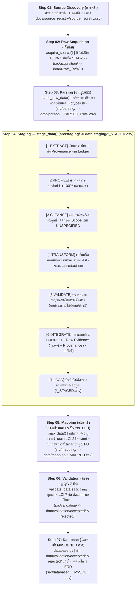

# CN230 Final Project: Data Engineering Pipeline (Source to Validated LCI)
**Industrial Domain:** Petroleum, Natural Gas & Fuels (Upstream E&P & Midstream Refinery / GSP)  
**Team:** G02 MarianDB  
**Course:** CN230 Data Engineering Pipeline

ระบบไปป์ไลน์วิศวกรรมข้อมูลแบบครบวงจร **Step 01 ถึง Step 06 (Source to Validated LCI Schema)** สำหรับสำรวจแหล่งข้อมูล ดึงไฟล์ดิบ สกัดโครงสร้างตาราง จัดเตรียมตารางชั่วคราวเฉพาะแหล่ง (Staging) แปลงและจับคู่ฟิลด์เข้าสู่โครงสร้างกลาง (Mapping) พร้อมคำนวณการปันส่วนพลังงาน (Energy-Based Allocation) สู่ 1 Functional Unit (1 FU) ตามมาตรฐาน ISO 14044 และตรวจสอบกฎคุณภาพ (Validation) เพื่อส่งมอบชุดข้อมูลที่พร้อมนำเข้าฐานข้อมูลเชิงสัมพันธ์แก่ทีมงานส่วนถัดไป

---

## 📌 บทนำและวัตถุประสงค์โครงการ (Project Overview & Purpose)

โครงการนี้มุ่งเน้นการออกแบบและสร้างระบบ Data Engineering Pipeline มาตรฐานองค์กร เพื่อบูรณาการข้อมูลด้านปิโตรเลียม ก๊าซธรรมชาติ การกลั่นน้ำมัน และสิ่งแวดล้อมของประเทศไทยที่มีโครงสร้างแตกต่างกันตามแต่ละหน่วยงาน ให้เข้าสู่โครงสร้างกลางมาตรฐาน **Life Cycle Inventory (LCI)** เพื่อส่งมอบให้กับขั้นตอนการประกอบฐานข้อมูลเชิงสัมพันธ์ โดยมีเสาหลักสำคัญดังนี้:

1. **บูรณาการข้อมูลพลังงานและสิ่งแวดล้อมข้ามหน่วยงาน (Cross-Agency LCI Integration)**:
   * **กรมเชื้อเพลิงธรรมชาติ (DMF):** ปริมาณการผลิตปิโตรเลียมต้นน้ำ (`Upstream - E&P`) รายแปลงสำรวจและแหล่งผลิต ทั้งบนบกและในอ่าวไทย (น้ำมันดิบ `SRC-044`, ก๊าซธรรมชาติ `SRC-045`, คอนเดนเสท `SRC-046`)
   * **บมจ. ปตท.สำรวจและผลิตปิโตรเลียม (PTTEP):** ข้อมูลผลการดำเนินงานด้านสิ่งแวดล้อม (`SRC-047`) ได้แก่ ปริมาณการผลิตไฮโดรคาร์บอนรวม, การใช้พลังงานทางตรง (`Direct Energy Consumption`), และการปลดปล่อยก๊าซเรือนกระจก/มลพิษทางอากาศ (`Scope 1 GHG`, `Methane`, `VOCs`, `NOx`, `SOx`)
   * **สำนักงานนโยบายและแผนพลังงาน (EPPO):** ข้อมูลปิโตรเลียมกลางน้ำ (`Midstream - Refinery & GSP`) ได้แก่ ปริมาณการผลิตผลิตภัณฑ์ปิโตรเลียมสำเร็จรูป (`SRC-048`), ปริมาณการนำน้ำมันดิบเข้ากลั่นแยกตามบริษัทโรงกลั่น (`SRC-049`), และปริมาณก๊าซธรรมชาติที่ป้อนเข้าโรงแยกก๊าซธรรมชาติ (`SRC-050`)
2. **สถาปัตยกรรมไปป์ไลน์ที่จับคู่โฟลเดอร์และฟังก์ชันแบบ 1-to-1 (Strict Layered Architecture)**:
   * แยกความรับผิดชอบอย่างชัดเจนระหว่าง **Step 04 Staging** (`src/staging/staging.py` $\rightarrow$ `data/staging/*_STAGED.csv` รักษาคอลัมน์เฉพาะของแต่ละแหล่งข้อมูลคู่กับ Provenance) และ **Step 05 Mapping** (`src/mapping/mapping.py` $\rightarrow$ `data/mapping/*_MAPPED.csv` แปลงทุกแหล่งเข้าสู่โครงสร้างกลาง LCI 24 คอลัมน์มาตรฐาน พร้อมดำเนินการปันส่วนตามฐานพลังงาน (Energy-Based Allocation) และปรับฐานสู่ 1 Functional Unit (1 FU) ตามมาตรฐานสากล ISO 14044) ก่อนส่งเข้าตรวจ **Step 06 Validation** (7 QC Rules) เพื่อคัดแยกข้อมูลที่ผ่านเกณฑ์เข้าสู่จุดส่งมอบ
3. **หลักธรรมาภิบาลและการตรวจสอบย้อนกลับได้ 100% (Data Governance & Cryptographic Lineage)**:
   * **Approved Source Gate:** ประมวลผลเฉพาะชุดข้อมูลที่มีสถานะ `approved` ในทะเบียน [`docs/source_registry/source_registry.csv`](docs/source_registry/source_registry.csv)
   * **100% Immutable Raw Preservation & SHA-256 Ledger:** เก็บไฟล์ดิบสภาพเดิมทุกไบต์ใน `data/raw/` พร้อมสมุดคุม [`_provenance_ledger.jsonl`](data/raw/_provenance_ledger.jsonl)
   * **Data Quality Separation:** แยกผลลัพธ์ข้อมูลผ่านเกณฑ์ (`data/validation/accepted/`) และข้อมูลกักกัน (`data/validation/rejected/`) พร้อมบันทึก `error_type` เพื่อส่งต่อเข้าสู่ตาราง `REJECTED_RECORD`

---

## 🏛️ สถาปัตยกรรมไปป์ไลน์ (Pipeline Architecture)



### ตารางสรุปความสอดคล้องของโมดูล ฟังก์ชัน และโฟลเดอร์ข้อมูล (1-to-1 Stage Alignment)

| ขั้นตอน (Stage) | โมดูลโค้ดต้นฉบับ (`src/`) | ฟังก์ชันหลัก (Entry Function) | โฟลเดอร์ข้อมูลปลายทาง (`data/` / `docs/`) | รูปแบบไฟล์ผลลัพธ์ |
|:---|:---|:---|:---|:---|
| **Step 01: Source Discovery** | `src/acquisition/acquisition.py` | `get_approved_sources()` | `docs/source_registry/` | `source_registry.csv` |
| **Step 02: Raw Acquisition** | `src/acquisition/acquisition.py` | `acquire_source(source_id)` | `data/raw/` | `*_RAW.*`, `_provenance_ledger.jsonl` |
| **Step 03: Parsing** | `src/parsing/parsing.py` | `parse_raw_data(source_id)` | `data/parsed/` | `*_PARSED_RAW.csv` |
| **Step 04: Staging** | `src/staging/staging.py` | `stage_data(source_id)` | `data/staging/` | `*_STAGED.csv` (Source-Specific) |
| **Step 05: Mapping** | `src/mapping/mapping.py` | `map_data(source_id)` | `data/mapping/` | `*_MAPPED.csv` (24 คอลัมน์มาตรฐาน) |
| **Step 06: Validation** | `src/validation/validation.py` | `validate_data(source_id)` | `data/validation/accepted/` & `rejected/` | `*_VALID.csv`, `*_ERR.csv` |
| **Step 07: Database & SQL** | `src/database/database.py` | `python src/database/database.py` (ครบทุกขั้น) | MySQL `petroleum` และ `sql/` | `01_schema.sql`, `02_insert_data.sql`, `03_fr_queries.sql` |

---

### รายละเอียดการทำงานของแต่ละขั้นตอน (Detailed Stage Breakdown)

#### 🟠 Step 01: Source Discovery (`docs/source_registry/`)
* **หน้าที่:** สำรวจและจัดทำทะเบียนแหล่งข้อมูลด้านปิโตรเลียมและพลังงานทั้งหมด **56 แหล่งข้อมูล** (`SRC-001` ถึง `SRC-056`) พร้อมกำหนดขอบเขตโครงงาน (`Upstream - E&P`, `Midstream - Refinery`, `Midstream - GSP`)
* **ชุดข้อมูลที่ได้รับอนุมัติ (`status = approved`) จำนวน 7 ชุดข้อมูล:**
  1. `SRC-044`: ปริมาณการผลิตน้ำมันดิบรายเดือน (DMF)
  2. `SRC-045`: ปริมาณการผลิตก๊าซธรรมชาติรายเดือน (DMF)
  3. `SRC-046`: ปริมาณการผลิตคอนเดนเสทรายเดือน (DMF)
  4. `SRC-047`: ข้อมูลผลการดำเนินงานด้านสิ่งแวดล้อม 2025 (PTTEP)
  5. `SRC-048`: การผลิตน้ำมันสำเร็จรูป (EPPO)
  6. `SRC-049`: การใช้น้ำมันดิบในการกลั่นแยกตามโรงกลั่น (EPPO)
  7. `SRC-050`: การใช้ก๊าซธรรมชาติรายสาขา — โรงแยกก๊าซธรรมชาติ GSP (EPPO)

#### 🔵 Step 02: Raw Acquisition (`src/acquisition/` $\rightarrow$ `data/raw/`)
* **โมดูลและฟังก์ชันหลัก:** `src/acquisition/acquisition.py` (`acquire_source`) และ `src/acquisition/provenance.py`
* **หน้าที่:** ดึงไฟล์ข้อมูลดิบจากแหล่งต้นทางและจัดเก็บลงใน `data/raw/*_RAW.*` โดยไม่ดัดแปลงเนื้อหา
* **กลไกสำคัญ:**
  * **Modular Strategy Extractors:** รองรับทั้ง CKAN Open Data API พร้อมระบบสำรอง 4 ชั้น (`portal_extractor.py`), เว็บฟอร์มและรายงานความยั่งยืน PDF (`form_extractor.py`), และลิงก์ตรงสำหรับ CSV/PDF (`direct_extractor.py`)
  * **SHA-256 Immutability & Idempotency:** คำนวณค่าแฮช `SHA-256` บันทึกลงใน `data/raw/_provenance_ledger.jsonl` หากมีไฟล์เดิมที่แฮชตรงกันจะข้ามการดาวน์โหลดซ้ำโดยอัตโนมัติ

#### ⚪ Step 03: Parsing (`src/parsing/` $\rightarrow$ `data/parsed/`)
* **โมดูลและฟังก์ชันหลัก:** `src/parsing/parsing.py` (`parse_raw_data`)
* **หน้าที่:** สกัดตารางจากไฟล์ดิบ (`.csv`, `.pdf`, `.xlsx`, `.html`) ให้อยู่ในรูปตารางดิบ `data/parsed/*_PARSED_RAW.csv`
* **กลไกสำคัญ:**
  * **High-Fidelity String Preservation (`dtype=str`):** อ่านข้อมูลทุกเซลล์เป็นข้อความ คงชื่อคอลัมน์และค่าตัวเลขตามต้นฉบับ 100%
  * **PDF Extractor for Environmental Metrics:** สกัดข้อมูลมลพิษและการใช้พลังงานจากรายงานสิ่งแวดล้อม PTTEP ด้วย `pypdf`

#### ⚫ Step 04: Staging (`src/staging/` $\rightarrow$ `data/staging/`)
* **โมดูลและฟังก์ชันหลัก:** `src/staging/staging.py` (`stage_data`, `stage_all_approved`)
* **หน้าที่:** ทำความสะอาดและจัดมาตรฐานข้อมูลเฉพาะของแต่ละแหล่ง (**Source-Specific Staging Schema**) โดยยังไม่บังคับรวมคอลัมน์ข้ามแหล่งข้อมูล ผ่าน **7 กระบวนการย่อย (`7 Sub-Processes`)**:
  1. **`[1.EXTRACT]` Data Extraction:** อ่านตารางจาก `data/parsed/` และดึง Provenance จากสมุดคุม
  2. **`[2.PROFILE]` Data Profiling:** วิเคราะห์ค่าว่างรายคอลัมน์, คอลัมน์ว่าง 100%, และแถวซ้ำ
  3. **`[3.CLEANSE]` Data Cleansing:** ลบช่องว่างซ้ำ, แปลงสัญลักษณ์ค่าว่าง (`-`, `N/A`) เป็น `NaN`, ลบลูกน้ำหลักพัน, ลบแถวชำรุด, เติม `UNSPECIFIED` ให้รหัสแปลงสำรวจบนบก และคัดกรองเฉพาะขอบเขตโครงงาน (`SRC-047` ตัดแถว Intensity ออก; `SRC-050` คัดเฉพาะ `sector == 'GSP'`)
  4. **`[4.TRANSFORM]` Data Transformation:** เปลี่ยนชื่อคอลัมน์เป็นชื่อมาตรฐานประจำแหล่งข้อมูล, แปลงปี พ.ศ. $\rightarrow$ ค.ศ. (`year` คู่กับ `year_raw`), แปลงชื่อเดือนอังกฤษและเลขเดือน (`month`, `month_num` คู่กับ `month_raw`), และแปลงชนิดข้อมูลตัวเลข
  5. **`[5.VALIDATE]` Staging Integrity Check:** ตรวจสอบคอลัมน์บังคับของแหล่งข้อมูลนั้น, ค่าตัวเลขไม่ติดลบ, และช่วงปี ค.ศ.
  6. **`[6.INTEGRATE]` Data Integration:** จัดเรียงคอลัมน์ `Source Columns` + `Raw Evidence (_raw)` + `Provenance (7 คอลัมน์)`
  7. **`[7.LOAD]` Data Loading:** บันทึกไฟล์ลงใน `data/staging/*_STAGED.csv`

#### 🔴 Step 05: Mapping (`src/mapping/` $\rightarrow$ `data/mapping/`)
* **โมดูลและฟังก์ชันหลัก:** `src/mapping/mapping.py` (`map_data`, `map_staged_dataframe`, `map_all_staged`)
* **หน้าที่:** แปลงตารางเฉพาะแหล่งจาก `data/staging/*_STAGED.csv` เข้าสู่ **โครงสร้างกลาง LCI 24 คอลัมน์มาตรฐาน (`MAPPED_COLUMNS` $\rightarrow$ `data/mapping/*_MAPPED.csv`)** พร้อมดำเนินการปันส่วนและปรับฐานตามมาตรฐานสากล ISO 14044:
  * **คอลัมน์ข้อมูล LCI 16 คอลัมน์:** `record_id`, `year`, `month`, `month_num`, `domain`, `process_name`, `location_name`, `country`, `flow_name`, `flow_type`, `compartment`, `direction`, `amount`, `unit`, `allocation`, `is_reference`
  * **คอลัมน์ Provenance 8 คอลัมน์:** `_source_id`, `_subtrack`, `_extraction_batch_id`, `_source_url`, `_source_sha256`, `_raw_file`, `_staged_at`, `_mapped_at`

##### ⚙️ ระเบียบวิธีการปันส่วนภาระสิ่งแวดล้อมและการปรับฐาน (ISO 14044 Allocation & 1 FU Normalization SOP)
1. **การรวมปริมาณผลผลิตรายปี (Annual Aggregation):**
   * ข้อมูลต้นน้ำ (`SRC-044`, `SRC-045`, `SRC-046` จาก DMF) และข้อมูลกลางน้ำ (`SRC-048`, `SRC-049`, `SRC-050` จาก EPPO) ถูกรวมจากระดับรายเดือนเป็นผลผลิตรายปีในระดับ Process และ Flow
2. **การแปลงหน่วยความร้อนสุทธิเพื่อหาค่าเทียบเท่าน้ำมันดิบ (Net Heating Value & BOE):**
   * น้ำมันดิบ: $1.000\text{ BOE / BBL}$ | คอนเดนเสท: $0.909\text{ BOE / BBL}$ | ก๊าซธรรมชาติ: $0.000174825\text{ BOE / scf}$
3. **การคำนวณอัตราส่วนการปันส่วนพลังงาน (Energy-Based Allocation Factor, $R_i$):**
   $$R_i = \frac{\text{BOE}_i}{\text{BOE}_{\text{total}}}$$
4. **การปันส่วนภาระสิ่งแวดล้อมและการปรับฐานสู่ 1 Functional Unit (1 FU):**
   * ดึงภาระสิ่งแวดล้อมรวมจาก PTTEP (`SRC-047`) และคำนวณปริมาณภาระต่อ 1 หน่วยผลิตภัณฑ์:
     $$\text{Burden Amount}_{i, f} = \frac{\text{PTTEP Total Burden}_f \times R_i}{\text{Annual Production}_i}$$
   * กำหนด Reference Flow: `amount = 1.00`, `is_reference = 1`

#### 🟢 Step 06: Validation (`src/validation/` $\rightarrow$ `data/validation/`)
* **โมดูลและฟังก์ชันหลัก:** `src/validation/validation.py` (`validate_data`, `validate_dataframe`, `validate_all_mapped`)
* **หน้าที่:** ตรวจสอบความถูกต้องของข้อมูลในโครงสร้างกลางด้วย **7 กฎคุณภาพ (7 QC Rules)**:
  1. `Check_Null_URL`: ลิงก์อ้างอิง `_source_url` ต้องไม่ว่างและขึ้นต้นด้วย `http://` หรือ `https://`
  2. `Validate_Unit`: หน่วยวัด (`unit`) ต้องอยู่ในรายการหน่วยมาตรฐาน 27 หน่วยของตาราง `UNIT` (รวม `BBL`, `scf`, `MMSCF`)
  3. `Check_Non_Negative`: ปริมาณสาร (`amount`) ต้องไม่ติดลบ ($\ge 0$)
  4. `Validate_Direction`: ทิศทางสายไหล (`direction`) ต้องเป็น `'IN'` หรือ `'OUT'` เท่านั้น
  5. `Check_Process_Year`: ปีของกระบวนการ (`year`) ต้องอยู่ในช่วง ค.ศ. 1950–2035
  6. `Validate_Product_Flow`: ชื่อสาร (`flow_name`), ประเภทสาร (`flow_type`), และสิ่งแวดล้อม (`compartment`) ต้องถูกต้องครบถ้วน
  7. `Check_Allocation_Burdens`: ตรวจสอบความสมบูรณ์ของการปันส่วนภาระสิ่งแวดล้อม — ข้อมูลกระบวนการผลิตต้นน้ำร่วม (`SRC-044`, `SRC-045`, `SRC-046`) จะผ่านเกณฑ์ได้เฉพาะปีที่มีข้อมูลพลังงานและภาระสิ่งแวดล้อมเพื่อปันส่วนจาก PTTEP (ปี 2022–2025) สำหรับปีที่ไม่มีข้อมูลภาระสิ่งแวดล้อมจะถูกกักกันส่งไปยัง `data/validation/rejected/*_ERR.csv`
* **ผลลัพธ์ (ส่งต่อให้ Step 07):**
  * ข้อมูลผ่านเกณฑ์: `data/validation/accepted/*_VALID.csv`
  * ข้อมูลไม่ผ่านเกณฑ์: `data/validation/rejected/*_ERR.csv`

#### 🟣 Step 07: Database Layer & SQL Verification (`src/database/` & `sql/`)
* **บทบาทตาม Mental Model:** เปลี่ยน **"Database-ready Dataset"** ให้กลายเป็น **"Relational Tables & SQL Queries"** ตามที่สอนในรายวิชา CN230 (Cell 22)
* **โมดูลและสคริปต์:** `src/database/` แบ่งเป็น `database.py` (ตัวสั่งการ), `connection.py` (path + เชื่อมต่อ MySQL จาก `.env`), `schema.py` (DDL 10 ตาราง), `loader.py` (CSV -> แถว -> MySQL + เขียน INSERT), `queries.py` (query ทดสอบ FR/BR)
* **วิธีรัน:** ตั้งค่า `.env` จาก `.env.example` (host, port, user, password, database) แล้วกดรัน `src/database/database.py` ใน VS Code หรือ `python src/database/database.py` = ทำครบทุกขั้นโดยไม่ถามยืนยัน (**จะ DROP ตารางเดิมในฐานข้อมูลแล้วสร้างใหม่ทุกครั้ง**) ทำทีละขั้นได้ด้วย `create`, `load`, `files`
* **ผลลัพธ์:** ตาราง 10 ตารางใน MySQL และไฟล์ `sql/01_schema.sql`, `sql/02_insert_data.sql`, `sql/03_fr_queries.sql` (ถูกเขียนทับทุกครั้งที่รัน: แก้ที่ `schema.py` / `queries.py` ไม่ใช่แก้ไฟล์ `.sql`) ภาพหลักฐานผล query เก็บใน `sql/evidence/`
* **หมายเหตุ:** `run_pipeline.py` รัน Step 07 ต่อท้ายให้อัตโนมัติ (ไม่ถามยืนยัน; `--no-db` = หยุดที่ Step 06) และจะข้าม Step 07 ถ้ามีแหล่งข้อมูลล้มเหลว โดย SRC-047 ถูกเรียงให้รันก่อนเสมอ เพราะต้นน้ำ SRC-044/045/046 ใช้ปันส่วนจากมัน
* **อินพุตที่รับมอบจากไปป์ไลน์:**
  1. `data/validation/accepted/*_VALID.csv` (ชุดข้อมูลที่ผ่านการตรวจสอบคุณภาพ 7 กฎ พร้อมนำเข้าตาราง)
  2. `data/validation/rejected/*_ERR.csv` (ชุดข้อมูลที่ถูกกักกัน พร้อมนำเข้าตาราง `REJECTED_RECORD`)
  3. `docs/source_registry/source_registry.csv` (ข้อมูลอ้างอิงแหล่งที่มาสำหรับตาราง `SOURCE`)
  4. `data/raw/_provenance_ledger.jsonl` (หลักฐานเวลาและ SHA-256 สำหรับตาราง `EXTRACTION_BATCH`)
* **แนวทางการทำงานที่ต้องพัฒนาต่อ (Implementation Guide for Database Team):**
  1. **Execute DDL Schema:** สร้างตาราง 10 ตารางบน MySQL 8 จาก `sql/01_schema.sql` (เขียนโดย `schema.py`) พร้อม Primary Keys, Foreign Keys และ `CHECK` (direction, ปี ค.ศ. 1900-2100, flow_type, status, url ไม่ว่าง, amount >= 0)
  2. **Relational Ingestion:** อ่านข้อมูลจาก `accepted/*_VALID.csv` และกระจายลงสู่ 10 ตารางตาม ERD:
     * แตกมิติข้อมูลสู่ตารางหลัก: `LOCATION`, `SOURCE`, `REFERENCE`, `PROCESS`, `UNIT`, `FLOW`, `EXTRACTION_BATCH`
     * บันทึกรายการแลกเปลี่ยนลงตาราง: `LCI_EXCHANGE` (พร้อมค่า `amount`, `allocation`, และ `is_reference`)
     * บันทึกประวัติการผ่านเกณฑ์ลงตาราง: `QUALITY_CHECK`
     * บันทึกข้อมูลที่ไม่ผ่านเกณฑ์จาก `rejected/*_ERR.csv` ลงตาราง: `REJECTED_RECORD`
  3. **SQL Verification & Analytics:** รันชุดคำสั่ง SQL Query เพื่อยืนยันความสมบูรณ์:
     * ตรวจสอบ Foreign Key Integrity (Zero Orphaned Records)
     * ตรวจสอบสมดุลสายไหล Input vs Output (Mass & Energy Flow Balance)
     * ตรวจสอบกฎเกณฑ์ทางธุรกิจ เช่น Functional Unit มี `is_reference = 1` และ `amount = 1.0` เสมอ

---

## 📂 โครงสร้างโปรเจกต์ (Project Structure)

```text
Project CN230/
├── run_pipeline.py                      # ตัวสั่งการไปป์ไลน์ Step 01 ถึง Step 07 (Pipeline Orchestrator)
├── requirements.txt                     # รายการไลบรารีที่จำเป็น (Dependencies)
├── .gitignore                           # กฎ Git Ignore
├── README.md                            # เอกสารสถาปัตยกรรม กฎการแมป และคู่มือการใช้งาน
│
├── docs/                                # [Step 01] เอกสารโครงการและการสำรวจแหล่งข้อมูล
│   ├── source_registry/                 # ทะเบียนแหล่งข้อมูลหลัก 56 แหล่ง (Approved 7 แหล่ง)
│   │   ├── source_registry.csv          # แคตตาล็อกแหล่งข้อมูล UTF-8 (Single Source of Truth)
│   │   └── source_registry.xlsx         # แคตตาล็อกรูปแบบ Excel
│   ├── requirements/                    # โจทย์และ Guideline Notebook ของรายวิชา
│   ├── erd/                             # ไดอะแกรมความสัมพันธ์ข้อมูล (10-Table 3NF ERD)
│   └── mapping/                         # สเปกการแปลงและจับคู่ฟิลด์ข้อมูล (Source-to-DB Mapping)
│
├── sql/                                 # [Step 07] ไฟล์ SQL และหลักฐานผลรัน (สร้างโดย database.py)
│   ├── 01_schema.sql                    # DDL 10 ตาราง (สร้างโดย schema.py)
│   ├── 02_insert_data.sql               # INSERT ข้อมูลทุกตาราง (สร้างโดย loader.py)
│   ├── 03_fr_queries.sql                # Query ทดสอบ FR-01..04, BR-01..03, VERIFY-01..02 (สร้างโดย queries.py)
│   └── evidence/                        # โฟลเดอร์สำหรับผลการรันคำสั่งตรวจสอบ SQL
│       └── .gitkeep
│
├── data/                                # ชั้นจัดเก็บข้อมูลแบบ 1-to-1 ตามลำดับขั้นของไปป์ไลน์
│   ├── raw/                             # [Step 02] ไฟล์ดิบสภาพเดิม 100% (*_RAW.*) + _provenance_ledger.jsonl
│   ├── parsed/                          # [Step 03] ตารางดิบที่สกัดโครงสร้างแล้ว (*_PARSED_RAW.csv)
│   ├── staging/                         # [Step 04] ตารางชั่วคราวเฉพาะแหล่งที่คลีนแล้ว + Provenance (*_STAGED.csv)
│   ├── mapping/                         # [Step 05] ตารางโครงสร้างกลาง 24 คอลัมน์มาตรฐาน (*_MAPPED.csv)
│   └── validation/                      # [Step 06: ผลลัพธ์ส่งต่อ Step 07] ผลการตรวจสอบกฎคุณภาพ 7 ข้อ
│       ├── accepted/                    #           ข้อมูลที่ผ่านเกณฑ์ครบทุกข้อ (*_VALID.csv) -> พร้อมเข้าสู่ DB
│       └── rejected/                    #           ข้อมูลที่ไม่ผ่านเกณฑ์ (*_ERR.csv) -> สำหรับตาราง REJECTED_RECORD
│
└── src/                                 # โค้ดต้นฉบับแยกตามขั้นตอน 1-to-1 กับชั้นข้อมูล
    ├── clear_data.py                    # ยูทิลิตี้สำหรับล้างไฟล์ใน data/ เพื่อเริ่มทดสอบใหม่
    ├── acquisition/                     # [Step 02] Raw Acquisition & SHA-256 Provenance
    │   ├── extractors/                  #           Strategy Extractors (Portal, Direct, Form)
    │   ├── acquisition.py               #           acquire_source() -> ดึงไฟล์ดิบจากแหล่งที่ Approved
    │   └── provenance.py                #           จัดการแฮช SHA-256 และ _provenance_ledger.jsonl
    ├── parsing/                         # [Step 03] Data Parsing
    │   └── parsing.py                   #           parse_raw_data() -> สกัดตารางเป็น *_PARSED_RAW.csv
    ├── staging/                         # [Step 04] Data Staging (7 Sub-Processes)
    │   └── staging.py                   #           stage_data() -> คลีนข้อมูลเฉพาะแหล่ง + Provenance -> *_STAGED.csv
    ├── mapping/                         # [Step 05] Data Mapping & Allocation
    │   └── mapping.py                   #           map_data() -> แปลงสู่โครงสร้างกลาง LCI 24 คอลัมน์ + ปันส่วน 1 FU -> *_MAPPED.csv
    ├── validation/                      # [Step 06] Data Validation
    │   └── validation.py                #           validate_data() -> ตรวจกฎคุณภาพ 7 ข้อ -> accepted/ & rejected/
    └── database/                        # [Step 07] Database Layer (Load into Relational Database + SQL)
        ├── .gitkeep
        ├── database.py                  #           ตัวสั่งการ: all | create | load | files
        ├── connection.py                #           path ไฟล์ + เชื่อมต่อ MySQL (อ่าน .env)
        ├── schema.py                    #           DDL 10 ตาราง -> 01_schema.sql + สร้างตาราง
        ├── loader.py                    #           accepted/rejected CSV -> 10 ตาราง -> MySQL + 02_insert_data.sql
        └── queries.py                   #           query ทดสอบ -> 03_fr_queries.sql
```

---

## 🛠️ การติดตั้งและคำสั่งใช้งาน (Getting Started)

### 1. ติดตั้งไลบรารีที่จำเป็น
```bash
pip install -r requirements.txt
```

### 2. การสั่งรันไปป์ไลน์แบบครบวงจร (Step 01 ถึง Step 07)
* **รันทุกชุดข้อมูลที่ได้รับอนุมัติ (`SRC-044` ถึง `SRC-050`):**
  ```bash
  python run_pipeline.py
  ```
* **รันเฉพาะชุดข้อมูลที่ต้องการ (ระบุ 1 หรือหลายชุดข้อมูลพร้อมกัน):**
  ```bash
  python run_pipeline.py SRC-044 SRC-047 SRC-048
  ```
* **บังคับดาวน์โหลดไฟล์ดิบใหม่ทั้งหมดโดยไม่ใช้แคช:**
  ```bash
  python run_pipeline.py --force
  ```
* **ข้ามขั้นโหลดเข้า MySQL (หยุดที่ Step 06):**
  ```bash
  python run_pipeline.py --no-db
  ```

### 3. การสั่งรันแยกเฉพาะแต่ละขั้นตอน (Standalone Stage Execution)
* **Step 02 (Raw Acquisition & Provenance Verification):**
  ```bash
  python src/acquisition/acquisition.py          # ดึงข้อมูล Approved ทั้งหมด
  python src/acquisition/acquisition.py --list   # แสดงรายชื่อ Approved Sources
  python src/acquisition/provenance.py           # ตรวจสอบ SHA-256 ของไฟล์ดิบทั้งหมด
  ```
* **Step 03 (Parsing):**
  ```bash
  python src/parsing/parsing.py                  # สกัดตารางดิบจากทุกชุดข้อมูล
  python src/parsing/parsing.py SRC-044          # สกัดตารางเฉพาะ SRC-044
  ```
* **Step 04 (Staging — 7 Sub-Processes):**
  ```bash
  python src/staging/staging.py                  # รัน Staging ทั้ง 7 ขั้นตอนย่อยสำหรับทุกชุดข้อมูล
  python src/staging/staging.py SRC-044          # รัน Staging เฉพาะ SRC-044
  ```
* **Step 05 (Mapping & Allocation):**
  ```bash
  python src/mapping/mapping.py                  # แปลงทุกชุดข้อมูลเข้าสู่โครงสร้างกลาง 24 คอลัมน์ และปันส่วนสู่ 1 FU
  python src/mapping/mapping.py SRC-047          # แปลงเฉพาะ SRC-047
  ```
* **Step 06 (Validation — 7 QC Rules):**
  ```bash
  python src/validation/validation.py            # ตรวจสอบกฎคุณภาพ 7 ข้อสำหรับทุกชุดข้อมูล
  python src/validation/validation.py SRC-048    # ตรวจสอบเฉพาะ SRC-048
  ```

### 4. การรีเซ็ตสภาพแวดล้อมข้อมูล (Environment Reset)
```bash
python src/clear_data.py
```
