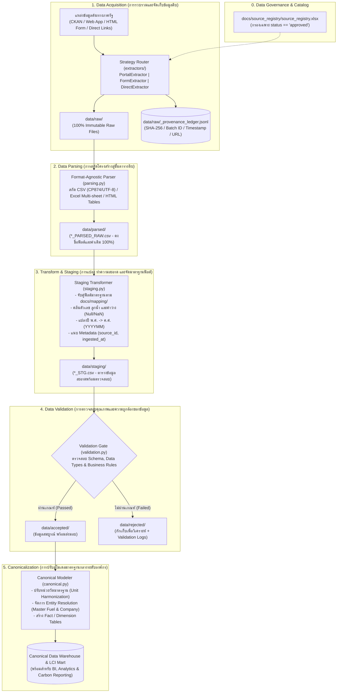

# CN230 Final Project: Data Engineering Pipeline (Source to Canonical)
**Industrial Domain:** Petroleum, Natural Gas & Fuels  
**Team:** G02 MarianDB  
**Course:** CN230 Data Engineering Pipeline: Source to Canonical

ระบบไปป์ไลน์วิศวกรรมข้อมูลแบบครบวงจร (End-to-End Data Engineering Pipeline) สำหรับรวบรวม ตรวจสอบ และแปรรูปข้อมูลพลังงาน ปิโตรเลียม ก๊าซธรรมชาติ เชื้อเพลิง และคาร์บอนฟุตพริ้นท์ของประเทศไทย ตั้งแต่แหล่งข้อมูลต้นทางจนถึงชั้นข้อมูลมาตรฐานกลาง (Canonical Data Model)

---

## 📌 บทนำและวัตถุประสงค์โครงการ (Project Overview & Purpose)

โครงการนี้มุ่งเน้นการออกแบบและสร้างระบบ Data Engineering Pipeline ระดับมาตรฐานองค์กร เพื่อรวบรวมข้อมูลในอุตสาหกรรม **Petroleum, Natural Gas & Fuels** ของประเทศไทย ซึ่งมีความกระจัดกระจาย หลากหลายรูปแบบ และต่างสถาปัตยกรรมการเผยแพร่ ให้มาอยู่ภายใต้มาตรฐานข้อมูลเดียวกัน โดยมีวัตถุประสงค์และเสาหลักสำคัญดังนี้:

1. **บูรณาการข้อมูลพลังงานและสิ่งแวดล้อมข้ามหน่วยงาน (Cross-Agency Integration)**:
   - รวบรวมข้อมูลปริมาณการผลิต การจัดหา การนำเข้า-ส่งออก การบริโภค และการปล่อยก๊าซเรือนกระจกจากหน่วยงานกำกับดูแลหลักของประเทศ ได้แก่:
     - **กรมเชื้อเพลิงธรรมชาติ (DMF)**: ปริมาณการผลิตและการจัดหาปิโตรเลียม (น้ำมันดิบ, ก๊าซธรรมชาติ, คอนเดนเสท) ทั้งระดับรายเดือนและสถิติย้อนหลังกว่า 23 ปี
     - **สำนักงานนโยบายและแผนพลังงาน (EPPO)**: ปริมาณการใช้น้ำมันสำเร็จรูป, ก๊าซ NGV, และการปล่อยก๊าซ CO2 รายสาขาเศรษฐกิจ
     - **องค์การบริหารจัดการก๊าซเรือนกระจก (TGO)**: ฐานข้อมูลคาร์บอนฟุตพริ้นท์ของผลิตภัณฑ์ปิโตรเลียมและปิโตรเคมี
     - **กรมธุรกิจพลังงาน (DOEB)**: ข้อมูลผู้ประกอบการและสถิติเชื้อเพลิง
2. **สร้างรากฐานข้อมูลสำหรับ Life Cycle Inventory (LCI) & Carbon Accounting**:
   - เชื่อมโยงข้อมูลปริมาณการผลิต/การใช้พลังงาน เข้ากับค่าสัมประสิทธิ์การปล่อยก๊าซเรือนกระจกและคาร์บอนฟุตพริ้นท์ เพื่อสนับสนุนการวิเคราะห์ Energy Balance และการประเมินผลกระทบสิ่งแวดล้อมในห่วงโซ่อุปทานพลังงาน
3. **หลักธรรมาภิบาลและการรักษาความน่าเชื่อถือของข้อมูล (Data Governance & Integrity)**:
   - **Approved Sources Gate**: ประมวลผลเฉพาะชุดข้อมูลที่ได้รับอนุมัติในทะเบียน Catalog (`docs/source_registry/source_registry.xlsx`) เท่านั้น ชุดข้อมูลที่มีสถานะอื่นจะไม่ถูกดึงเข้ามาในระบบ
   - **Modular Strategy Extractor Architecture**: ออกแบบตรรกะการดึงข้อมูลแยกตามสถาปัตยกรรมเว็บไซต์ (CKAN Portals, Web Applications, HTML Snapshots, Direct URLs) พร้อมระบบ Exponential Backoff, Idempotency และ Rate-Limit Protection
   - **100% Immutable Raw Preservation**: จัดเก็บไฟล์ดิบดั้งเดิมโดยไม่มีการดัดแปลงแม้แต่ไบต์เดียว
   - **Cryptographic Provenance Audit**: มีสมุดคุมประวัติ (`_provenance_ledger.jsonl`) บันทึกรหัส Batch, เวลาเข้าถึง (ISO 8601 +07:00), URL ต้นทาง และค่าแฮช `SHA-256` สำหรับสอบย้อนกลับ (Data Lineage) ได้สมบูรณ์ทุกขั้นตอน

---

## 🏛️ สถาปัตยกรรมข้อมูล 5 ขั้นตอน (Data Pipeline Architecture)

สถาปัตยกรรมของไปป์ไลน์ถูกแบ่งออกเป็น 5 ลำดับขั้นมาตรฐาน (5-Stage Data Engineering Architecture) เพื่อให้เกิดการแยกหน้าที่ (Separation of Concerns), ความสามารถในการทดสอบ (Testability) และความโปร่งใสของข้อมูลในทุกจุด:



### รายละเอียดการทำงานของแต่ละลำดับขั้น (Pipeline Stages Breakdown)

#### 1. Step 1: Data Acquisition (การรวบรวมและจัดเก็บข้อมูลดิบ)
* **หน้าที่:** ดึงไฟล์ข้อมูลจากแหล่งกำเนิดต้นทางที่มีสถาปัตยกรรมแตกต่างกัน และจัดเก็บลงใน `data/raw/` อย่างปลอดภัย
* **กลไกการทำงาน:**
  * **Strict Quality Gate:** โหลดเฉพาะชุดข้อมูลที่มีสถานะ `approved` ในแคตตาล็อกกลาง (`docs/source_registry/source_registry.xlsx`)
  * **Modular Strategy Pattern (`src/acquisition/extractors/`):**
    * `PortalExtractor`: เชื่อมต่อ CKAN Open Data API, Datastore CSV Dump และดาวน์โหลดไฟล์โดยตรงจากพอร์ทัล (`data.go.th`, `catalog.eppo.go.th`, `catalog.dmf.go.th`) พร้อมระบบ Retry แบบ Exponential Backoff
    * `FormExtractor`: รองรับเว็บแอปพลิเคชันที่มี Form Search / Session เช่น เว็บไซต์จัดหาปิโตรเลียม DMF และตาราง HTML ของ TGO (แยกดึงตารางผลิตภัณฑ์ปิโตรเลียม `industry=9` และปิโตรเคมี `industry=20`)
    * `DirectExtractor`: ดาวน์โหลดไฟล์ผ่าน URL ตรง รองรับทั้ง `.csv`, `.xlsx`, `.pdf`, `.zip`
  * **100% Immutable Raw Preservation:** ไฟล์ดิบดั้งเดิมจะถูกจัดเก็บโดยไม่มีการแก้ไขโครงสร้าง การเข้ารหัส (Encoding) หรือเนื้อหาแม้แต่ไบต์เดียว
  * **Cryptographic Lineage:** ทุกไฟล์จะถูกคำนวณแฮช `SHA-256` และบันทึกลงใน `data/raw/_provenance_ledger.jsonl`
  * **Idempotency:** หากไฟล์เดิมมีอยู่แล้วและแฮชตรงกัน ระบบจะข้ามการดาวน์โหลดซ้ำโดยอัตโนมัติ

#### 2. Step 2: Data Parsing (การสกัดโครงสร้างสู่ชั้นตารางดิบ)
* **หน้าที่:** สกัดข้อมูลจากไฟล์ดิบหลากหลายรูปแบบ (`.csv`, `.xlsx`, `.html`) ให้อยู่ในรูป Tabular DataFrame
* **กลไกการทำงาน:**
  * ตรวจสอบ Encoding อัตโนมัติ (เช่น CP874 / TIS-620 ของเอกสารราชการไทย หรือ UTF-8)
  * สกัดตารางข้อมูลจากโครงสร้างที่ซับซ้อน เช่น การแยก Sheet ในไฟล์ Excel หรือการ Parse Element `<table>` จากหน้าเว็บ HTML
  * **คงค่าเดิม 100% (High Raw Fidelity):** ยังไม่มีการเปลี่ยนชื่อหัวคอลัมน์ภาษาไทย ไม่มีการดัดแปลงค่าตัวเลข เพื่อเป็น Snapshot ชั้นตารางดิบที่โปร่งใสใน `data/parsed/*_PARSED_RAW.csv`

#### 3. Step 3: Transform & Staging (การแปลง ทำความสะอาด และจัดมาตรฐานฟิลด์)
* **หน้าที่:** ปรับปรุงโครงสร้างข้อมูลให้อยู่ในรูปแบบที่พร้อมสำหรับการประมวลผลเชิงวิเคราะห์ (Analytics-Ready)
* **กลไกการทำงาน:**
  * **Schema Harmonization:** แมปชื่อคอลัมน์ภาษาไทยจากแต่ละหน่วยงานให้เป็นชื่อภาษาอังกฤษมาตรฐานตามข้อกำหนดใน `docs/mapping/`
  * **Data Cleansing:** ลบเครื่องหมายจุลภาคคั่นหลักพัน (`,`), จัดการค่าว่าง (Null, NaN, ขีด `-`), และแปลงชนิดข้อมูล (Type Casting) ให้ถูกต้อง
  * **Temporal Harmonization:** ปรับปี พ.ศ. ให้เป็นปี ค.ศ. สากล (เช่น `2567/08` -> `202408`)
  * **Lineage Enrichment:** แนบ Audit Metadata เข้ากับทุก Record (เช่น `source_id`, `extraction_batch_id`, `ingested_at`) และบันทึกใน `data/staging/*_STG.csv`

#### 4. Step 4: Data Validation (การตรวจสอบคุณภาพและความถูกต้องของข้อมูล)
* **หน้าที่:** ตรวจสอบความถูกต้องสมบูรณ์ของข้อมูลตาม Data Contracts และ Business Rules
* **กลไกการทำงาน:**
  * **Schema Rules:** ตรวจสอบความครบถ้วนของคอลัมน์บังคับ, ชนิดข้อมูล, และกฎ Not-Null
  * **Domain & Business Logic:** ตรวจสอบความสมเหตุสมผล เช่น ค่าปริมาณการผลิต/การใช้ต้องมีค่ามากกว่าหรือเท่ากับศูนย์ ($x \ge 0$), วันที่ต้องอยู่ในช่วงที่กำหนด
  * **Dual-Route Quarantine Strategy:**
    * ข้อมูลที่ผ่านเกณฑ์ทั้งหมดจะถูกส่งต่อไปยัง `data/accepted/`
    * ข้อมูลที่มีค่าผิดปกติ (Anomaly / Outlier / Invalid) จะถูกกักไว้ที่ `data/rejected/` พร้อมสร้างบันทึกสาเหตุข้อผิดพลาด (Validation Error Log) สำหรับการตรวจสอบและแก้ไข

#### 5. Step 5: Canonicalization (การปรับสู่โมเดลมาตรฐานกลางระดับองค์กร)
* **หน้าที่:** หลอมรวมข้อมูลจากทุกแหล่งเข้าสู่ Canonical Data Model และ Life Cycle Inventory (LCI) Data Warehouse
* **กลไกการทำงาน:**
  * **Unit Harmonization:** แปลงหน่วยวัดพลังงานที่หลากหลาย (เช่น บาร์เรล, ลิตร, พันลูกบาศก์ฟุต, ตัน) ให้เป็นหน่วยมาตรฐานสากล (SI Units / MMBTU / BOE)
  * **Master Entity Resolution:** จัดระเบียบชื่อประเภทเชื้อเพลิง, ชื่อบริษัทผู้ผลิต และสาขาเศรษฐกิจให้เชื่อมโยงกับ Master Entities กลาง
  * **Data Modeling:** โครงสร้างข้อมูลในรูป Star Schema (Fact Tables & Dimension Tables) พร้อมสำหรับการวิเคราะห์ใน BI Dashboard, การคำนวณสมดุลพลังงาน (Energy Balance) และรายงานการปล่อยคาร์บอน (Carbon Accounting)

---

### ตารางเปรียบเทียบหน้าที่และคุณสมบัติของข้อมูลในแต่ละเลเยอร์ (Data Layer Architecture Matrix)

| เลเยอร์ (Layer) | ไดเรกทอรีจัดเก็บ (Storage Path) | รูปแบบไฟล์ (Format) | ระดับการดัดแปลงข้อมูล (Transformation) | การตรวจสอบความน่าเชื่อถือ (Integrity & Governance) | บทบาทในไปป์ไลน์ (Pipeline Role) |
|:---|:---|:---:|:---:|:---:|:---|
| **Raw Layer** | `data/raw/` | `.csv`, `.xlsx`, `.html` | **0% (สภาพเดิม 100%)** | SHA-256 Checksum + Provenance Ledger | แหล่งอ้างอิงความจริงดั้งเดิม (Immutable Source of Truth) |
| **Parsed Layer** | `data/parsed/` | `*_PARSED_RAW.csv` | สกัดโครงสร้างสู่ตาราง คงค่าเดิม | Row Count Reconciliation เทียบกับไฟล์ดิบ | สแนปช็อตตารางดิบเพื่อความสะดวกในการประมวลผลต่อ |
| **Staging Layer** | `data/staging/` | `*_STG.csv` | คลีนตัวเลข, แมปฟิลด์อังกฤษ, แปลง ค.ศ. | Schema Type Check + แนบ Metadata ประจำแถว | ตารางข้อมูลสะอาดพร้อมรับการทดสอบคุณภาพ |
| **Accepted Layer** | `data/accepted/` | `*_VALID.parquet` / `.csv` | ผ่านการตรวจสอบคุณภาพครบถ้วน | Business Rules & Constraint Passed | ข้อมูลสะอาดที่ผ่านเกณฑ์รับรอง พร้อมใช้งานระดับองค์กร |
| **Rejected Layer** | `data/rejected/` | `*_ERR.csv` | ข้อมูลที่มีค่าผิดปกติ พร้อม Error Tag | Quarantine Log บันทึกฟิลด์ที่ผิดกฎ | กักกันข้อมูลผิดพลาดเพื่อการตรวจสอบย้อนกลับและแก้ไข |
| **Canonical Layer** | Data Warehouse / Mart | Parquet / RDBMS Tables | รวมโมเดลกลาง, แปลงหน่วย, เชื่อม LCI | Master Entity Match + Dimensional Integrity | เสิร์ฟข้อมูลสำหรับ Business Intelligence, ESG & Analytics |

---

## 📂 โครงสร้างโปรเจกต์ (Project Structure)

```text
Project CN230/
├── run_pipeline.py                      # ตัวสั่งการไปป์ไลน์แบบครบวงจร (End-to-End Orchestrator)
├── requirements.txt                     # รายการไลบรารีที่จำเป็น (Dependencies)
├── req.txt                              # รายการไลบรารีสำรอง (Aliases)
├── .gitignore                           # กฎ Git Ignore เพื่อรักษาความสะอาดของ Repository
├── README.md                            # เอกสารแนะนำและคู่มือการใช้งานโครงการ
│
├── docs/                                # เอกสารประกอบโครงการ (Project Documentation)
│   ├── source_registry/                 # ทะเบียนแหล่งข้อมูลหลัก (Source Registry)
│   │   └── source_registry.xlsx         # แคตตาล็อกฉบับสมบูรณ์ที่ผ่านการคัดกรอง
│   ├── erd/                             # ไดอะแกรมความสัมพันธ์ข้อมูล (Entity-Relationship Diagram)
│   ├── mapping/                         # สเปกการแปลงและจับคู่ฟิลด์ข้อมูล (Data Mapping Specs)
│   └── requirements/                    # เอกสารข้อกำหนดโครงการ (Business Requirements)
│
├── sql/                                 # สคริปต์ฐานข้อมูลและการตรวจสอบ (SQL & Evidence)
│   └── evidence/                        # หลักฐานการรัน SQL และผลการตรวจสอบความถูกต้อง
│
├── data/                                # ชั้นจัดเก็บข้อมูลแต่ละขั้นตอน (Layered Data Storage)
│   ├── raw/                             # Step 1: ไฟล์ดิบสภาพเดิม 100% + _provenance_ledger.jsonl
│   ├── parsed/                          # Step 2: ไฟล์ตารางที่สกัดโครงสร้างแล้ว (*_PARSED_RAW.csv)
│   ├── staging/                         # Step 3: ไฟล์ตารางที่ผ่านการคลีนและแมปปิ้ง (*_STG.csv)
│   ├── accepted/                        # Step 4: ข้อมูลที่ผ่านการตรวจสอบคุณภาพ พร้อมใช้งาน
│   └── rejected/                        # Step 4: ข้อมูลที่ไม่ผ่านเกณฑ์คุณภาพ กักไว้ตรวจสอบ
│
└── src/                                 # โค้ดต้นฉบับแยกตามความรับผิดชอบ (Modular Source Code)
    ├── clear_data.py                    # ยูทิลิตี้สำหรับรีเซ็ตและล้างไฟล์ใน data/ เพื่อเริ่มทดสอบใหม่
    │
    ├── acquisition/                     # Step 1: Data Acquisition (งานหลัก)
    │   ├── extractors/                  # โมดูลแยกดึงข้อมูลตามประเภทสถาปัตยกรรมเว็บ (Strategy Pattern)
    │   │   ├── base_extractor.py        # แม่แบบ (Protocol) รับส่งค่าแบบเดียวกันทุกเว็บ + Strategy Router
    │   │   ├── portal_extractor.py      # พอร์ทัลข้อมูลเปิดและคลิกดาวน์โหลด (data.go.th, EPPO, DMF Catalog, DOEB)
    │   │   ├── direct_extractor.py      # ลิงก์ตรง (.csv, .xlsx, .pdf, .zip)
    │   │   └── form_extractor.py        # เว็บแอปพลิเคชันแบบฟอร์มและตาราง HTML (TGO, DMF Supply)
    │   ├── acquisition.py               # ตัว Conductor: อ่าน Catalog -> สั่ง Router -> บันทึกไฟล์ดิบ
    │   └── provenance.py                # จัดการ SHA-256 + บันทึกลง _provenance_ledger.jsonl
    │
    ├── parsing/                         # Step 2: Data Parsing
    │   └── parsing.py                   # ตัวสกัดโครงสร้างจาก HTML/Excel/CSV สู่ DataFrame
    │
    ├── transform/                       # Step 3: Transform & Staging
    │   └── staging.py                   # ตัวแปลง Schema, คลีนลูกน้ำตัวเลข และแนบ Metadata
    │
    ├── validation/                      # Step 4: Data Validation
    │   └── validation.py                # กฎตรวจสอบความถูกต้องของ Schema และ Business Rules
    │
    └── canonical/                       # Step 5: Canonicalization
        └── canonical.py                 # ตัวปรับหน่วยวัดสากลและส่งออกสู่ Data Warehouse
```

---

## 📋 มาตรฐานการตั้งชื่อและข้อกำหนดข้อมูล (Data Specifications)

### 1. มาตรฐานชื่อไฟล์ดิบ (Raw Filename Convention)
ไฟล์ดิบทุกไฟล์ที่ถูกดึงเข้ามาจะถูกจัดเก็บตามมาตรฐานสากลทันทีก่อนบันทึกลงใน `data/raw/`:

* **กรณีไฟล์สถิติรายงวด (Monthly Snapshot):**
  $$\text{\{source\_id\}\_\{owner\}\_\{flow\}\_TH\_\{year\_ce\}\{month:02d\}\_RAW.\{extension\}}$$
  * *ตัวอย่าง:* `SRC-033_EPPO_Petroleum-Consumption_TH_202408_RAW.csv`

* **กรณีไฟล์ชุดประวัติศาสตร์ระยะยาว (Historical Multi-Year Span):**
  $$\text{\{source\_id\}\_\{owner\}\_\{flow\}\_TH\_\{start\_year\_ce\}\{start\_month:02d\}-\{end\_year\_ce\}\{end\_month:02d\}\_RAW.\{extension\}}$$
  * *ตัวอย่าง:* `SRC-044_DMF_Petroleum-Production_TH_200301-202603_RAW.csv`

* **คำอธิบายตัวแปร:**
  * `source_id`: รหัสประจำแหล่งข้อมูลใน Catalog เช่น `SRC-033`, `SRC-044`
  * `owner`: อักษรย่อหน่วยงานเจ้าของข้อมูล เช่น `DMF`, `EPPO`, `DOEB`, `TGO`
  * `flow`: หมวดหมู่ลักษณะข้อมูล เช่น `Petroleum-Consumption`, `Petroleum-Production`, `Carbon-Footprint`
  * `TH`: รหัสประเทศ (Thailand)
  * `RAW.ext`: ป้ายกำกับชั้นข้อมูลดิบและนามสกุลจริง เช่น `_RAW.csv`, `_RAW.xlsx`, `_RAW.html`

---

### 2. โครงสร้างสมุดคุมประวัติข้อมูล (`_provenance_ledger.jsonl`)
ทุกครั้งที่มีการบันทึกไฟล์ดิบ ระบบจะสร้าง Record ลงในไฟล์ JSON Lines ต่อท้ายเสมอ:
```json
{
  "extraction_batch_id": "BATCH-20261026-203200-SRC-033",
  "source_id": "SRC-033",
  "accessed_at": "2026-10-26T20:32:00+07:00",
  "source_url": "https://data.go.th/datastore/dump/b43b4890-138d-48c1-a7e7-82778e3e2f10?format=csv",
  "page_or_table": "ปริมาณการใช้น้ำมันสำเร็จรูป",
  "extraction_method": "modular_extractor_engine",
  "raw_file_path": "C:\\Users\\...\\data\\raw\\SRC-033_EPPO_Petroleum-Consumption_TH_202408_RAW.csv",
  "sha256_checksum": "f6ee5fec7b5c28f090d80c35272dd2982d6daecb8cb9d52eb5b95499a0dffbb3",
  "status": "ACQUIRED"
}
```

---

## 🛠️ การติดตั้งและเริ่มต้นใช้งาน (Getting Started)

### 1. ติดตั้งไลบรารีที่จำเป็น
```bash
pip install -r requirements.txt
# หรือใช้: pip install -r req.txt
```

### 2. การสั่งรัน Step 1 (Data Acquisition)

* **ดาวน์โหลดชุดข้อมูลที่ผ่านการอนุมัติ (Approved Sources) ทั้งหมดโดยอัตโนมัติ:**
  ```bash
  python src/acquisition/acquisition.py
  ```
  *(ระบบจะดึงเฉพาะชุดข้อมูลที่มีสถานะ Approved ในแคตตาล็อก พร้อมตรวจจับ Idempotency ให้ทันที)*

* **ตรวจสอบรายชื่อ Approved Sources ทั้งหมดในแคตตาล็อก:**
  ```bash
  python src/acquisition/acquisition.py --list
  ```

* **ดาวน์โหลดทีละชุดข้อมูล (Single Source):**
  ```bash
  python src/acquisition/acquisition.py SRC-033
  ```
  *(หากระบุรหัสที่ไม่ผ่านการอนุมัติ เช่น `SRC-001` ระบบจะปฏิเสธและแจ้งเตือนทันที)*

* **บังคับดาวน์โหลดใหม่แม้ว่าจะมีไฟล์อยู่แล้ว (Force Re-download):**
  ```bash
  python src/acquisition/acquisition.py SRC-033 --force
  ```

* **ตรวจสอบความสมบูรณ์ของไฟล์ดิบทั้งหมด (Immutable Integrity Verification):**
  ```bash
  python src/acquisition/provenance.py
  ```
  *(ระบบจะคำนวณแฮชไฟล์ปัจจุบันเทียบกับใน Ledger เพื่อยืนยันว่าไม่มีการแก้ไขไฟล์ดิบ 100%)*

---

### 3. การสั่งรันไปป์ไลน์แบบครบวงจร (End-to-End Execution)

* **รันทุกชุดข้อมูลที่ได้รับอนุมัติต่อเนื่อง Step 1 ถึง Step 5:**
  ```bash
  python run_pipeline.py
  ```

* **รันเฉพาะชุดข้อมูลที่ต้องการ:**
  ```bash
  python run_pipeline.py SRC-033
  ```

---

### 4. การรีเซ็ตสภาพแวดล้อมข้อมูล (Environment Reset)
หากต้องการล้างไฟล์ข้อมูลที่ดาวน์โหลดมาทั้งหมดเพื่อเริ่มการทดสอบใหม่ โดยคงโครงสร้างโฟลเดอร์ไว้ผ่าน `.gitkeep`:
```bash
python src/clear_data.py
```
*(หรือระบุเฉพาะโฟลเดอร์ เช่น `python src/clear_data.py raw`)*
