# เอกสารพิสูจน์แหล่งอ้างอิงและการบูรณาการโมเดล LCI วัฏจักรชีวิตปิโตรเลียมและก๊าซธรรมชาติไทย (`CN230`: `18 SRC` + `60 TSRC` -> `P01–P20`)

> **หลักการตรวจสอบแหล่งอ้างอิง**: แต่ละการ์ดเป็นบันทึกหลักฐานของแหล่งหนึ่ง และแยกหลักฐานที่ปรากฏตรงตัวออกจากสมการ/ข้อจำกัด/ข้อมูลที่ไม่เปิดเผย การ์ดอาจมีลิงก์ผู้เผยแพร่และ CDN ทางการหลายโดเมน; `TSRC-07` เป็นชุดหลักฐานขนส่งที่รวมผู้เผยแพร่หลายรายอย่างชัดเจน มีทั้งหมด **`78` การ์ด (`18 SRC` + `60 TSRC`)** และภาพหลักฐาน **`289` ภาพไม่ซ้ำกัน** (`60` ภาพเว็บ · `18` ตารางสกัด · `211` ภาพจาก PDF/แผนที่)

---

# ส่วนที่ 1: การพิสูจน์แหล่งอ้างอิงหลักในคลังข้อมูล (`SRC-044` ถึง `SRC-061` — 18 แหล่ง)

## 01. `SRC-044` — DMF OpenData: การผลิตน้ำมันดิบรายเดือน (production_oil.csv)

- **ลิงก์และสถานะไฟล์**: **หน้าเว็บหลักชุดข้อมูล กพร./DMF (`HTTP 200`)**: https://catalog.dmf.go.th/dataset/production-oil · **ไฟล์ CSV ตรง (`HTTP 200`)**: [`production_oil.csv`](https://catalog.dmf.go.th/dataset/d31a2911-071b-4b85-ab84-0717f0251061/resource/9809b59e-5636-47d0-8447-03a5afafc21f/download/production_oil.csv) *(snapshot ในโครงการมี 11,635 แถวข้อมูล / 11,636 บรรทัดรวม header, งวดล่าสุด ธ.ค. 2568; หน้าเว็บและ CSV ของ DMF ตอบสนอง `HTTP 200` โดยใช้เวลาตอบกลับ ~20–30 วินาที)*
**วิธีตรวจ (`Ctrl+F` ในไฟล์ CSV — *หมายเหตุ: เข้ารหัสภาษาไทยแบบ `CP874 / TIS-620`*)**: - ค้นหาหัวตาราง (บรรทัดที่ 1): `YEAR,MONTH,BLOCK_TYPE,BLOCK,SOURCE_GROUP,OIL,DAYSOFPRODUCE` - ค้นหาตัวอย่างแหล่งบนบก: `2547,8,บนบก,,สังฆจาย,108,31` หรือ `2568,12,บนบก,SW1,วิเชียรบุรี นาสนุ่น ศรีเทพ,71.71,31` หรือค้นคำว่า `สิริกิติ์`, `อู่ทอง`, `กำแพงแสน`, `ฝาง` - ค้นหาตัวอย่างแหล่งในทะเล: `2568,12,ในทะเล,G11/48,นงเยาว์,11449.9,31` หรือค้นคำว่า `เบญจมาศ`, `จัสมิน`, `บัวหลวง`, **`นงเยาว์`** (ใน CSV สะกดว่า `นงเยาว์`), `วาสนา`, `สงขลา`, `นางนวล` - ตัวอย่างแถวงวดล่าสุด (`2568,12` ตาม `[Fig. B]`): `BLOCK=S1, Sirikit และอื่นๆใน S1`, `บึงหญ้า ต.ต.`, `L33 นาสุ่นตะวันออก`, `กำแพงแสน อู่ทอง สังฆจาย` *(ควบคู่กับชื่อ `สิริกิติ์`, `สังฆจาย` ในงวดก่อนหน้า)*
- **หลักฐานภาพด้านล่าง**: `[Fig. A]` พอร์ทัล DMF OpenData และ `[Fig. B]` ตัวอย่างแถวสกัดจาก `production_oil.csv`
**ระดับที่ 1 (ปรากฏตรงตัว)**: ระบุปี พ.ศ. (`YEAR`), เดือน (`MONTH`), ประเภทพื้นที่ (`บนบก` หรือ `ในทะเล`), รหัสแปลง (`BLOCK`), ชื่อกลุ่มแหล่งผลิต (`SOURCE_GROUP`), ปริมาณการผลิตน้ำมันดิบ (`OIL` หน่วยบาร์เรล/วัน) และจำนวนวันผลิต (`DAYSOFPRODUCE`) *(หมายเหตุ: ชื่อแหล่ง `จันทรา` ไม่ปรากฏในไฟล์ `SRC-044`)*
**ระดับที่ 2 (ข้อจำกัดและการตีความต่อ)**: 1. ไฟล์ CSV นี้ **ไม่ได้ระบุวิธีการขนส่ง** (ไม่ได้เขียนว่าขนทางรถไฟ รถบรรทุก หรือเรือ) และ **ไม่ได้ระบุว่าส่งไปโรงกลั่นใด** 2. การสรุปว่าแหล่งบนบกขนาดเล็ก (เช่น วิเชียรบุรี, อู่ทอง, กำแพงแสน) ขนส่งด้วย **รถบรรทุก (`Road Tanker`)** และแหล่งในทะเลขนส่งด้วย **เรือ (`Shuttle Tanker`)** เป็นการเชื่อมโยงร่วมกับ `TSRC-03`, `TSRC-04` (ตำแหน่งแหล่ง หน้า PDF 11–13 และข้อยืนยันไม่ส่งออกน้ำมันดิบบนบก หน้า PDF 32), `TSRC-08`, `TSRC-09` และ `SRC-060` (ดูคำชี้แจงในตาราง `TTRC-01`–`25` ส่วนที่ 3)
- **การนำไปใช้ใน LCI (`P01–P20`)**: ต้นน้ำ **`P01` (ผลิตบนบก)** และ **`P02` (ผลิตนอกชายฝั่ง)**, ตาราง `TTRC-01` ถึง `TTRC-07` และ `TTRC-18` ถึง `TTRC-24`

### หลักฐานภาพประกอบของ `SRC-044` (`2` รายการ)

**[Fig. A | Web capture]** — ภาพหน้าชุดข้อมูลการผลิตน้ำมันดิบรายเดือนของ DMF (catalog.dmf.go.th, HTTP 200)
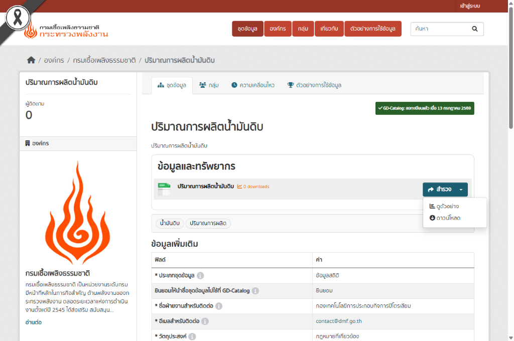

**[Fig. B | CSV Extract]** — production_oil.csv (CP874, 11,635 แถวข้อมูล; snapshot ล่าสุด ธ.ค. 2568): ยืนยันชื่อกลุ่มแหล่งและปริมาณ OIL (BBL/D)
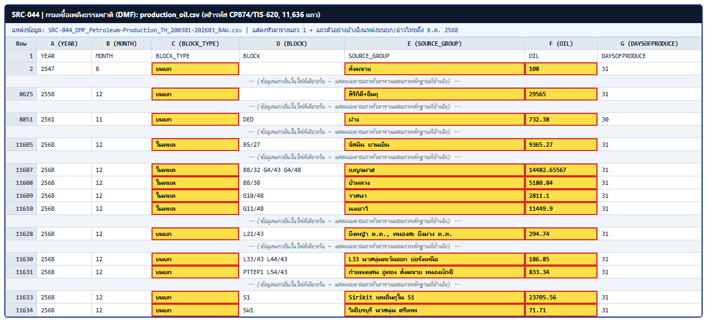

---

## 02. `SRC-045` — DMF OpenData: การผลิตก๊าซธรรมชาติรายเดือน (production_gas.csv)

- **ลิงก์และสถานะไฟล์**: **หน้าเว็บหลักชุดข้อมูล กพร./DMF (`HTTP 200`)**: https://catalog.dmf.go.th/dataset/production-natural-gas · **ไฟล์ CSV ตรง (`HTTP 200`)**: [`production_gas.csv`](https://catalog.dmf.go.th/dataset/ad91d31d-7e3b-48a3-b454-53c174156705/resource/f86d5605-e407-461f-83d8-47f9b4bd0803/download/production_gas.csv) *(snapshot ในโครงการมี 11,635 แถวข้อมูล / 11,636 บรรทัดรวม header, งวดล่าสุด ธ.ค. 2568; หน้าเว็บและ CSV ของ DMF ตอบสนอง `HTTP 200` โดยใช้เวลาตอบกลับ ~20–30 วินาที)*
**วิธีตรวจ (`Ctrl+F` ในไฟล์ CSV — เข้ารหัส `CP874`)**: - ค้นหาหัวตาราง (บรรทัดที่ 1): `YEAR,MONTH,BLOCK_TYPE,BLOCK,SOURCE_GROUP,GAS,GAS_EQUI_OIL,DAYSOFPRODUCE` - ค้นหาบรรทัดที่ 11,636: `2568,12,ในทะเล,B12/27,ไพลินเหนือ,157.9113333,27539.73653,31` - ค้นหาชื่อแหล่ง: `เอราวัณ`, `บงกช`, `อาทิตย์`, `ปลาทอง`, `สตูล`, `ฟูนาน`, `สินภูฮ่อม`, `น้ำพอง` (ส่วนพื้นที่พัฒนาร่วมไทย-มาเลเซีย `MTJDA` ใน CSV ปรากฏชื่อกลุ่มว่า **`CPOC **`** ไม่ได้ใช้คำว่า `JDA`) - ตัวอย่างแถวงวดล่าสุด (`2568,12` ตาม `[Fig. B]`): ใช้ชื่อ `BLOCK=EU1, ภูฮ่อม` (`110.55 MMSCFD`) ควบคู่กับ `สินภูฮ่อม` ในงวดก่อนหน้า
- **หลักฐานภาพด้านล่าง**: `[Fig. A]` พอร์ทัล DMF OpenData และ `[Fig. B]` ตัวอย่างแถวสกัดจาก `production_gas.csv`
**ระดับที่ 1 (ปรากฏตรงตัว)**: ระบุปริมาณการผลิตก๊าซธรรมชาติรายเดือน (`GAS` หน่วยล้านลูกบาศก์ฟุตต่อวัน `MMSCFD`) และค่าเทียบเท่าน้ำมันดิบ (`GAS_EQUI_OIL` หน่วยบาร์เรลเทียบเท่าน้ำมันดิบ/วัน `BOE/d`) แยกตามแหล่งบนบกและในทะเล
**ระดับที่ 2 (ข้อจำกัดและการตีความต่อ)**: 1. ไฟล์ CSV บอกเฉพาะปริมาณก๊าซที่ผลิตได้จากแต่ละแหล่ง แต่ **ไม่ได้ระบุเส้นทางท่อส่งก๊าซหรือโรงแยกก๊าซ/โรงไฟฟ้าปลายทาง** 2. การเชื่อมโยงว่าก๊าซจากอ่าวไทยเข้าท่อประธานเส้นที่ 1–3 ไปโรงแยกก๊าซฯ ระยอง/ขนอม และก๊าซจากสินภูฮ่อม/น้ำพองส่งเข้าโรงไฟฟ้าน้ำพอง ต้องใช้อ้างอิงจากแผนที่และตารางท่อส่งก๊าซใน `TSRC-08` (หน้า PDF 40–41 / เลขหน้าเอกสาร 076–079), `TSRC-09` (หน้า PDF 26–27 `Figure 22`), `TSRC-02` และ `TSRC-13` (ร่วมกับแผนที่จุดแหล่งผลิตใน `TSRC-04` หน้า PDF 11–13 / เอกสาร 8–10)
- **การนำไปใช้ใน LCI (`P01–P20`)**: ต้นน้ำ **`P01`**, **`P02`** และการคำนวณมวลก๊าซเข้าท่อ **`P03` / `P09`** (`TTRC-08` ถึง `TTRC-17`)

### หลักฐานภาพประกอบของ `SRC-045` (`2` รายการ)

**[Fig. A | Web capture]** — ภาพหน้าชุดข้อมูลการผลิตก๊าซธรรมชาติรายเดือนของ DMF (catalog.dmf.go.th, HTTP 200)
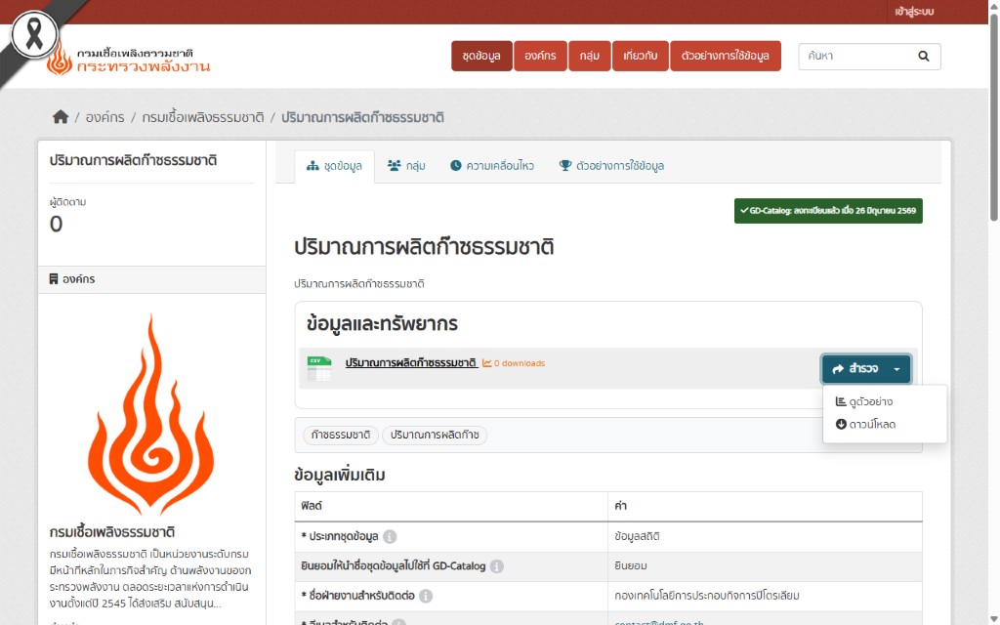

**[Fig. B | CSV Extract]** — production_gas.csv (11,635 แถวข้อมูล; snapshot ล่าสุด ธ.ค. 2568): แสดงแหล่งผลิตหลัก หน่วย GAS (MMSCFD) และ GAS_EQUI_OIL (BOE/d)
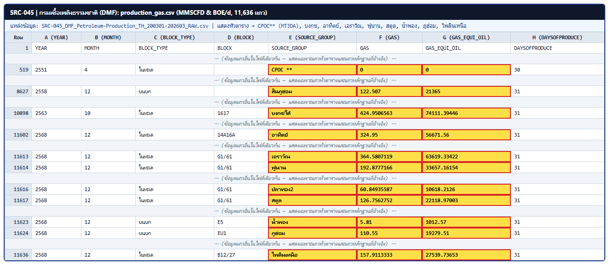

---

## 03. `SRC-046` — DMF OpenData: การผลิตคอนเดนเสทรายเดือน (production_condensate.csv)

- **ลิงก์และสถานะไฟล์**: **หน้าเว็บหลักชุดข้อมูล กพร./DMF (`HTTP 200`)**: https://catalog.dmf.go.th/dataset/production-condensate · **ไฟล์ CSV ตรง (`HTTP 200`)**: [`production_condensate.csv`](https://catalog.dmf.go.th/dataset/d12c4281-6728-4542-a49f-da30d9919f4c/resource/1304bcc1-22b1-4b2c-a4b5-954f40310ff6/download/production_condensate.csv) *(snapshot ในโครงการมี 11,635 แถวข้อมูล / 11,636 บรรทัดรวม header, งวดล่าสุด ธ.ค. 2568; หน้าเว็บและ CSV ของ DMF ตอบสนอง `HTTP 200` โดยใช้เวลาตอบกลับ ~20–30 วินาที)*
**วิธีตรวจ (`Ctrl+F` ในไฟล์ CSV — เข้ารหัส `CP874`)**: - ค้นหาหัวตาราง (บรรทัดที่ 1): `YEAR,MONTH,BLOCK_TYPE,BLOCK,SOURCE_GROUP,CONDENSATE,CONDENSATE_EQUI_OIL,DAYSOFPRODUCE` - ค้นหาบรรทัดที่ 11,636: `2568,12,ในทะเล,B12/27,ไพลินเหนือ,6320.131667,5748.791764,31` - ค้นหาชื่อแหล่ง: `เอราวัณ`, `บงกช`, `อาทิตย์`, `ปลาทอง`, `สตูล`, `ฟูนาน`, `ไพลิน`, `CPOC **` (ไม่ปรากฏคำว่า `JDA`) **ระดับที่ 1 (ปรากฏตรงตัว)**: ระบุปริมาณการผลิตคอนเดนเสทรายเดือน (`CONDENSATE` หน่วยบาร์เรล/วัน) และค่าเทียบเท่าน้ำมันดิบ (`CONDENSATE_EQUI_OIL`) แยกตามแหล่งผลิต
**ระดับที่ 2 (ข้อจำกัดและการตีความต่อ)**: 1. ไฟล์ CSV บอกเฉพาะปริมาณคอนเดนเสทที่ผลิตได้ที่ปากหลุม แต่ **ไม่ได้ระบุว่าส่งไปกลั่นหรือแปรรูปที่บริษัทใด** 2. การระบุว่าคอนเดนเสทจากอ่าวไทยถูกส่งเข้าหน่วยแยกคอนเดนเสท (`Condensate Splitter`) ของ `PTTGC` (`TFAC-04`) เป็นหลัก อ้างอิงจากเอกสารโครงสร้างธุรกิจของ `PTTGC` (`TSRC-16` หน้า 21–22) ไม่ได้เขียนอยู่ในไฟล์ CSV นี้
- **การนำไปใช้ใน LCI (`P01–P20`)**: ต้นน้ำ **`P02`** และวัตถุดิบเข้า **`P06` / `P18`** (`TFAC-04`)

### หลักฐานภาพประกอบของ `SRC-046` (`2` รายการ)

**[Fig. A | Web capture]** — ภาพหน้าชุดข้อมูลการผลิตคอนเดนเสทรายเดือนของ DMF (catalog.dmf.go.th, HTTP 200)
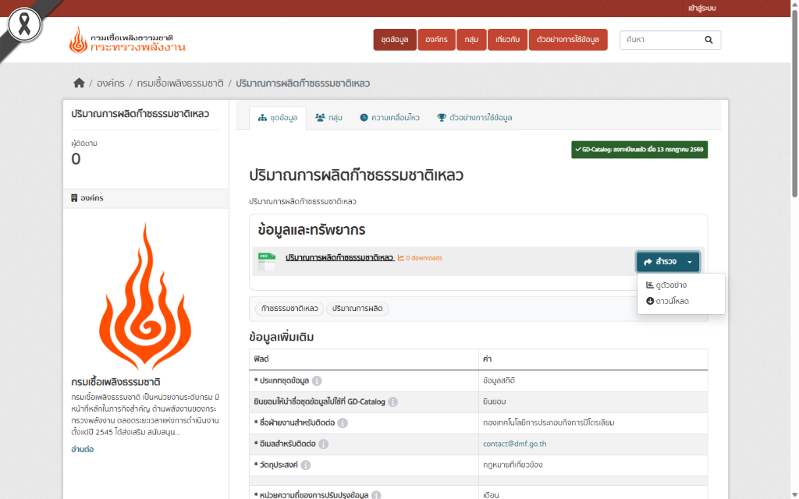

**[Fig. B | CSV Extract]** — production_condensate.csv (11,635 แถวข้อมูล; snapshot ล่าสุด ธ.ค. 2568): แสดง CONDENSATE (BBL/D) และ CONDENSATE_EQUI_OIL (BOE/d)
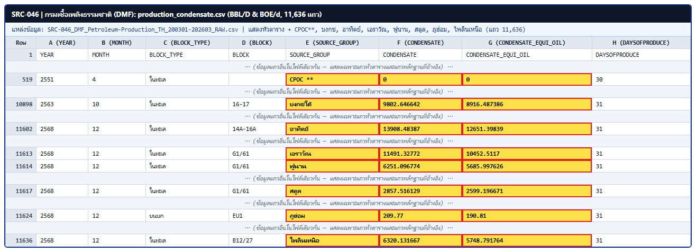

---

## 04. `SRC-047` — PTTEP Environmental Performance Data (Thailand Scope 1 & Environmental)

- **ลิงก์และสถานะไฟล์**: **หน้าเว็บหลักพอร์ทัลความยั่งยืน ปตท.สผ. (`HTTP 200`)**: https://sustainability.pttep.com/th/publication/sustainability-performance-data — **ไฟล์ PDF ตรง (`8` หน้า, `HTTP 200`)**: https://sustainability.pttep.com/storage/document/sustainability/pttep-environmental-performance-data-th.pdf *(วิธีเข้าถึง: เมนู **ความยั่งยืน -> สิ่งพิมพ์และข้อมูลผลการดำเนินงาน** -> เลือกดาวน์โหลด `ข้อมูลผลการดำเนินงานด้านสิ่งแวดล้อม`; หมายเหตุ: โดเมนหลัก `www.pttep.com` มีด่าน Radware Bot Manager Captcha ส่วนซับโดเมน `sustainability.pttep.com` เปิดได้โดยตรง `HTTP 200`)*
**วิธีตรวจ (`Ctrl+F` ในไฟล์ PDF 6 หน้า)**: - **หน้า 1** (`Ctrl+F`: `154,026,283` หรือ `24,022,968` หรือ `38,470,917`): - `Hydrocarbon Production` -> `Thailand`: ปี 2022 = `109,209,440` BOE (`15,360,942` Tonne), ปี 2023 = `136,983,312` BOE (`19,939,450` Tonne), **ปี 2024 = `154,026,283` BOE (`24,022,968` Tonne)**, ปี 2025 = `158,094,363` BOE (`25,462,005` Tonne) - `Total Direct Energy Consumption` -> `Thailand`: ปี 2024 = **`38,470,917` GJ** (`Total Energy Consumption = 38,614,443` GJ), ปี 2025 = `45,293,551` GJ - **หน้า 2** (`Ctrl+F`: `5,092,591` หรือ `2,395,063` หรือ `20,707` หรือ `15,582`): - `Total Direct GHG Emissions (Scope 1)` -> `Thailand`: ปี 2024 = **`5,092,591` Tonne CO2e** (ปี 2025 = `6,627,630` Tonne CO2e); แยกเป็น `Flare = 2,395,063` Tonne CO2e, `Stationary Combustion = 2,174,344` Tonne CO2e - `Total Methane Emission (Scope 1)` -> `Thailand`: ปี 2024 = **`8,870` Metric Tonne** (ปี 2025 = `36,826` Metric Tonne) - `Volatile Organic Compounds (VOCs)` -> `Thailand`: ปี 2024 = **`15,582` Tonne VOC** (ปี 2025 = `15,552`) - `Nitrogen Oxides (NOx)` -> `Thailand`: ปี 2024 = **`20,707` Tonne NO2** (ปี 2025 = `22,286`) - `Sulfur Oxides (SOx)` -> `Thailand`: ปี 2024 = **`1,579` Tonne SO2** (ปี 2025 = **`1,575`**) - **หน้า 3–5** (`Ctrl+F`: `58.52` หรือ `44.66` หรือ `12.80` หรือ `455,324`): - `Total Water Withdrawal (Thailand 2024)` หน้า 3 = **`58.52` Million m3** (`Seawater 44.66`, `Produced Water 12.80`, `Groundwater 0.71`, `Third-party Water 0.35`; ไม่รวมน้ำเกลือ หน้า 4 = `13.86` Million m3) - `Produced Water (Thailand 2024)` หน้า 4 = **`12.80` Million m3** (`Reinjection for disposal 12.79`) - `Total Waste Generated (Thailand 2024)` หน้า 5 = **`455,324` Tonne** (`Hazardous Waste = 65,289` Tonne)
**ระดับที่ 2 (การคำนวณต่อและข้อจำกัด — ชี้แจงอย่างซื่อสัตย์)**: 1. เอกสารรายงานยอดรวมของทุกโครงการในประเทศไทยของ ปตท.สผ. (`Thailand Total`) **ไม่ได้แยกตัวเลขมลพิษรายหลุมเจาะหรือแยกก๊าซกับน้ำมันดิบออกจากกัน** 2. **ที่มาของตัวหาร `23.52 ล้านตัน`**: ในตาราง LCI (`LCX-002` ถึง `LCX-012` และ `LCX-030` ถึง `LCX-036`) ใช้ตัวหารมวลอ้างอิงเดิมของโมเดล `23,520,000 ตัน` (`= 5,092,591 tCO2e ÷ 0.216522`) ขณะที่ไฟล์ PDF ปรับปรุงล่าสุด (`SRC-047` หน้า 1) รายงานผลผลิตปี 2024 เป็น **`24,022,968 ตัน`** (ต่างกัน `~2.1%`) 3. **ตัวเลข `1,012,492 t` (`41,746 MMSCF`) ใน `LCX-010` ไม่ปรากฏใน PDF นี้**: `SRC-047` หน้า 2 (ทั้งฉบับ TH และ EN) พิมพ์เฉพาะยอดปล่อยก๊าซเรือนกระจกจากการเผาทิ้ง **`GHG Emissions - Flare = 2,395,063 Tonne CO2e`** เท่านั้น มวลก๊าซที่เผา `1,012,492 ตัน` จึงเป็นค่าคำนวณ/อ้างอิงภายนอกของโมเดล ไม่ใช่ตัวเลขตรงตัวใน PDF
- **การนำไปใช้ใน LCI (`P01–P20`)**: ต้นน้ำ **`P01` & `P02`** (`LCX-001` ถึง `LCX-012` และ `LCX-029` ถึง `LCX-036`)

### หลักฐานภาพประกอบของ `SRC-047` (`4` รายการ)

**[Fig. A | PDF Highlighted]** — PTTEP ESG Performance Data (หน้า 1): ตาราง Hydrocarbon Production & Energy Consumption — Thailand 2024 = 154,026,283 BOE (24,022,968 Tonne) และ Direct Energy = 38,614,443 GJ (Non-renewable 38,470,917 GJ)
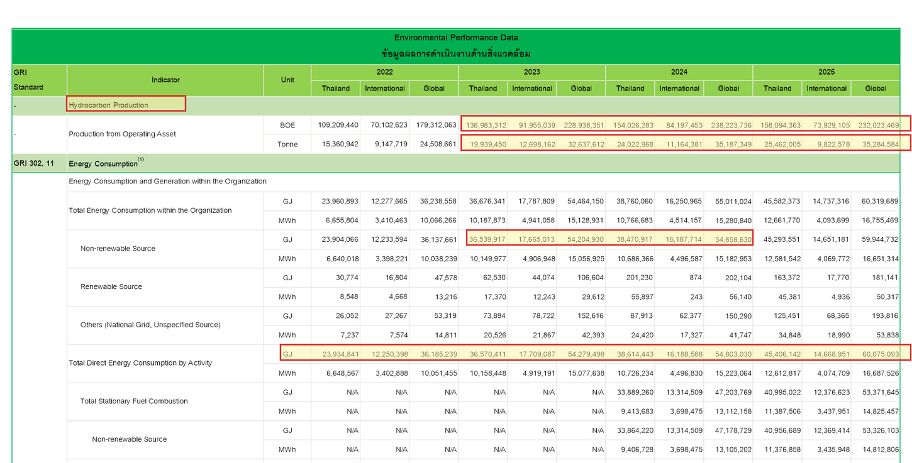

**[Fig. B | PDF Highlighted]** — PTTEP (หน้า 2): ก๊าซเรือนกระจกและมลพิษทางอากาศ Thailand 2024 — Scope 1 = 5,092,591 tCO2e (Flare 2,395,063, Stationary 2,174,344), CH4 = 8,870 t, VOC = 15,582 t, NOx = 20,707 t, SOx = 1,579 t
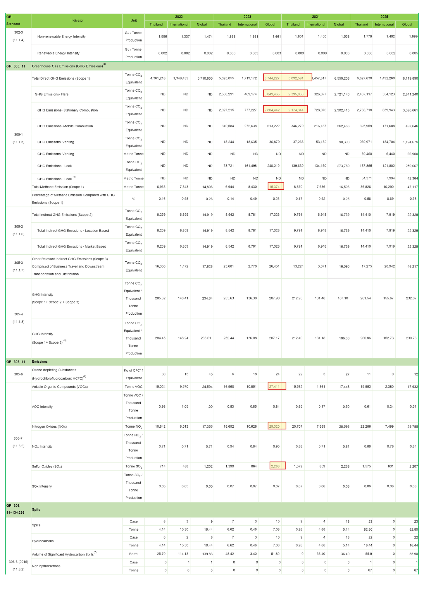

**[Fig. C | PDF Highlighted]** — PTTEP (หน้า 3): Total Water Withdrawal Thailand 2024 = 58.52 Million m3 (Seawater 44.66, Produced Water 12.80)
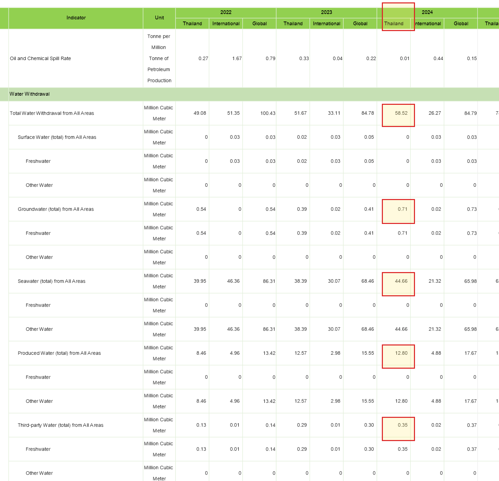

**[Fig. D | PDF Highlighted]** — PTTEP (หน้า 5): Waste Generated Thailand 2024 — Total Waste = 455,324 Tonne (Hazardous = 65,289 Tonne)
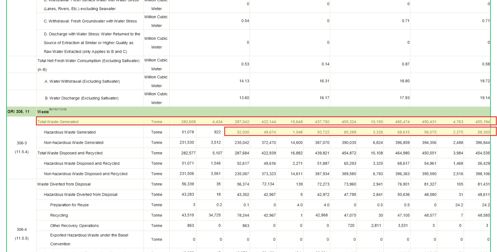

---

## 05. `SRC-048` — EPPO OpenData: ปริมาณผลิตผลิตภัณฑ์ปิโตรเลียม (dataset_11_14)

- **ลิงก์แหล่งทางการ**: https://catalog.eppo.go.th/dataset/dataset_11_14 · [ไฟล์ CSV (Data API)](https://catalog.eppo.go.th/datastore/dump/63491d54-cfd8-46ea-866b-824519097944?format=csv) — ข้อมูล snapshot ในโครงการมี `2,928` แถว ล่าสุดเดือนสิงหาคม 2026
**วิธีตรวจ (`Ctrl+F` ในไฟล์ CSV)**: หัวตาราง `_id,Year,Month,Product,Quantity,UNIT`; แถวล่าสุด 2026-08 คือ `2923 GASOLINE 1113.846`, `2924 KEROSENE 173.663`, `2925 DIESEL 2160.996`, `2926 JET PETROLEUM 692.537`, `2927 FUEL OIL 489.744`, `2928 LPG 943.496296` (ทั้งหมด Million Litres). รายงานเป็นยอดผลิตระดับประเทศ ไม่แยกรายโรงกลั่น.
**ระดับที่ 2 (ข้อจำกัดและการคำนวณต่อ)**: 1. ไฟล์นี้แสดง **ยอดผลิตรวมของทุกโรงกลั่นทั้งประเทศ** ไม่ได้แยกตามรายบริษัทโรงกลั่น 2. การแปลงจากหน่วย `Million Litres` เป็น `บาร์เรล/วัน` ต้องหารด้วย `158.987 ลิตร/บาร์เรล` และจำนวนวันในเดือน (หรือดูตารางหน่วยบาร์เรล/วันโดยตรงใน `TSRC-10`)
- **การนำไปใช้ใน LCI (`P01–P20`)**: กลางน้ำ **`P06` (การกลั่นน้ำมัน — สมดุลผลผลิตระดับประเทศ)**

### หลักฐานภาพประกอบของ `SRC-048` (`2` รายการ)

**[Fig. A | Web capture]** — ภาพหน้าชุดข้อมูลการผลิตน้ำมันสำเร็จรูปรายเดือนของ EPPO
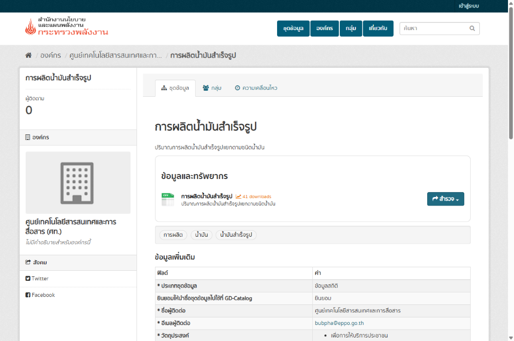

**[Fig. B | CSV Extract]** — EPPO Petroleum Production CSV (2,928 แถวข้อมูล): แถวล่าสุด ส.ค. 2026 แยก GASOLINE, KEROSENE, DIESEL, JET PETROLEUM, FUEL OIL และ LPG
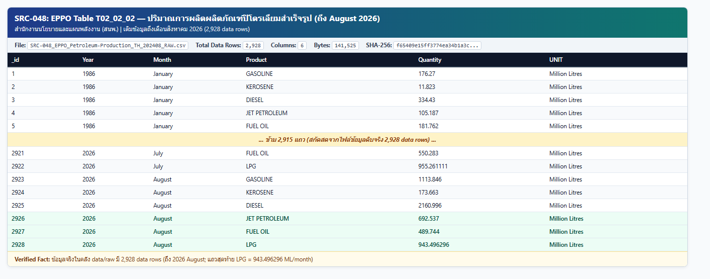

---

## 06. `SRC-049` — EPPO OpenData: ปริมาณน้ำมันดิบและวัตถุดิบเข้ากลั่น (dataset_11_13)

- **ลิงก์และสถานะไฟล์**: **หน้าเว็บหลักชุดข้อมูล สนพ. / EPPO (`HTTP 200`)**: https://catalog.eppo.go.th/dataset/dataset_11_13 · **ไฟล์ Data API CSV (`HTTP 200`)**: [Data API CSV](https://catalog.eppo.go.th/datastore/dump/f8ce9405-81c1-498b-94b5-9b86c0ca26c1?format=csv) *(snapshot ในโครงการมี `3,096` แถวข้อมูล ล่าสุดเดือนสิงหาคม 2026)*
**วิธีตรวจ (`Ctrl+F` ในไฟล์ CSV)**: หัวตาราง `_id,Year,Month,Company,Quantity,UNIT`; แถวเดือนสิงหาคม 2026: `3090 FANG 536`, `3091 THAI OIL 306231`, `3092 BANGCHAK 106159`, `3093 ESSO 159349`, `3094 TPI / IRPC 170277`, `3095 RRC / PTTAR / PTTGC 157932`, `3096 SPRC 162402` (ทั้งหมด BBL/DAY). ชุดข้อมูลระบุยอดรายโรงกลั่น แต่ไม่แยกแหล่ง crude.
**ระดับที่ 2 (ข้อจำกัดและการตีความต่อ)**: 1. ไฟล์นี้บอกปริมาณน้ำมันดิบรวมที่แต่ละโรงกลั่นรับเข้ากลั่น (`BBL/DAY`) แต่ **ไม่ได้แยกแยะว่าน้ำมันดิบที่เข้าโรงกลั่นนั้นมาจากแหล่งในประเทศแหล่งใด หรือนำเข้าจากประเทศใดกี่เปอร์เซ็นต์** 2. ในไฟล์ยังคงใช้ชื่อเดิม `ESSO` สำหรับโรงกลั่นศรีราชา (`BSRC`) และใช้ `TPI / IRPC`, `RRC / PTTAR / PTTGC` ตามชุดข้อมูลประวัติศาสตร์ของ สนพ.
- **การนำไปใช้ใน LCI (`P01–P20`)**: กลางน้ำ **`P06` (ตัวหารปริมาณน้ำมันดิบเข้ากลั่นรายโรงกลั่น `TFAC-01`–`TFAC-07`)**

### หลักฐานภาพประกอบของ `SRC-049` (`2` รายการ)

**[Fig. A | Web capture]** — ภาพหน้าชุดข้อมูลปริมาณน้ำมันดิบเข้ากลั่นของ EPPO
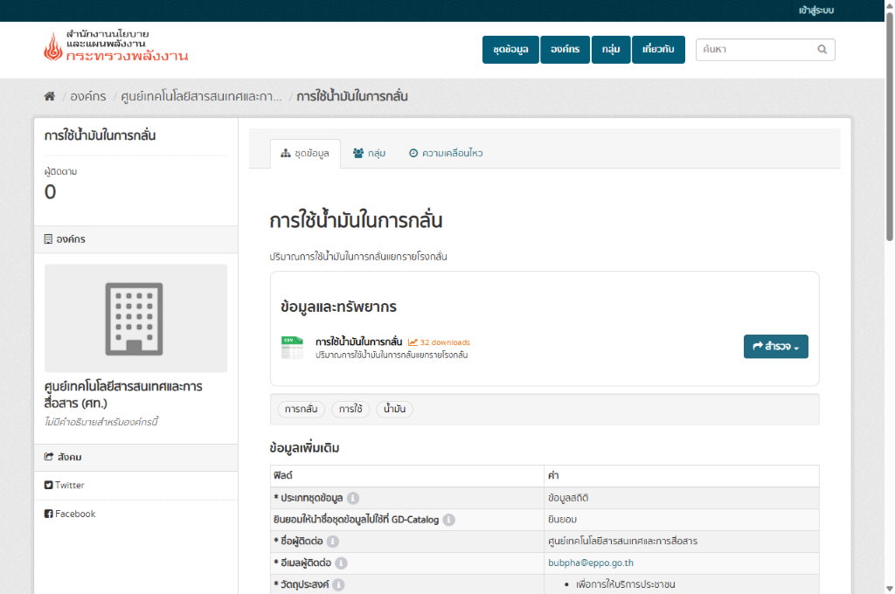

**[Fig. B | CSV Extract]** — EPPO Refinery Intake CSV (3,096 แถวข้อมูล): ปริมาณรับเข้ากลั่นรายโรงกลั่น ส.ค. 2026 (BBL/DAY)
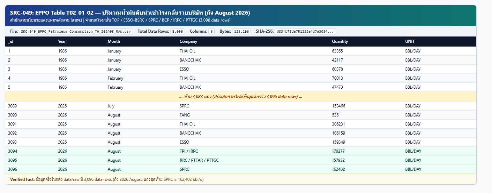

---

## 07. `SRC-050` — EPPO OpenData: การใช้ก๊าซธรรมชาติแยกตามสาขา (dataset_11_22)

- **ลิงก์และสถานะไฟล์**: **หน้าเว็บหลักชุดข้อมูล สนพ. / EPPO (`HTTP 200`)**: https://catalog.eppo.go.th/th/dataset/dataset_11_22 · **ไฟล์ Data API CSV (`HTTP 200`)**: [Data API CSV](https://catalog.eppo.go.th/datastore/dump/f69c137e-168c-473c-beb0-2f49a3dc076f?format=csv) *(snapshot ในโครงการมี `1,733` แถวข้อมูล ล่าสุดเดือนสิงหาคม 2026)*
**วิธีตรวจ (`Ctrl+F` ในไฟล์ CSV)**: หัวตาราง `_id,Year,Month,Sector,Quantity,UNIT`; แถวล่าสุด `1730,2026,August,ELECTRICITY,3038,MMSCFD`, `1731,2026,August,INDUSTRY,753,MMSCFD`, `1732,2026,August,GSP,907,MMSCFD`, `1733,2026,August,NGV,71,MMSCFD`. มี 4 สาขา; `ELECTRICITY` ไม่แยก EGAT/IPP/SPP.
**ระดับที่ 2 (ข้อจำกัด)**: 1. ไฟล์ CSV ของ สนพ. นี้รวมกลุ่มโรงไฟฟ้าทั้งหมดเป็นค่าเดียวคือ **`ELECTRICITY`** (ไม่ได้แยก `EGAT / IPP / SPP` และไม่ได้แยก `GSP 1–6`) 2. การแยกสัดส่วนผู้ใช้ไฟฟ้ารายกลุ่ม (`EGAT 793 / IPP 753 / SPP 1,197`) และแยกโรงแยกก๊าซฯ หน่วยที่ 1–6 ต้องดูรายละเอียดในรายงาน 56-1 ของ ปตท. (**`TSRC-08` หน้า 37–41**)
- **การนำไปใช้ใน LCI (`P01–P20`)**: กลางน้ำ **`P07` (โรงแยกก๊าซฯ)** และปลายน้ำ **`P13` (NGV), `P15` (โรงไฟฟ้า), `P16` (อุตสาหกรรม)**

### หลักฐานภาพประกอบของ `SRC-050` (`2` รายการ)

**[Fig. A | Web capture]** — ภาพหน้าชุดข้อมูลการใช้ก๊าซธรรมชาติแยกตามสาขาของ EPPO (catalog.eppo.go.th, HTTP 200)
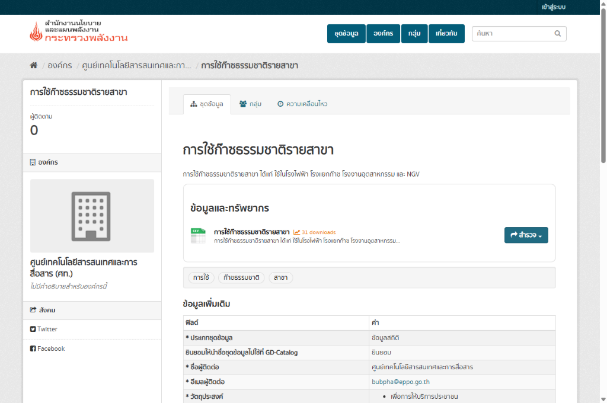

**[Fig. B | CSV Extract]** — EPPO Gas Consumption CSV (1,733 แถวข้อมูล): แถวล่าสุด ส.ค. 2026: ELECTRICITY 3,038, INDUSTRY 753, GSP 907, NGV 71 MMSCFD
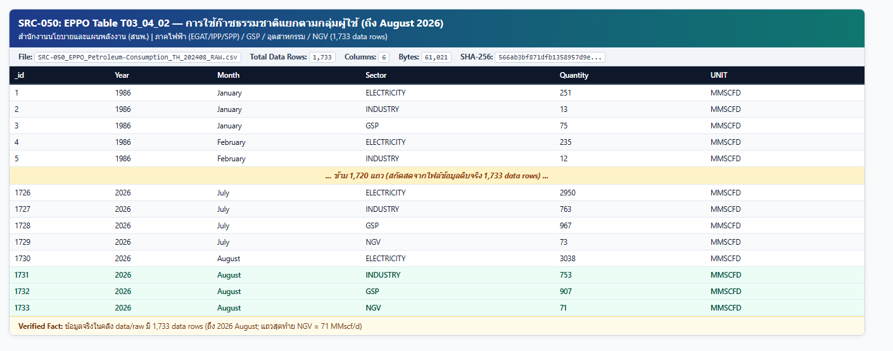

---

## 08. `SRC-051` — Bangchak (BCP) Integrated Sustainability Report 2567 (พระโขนง)

- **ลิงก์และสถานะไฟล์**: **หน้าเว็บหลักพอร์ทัลรายงานความยั่งยืนบางจาก (`HTTP 200`)**: https://sustainability.bangchak.co.th/th/document/sustainability-reports — **ไฟล์ PDF ตรง (`HTTP 200`, ประจำปี 2567)**: https://sustainability.bangchak.co.th/storage/esg-reporting-library/reporting-and-disclosure/sustainability-report/2024/bcp-sr2024-th.pdf *(วิธีเข้าถึง: เข้าเมนู **คลังรายงาน ESG -> รายงานความยั่งยืน -> ปี 2567 (2024) ภาษาไทย**)*
**วิธีตรวจ (`Ctrl+F` ในไฟล์ PDF ภาษาไทย 107 หน้า)**: - **หน้า 8 & หน้า 62** (`Ctrl+F`: `294,000`): `"มาตรฐานระดับโลก 2 แห่ง กำลังการผลิตติดตั้ง รวม 294,000 บาร์เรลต่อวัน สถานีบริการ 2,163 สถานี"` - **หน้า 47** (`Ctrl+F`: `884,136.05` หรือ `110.6`): `"ในปี 2567 โรงกลั่นน้ำมันบางจาก พระโขนง มีกำลังการกลั่นเฉลี่ยอยู่ที่ 110.6 พันบาร์เรลต่อวัน คิดเป็นร้อยละ 92 ... ขอบเขตที่ 1 และ 2: 884,136.05 ตันคาร์บอนไดออกไซด์เทียบเท่า"` - **หน้า 81 ตาราง `GRI 301-1` & `302-1`** (`Ctrl+F`: `10,568,568.32` หรือ `13,605.10` หรือ `5.20`): ปี 2567 `วัตถุดิบที่ใช้ทั้งหมด = 10,568,568.32 ตัน` (ปี 2566: `8,033,064.18`), `การจำหน่ายผลิตภัณฑ์ = 17,222.21 ล้านลิตร`, `การใช้พลังงานรวมสุทธิภายในหน่วยธุรกิจ = 13,605.10 เทระจูล` (`ก๊าซเชื้อเพลิงและ LPG 4,379.36 TJ`, `ก๊าซธรรมชาติ 9,148.45 TJ`, `ไฟฟ้า 70.26 TJ`), **`%FOEB = 5.20%`** (ปี 2566: `4.90%`) - **หน้า 83 ตาราง `GRI 305-1` & `305-2`** (`Ctrl+F`: `976,280.59` หรือ `984,892.94`): ปี 2567 `ขอบเขตที่ 1 = 976,280.59 tCO2e` (`CO2 = 973,768.69`, `CH4 = 1,935.79 tCO2e / 64.51 ตัน`), `ขอบเขตที่ 2 = 8,612.34 tCO2e`, **`รวมขอบเขตที่ 1 และ 2 = 984,892.94 tCO2e`**, `ความเข้มข้น = 0.09 tCO2e/ตันวัตถุดิบ` - **หน้า 86 ตาราง `GRI 305-7` & `303-3`** (`Ctrl+F`: `279.34` หรือ `498.07` หรือ `2.767`): ปี 2567 **`ออกไซด์ของไนโตรเจน (NOx) = 279.34 ตัน`** (ปี 2566: `526.79`), **`ซัลเฟอร์ไดออกไซด์ (SO2) = 23.42 ตัน`** (ปี 2566: `38.95`), `ฝุ่นละออง (TSP) = 5.03 ตัน`, `H2S = 10.65 ตัน`, **`VOC Inventory = 498.07 ตัน`**, `Fugitive VOC = 2.98 ตัน`, `ปริมาณการดึงน้ำมาใช้ทั้งหมด = 2.767 ล้านลูกบาศก์เมตร` - **หน้า 87 ตาราง `GRI 303-4`** (`Ctrl+F`: `0.983` หรือ `41.55`): ปี 2567 `ปริมาณน้ำทิ้งทั้งหมด = 0.983 ล้านลูกบาศก์เมตร`, **`COD = 41.55 ตัน`**, `BOD = 4.40 ตัน`
**ระดับที่ 2 (ชี้แจงความคลาดเคลื่อนในโค้ดเดิมและการใช้ข้อมูล)**: 1. เชิงอรรถที่ 1 หน้า 81 ระบุว่าขอบเขตข้อมูลของ บมจ.บางจาก คอร์ปอเรชั่น ในตารางหน้า 81–87 ครอบคลุมทั้งโรงกลั่นสุขุมวิท 64, คลังน้ำมันบางปะอิน, คลังสุราษฎร์ฯ และสำนักงานใหญ่ (ส่วนเฉพาะโรงกลั่นพระโขนงอย่างเดียว หน้า 47 ระบุ Scope 1+2 = `884,136.05 tCO2e`) 2. ในไฟล์ `TSRC-26` (ESG Data 2025) มีข้อมูลอัปเดตปี 2568 (`วัตถุดิบ 11,338,088 ตัน`, `%FOEB = 5.11%`, `Scope 1 = 907,297 tCO2e`, `COD = 39.636 ตัน`) ซึ่งถูกนำไปใช้เป็นฐานคำนวณใน `LCX-018` ถึง `LCX-024`
- **จุดตรวจเพิ่มเติมหน้า `81` ส่วนล่าง (เชิงอรรถที่ `1`) `[Fig. G]`**: ย้ายภาพเชิงอรรถขอบเขตคลังน้ำมันมาจากบัตรรวม `TSRC` เดิม เพื่อให้หลักฐานทุกหน้าของ `BCP SR 2567` อยู่ที่เดียว (`Ctrl+F`: `สุขุมวิท 64`, `คลังน้ำมันบางปะอิน`, `คลังน้ำมันสุราษฎร์`)
- **การนำไปใช้ใน LCI (`P01–P20`)**: กลางน้ำ **`P06` (การกลั่นน้ำมัน — โรงกลั่นบางจาก พระโขนง `TFAC-05`)**

### หลักฐานภาพประกอบของ `SRC-051` (`7` รายการ)

**[Fig. A | PDF Highlighted]** — บางจาก (BCP 56-1) หน้า 8: กำลังการผลิตติดตั้งรวม 294,000 บาร์เรลต่อวัน (2 โรงกลั่น) และสถานีบริการ
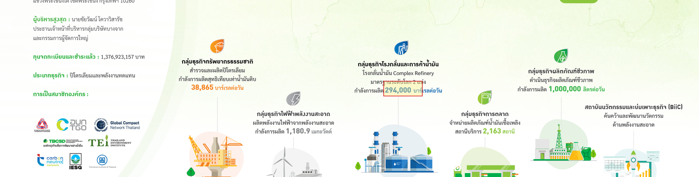

**[Fig. B | PDF Highlighted]** — บางจาก หน้า 47: กำลังกลั่นเฉลี่ยพระโขนง 110.6 kb/d (92%) และ Scope 1+2 = 884,136.05 tCO2e
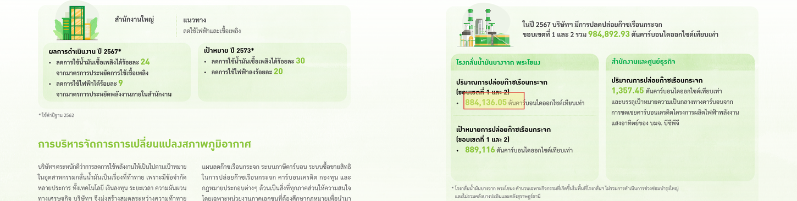

**[Fig. C | PDF Highlighted]** — บางจาก หน้า 81: GRI 301-1/302-1 วัตถุดิบที่ใช้ทั้งหมด 10,568,568.32 ตัน, การใช้พลังงานสุทธิ 13,605.10 TJ, %FOEB = 5.20%
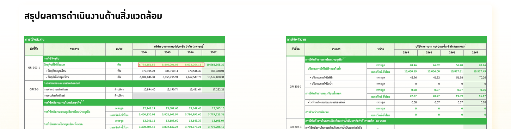

**[Fig. D | PDF Highlighted]** — บางจาก หน้า 83: GRI 305-1/305-2 ขอบเขตที่ 1 = 976,280.59 tCO2e (รวม Scope 1+2 = 984,892.94 tCO2e / 0.09 tCO2e/ตัน)
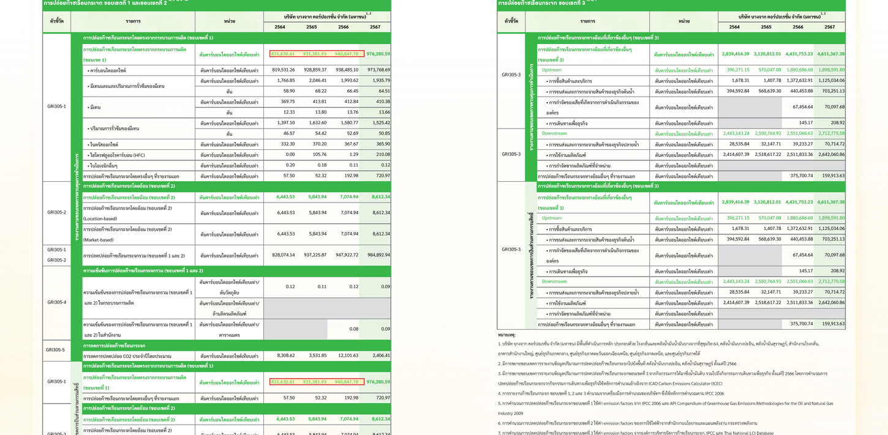

**[Fig. E | PDF Highlighted]** — บางจาก หน้า 86: GRI 305-7/303-3 มลพิษทางอากาศ NOx = 279.34 ตัน, SO2 = 23.42 ตัน, VOC Inventory = 498.07 ตัน
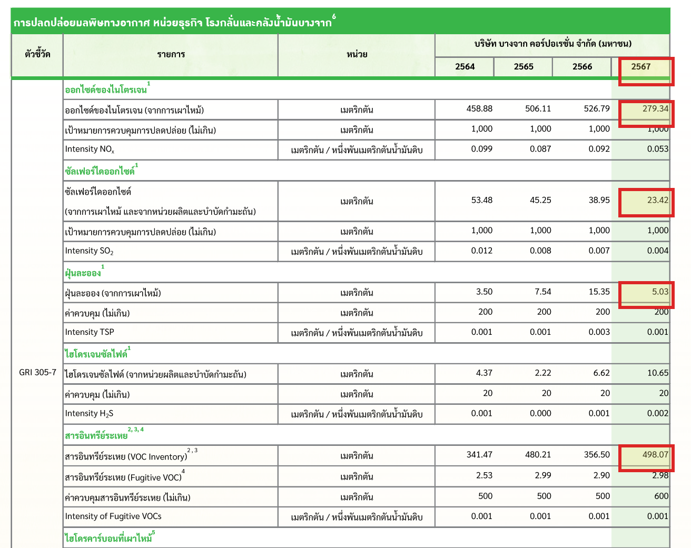

**[Fig. F | PDF Highlighted]** — บางจาก หน้า 87: GRI 303-4 ปริมาณน้ำทิ้ง 0.983 ล้าน ลบ.ม. และ COD = 41.55 ตัน
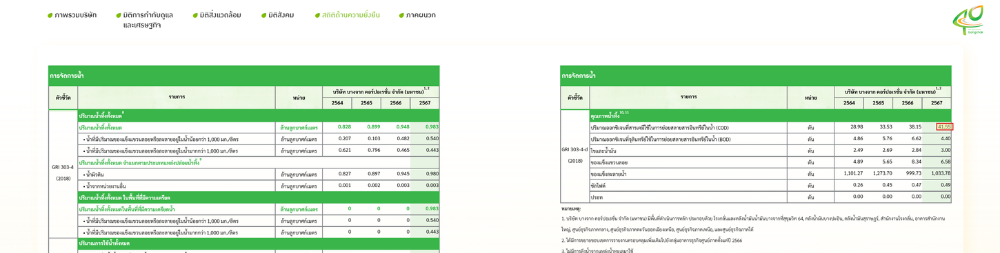

**[Fig. G | PDF Highlighted]** — รายงานความยั่งยืนบางจาก 2567 หน้า 81 (ส่วนล่าง — เชิงอรรถที่ 1): ยืนยันขอบเขตพื้นที่ดำเนินการโรงกลั่น/คลังสุขุมวิท 64, คลังน้ำมันบางปะอิน และคลังน้ำมันสุราษฎร์ธานี
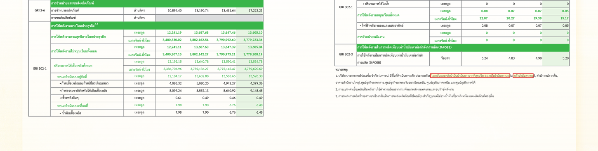

---

## 09. `SRC-052` — DMF: คู่มือรายงานและคำนวณก๊าซเรือนกระจกจากกิจการปิโตรเลียม

- **ลิงก์และสถานะไฟล์**: **หน้าเว็บหลักประกาศกฎหมาย กรมเชื้อเพลิงธรรมชาติ (`HTTP 200`)**: https://law.dmf.go.th/public/law/index/main -> รายการ ID 311: https://law.dmf.go.th/public/law/index/detail/id/311 — **ไฟล์ PDF ตรง (`28` หน้า)**: https://law.dmf.go.th/UserFiles/Law/311/2_เอกสารแนบท้ายประกาศ_คู่มือวิธี.pdf *(วิธีเข้าถึง: ค้นหาคำว่า `ก๊าซเรือนกระจก` หรือเปิดรายการ `id/311` -> ดาวน์โหลดเอกสารแนบท้ายประกาศฯ)*
**วิธีตรวจ (`Ctrl+F` ในไฟล์ PDF ภาษาไทย 28 หน้า)**: - **หน้า 3 ตารางที่ 2** (`Ctrl+F`: `298` หรือ `GWP100`): ค่าศักยภาพในการทำให้โลกร้อน (`GWP100` อ้างอิง IPCC 2006): `CO2 = 1`, `CH4 = 25`, `N2O = 298` - **หน้า 6 สมการ (10)** (`Ctrl+F`: `222 kJ/tonne-km` หรือ `98%`): การขนส่งทางรถไฟ `FE = 222 kJ/tonne-km หรือ 337 BTU/ton-mile`; การเผาก๊าซที่ปล่อง Flare `ความสมบูรณ์ของการเผาไหม้ 98%` - **หน้า 14 ตารางที่ a-1** (`Ctrl+F`: `0.0670` หรือ `2.7080`): Stationary Combustion EF: `ก๊าซธรรมชาติ = 0.0670 kgCO2e/Scf`, `น้ำมันดีเซล = 2.7080 kgCO2e/L`, `น้ำมันเตา = 3.0883 kgCO2e/L` - **หน้า 15–16 ตารางที่ a-2** (`Ctrl+F`: `74.4` หรือ `55.9`): ค่า Default EF (`Tonnes CO2/TJ on a Lower Heating Value Basis`): `Crude Oil = 74.4`, `Gas/Diesel Oil = 74.1`, `Natural Gas (Pipeline) = 55.9`, `Natural Gas (Flared) = 57.6`, `Refinery Gas = 57.6` - **หน้า 18 ตารางที่ b-1** (`Ctrl+F`: `2.7446` หรือ `2.1896`): Mobile Combustion EF: `น้ำมันดีเซล = 2.7446 kgCO2e/L`, `น้ำมันเบนซิน = 2.1896 kgCO2e/L`, `ก๊าซหุงต้ม (LPG) = 2.8400 kgCO2e/Kg` - **หน้า 20 ตารางที่ b-3** (`Ctrl+F`: `0.0459` หรือ `0.0830`): TGO Road Transport EF: `รถกระบะบรรทุกกึ่งพ่วง 18 ล้อ 32 ตัน 50% load = 0.0830 kgCO2e/ton-km`, `Full load = 0.0459 kgCO2e/ton-km` - **หน้า 25 ตารางที่ e-1** (`Ctrl+F`: `2.346E-04` หรือ `1.040E-02`): Fugitive CH4: `Onshore oil production = 2.346E-04 tonnes CH4/bbl`, `Offshore gas production = 1.040E-02 tonnes CH4/106 scf` - **หน้า 26–27 ตารางที่ e-5** (`Ctrl+F`: `36.33` หรือ `36.42` หรือ `33.07`): ค่าความร้อนสุทธิ (`Net Heating Value`): **`น้ำมันดิบ = 36.33 MJ/L`**, **`คอนเดนเสท = 33.07 MJ/L`**, `ก๊าซธรรมชาติชื้น = 1.04 MJ/scf`, `ก๊าซธรรมชาติแห้ง = 1.02 MJ/scf`, **`น้ำมันดีเซล = 36.42 MJ/L`**, **`น้ำมันเบนซิน = 31.48 MJ/L`**, **`น้ำมันเครื่องบิน = 34.53 MJ/L`**, **`LPG = 26.62 MJ/L`**, **`น้ำมันเตา = 39.77 MJ/L`**, `อีเทน = 46.89 MJ/kg`
**ระดับที่ 2 (ชี้แจงการปรับฐาน GWP ในโมเดล)**: 1. ในหน้า 3 ของประกาศกรมเชื้อเพลิงธรรมชาติฉบับนี้ใช้ค่า `GWP100` ตามเกณฑ์เก่า (`IPCC AR4: CH4 = 25, N2O = 298`) ซึ่งทำให้ค่าดีเซลในตาราง a-1 เท่ากับ `2.7080 kgCO2e/L` 2. ในตาราง LCI ของโปรเจกต์ (`LCX-028`, `LCX-038`) ได้เลือกใช้ค่าตามเกณฑ์ใหม่ของ อบก. (`TSRC-14` และ `TSRC-27` บนฐาน `IPCC AR5: CH4 = 28, N2O = 265`) ซึ่งให้ค่าดีเซล `= 2.707572 kgCO2e/L` เพื่อให้สอดคล้องกับรายงานความยั่งยืนของบริษัทปิโตรเลียมปีล่าสุดที่เปลี่ยนมาใช้ `IPCC AR5` ทั้งหมดแล้ว
- **การนำไปใช้ใน LCI (`P01–P20`)**: ใช้ค่าความร้อนสุทธิ (`36.33`, `36.42 MJ/L`) และสมการมาตรฐานใน **`P01`, `P02`, `P06`, `P13`–`P17`**

### หลักฐานภาพประกอบของ `SRC-052` (`8` รายการ)

**[Fig. A | PDF Highlighted]** — ข้อแนะนำกรมเชื้อเพลิงธรรมชาติ (DMF) หน้า 3 ตารางที่ 2: ค่า GWP100 (CH4 = 25, N2O = 298)
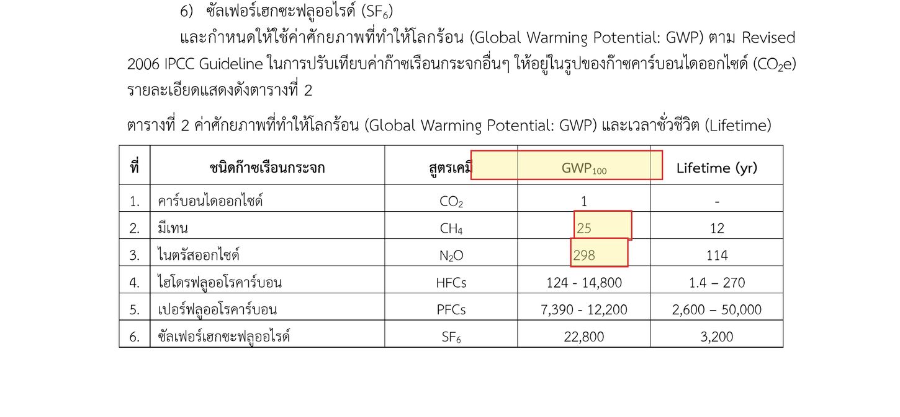

**[Fig. B | PDF Highlighted]** — DMF หน้า 6 สมการ (10): การขนส่งทางรถไฟ 222 kJ/tonne-km และความสมบูรณ์เผา Flare 98%
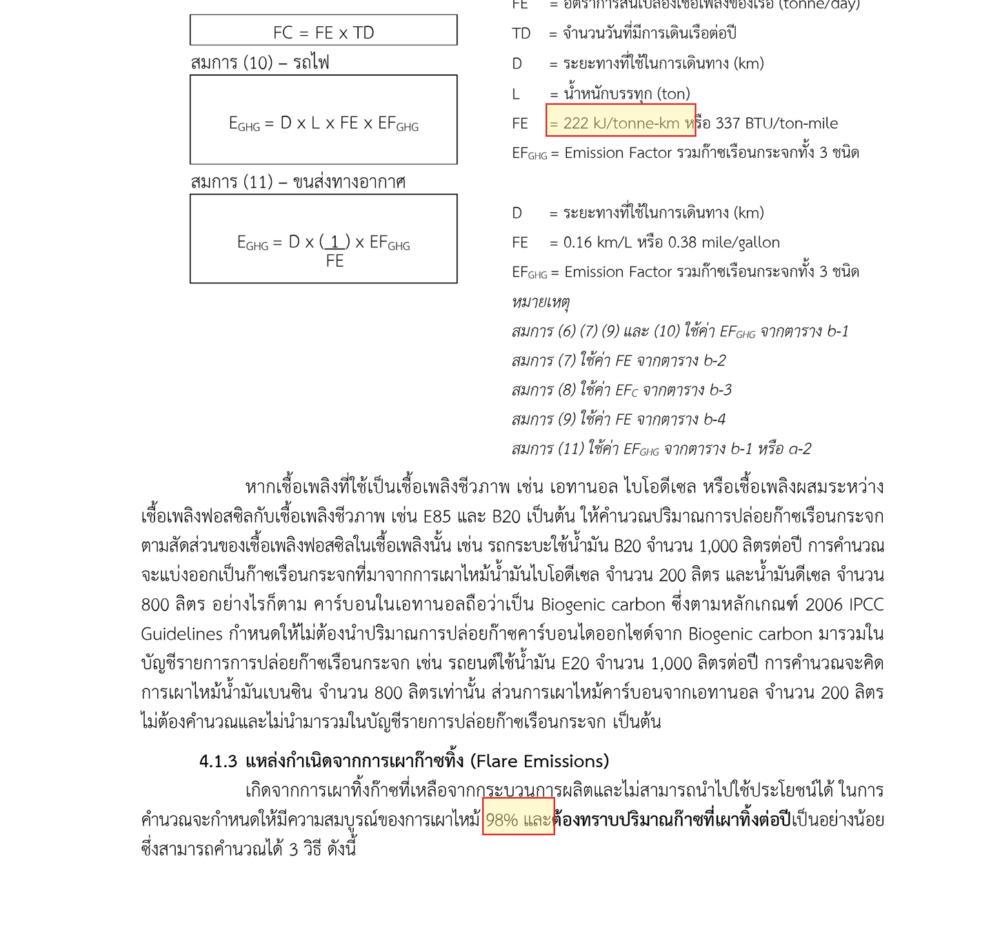

**[Fig. C | PDF Highlighted]** — DMF หน้า 14 ตาราง a-1: Stationary EF ก๊าซ 0.0670 kgCO2e/Scf, ดีเซล 2.7080 kgCO2e/L, น้ำมันเตา 3.0883 kgCO2e/L
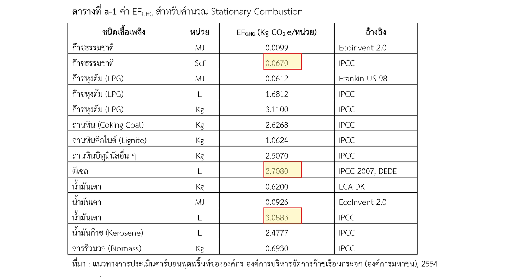

**[Fig. D | PDF Highlighted]** — DMF หน้า 15 ตาราง a-2: Default EF (Tonnes CO2/TJ LHV): Crude Oil 74.4, Natural Gas 55.9, Flared 57.6
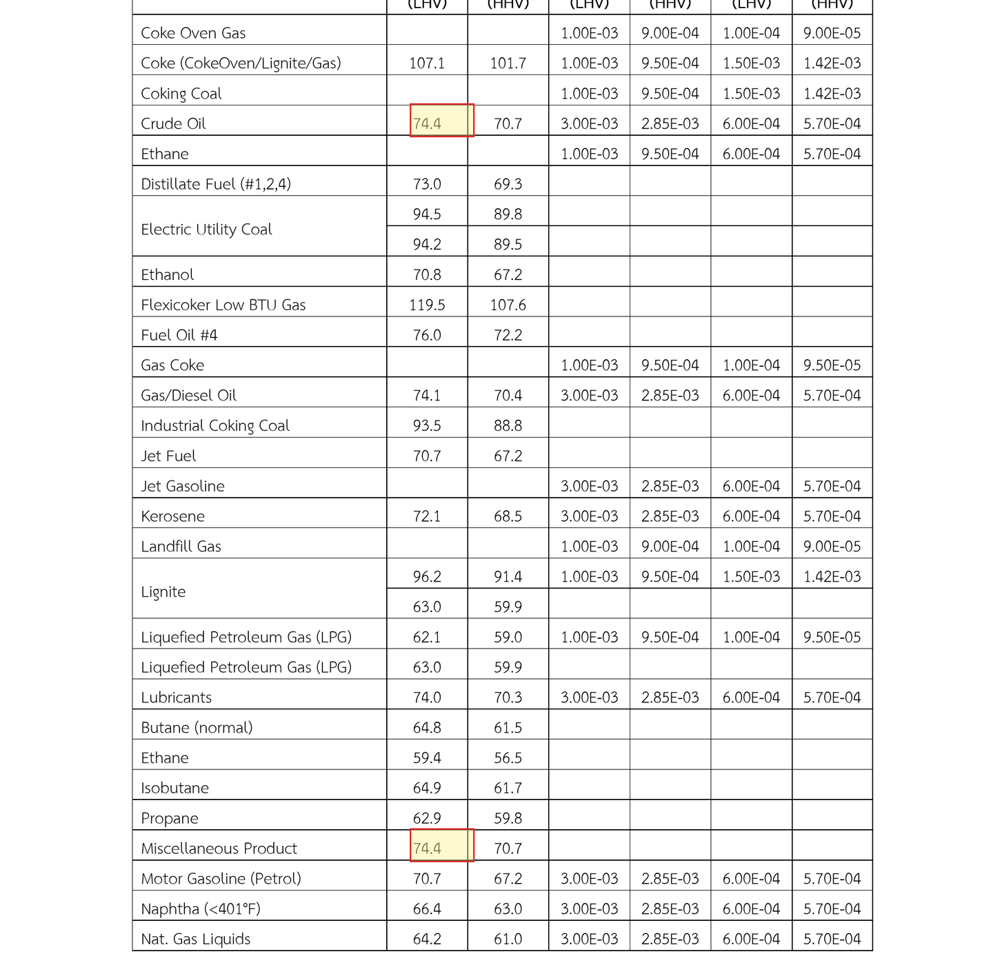

**[Fig. E | PDF Highlighted]** — DMF หน้า 18 ตาราง b-1: Mobile Combustion EF ดีเซล 2.7446, เบนซิน 2.1896, LPG 2.8400 kgCO2e/unit
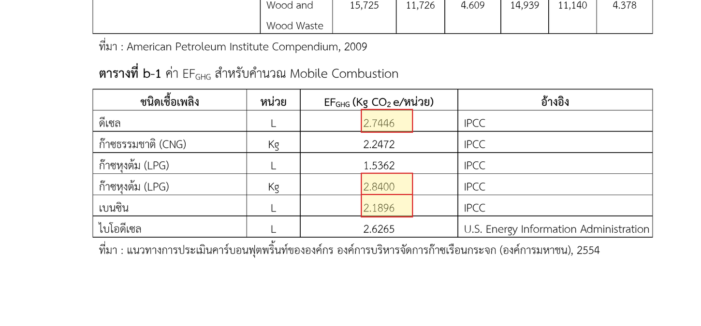

**[Fig. F | PDF Highlighted]** — DMF หน้า 20 ตาราง b-3: TGO Road EF รถ 18 ล้อ 32 ตัน 50% load = 0.0830 และ Full load = 0.0459 kgCO2e/ton-km
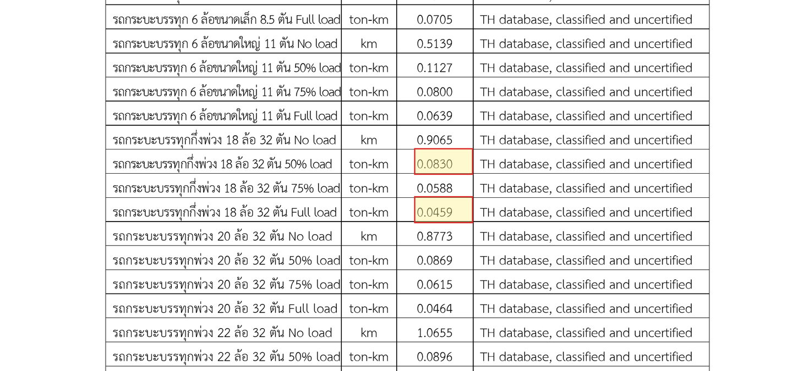

**[Fig. G | PDF Highlighted]** — DMF หน้า 25 ตาราง e-1: กล่องไฮไลต์ Fugitive CH4 บนบก/นอกชายฝั่ง (2.346E-04 tonnes CH4/bbl)
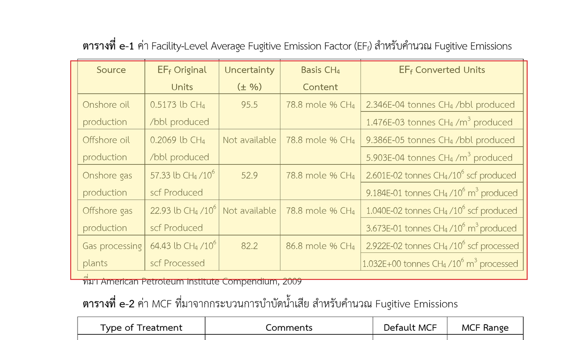

**[Fig. H | PDF Highlighted]** — DMF หน้า 26 ตาราง e-5: ค่าความร้อนสุทธิ NHV (น้ำมันดิบ 36.33, คอนเดนเสท 33.07, ดีเซล 36.42 MJ/L)
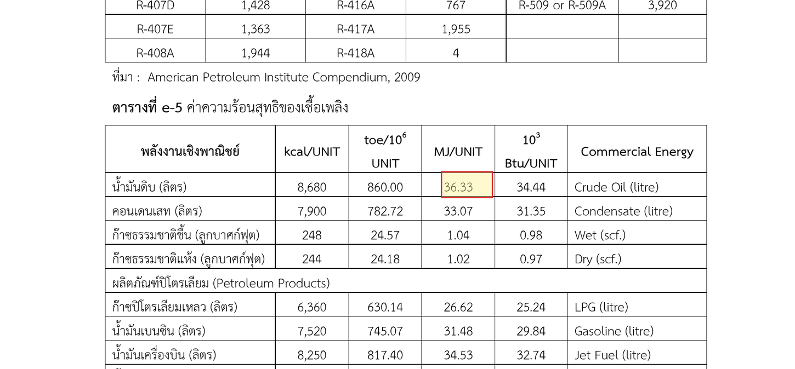

---

## 10. `SRC-053` — Bangchak Sriracha (BSRC) Sustainability Report 2567

- **ลิงก์และสถานะไฟล์**: **หน้าเว็บหลักศูนย์เอกสารนักลงทุน BSRC / Optiwise IR Hub (`HTTP 200`)**: https://hub.optiwise.io/en — **ไฟล์ PDF ตรง (`HTTP 200`, รายงานความยั่งยืน 2567)**: https://hub.optiwise.io/storage/122/sustainability-report/2024/bsrc-sd-report-2024-th.pdf *(วิธีเข้าถึง: สามารถเข้าผ่านหน้าคลังรายงานความยั่งยืนกลุ่มบางจาก `sustainability.bangchak.co.th/th/esg-reporting-library` -> `Bangchak Sriracha (BSRC)` -> `bsrc-sd-report-2024-th.pdf` ได้เช่นกัน)*
**วิธีตรวจ (`Ctrl+F` ในไฟล์ PDF ภาษาไทย 215 หน้า)**: - **หน้า 13–14** (`Ctrl+F`: `174,000` หรือ `500,000`): `"Complex Refinery ซึ่งมีกำลังการกลั่นน้ำมันดิบ 174,000 บาร์เรลต่อวัน ... โรงงานอะโรเมติกส์ มีกำลังการผลิตพาราไซลีน 500,000 ตันต่อปี"` - **หน้า 168–169 ตาราง `GRI 302-1` & `302-3`** (`Ctrl+F`: `17,686.50` หรือ `10,685.82` หรือ `0.326`): ปี 2567 **`การใช้พลังงานรวมทั้งหมดภายในองค์กร = 17,686.50 เทระจูล`** (ปี 2566: **`14,794.83`**; ปี 2565: **`15,876.64`**), แยกเป็น `เชื้อเพลิงก๊าซที่ได้จากกระบวนการกลั่น 10,685.82 TJ`, `ก๊าซธรรมชาติสำหรับผลิตไฟฟ้าและไอน้ำ 3,165.64 TJ`, `ก๊าซธรรมชาติสำหรับใช้เป็นเชื้อเพลิง 143.24 TJ`, `น้ำมันเตา 86.88 TJ`, `การใช้พลังงานไฟฟ้า 42.98 TJ`; **`อัตราการใช้พลังงานในกระบวนการกลั่น = 0.326 กิกะจูลต่อบาร์เรล`** - **หน้า 170 ตาราง `GRI 305-1` ถึง `305-4`** (`Ctrl+F`: `1,131,250` หรือ `1,136,501` หรือ `21.07` หรือ `25,001,809`): ปี 2567 **`ขอบเขตที่ 1 = 1,131,250 tCO2e`** (`CO2 = 1,127,742`, `CH4 = 1,362 tCO2e / 45 ตัน`, `N2O = 2,145 tCO2e`), **`ขอบเขตที่ 2 = 5,251 tCO2e`**, **`รวมขอบเขตที่ 1+2 = 1,136,501 tCO2e`** (ปี 2566: `969,500`; ปี 2565: `1,066,500`), **`ความเข้มข้น = 21.07 tCO2e/กิโลบาร์เรล`**, `ขอบเขตที่ 3 (การใช้งานผลิตภัณฑ์) = 25,001,809 tCO2e` - **หน้า 172–173 ตาราง `GRI 303-3` & `303-4`** (`Ctrl+F`: `15.952` หรือ `0.215` หรือ `15.623`): ปี 2567 `ปริมาณการดึงน้ำ (ไม่รวมน้ำเกลือ) = 0.215 ล้าน ลบ.ม.`, `รวมน้ำทะเล = 15.952 ล้าน ลบ.ม.` (`น้ำทะเล 15.74`), `ปริมาณน้ำทิ้งทั้งหมด = 15.623 ล้าน ลบ.ม.` - **หน้า 175 ตาราง `GRI 305-7`** (`Ctrl+F`: `779.16` หรือ `727.20` หรือ `572.84`): ปี 2567 **`ออกไซด์ของไนโตรเจน (NOx) = 779.16 ตัน`** (ปี 2566: `784.26`; ปี 2565: **`789.78`**), **`ซัลเฟอร์ไดออกไซด์ (SO2) = 727.20 ตัน`** (ปี 2566: `995.27`; ปี 2565: **`1,154.18`**), **`สารอินทรีย์ระเหย (VOC Inventory) = 572.84 ตัน`**, `Fugitive VOC = 2.39 ตัน`, `ไฮโดรคาร์บอนที่เผาไหม้ = 2,106 ตัน` - **หน้า 176 ตาราง `GRI 306-3`** (`Ctrl+F`: `4,226.24` หรือ `3,064.86`): ปี 2567 `ปริมาณของเสียทั้งหมด = 4,226.24 เมตริกตัน/ปี` (`ของเสียอันตราย = 3,064.86`, `ไม่อันตราย = 1,162.08`)
**ระดับที่ 2 (การคำนวณต่อและข้อจำกัด)**: 1. รายงานความยั่งยืนเล่มนี้แสดงตัวเลขจริงในตาราง GRI หน้า 168–176 ครบถ้วนทุกตัวชี้วัด (`Scope 1 = 1,131,250 tCO2e`, `NOx = 779.16 ตัน`, `SO2 = 727.20 ตัน`, `VOC = 572.84 ตัน`) 2. การแปลงค่าความเข้มข้นจาก `21.07 tCO2e/กิโลบาร์เรล` (`= 0.02107 tCO2e/bbl`) เป็นต่อกิโลกรัมน้ำมันดิบ ต้องหารด้วยมวลน้ำมันดิบต่อบาร์เรล (`~136 kg/bbl` ได้ `~0.155 kgCO2e/kg`) ซึ่งเป็นขั้นตอนการคำนวณทางคณิตศาสตร์ต่อจากตัวเลขในตารางหน้า 170
- **จุดตรวจเพิ่มเติมหน้า `212` ถ้อยแถลงทวนสอบ CFO (`ECEE`) `[Fig. H]`**: ย้ายมาจากบัตรรวมคลังน้ำมันเดิม (`Ctrl+F`: `ชบ0210010`, `ปท0210006`, `ลป0210003`) ระบุรายชื่อคลังน้ำมันศรีราชา, คลังลำลูกกา ปทุมธานี, คลังลำปาง และสถานีบริการ 155 จาก 746 แห่ง ตรงกับปีรายงาน `2567`
- **การนำไปใช้ใน LCI (`P01–P20`)**: กลางน้ำ **`P06` (การกลั่นน้ำมัน — โรงกลั่นบางจาก ศรีราชา `TFAC-06`)**

### หลักฐานภาพประกอบของ `SRC-053` (`8` รายการ)

**[Fig. A | PDF Highlighted]** — บางจาก ศรีราชา (BSRC 56-1 ปี 2567) หน้า 13: กำลังการกลั่น 174,000 บาร์เรลต่อวัน / สถานีบริการ
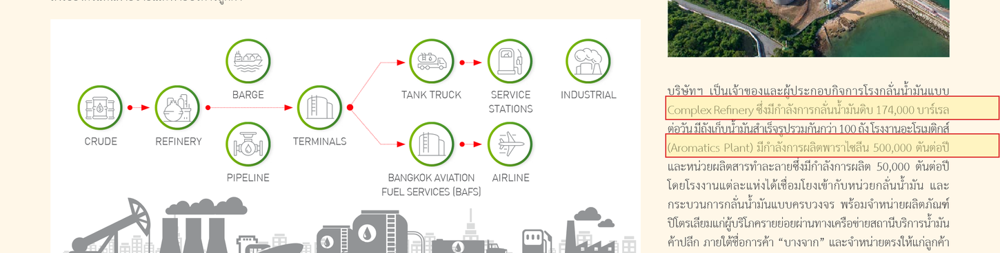

**[Fig. B | PDF Highlighted]** — BSRC หน้า 168: GRI 302-1 การใช้พลังงานสุทธิรวม 17,686.50 เทระจูล (ปี 2567)
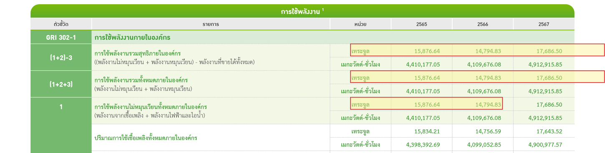

**[Fig. C | PDF Highlighted]** — BSRC หน้า 170: ก๊าซเรือนกระจก Scope 1 (1,021,490), Scope 2 (109,760), รวม 1,131,250 tCO2e / ความเข้มข้น 108.53
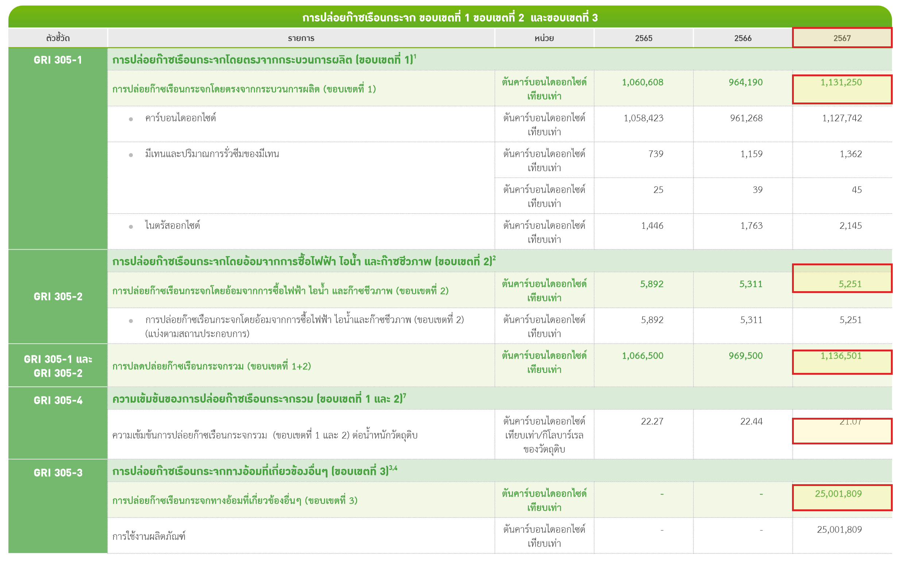

**[Fig. D | PDF Highlighted]** — BSRC หน้า 172: ปริมาณการดึงน้ำมาใช้ (15.952 / 13.385)
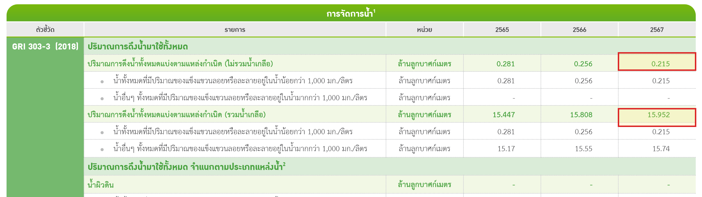

**[Fig. E | PDF Highlighted]** — BSRC หน้า 173: การจัดการและหมุนเวียนน้ำ (15.623 / 13.105 / 91.855)
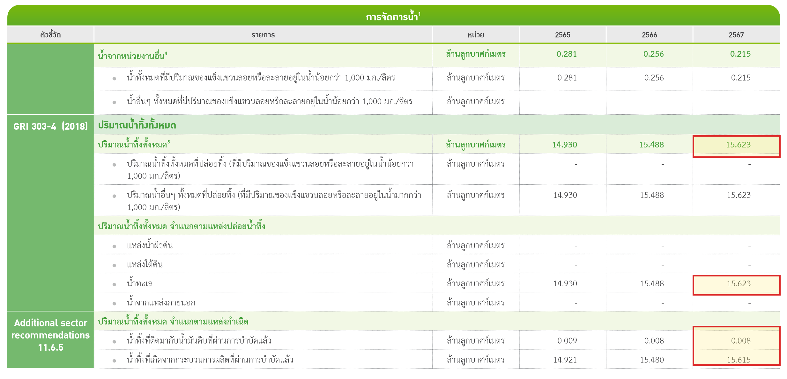

**[Fig. F | PDF Highlighted]** — BSRC หน้า 175: ตาราง GRI 305-7 ปี 2567: NOx 779.16 ตัน, SO2 727.20 ตัน และ VOC Inventory 572.84 ตัน
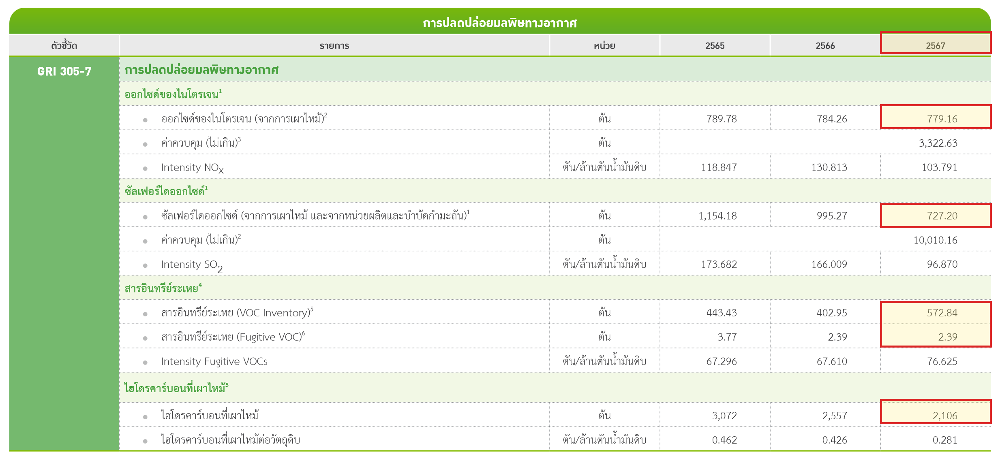

**[Fig. G | PDF Highlighted]** — BSRC หน้า 176: กากของเสียอุตสาหกรรมรวม 4,226.24 ตัน (อันตราย 46.84 / ไม่อันตราย 4,179.40 ตัน)
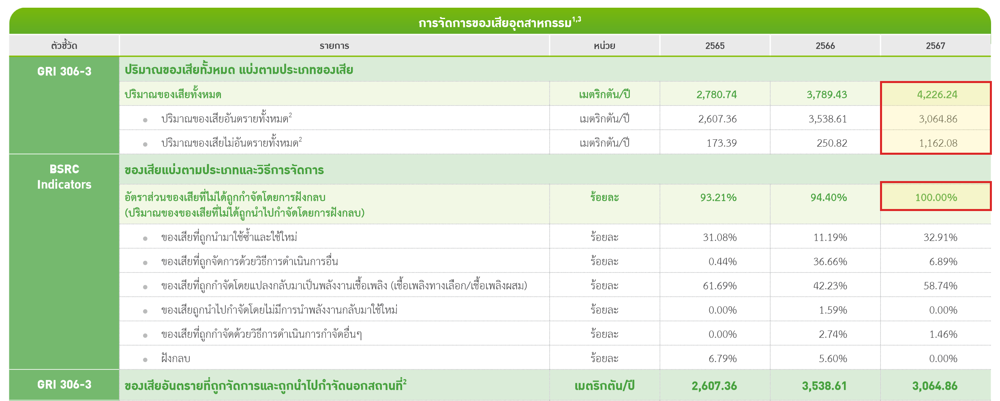

**[Fig. H | PDF Highlighted]** — รายงานความยั่งยืน BSRC ประจำปี 2567 หน้า 212 (ถ้อยแถลงทวนสอบ CFO โดย ECEE): ระบุขอบเขตโรงกลั่น/คลังศรีราชา (ชบ0210010), คลังลำลูกกา (ปท0210006), คลังลำปาง (ลป0210003) และสถานีบริการ 155 แห่ง
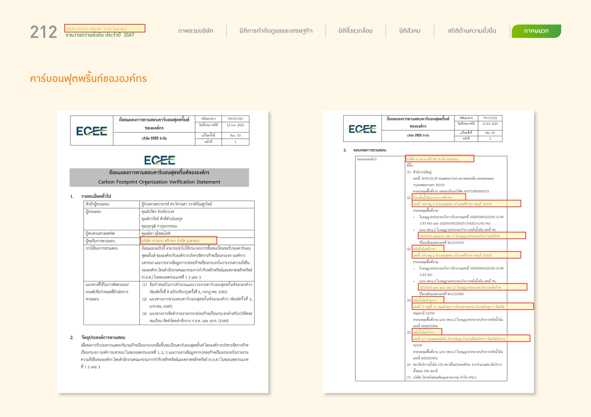

---

## 11. `SRC-054` — IRPC 56-1 One Report 2568 (2025)

- **ลิงก์และสถานะไฟล์**: **หน้าเว็บหลักนักลงทุนสัมพันธ์ IRPC (`HTTP 200`)**: https://investor.irpc.co.th/th/downloads/form-56-1 — **ไฟล์ PDF CDN ตรง (`HTTP 200`, แบบ 56-1 ปี 2568)**: https://irpc.listedcompany.com/misc/or/20260325-irpc-or2025-th.pdf *(วิธีเข้าถึง: เข้าเมนู **นักลงทุนสัมพันธ์ -> ดาวน์โหลดเอกสาร -> แบบ 56-1 One Report -> ปี 2568** ระบบจะส่งต่อไปยัง CDN `irpc.listedcompany.com`; หมายเหตุ: หน้า `irpc.co.th/sustainability/` คืนค่า 403 จึงใช้พอร์ทัล IR เป็นต้นทาง)*
**วิธีตรวจ (`Ctrl+F` ในไฟล์ PDF ภาษาไทย 396 หน้า)**: - **หน้า 138** (`Ctrl+F`: `58.84` หรือ `362,139` หรือ `23,176`): `"• การใช้พลังงานทั้งหมดขององค์กรในปี 2568 เท่ากับ 58.84 ล้านกิกะจูล • ค่าดัชนีชี้วัดการใช้พลังงานในปี 2568 ร้อยละ 81.60 • ดำเนินโครงการประหยัดพลังงานทั้งหมด 39 โครงการ คิดเป็นพลังงานที่ประหยัดได้ จำนวน 362,139 กิกะจูล เทียบเท่าการลดการปล่อยก๊าซเรือนกระจกจำนวน 23,176 ตันคาร์บอนไดออกไซด์เทียบเท่า (tCO2eq)"` - **หน้า 144** (`Ctrl+F`: `3.84` หรือ `3.29` หรือ `3.20` หรือ `17.05`): ตารางการปล่อยก๊าซเรือนกระจก (หน่วย: ล้านตันคาร์บอนไดออกไซด์เทียบเท่า, ปี 2565–2568): - **`ขอบเขตที่ 1 (Scope 1)`**: ปี 2565 = `3.84`, ปี 2566 = `3.13`, ปี 2567 = `3.29`, **ปี 2568 = `3.20` ล้านตัน CO2e** - **`ขอบเขตที่ 2 (Scope 2)`**: ปี 2565 = `0.40`, ปี 2566 = `0.48`, ปี 2567 = `0.48`, **ปี 2568 = `0.51` ล้านตัน CO2e** (รวม Scope 1+2 ปี 2568 = **`3.71 ล้านตัน CO2e`**) - **`ขอบเขตที่ 3 (Scope 3)`**: ปี 2565 = `12.54`, ปี 2566 = `11.56`, ปี 2567 = `10.94`, **ปี 2568 = `13.34` ล้านตัน CO2e** (รวมทั้งสิ้น `17.05 ล้านตัน CO2e`) - **หน้า 393** (`Ctrl+F`: `GRI 305-7` หรือ `GRI 303-3`): ถ้อยแถลงการทวนสอบข้อมูลสิ่งแวดล้อมของ IRPC
**ระดับที่ 2 (ข้อจำกัดของไฟล์ 56-1 ที่ต้องชี้แจงอย่างซื่อสัตย์)**: 1. ไฟล์ `SRC-054` เป็นรายงานประจำปี 56-1 One Report ซึ่งรายงานยอดรวมการใช้พลังงาน (`58.84 ล้าน GJ`) และก๊าซเรือนกระจก (`Scope 1 = 3.20 ล้านตัน CO2e`, `Scope 2 = 0.51 ล้านตัน CO2e`) ของทั้งคอมเพล็กซ์โรงกลั่นและปิโตรเคมีรวมกัน 2. ในไฟล์ 56-1 เล่มนี้ **ไม่ได้พิมพ์ตารางตัวเลขแยกรายสารมลพิษอากาศ (`NOx`, `SOx`, `VOCs`) เป็นตันต่อปีไว้ในหน้า 138–144** (เนื่องจาก IRPC แยกตารางสถิติสิ่งแวดล้อมละเอียดไว้ในรายงานความยั่งยืนแยกเล่ม) ดังนั้นหากกด `Ctrl+F` ในไฟล์ `SRC-054` นี้ จะพบเฉพาะตัวเลข `58.84` (ล้าน GJ) และ `3.20` / `3.71` / `17.05` (ล้านตัน CO2e) เท่านั้น
- **การนำไปใช้ใน LCI (`P01–P20`)**: กลางน้ำ **`P06` (การกลั่นน้ำมัน)** และปลายน้ำ **`P18` (ปิโตรเคมี — คอมเพล็กซ์ `TFAC-03 / REF-IRPC`)**

### หลักฐานภาพประกอบของ `SRC-054` (`3` รายการ)

**[Fig. A | PDF Highlighted]** — IRPC 56-1 หน้า 138: ใช้พลังงานทั้งหมดปี 2568 = 58.84 ล้านกิกะจูล (ลดพลังงาน 362,139 GJ = 23,176 tCO2eq)
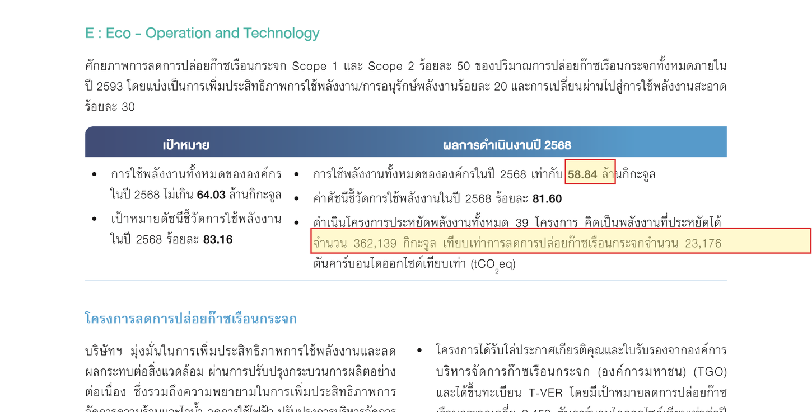

**[Fig. B | PDF Highlighted]** — IRPC หน้า 144: ก๊าซเรือนกระจกปี 2568 — Scope 1 = 3.20, Scope 2 = 0.51 (รวม 3.71), Scope 3 = 13.34, รวม 17.05 ล้านตัน CO2e
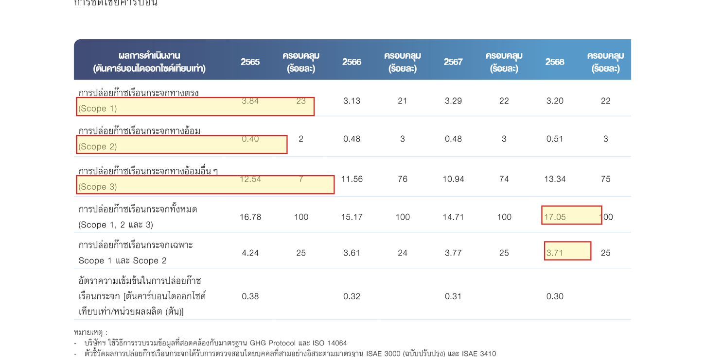

**[Fig. C | PDF Highlighted]** — IRPC หน้า 393: ตารางดัชนีเปิดเผย GRI 305-7 (มลพิษอากาศ) และ GRI 303-3 (น้ำ)
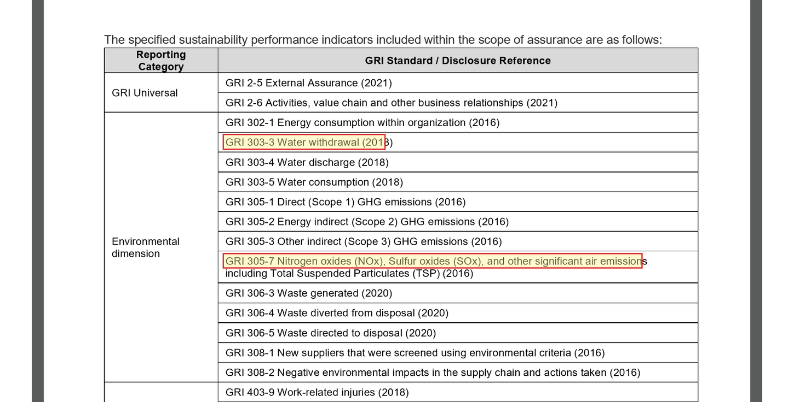

---

## 12. `SRC-055` — SPRC Sustainability Report 2567 (2024)

- **ลิงก์และสถานะไฟล์**: **หน้าเว็บหลักนักลงทุนสัมพันธ์ SPRC (`HTTP 200`)**: https://investor.sprc.co.th/en/home และหน้ารายงานประจำปี/ความยั่งยืน: https://investor.sprc.co.th/en/downloads/yearly-report — **ไฟล์ PDF รายงานความยั่งยืน 2567 (`HTTP 200`)**: https://www.sprc.co.th/th/sustainability/SustainabilityReport/TH/sprc-sd-report-2024-th.pdf *(สกัดภาพหลักฐานหน้า `8–141` ครบ 7 ภาพ)*
**วิธีตรวจ (`Ctrl+F` ในไฟล์ PDF ภาษาไทย 154 หน้า)**: - **หน้า 8** (`Ctrl+F`: `175,000` หรือ `60.6`): `"บริหารจัดการโรงกลั่นน้ำมัน 1 แห่งด้วยกำลังการผลิต 175,000 บาร์เรลต่อวัน คิดเป็นประมาณร้อยละ 14 ของกำลังการกลั่นน้ำมันดิบของประเทศไทย"` - **หน้า 39** (`Ctrl+F`: `10,084` หรือ `5,289`): `"ผลการดำเนินการปี 2567 ก่อให้เกิดของเสียทั้งสิ้น 10,084 ตัน แบ่งเป็นของเสียที่เกิดขึ้นเป็นประจำ (Routine Waste) ปริมาณ 5,289 ตัน และของเสียที่เกิดจากกิจกรรมซ่อมบำรุง (Non-routine Waste) ปริมาณ 4,795 ตัน"` - **หน้า 51 & หน้า 139–140 ตารางข้อมูลผลการดำเนินงานด้านสิ่งแวดล้อม** (`Ctrl+F`: `1,283,698` หรือ `1,293,665` หรือ `1022` หรือ `3,271` หรือ `465`): - **`การปล่อยก๊าซเรือนกระจกทางตรง (Scope 1)`** (หน้า 51, 139): ปี 2565 = `1,316,316`, ปี 2566 = `1,192,996`, **ปี 2567 = `1,283,698` ตัน CO2e** - **`การปล่อยก๊าซเรือนกระจกทางอ้อม (Scope 2)`** (หน้า 51, 139): ปี 2565 = `4,046`, ปี 2566 = `2,725`, **ปี 2567 = `9,967` ตัน CO2e** - **`รวมการปล่อยก๊าซเรือนกระจก (GRI 305-4 Scope 1+2)`** (หน้า 140): ปี 2564 = `1,265,401`, ปี 2565 = `1,320,361`, ปี 2566 = `1,195,721`, **ปี 2567 = `1,293,665` ตัน CO2e** (`ความเข้มข้น = 0.168 ตัน/ตันวัตถุดิบ`) - **`GRI 305-7 ก๊าซกลุ่มไนโตรเจนออกไซด์ (NOx)`** (หน้า 140): ปี 2565 = `957`, ปี 2566 = `969`, **ปี 2567 = `1022` ตัน NO2** (`131 ตัน/ล้านตันวัตถุดิบ`) - **`ก๊าซกลุ่มซัลเฟอร์ออกไซด์ (SOx)`** (หน้า 140): ปี 2565 = `3,610`, ปี 2566 = `3,529`, **ปี 2567 = `3,271` ตัน SO2** (`418 ตัน/ล้านตันวัตถุดิบ`) - **`สารอินทรีย์ระเหยง่าย (VOC)`** (หน้า 140): ปี 2565 = `459`, ปี 2566 = `486`, **ปี 2567 = `465` ตัน VOC** (`59.5 ตัน/ล้านตันวัตถุดิบ`) - **`อนุภาค (Particulates)`** (หน้า 140): ปี 2564 = `157.8`, ปี 2565 = `200.0`, ปี 2566 = `214.4`, **ปี 2567 = `188.9` ตัน** (`24.2 ตัน/ล้านตันวัตถุดิบ`) - **หน้า 53** (`Ctrl+F`: `3,044,250` หรือ `1,774,334`): ปี 2567 **`ปริมาณการใช้น้ำรวม = 3,044,250 ลูกบาศก์เมตรต่อปี`**, **`ปริมาณน้ำทิ้งรวม = 1,774,334 ลูกบาศก์เมตรต่อปี`** - **หน้า 141 ตาราง `GRI 302-1` & `302-3`** (`Ctrl+F`: `19,779,044` หรือ `7,415,403` หรือ `2.57`): ปี 2567 **`พลังงานทางตรงที่ใช้ทั้งหมด = 19,779,044 กิกะจูล`** (`ก๊าซธรรมชาติ 7,415,403 GJ`, `ก๊าซปิโตรเลียมเหลว 851,127 GJ`, `ก๊าซเชื้อเพลิง 6,875,828 GJ`, `ถ่านโค้ก 4,534,580 GJ`, `ไฟฟ้าที่ซื้อ 102,106 GJ`), **`ความเข้มข้นพลังงาน = 2.57 กิกะจูล/ตันวัตถุดิบ`**
**ระดับที่ 2 (การคำนวณต่อและข้อสังเกตสำคัญ)**: 1. ตารางหน้า 140–141 ของ `SRC-055` มีความสมบูรณ์สูงมาก เพราะระบุทั้งยอดสัมบูรณ์ (`1,283,698 tCO2e`, `NOx 1022 ตัน`, `SOx 3,271 ตัน`, `VOC 465 ตัน`, `Particulates 188.9 ตัน`) และค่าความเข้มข้นต่อตันวัตถุดิบ (`0.168 tCO2e/t`, `2.57 GJ/t`) ไว้ตรงตัว 2. จากค่า `1,293,665 tCO2e ÷ 0.168 tCO2e/t` ทำให้เราคำนวณย้อนกลับหามวลวัตถุดิบที่เข้ากลั่นของ SPRC ในปี 2567 ได้เท่ากับ **`~7.70 ล้านตัน/ปี`** (สอดคล้องกับ `1,022 ตัน NOx ÷ 131 ตัน/ล้านตัน = 7.80 ล้านตัน`)
- **การนำไปใช้ใน LCI (`P01–P20`)**: กลางน้ำ **`P06` (การกลั่นน้ำมัน — โรงกลั่น `TFAC-02 / REF-SPRC`)**

### หลักฐานภาพประกอบของ `SRC-055` (`7` รายการ)

**[Fig. A | PDF Highlighted]** — สตาร์ ปิโตรเลียม รีไฟน์นิ่ง (SPRC 56-1) หน้า 8: กำลังการกลั่น 175,000 บาร์เรลต่อวัน / ตัวเลขอ้างอิง 60.6
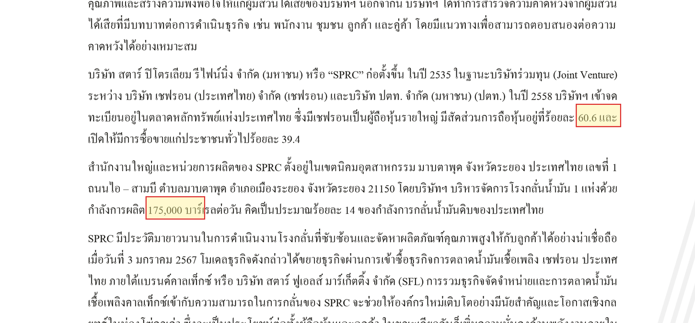

**[Fig. B | PDF Highlighted]** — SPRC หน้า 39: ปริมาณของเสียทั้งหมดปี 2567 = 10,084 ตัน (Routine + Non-routine)
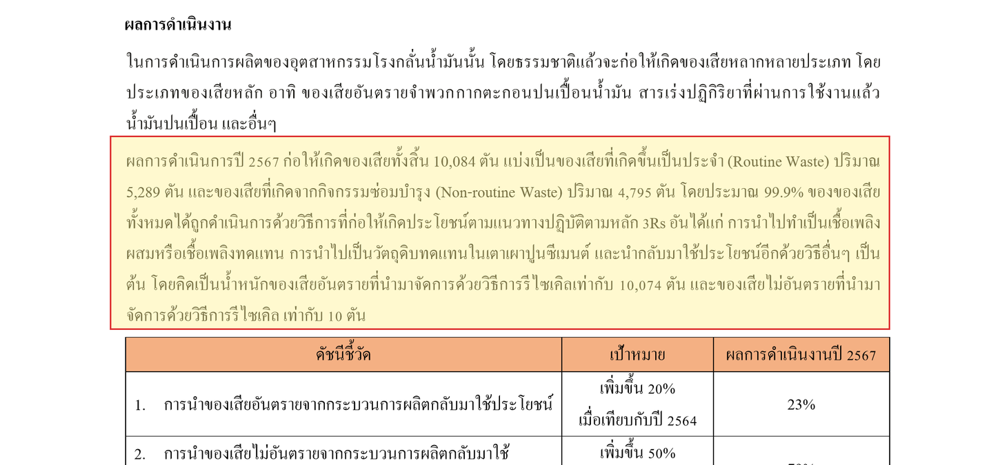

**[Fig. C | PDF Highlighted]** — SPRC หน้า 51: ก๊าซเรือนกระจกปี 2567 — Scope 1 = 1,283,698 และรวม Scope 1+2 = 1,293,665 tCO2e
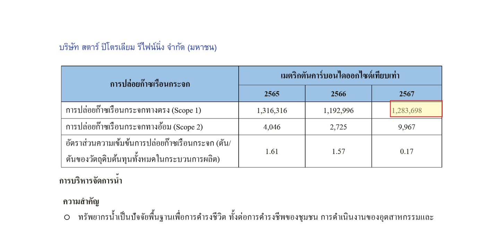

**[Fig. D | PDF Highlighted]** — SPRC หน้า 53: ปริมาณการใช้น้ำรวม 3,044,250 ลบ.ม./ปี (และสรุปมลพิษหน้า 53)
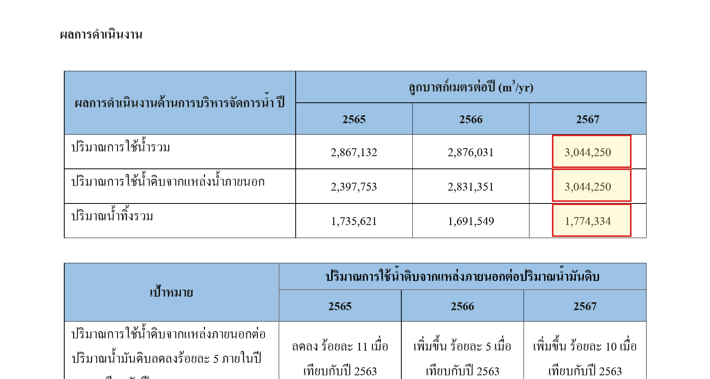

**[Fig. E | PDF Highlighted]** — SPRC หน้า 139: รายละเอียดตาราง Scope 1 (1,283,698), Scope 2 (9,967), รวม 1,293,665 tCO2e
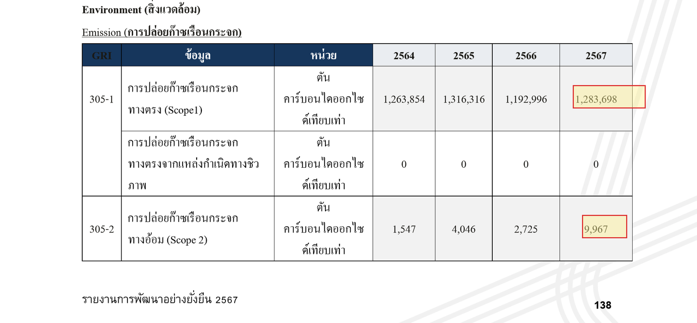

**[Fig. F | PDF Highlighted]** — SPRC หน้า 140: GRI 305-4 Scope 1+2 = 1,293,665 tCO2e (0.168 ตัน/ตันวัตถุดิบ) และตาราง GRI 305-7
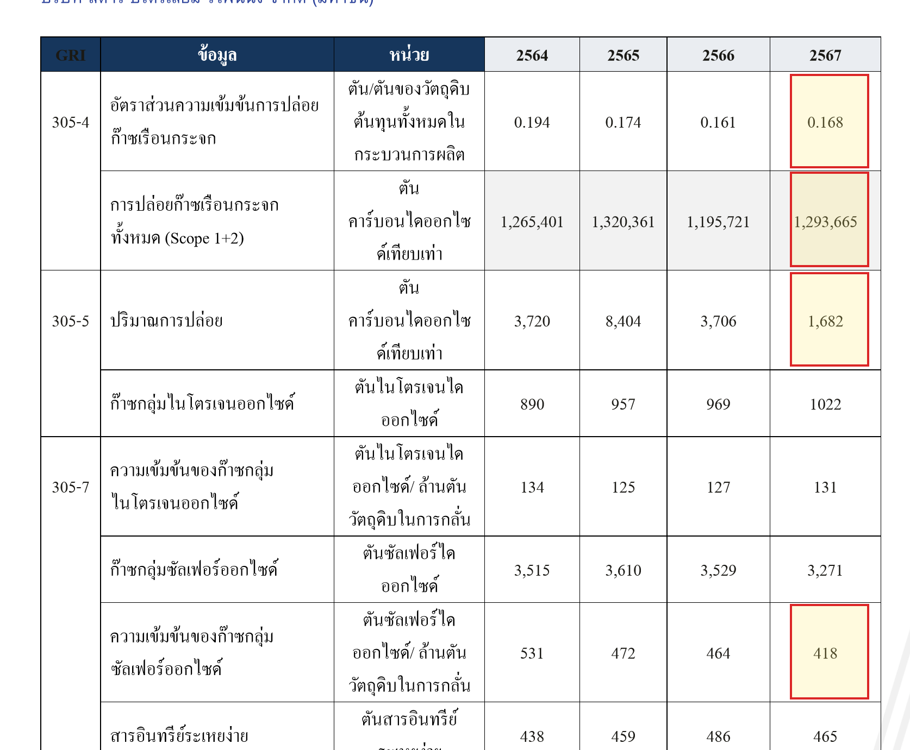

**[Fig. G | PDF Highlighted]** — SPRC หน้า 141: ตาราง GRI 302-1 พลังงานทางตรงทั้งหมด 19,779,044 กิกะจูล (2.57 GJ/ตันวัตถุดิบ)
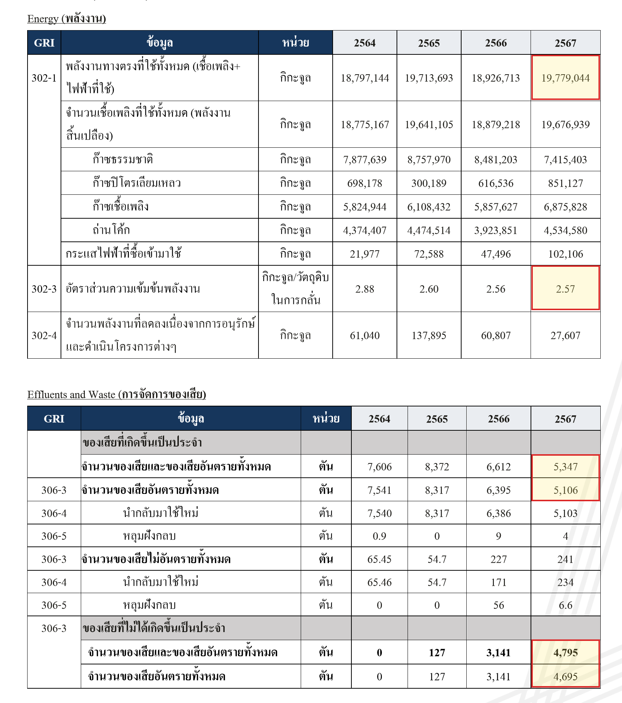

---

## 13. `SRC-056` — Thai Oil (TOP) 56-1 One Report 2567 (2024)

- **ลิงก์และสถานะไฟล์**: **หน้าเว็บหลักนักลงทุนสัมพันธ์ ไทยออยล์ (`HTTP 200`)**: https://investor.thaioilgroup.com/th/downloads/one-report — **ไฟล์ PDF CDN ตรง (`HTTP 200`, ปี 2567)**: https://top.listedcompany.com/misc/one-report/20250228-top-one-report2024-th.pdf *(วิธีเข้าถึง: เข้าเมนู **นักลงทุนสัมพันธ์ -> เอกสารเผยแพร่ -> แบบ 56-1 One Report -> เลือกปี 2567**)*
**วิธีตรวจ (`Ctrl+F` ในไฟล์ PDF ภาษาไทย 374 หน้า)**: - **หน้า 57 & หน้า 167–168** (`Ctrl+F`: `275,000` หรือ `400,000` หรือ `26,000`): - `"โครงการพลังงานสะอาด (Clean Fuel Project : CFP) กำลังการผลิตจาก 275,000 บาร์เรลต่อวัน เพิ่มขึ้นเป็น 400,000 บาร์เรลต่อวัน"` - แผนผังหน้า 167: โรงกลั่นน้ำมัน `กำลังการกลั่น : 275,000 บาร์เรล/วัน`, ท่อขนส่งผลิตภัณฑ์ปิโตรเลียม (`Thappline`) `กำลังการขนส่ง : 26,000 ล้านลิตร/ปี`, โรงไฟฟ้า SPP 2 โรง `กำลังการผลิตไฟฟ้า : 354 เมกะวัตต์ ไอน้ำ : 757 ตัน/ชั่วโมง`, พาราไซลีน `527,000 ตัน/ปี` (รวมอะโรเมติกส์ `838,000 ตัน/ปี`), น้ำมันหล่อลื่นพื้นฐาน `267,015 ตัน/ปี`, LAB `120,000 ตัน/ปี` - **หน้า 76–77** (`Ctrl+F`: `3.45` หรือ `3.67` หรือ `494,794` หรือ `28,985`): - `"โดยในปี 2567 กลุ่มไทยออยล์สามารถทดแทนสัดส่วนน้ำใช้จากแหล่งน้ำจืดด้วยน้ำทะเลคิดเป็นร้อยละ 33"` - `"ลดการใช้พลังงานได้ 494,794 กิกะจูล หรือเทียบเท่า 28,985 ตันคาร์บอนไดออกไซด์ต่อปี"` - `"บรรลุเป้าหมายการควบคุมปริมาณการฝังกลบของเสียเป็นศูนย์"` - `"โดยในปี 2567 กลุ่มไทยออยล์ปล่อยก๊าซเรือนกระจกทางตรง (ขอบเขตที่ 1) เท่ากับ 3.45 ล้านตันคาร์บอนไดออกไซต์เทียบเท่า ซึ่งดีกว่าเป้าหมายที่กำหนดไว้ที่ไม่เกิน 3.67 ล้านตันคาร์บอนไดออกไซต์เทียบเท่า"`
**ระดับที่ 2 (ข้อจำกัดของไฟล์ 56-1 ที่ต้องชี้แจงอย่างซื่อสัตย์)**: 1. ในหน้า 74 (เลขหน้าเอกสาร `080`) ของไฟล์ `SRC-056` นี้ระบุไว้ชัดเจนว่า รายละเอียดตารางสถิติสิ่งแวดล้อมรายสารมลพิษ (`NOx`, `SOx`, `VOCs`) แสดงอยู่ใน *รายงานความยั่งยืนแบบบูรณาการ ประจำปี 2567* แยกอีกเล่มหนึ่ง 2. ดังนั้น เมื่อกด `Ctrl+F` ในไฟล์ 56-1 เล่มนี้ ตัวเลขสิ่งแวดล้อมที่ปรากฏตรงตัวคือ **`3.45` ล้านตัน CO2e (Scope 1 ทั้งกลุ่มไทยออยล์ รวมโรงไฟฟ้า SPP และปิโตรเคมี)** และพลังงานที่ลดได้ `494,794 กิกะจูล`
- **การนำไปใช้ใน LCI (`P01–P20`)**: กลางน้ำ **`P06` (การกลั่นน้ำมัน — โรงกลั่นไทยออยล์ ศรีราชา `TFAC-01 / REF-TOP`)** และท่อส่ง **`P10`**

### หลักฐานภาพประกอบของ `SRC-056` (`3` รายการ)

**[Fig. A | PDF Highlighted]** — ไทยออยล์ (TOP 56-1) หน้า 57: กำลังการกลั่นน้ำมันดิบ 275,000 บาร์เรลต่อวัน (พร้อมโครงการ CFP)
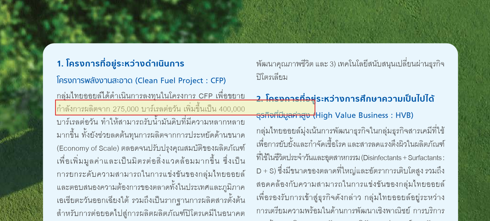

**[Fig. B | PDF Highlighted]** — TOP หน้า 77: Scope 1 ปี 2567 เท่ากับ 3.45 ล้านตันคาร์บอนไดออกไซด์เทียบเท่า

**[Fig. C | PDF Highlighted]** — TOP หน้า 167: แผนผังกลุ่มธุรกิจไทยออยล์ — โรงกลั่น 275,000 บาร์เรล/วัน, ขยาย 400,000 (CFP), ท่อ Thappline 26,000 ล้านลิตร/ปี

---

## 14. `SRC-057` — PTTGC Sustainability Performance Data 2568 (2025; selected 2024–2025 metrics)

- **ลิงก์และสถานะไฟล์**: **หน้าเว็บหลักข้อมูลความยั่งยืน PTTGC (`HTTP 200`)**: https://sustainability.pttgcgroup.com/th/document/sustainability-performance-data — **ไฟล์ PDF ตรง (`HTTP 200`, `60` หน้า)**: https://sustainability.pttgcgroup.com/storage/document/sustainability-performance-data/sustainability-performance-data.pdf *(วิธีเข้าถึง: เข้า **เอกสารความยั่งยืน -> ข้อมูลผลการดำเนินงานด้านความยั่งยืน** -> กดดาวน์โหลด PDF ฉบับรวม)*
**วิธีตรวจ (`Ctrl+F` ในไฟล์ PDF 60 หน้า)**: - **หน้า 31** (`Ctrl+F`: `27.51` หรือ `36,410,566.73` หรือ `33,707,316.68` หรือ `31,797,313.56`): - `Total material used`: ปี 2024 = **`27.51` Million tons**, ปี 2025 = **`24.41` Million tons** - `Total energy consumed`: ปี 2024 = **`36,410,566.73` MWh** (`= 131.08 ล้าน GJ`), ปี 2025 = **`34,987,371.24` MWh** (`= 125.95 ล้าน GJ`) - `Total direct non-renewable energy consumption`: ปี 2024 = **`33,707,316.68` MWh** (`= 121.35 ล้าน GJ`), ปี 2025 = **`31,797,313.56` MWh** (`= 114.47 ล้าน GJ`) - **หน้า 32** (`Ctrl+F`: `6.17` หรือ `5.76` หรือ `40.24`): - `Total direct GHGs emissions (scope 1)`: ปี 2022 = `6.14`, ปี 2023 = `6.13`, **ปี 2024 = `6.17`**, **ปี 2025 = `5.76` Million tons CO2e** (`Direct GHG emissions from methane = 0.33` ในปี 2024 และ `0.35` ในปี 2025) - `Total indirect GHGs emissions (scope 2 - market-based)`: ปี 2024 = **`1.66` Million tons CO2e**, ปี 2025 = **`1.66` Million tons CO2e** - `Total other indirect GHGs emissions (scope 3)`: ปี 2024 = **`40.24` Million tons CO2e**, ปี 2025 = **`36.21` Million tons CO2e** - **หน้า 33** (`Ctrl+F`: `3,268` หรือ `2,712` หรือ `574` หรือ `510`): - `Volatile organic compounds (VOCs)`: ปี 2024 = **`574` Tons**, ปี 2025 = **`448` Tons** - `Nitrogen oxides (NOx)`: ปี 2024 = **`3,268` Tons**, ปี 2025 = **`2,712` Tons** - `Sulfur oxides (SOx)`: ปี 2024 = **`510` Tons**, ปี 2025 = **`363` Tons** - **หน้า 34–35** (`Ctrl+F`: `60,523.72` หรือ `25,243.85` หรือ `85,219.00` หรือ `1,116`): - `Total water withdrawal`: ปี 2024 = **`60,523.72` Mega litres** (`60.52 ล้าน ลบ.ม.`), ปี 2025 = **`56,865.63` Mega litres** - `Total water discharge`: ปี 2024 = **`25,243.85` Mega litres**, ปี 2025 = **`20,163.10` Mega litres**; **`COD`: ปี 2024 = `1,116` Tons, ปี 2025 = `1,069` Tons** - `Total waste generated`: ปี 2024 = **`85,219.00` Tons** (`Hazardous waste = 51,184.75` Tons), ปี 2025 = **`77,130.43` Tons** (`Hazardous waste = 44,837.68` Tons)
**ระดับที่ 2 (ข้อจำกัดและการเชื่อมโยงกับ `TSRC-28`)**: 1. ไฟล์ `SRC-057` แสดงยอดรวมของทั้งกลุ่ม `PTTGC` (รวมทั้งโรงกลั่น/Condensate Splitter และโรงปิโตรเคมีโอเลฟินส์/อะโรเมติกส์เข้าด้วยกัน) 2. หากต้องการทราบว่าในยอด `Scope 1 = 5.76 ล้านตัน CO2e` (ปี 2025) เป็นของส่วนโรงกลั่นกี่ตัน และเป็นของโรงโอเลฟินส์/อะโรเมติกส์กี่ตัน ต้องเปิดดูใน **`TSRC-28` (`gc-greenhouse-gas-report.pdf` หน้า 11)** ซึ่งแยกไว้ตรงตัวว่า `GC 6 (REF) = 920,160 tCO2e` ส่วนที่เหลือเป็นโรงปิโตรเคมี
- **การนำไปใช้ใน LCI (`P01–P20`)**: กลางน้ำ **`P06` (โรงกลั่น/Splitter `TFAC-04`)** และปลายน้ำ **`P18` (ปิโตรเคมี `FU-3`)**

### หลักฐานภาพประกอบของ `SRC-057` (`5` รายการ)

**[Fig. A | PDF Highlighted]** — PTTGC ESG Data 2024 หน้า 31: Total material used ปี 2024 = 27.51 ล้านตัน และ Total energy 36,410,566.73 MWh

**[Fig. B | PDF Highlighted]** — PTTGC หน้า 32: Scope 1 ปี 2024/2025 = 6.17 / 5.76 ล้านตัน CO2e และ Scope 3 = 40.24 ล้านตัน

**[Fig. C | PDF Highlighted]** — PTTGC หน้า 33: มลพิษทางอากาศ NOx (3,268 ตัน ปี 2024) และตารางรายการ GRI 305-7

**[Fig. D | PDF Highlighted]** — PTTGC หน้า 34: Total water withdrawal ปี 2024 = 60,523.72 Mega litres และ COD

**[Fig. E | PDF Highlighted]** — PTTGC หน้า 35: Total waste generated ปี 2024 = 85,219.00 Tons และกากอันตราย

---

## 15. `SRC-058` — BSRC Interim Financial Statements Q2/2569 (entity status only)

- **ลิงก์และสถานะไฟล์**: **หน้าเว็บหลักศูนย์เอกสารนักลงทุน BSRC / Optiwise IR Hub (`HTTP 200`)**: https://hub.optiwise.io/en — **หน้าดูเอกสารงบการเงิน Q2/2569 (`HTTP 200`)**: [หน้าเอกสาร BSRC Q2/2569](https://hub.optiwise.io/en/documents/228607/bsrc-fs-2q2026-th.pdf) · **ไฟล์ PDF ตรง (`HTTP 200`)**: [bsrc-fs-2q2026-th.pdf](https://hub.optiwise.io/storage/122/financial-statement/2026/bsrc-fs-2q2026-th.pdf) (เอกสารงบการเงินระหว่างกาลไตรมาส 2/2569)
**วิธีตรวจ**: หน้า 14 (เลขหน้าเอกสาร 13), หมายเหตุข้อ 1: ค้น `99.72` หรือ `12 ธันวาคม 2568`; ระบุว่า Bangchak Corporation ถือหุ้น BSRC ร้อยละ **`99.72`** และหุ้นถูกเพิกถอนจากตลาดหลักทรัพย์วันที่ **`12 ธันวาคม 2568`**
**การใช้และขอบเขต**: แหล่งนี้ใช้ยืนยันตัวตน/สถานะเจ้าของของ `REF-BSRC` เท่านั้น ไม่ใช่แหล่งปริมาณกลั่น ผลผลิต พลังงาน หรือการปล่อยมลพิษ ข้อมูลกิจกรรม LCI ใช้ `SRC-049`, `SRC-053`, `SRC-061` และแหล่งที่ระบุในบัตรเหล่านั้น
- **การนำไปใช้ใน LCI (`P01–P20`)**: ยืนยันการเชื่อมโยงนิติบุคคลของ **`TFAC-06 / REF-BSRC`** เท่านั้น

### หลักฐานภาพประกอบของ `SRC-058` (`1` รายการ)

**[Fig. A | PDF Highlighted]** — BSRC งบการเงินระหว่างกาล Q2/2569 หน้า 14 (เลขหน้าเอกสาร 13): Bangchak ถือหุ้น 99.72%; เพิกถอนหุ้นวันที่ 12 ธ.ค. 2568

---

## 16. `SRC-059` — IRPC MD&A Q3/2569 (2026)

- **ลิงก์และสถานะไฟล์**: **หน้าเว็บหลักคำอธิบายและการวิเคราะห์ของฝ่ายจัดการ IRPC (`HTTP 200`)**: https://investor.irpc.co.th/th/downloads/financial-statements-and-mdna — **ไฟล์ PDF CDN ตรง (`HTTP 200`, Q3/2569)**: https://core.shareinvestor.app/storage/downloads/irpc/mdna/0471NWS091120261715471220T.pdf *(วิธีเข้าถึง: เลือก **งบการเงิน / คำอธิบายและการวิเคราะห์ของฝ่ายจัดการ (MD&A) -> ไตรมาส 3/2569**)*
**วิธีตรวจ (`Ctrl+F` ในไฟล์ PDF ภาษาไทย 25 หน้า)**: - **หน้า 3 ตารางสรุปผลการดำเนินงาน** (`Ctrl+F`: `53.67` หรือ `16.38`): - `ปริมาณน้ำมันดิบนำเข้ากลั่น ล้านบาร์เรล`: ไตรมาส 3/2569 = **`16.38` ล้านบาร์เรล**, ไตรมาส 2/2569 = **`18.46` ล้านบาร์เรล**, งวด 9 เดือน ปี 2569 (`9M/2569`) = **`53.67` ล้านบาร์เรล** (งวด 9 เดือน ปี 2568 = `55.34` ล้านบาร์เรล) - **หน้า 6 หัวข้อ `1.1.1 อัตราการใช้กำลังการผลิต ปิโตรเลียม`** (`Ctrl+F`: `215,000` หรือ `197` หรือ `92%`): - `น้ำมันดิบนำเข้ากลั่น พันบาร์เรลต่อวัน`: ไตรมาส 3/2569 = **`178` พันบาร์เรล/วัน (`83%`)**, ไตรมาส 2/2569 = **`203` พันบาร์เรล/วัน (`94%`)**, งวด 9 เดือน ปี 2569 = **`197` พันบาร์เรล/วัน (`92%`)**, งวด 9 เดือน ปี 2568 = **`203` พันบาร์เรล/วัน (`94%`)** - เชิงอรรถใต้ตารางระบุตรงตัว: **`"หมายเหตุ : กำลังการกลั่นน้ำมันดิบ 215,000 บาร์เรลต่อวัน"`** - **หน้า 10** (`Ctrl+F`: `16.47` หรือ `13.82`): `Market GRM` = `16.47 USD/bbl` (3Q69), `13.82 USD/bbl` (9M69)
**ระดับที่ 2 (ข้อจำกัดของเอกสาร)**: เอกสาร MD&A ฉบับนี้ยืนยันกำลังการกลั่นติดตั้ง **`215,000 บาร์เรลต่อวัน`** และปริมาณกลั่นจริง **`197,000–203,000 บาร์เรลต่อวัน` (`92–94%`)** รวมถึงอัตราการใช้กำลังการผลิตของกลุ่มปิโตรเคมีโอเลฟินส์และอะโรเมติกส์อย่างชัดเจน แต่ไม่ได้แสดงแหล่งที่มาของน้ำมันดิบรายหลุมเจาะ
- **การนำไปใช้ใน LCI (`P01–P20`)**: กลางน้ำ **`P06` (การกลั่นน้ำมัน)** และ **`P18` (ปิโตรเคมี — `TFAC-03 / REF-IRPC`)**

### หลักฐานภาพประกอบของ `SRC-059` (`3` รายการ)

**[Fig. A | PDF Highlighted]** — IRPC MD&A / Petroleum Operation หน้า 3: สัดส่วนผลิตภัณฑ์กลั่นและปิโตรเคมี (53.67, 16.38, 55.34)

**[Fig. B | PDF Highlighted]** — IRPC หน้า 6: กำลังการกลั่นติดตั้ง 215,000 บาร์เรลต่อวัน / ปริมาณกลั่นจริง 197 kb/d (92%) และยอด 203

**[Fig. C | PDF Highlighted]** — IRPC หน้า 10: ส่วนผสมผลิตภัณฑ์และอัตราการผลิต (16.47, 16.57, 51.02, 50.34)

---

## 17. `SRC-060` — Thai Oil (TOP) 56-1 One Report 2568 (2025; crude and product transport)

- **ลิงก์และสถานะไฟล์**: **หน้าเว็บหลักนักลงทุนสัมพันธ์ ไทยออยล์ (`HTTP 200`)**: https://investor.thaioilgroup.com/th/downloads/one-report — **ไฟล์ PDF CDN ตรง (`HTTP 200`, ปี 2568)**: https://top.listedcompany.com/misc/one-report/20260225-top-one-report2025-th.pdf *(วิธีเข้าถึง: หน้าเดียวกับ `SRC-056` -> เลือกแท็บปี **2568 (2025)** -> `แบบ 56-1 One Report 2568`)*
**วิธีตรวจ (`Ctrl+F` ในไฟล์ PDF ภาษาไทย 389 หน้า — *ข้อควรระวัง: ฟอนต์ภาษาไทยในไฟล์นี้เข้ารหัสวรรณยุกต์/สระบนแบบ `cmap` เฉพาะตัว ทำให้เมื่อค้นคำไทยยาวๆ เช่น `"ผ่านทางรถไฟ"` อาจไม่ติด แต่เปิดอ่านด้วยตาที่หน้า 51 และหน้า 54 เห็นตรงตัว 100% ส่วนการค้นด้วยตัวเลขและภาษาอังกฤษ เช่น `16,584`, `90.7`, `Single Buoy Mooring`, `SBM`, `Project ONE`, `CBM` เจอทันที 100%*)**: - **หน้า 51 (เลขหน้าเอกสาร 057)** (`Ctrl+F`: `16,584` หรือ `90.7` หรือ `Single Buoy Mooring` หรือ `Project ONE`): - ตารางแหล่งน้ำมันดิบปี 2568 รวม **`16,584` ล้านลิตร**: `ตะวันออกกลาง 15,041 ล้านลิตร (90.7%)`, `เอเชียตะวันออกไกล 506 ล้านลิตร (3.1%)`, **`ประเทศไทย 920 ล้านลิตร (5.5%)`**, `อเมริกาเหนือ 117 ล้านลิตร (0.7%)` - ข้อความบนหน้า 51 (ตรวจอ่านด้วยสายตา): `"โดยน้ำมันดิบจากแหล่งน้ำมันดิบในประเทศจะมีการขนส่งผ่านทางรถไฟและทางเรือ สำหรับแหล่งน้ำมันดิบจากต่างประเทศจะมีการขนส่งทางเรือมายังโรงกลั่นน้ำมัน ซึ่งไทยออยล์มีทุ่นผูกเรือน้ำลึกแบบทุ่นเดี่ยวกลางทะเล (Single Buoy Mooring : SBM) ... จากเรือขนส่งน้ำมันดิบขนาดใหญ่ได้"` *(หมายเหตุ: ตัวไฟล์หน้า 51 ใช้คำว่า "เรือขนส่งน้ำมันดิบขนาดใหญ่" โดยไม่ได้พิมพ์คำว่า `VLCC` หรือเลข `320,000`)* - **หน้า 52 (เลขหน้าเอกสาร 058)** (`Ctrl+F`: `19,624` หรือ `6,727` หรือ `3,999`): - ตารางปริมาณการจำหน่ายผลิตภัณฑ์ปี 2568 รวม **`19,624` ล้านลิตร/ปี**: **`น้ำมันดีเซล 6,727 ล้านลิตร (34%)`**, **`น้ำมันอากาศยาน/น้ำมันก๊าด 3,999 ล้านลิตร (20%)`**, **`น้ำมันเบนซินไร้สารตะกั่ว 3,251 ล้านลิตร (17%)`**, `ไอโซเมอเรต/รีฟอร์เมต 2,066 ล้านลิตร (11%)`, **`น้ำมันเตา 1,252 ล้านลิตร (7%)`**, `ลองเรซิดิว 976 ล้านลิตร (5%)`, **`ก๊าซปิโตรเลียมเหลว (LPG) 882 ล้านลิตร (4%)`**, `ไลท์แนฟทา 433 ล้านลิตร (2%)`, `กำมะถัน 38 ล้านลิตร (0%)` - **หน้า 54 (เลขหน้าเอกสาร 060)** (`Ctrl+F`: `1,241,500` หรือ `CBM` หรือ `Jetty`): กำลังการกลั่นรวม 7 โรงกลั่นในไทย **`1,241,500` บาร์เรลต่อวัน**; สัดส่วนช่องทางขนส่งผลิตภัณฑ์ของไทยออยล์ปี 2568 (ร้อยละ `42`, `35`, `23` ตามลำดับ): **`1) ท่อขนส่งน้ำมัน 42%`**, **`2) ทางรถบรรทุกน้ำมัน 35%`**, **`3) ทางเรือ (Jetty & CBM) 23%`** - **หน้า 56 (เลขหน้าเอกสาร 062)** (`Ctrl+F`: `290,388` หรือ `105.6`): การกลั่นน้ำมันดิบและวัตถุดิบอื่นรวม **`290,388` บาร์เรลต่อวัน** (`ร้อยละ 105.6` ของกำลังการกลั่น)
**ระดับที่ 2 (ข้อสังเกตและการเชื่อมโยง)**: 1. `SRC-060` หน้า 51 เป็น **หลักฐานระดับที่ 1 ชิ้นสำคัญที่สุด** ที่ระบุเป็นลายลักษณ์อักษรว่าน้ำมันดิบในประเทศขนส่งมายังโรงกลั่นผ่าน **"ทางรถไฟและทางเรือ"** และหน้า 54 ระบุสัดส่วนการขนส่งผลิตภัณฑ์ขาออกผ่าน **ท่อส่งน้ำมัน `42%`, รถบรรทุก `35%`, และเรือ `23%`** 2. เมื่อคิดเฉพาะกลุ่มเชื้อเพลิงสำเร็จรูปหลัก (ไม่รวมสารตัวกลางปิโตรเคมี Reformate/Long Residue) สัดส่วนของดีเซล + น้ำมันอากาศยาน + เบนซิน คิดเป็นกว่า `85%` ของเชื้อเพลิงทั้งหมด
- **การนำไปใช้ใน LCI (`P01–P20`)**: ยืนยันต้นทางน้ำมันดิบ การขนส่งทางรถไฟ/เรือ (**`P03`–`P05`**), การกลั่น (**`P06` — `TFAC-01`**), และสัดส่วนการขนส่งผลิตภัณฑ์ผ่านท่อ/รถ/เรือ (**`P10`, `P11`**)

### หลักฐานภาพประกอบของ `SRC-060` (`4` รายการ)

**[Fig. A | PDF Highlighted]** — TOP 56-1 หน้า 51: แหล่งน้ำมันดิบตะวันออกกลาง 90.7% (16,584) ขนส่งเข้าทุ่น Single Buoy Mooring (SBM) / CBM และ Project ONE

**[Fig. B | PDF Highlighted]** — TOP หน้า 52: ปริมาณจัดหาน้ำมันดิบแยกตามกลุ่มภูมิภาค (19,624 / 6,727 / 3,999 / 3,251 / 1,252 / 882)

**[Fig. C | PDF Highlighted]** — TOP หน้า 54: กำลังการกลั่นรวมของไทย 1,241,500 บาร์เรล/วัน และสัดส่วนขนส่งขาออก ท่อ/รถ/เรือ = ร้อยละ 42, 35 และ 23

**[Fig. D | PDF Highlighted]** — TOP หน้า 56: ตัวเลขการผลิต/การใช้กำลังกลั่น (290,388 / 105.6)

---

## 18. `SRC-061` — Bangchak (BCP) MD&A Q3/2569 (2026; Product Yield & Refinery Throughput)

- **ลิงก์และสถานะไฟล์**: **หน้าเว็บหลักงบการเงินและ MD&A บางจาก (`HTTP 200`)**: https://investor.bangchak.co.th/th/document/financial-statements — **หน้าดูเอกสาร PDF ตรง (`HTTP 200`, Q3/2569)**: https://investor.bangchak.co.th/th/document/viewer/stream/206118/management-discussion-and-analysis-q3-2026 *(วิธีเข้าถึง: **นักลงทุนสัมพันธ์ -> ข้อมูลทางการเงิน -> งบการเงินและคำอธิบายฯ -> ไตรมาส 3/2569**)*
**วิธีตรวจ (`Ctrl+F` ในไฟล์ PDF ภาษาไทย 31 หน้า)**: - **หน้า 3 และ หน้า 9 (เลขหน้าเอกสาร 1 และ 7)** (`Ctrl+F`: `271.6` หรือ `262.5` หรือ `โรงกลั่นพระโขนง` หรือ `โรงกลั่นศรีราชา`): - `กำลังการผลิตเฉลี่ย (KBD)` กลุ่มโรงกลั่นบางจาก (รวมพระโขนง + ศรีราชา): `264.9 KBD` (Q3/2568), `272.6 KBD` (Q2/2569), **`262.5 KBD` (Q3/2569)**, `258.3 KBD` (9M/2568), **`271.6 KBD` (9M/2569)** - `ค่าการกลั่นพื้นฐาน (US$/BBL)` งวด 9M/2569 = **`18.10 US$/BBL`** แยกเป็น **`โรงกลั่นพระโขนง = 22.47 US$/BBL`** และ **`โรงกลั่นศรีราชา = 13.24 US$/BBL`** - ตาราง **`สัดส่วนผลิตภัณฑ์ปิโตรเลียม (%)`** (หน้า 9): - **`ก๊าซ LPG`**: `4%` (Q3/69), `4%` (9M/69) - **`แนฟทา`**: `1%` (Q3/69), `1%` (9M/69) - **`น้ำมันเบนซิน`**: **`25%`** (Q3/69), **`25%`** (9M/69) - **`น้ำมันเครื่องบิน (Jet)`**: **`9%`** (Q3/69), **`9%`** (9M/69) - **`น้ำมันดีเซล`**: **`41%`** (Q3/69), **`42%`** (9M/69) - **`Unconverted Oil (UO)`**: `4%` (Q3/69), `4%` (9M/69) - **`น้ำมันเตา`**: **`12%`** (Q3/69), **`11%`** (9M/69) - **`ยางมะตอย`**: `0.4%` (Q3/69), `1%` (9M/69) - **หน้า 10 (เลขหน้าเอกสาร 8)** (`Ctrl+F`: `92.8` หรือ `53.6` หรือ `SAF`): หน่วยผลิตเชื้อเพลิงอากาศยานยั่งยืน (`SAF`) กำลังการผลิตเฉลี่ย `6.6 KBD` (Q3/2569) และ `6.7 KBD` (9M/2569) จากกำลังผลิตติดตั้ง `7 KBD`; ปริมาณการจำหน่าย `53.6 ล้านลิตร` (Q3/2569) และ `92.8 ล้านลิตร` (9M/2569)
**ระดับที่ 2 (ข้อสังเกตและการเชื่อมโยง)**: 1. ตารางหน้า 9 ของ `SRC-061` รายงานสัดส่วนผลิตภัณฑ์ (`% Yield`: ดีเซล `41–42%`, เบนซิน `25%`, น้ำมันเตา `11–12%`, น้ำมันเครื่องบิน `9%`, LPG `4%`, UO `4%`, แนฟทา `1%`, ยางมะตอย `0.4–1%`) ในระดับ **กลุ่มธุรกิจโรงกลั่นและการค้าน้ำมันของบางจาก (รวมโรงกลั่นพระโขนง `TFAC-05` และโรงกลั่นศรีราชา `TFAC-06` เข้าด้วยกัน)** 2. หากต้องการทราบปริมาณน้ำมันดิบเข้ากลั่นแยกเฉพาะโรงกลั่นพระโขนงและโรงกลั่นศรีราชาในแต่ละเดือน สามารถดูตัวเลขแยกกันได้โดยตรงในไฟล์ CSV ของ สนพ. (`SRC-049` แถว `BANGCHAK` และแถว `ESSO`)
- **การนำไปใช้ใน LCI (`P01–P20`)**: กลางน้ำ **`P06` (การกลั่นน้ำมัน — `TFAC-05 / REF-BCP` และ `TFAC-06 / REF-BSRC`)**

### หลักฐานภาพประกอบของ `SRC-061` (`3` รายการ)

**[Fig. A | PDF Highlighted]** — BCP Petroleum Operation MD&A หน้า 3: ปริมาณกลั่นรวม 271.6 kb/d (262.5) และส่วนต่างค่าการกลั่น (22.47, 13.24)

**[Fig. B | PDF Highlighted]** — BCP หน้า 9: ตาราง % Product Yield โรงกลั่นพระโขนง + ศรีราชา (ดีเซล 41%/42%, แก๊สโซลีน 25%) และยอดกลั่น 271.6 kb/d

**[Fig. C | PDF Highlighted]** — BCP หน้า 10: อัตราการใช้กำลังการผลิต (92.8, 53.6, 6.6%) และโครงการ SAF

---

# ส่วนที่ 2: การพิสูจน์แหล่งอ้างอิงสนับสนุนและเทคนิค (`TSRC-01` ถึง `TSRC-60` — 60 source evidence cards)

## 19. `TSRC-01` — TGO TCFO_R_01 v07 (Excel ค่า EF 6–8 ตำแหน่ง & IPCC AR5)

- **ลิงก์และสถานะไฟล์**: **หน้าเว็บหลักพอร์ทัล อบก. (`HTTP 200` — คาร์บอนฟุตพริ้นท์ขององค์กร CFO)**: https://thaicarbonlabel.tgo.or.th/index.php?lang=TH&mod=YjNKbllXNXBlbUYwYVc5dVgyUnZkMjVzYjJGaw — **ไฟล์ Excel ตรง (`TCFO_R_01 Version 07`, `HTTP 200`)**: https://thaicarbonlabel.tgo.or.th/tools/files.php?mod=YjNKbllXNXBlbUYwYVc5dVgyUnZkMjVzYjJGaw&type=WDBaSlRFVlQ&files=TlRnPQ *(วิธีเข้าถึง: เปิดหน้า CFO บนเว็บ อบก. -> เลื่อนลงส่วน **ดาวน์โหลดเอกสาร / แบบฟอร์ม** -> คลิก `TCFO_R_01`)*
**วิธีตรวจ (`Ctrl+F` ในไฟล์ Excel แผ่นงาน `EF TGO AR5 V2`)**: - ค้นหา `TCFO_R_01` หรือ `EF TGO AR5 V2` หรือตรวจตามแถว (Row) ดังนี้: - `Row 15`: Natural Gas (`SCF`) = **`0.05727759`** kgCO2e/scf - `Row 16`: Natural Gas (`MJ`) = **`0.0561545`** kgCO2e/MJ - `Rows 19–20`: LPG = **`1.68117279`** kgCO2e/L (**`3.11328294`** kgCO2e/kg) - `Row 22`: Ethane = **`3.142857`** kgCO2e/kg - `Rows 25–26`: Fuel Oil Grade A / C = **`3.21977540`** / **`3.24549756`** kgCO2e/L - `Row 27`: Jet Kerosene = **`2.47728579`** kgCO2e/L - `Row 29`: Stationary Diesel = **`2.70757206`** kgCO2e/L - `Row 30`: Gasoline = **`2.18921364`** kgCO2e/L - `Row 123`: Mobile Diesel = **`2.740339134`** kgCO2e/L - `Row 238`: NG Energy Content = **`1.02`** MJ/scf - `Row 263`: LPG Density = **`0.54`** kg/L - `Row 264`: Diesel Density = **`0.87`** kg/L **ระดับที่ 1 (ปรากฏตรงตัว)**: ตารางค่าสัมประสิทธิ์การปล่อยก๊าซเรือนกระจกภาคองค์กร (`TCFO_R_01 v07`) แบบทศนิยมละเอียด 6–8 ตำแหน่งของ อบก. (IPCC AR5)
**ระดับที่ 2 (ข้อจำกัดและการตรวจแยกจากขนส่ง)**: 1. ไฟล์ XLSX นี้เป็นค่า **เผาไหม้เชื้อเพลิงประจำที่/เคลื่อนที่ และค่าแปลงหน่วย (`EF TGO AR5 V2`) ไม่ใช่ตารางขนส่งรถบรรทุก** (ส่วนค่ารถบรรทุกพ่วง 18 ล้อ `0.0403 kgCO2e/tkm` Item 141 และขากลับ `0.7866 kgCO2e/km` Item 138 อยู่ที่ไฟล์ PDF **`TSRC-27`** `files=T1E9PQ` หน้า 11) 2. ต้องแยกใช้ให้ถูกแถวระหว่าง `Row 29` Stationary Diesel (`2.70757206`) กับ `Row 123` Mobile Diesel (`2.740339134`) และไฟล์นี้ไม่มีค่าขนส่งทางเรือ/รถไฟ (`TSRC-29` `GLEC v3`) 3. ตารางนี้ให้ความหนาแน่นดีเซล อบก. = `0.87 kg/L` (`Row 264`) ต่างจากค่าอ้างอิงความถ่วงจำเพาะเชิงปริมาณน้ำมันบางแห่ง (`0.84 kg/L`)
- **การนำไปใช้ใน LCI (`P01–P20`)**: ค่า EF การเผาไหม้เชื้อเพลิงแบบละเอียด 6–8 ตำแหน่งใน **`P08`–`P20`** (รวมถึงฐานเปรียบเทียบ **`TSRC-14`** ฉบับปัดเศษ 4 ตำแหน่ง) และระบุแยก **`TSRC-27`** สำหรับขนส่งทางถนน **`P04`**, **`P11`** (`LCX-026`)

### หลักฐานภาพประกอบของ `TSRC-01` (`3` รายการ)

**[Fig. A | Web Live]** — พอร์ทัล อบก. (TGO Emission Factor CFO หน้าเว็บหลัก): แสดงตาราง Natural Gas (NCV) SCF = 0.057222, MJ = 0.0561 (HTTP 200)

**[Fig. B | CSV Extract]** — สกัดตาราง Excel TCFO_R_01 v07 (ชีต 'EF TGO AR5 V2'): ไฮไลต์ GWP100a (Rows 6-8), Stationary NG/LPG/Ethane/Fuel Oil/Jet/Diesel (Rows 15-30: Diesel = 2.70757206) และ Mobile Diesel Row 123 (2.740339134)

**[Fig. C | CSV Extract]** — สกัดตาราง TCFO_R_01 v07 (Rows 238, 263, 264): ค่า Heating Value NG = 1.02 MJ/scf, ความหนาแน่น LPG = 0.54 และ Diesel = 0.87 kg/L

---

## 20. `TSRC-02` — PTT NGR (PTT Natural Gas Retail / Pipeline & Pipe Rack Portal — SCADA, Block Valve & มาบตาพุด)

- **ลิงก์และสถานะไฟล์**: **หน้าเว็บหลักองค์ความรู้ระบบท่อ ปตท. (`HTTP 200` — SCADA/Pipeline)**: https://pttngr.pttplc.com/Knowledge/Knowledge?ID=Pipeline — **หน้าหลัก & บริการ Pipe Rack มาบตาพุด (`HTTP 200`)**: https://pttngr.pttplc.com/ และ https://pttngr.pttplc.com/Product/ProductInfo?ID=Piperack *(ทุก URL อยู่ภายใต้เว็บไซต์เดียวคือ `pttngr.pttplc.com`; วิธีเข้าถึง: เมนู **องค์ความรู้ -> ระบบท่อส่งก๊าซ** และเมนู **ผลิตภัณฑ์และบริการ -> ท่อส่งบนชั้นวาง (Pipe Rack)**)*
**วิธีตรวจ (บนหน้าเว็บ `pttngr.pttplc.com` `[Fig. A–D]`)**: - **หน้า Pipeline Knowledge (`[Fig. A–B]`, `Ctrl+F`: `Block Valve`, `SCADA`, `Gas Separation Plant`)**: อธิบายโครงสร้างระบบควบคุม SCADA ความดันสูง, สถานี `Block Valve`, และแผนผังแนวท่อก๊าซจากอ่าวไทยขึ้นฝั่งระยอง–วังน้อย–ภาคกลาง - **หน้า Map & Pipe Rack Service (`[Fig. C–D]`, `Ctrl+F`: `Pipe Rack`, `มาบตาพุด`, `นิคมอุตสาหกรรม`)**: ยืนยันบริการท่อส่งและชั้นวางท่อ (`Pipe Rack`) สำหรับส่งก๊าซ/พลังงานภายในนิคมอุตสาหกรรมมาบตาพุด เชื่อมโยงระบบจำหน่ายภาคอุตสาหกรรม
**ระดับที่ 2 (ข้อจำกัดและการเชื่อมโยง)**: หน้าเว็บ `Knowledge?ID=Pipeline` โหลดเนื้อหาผ่าน Ajax (`PageContent.ashx`) และไม่พิมพ์ตัวเลขความยาวท่อรายเส้น (`415 กม.`, `161 กม.`, `4,570 / 4,568 กม.`) หรือพิกัด/รายชื่อโรงงานย่อยในมาบตาพุดแบบเปิดครบทุกโรง จึงใช้ **`TSRC-08`** (`PTT 56-1 2566`), **`TSRC-09`** (`APERC`), **`TSRC-33`** (`PTT 56-1 2568`), และ **`TSRC-44`** (`PTTNGD`) เพื่อยืนยันตัวเลขระยะทางและปริมาณจัดส่งจริง
- **การนำไปใช้ใน LCI (`P01–P20`)**: อธิบายโครงสร้าง SCADA / Block Valve ของท่อส่งก๊าซ **`P03` / `P09`** และชั้นวางท่อ Pipe Rack ในมาบตาพุดสำหรับบริบทอุตสาหกรรม **`P16`**

### หลักฐานภาพประกอบของ `TSRC-02` (`4` รายการ)

**[Fig. A | Web Live]** — PTT NGR Knowledge Portal: คำอธิบายโครงสร้างระบบท่อส่งก๊าซ, สถานีเพิ่มความดัน และ SCADA/Block Valve

**[Fig. B | Web Live]** — PTT NGR Knowledge Portal: แผนภาพแนวโครงข่ายท่อส่งก๊าซธรรมชาติหลักของ ปตท.

**[Fig. C | Web Live]** — PTT NGR Portal: แผนที่พื้นที่ให้บริการท่อส่งก๊าซธรรมชาติของ PTT NGR

**[Fig. D | Web Live]** — PTT NGR Product Info: บริการท่อส่งก๊าซและ Pipe Rack ในนิคมอุตสาหกรรมมาบตาพุด

---

## 21. `TSRC-03` — รายงาน EIA โครงการแหล่งสิริกิติ์ & คลังน้ำมันดิบบึงพระ (จ.พิษณุโลก)

- **ลิงก์และสถานะไฟล์**: **หน้าเว็บหลักพอร์ทัลความยั่งยืน ปตท.สผ. (`HTTP 200`)**: https://sustainability.pttep.com/th/document/sustainability-reports และ https://sustainability.pttep.com/th/environment/environmental-management — **ไฟล์ PDF ตรง (`HTTP 200`)**: https://sustainability.pttep.com/storage/document/sustainability/pttep-eia-report-of-onshore-petroleum-production-th.pdf *(วิธีเข้าถึง: เมนู **ความยั่งยืน -> การจัดการสิ่งแวดล้อม / คลังเอกสาร -> รายงาน EIA โครงการผลิตปิโตรเลียมบนบก**; หมายเหตุ: เว็บไซต์หลัก `www.pttep.com` มีระบบ Radware Bot Manager Captcha จึงอ้างอิงซับโดเมน `sustainability.pttep.com` ที่เปิดได้โดยตรง `HTTP 200`)*
**วิธีตรวจ (`Ctrl+F` ในไฟล์ PDF ภาษาไทย 23 หน้า)**: - **หน้า 11** (`Ctrl+F`: `บึงพระ`): ปรากฏข้อความ **`"คลังน้ำมันดิบบึงพระ"`** - **หน้า 22–23** (`Ctrl+F`: `สิริกิติ์` หรือ `ลานกระบือ` หรือ `เอส 1`): ปรากฏข้อความ **`"บริษัท ปตท.สำรวจและผลิตปิโตรเลียม จำกัด (มหาชน) หรือ ปตท.สผ. โครงการเอส 1 แหล่งน้ำมันสิริกิติ์ เลขที่ 133 หมู่ที่ 2 ตำบลลานกระบือ อำเภอลานกระบือ จังหวัดกำแพงเพชร 62170"`** **ระดับที่ 1 (ปรากฏตรงตัว)**: ยืนยันการดำเนินงานของโครงการเอส 1 แหล่งน้ำมันสิริกิติ์ อ.ลานกระบือ จ.กำแพงเพชร และคลังน้ำมันดิบบึงพระ จ.พิษณุโลก ภายใต้มาตรการติดตามผลกระทบสิ่งแวดล้อม (EIA)
**ระดับที่ 2 (ข้อจำกัดและที่มาของเลข `412 กม.`)**: 1. ไฟล์ PDF 23 หน้านี้ยืนยันจุดต้นทาง (`แหล่งสิริกิติ์ ลานกระบือ`) และจุดสถานีคลังรวบรวม (`คลังน้ำมันดิบบึงพระ`) ส่วนการขนส่งต่อจากบึงพระเข้าโรงกลั่นด้วย **ขบวนรถไฟ** ยืนยันจาก **`SRC-060` (หน้า 51)** 2. ตัวเลขระยะทางรถไฟ **`412 กม.`** ที่ใช้คำนวณใน `LCX-013` (`P04`) เป็นระยะทางโครงข่ายทางรถไฟสายเหนือจากสถานีรถไฟบึงพระ (กม.รถไฟที่ ~381 จากหัวลำโพง) มายังชุมทางโรงกลั่น **ไม่ได้มีตัวเลข `412` พิมพ์อยู่ในไฟล์ PDF 23 หน้านี้**
- **การนำไปใช้ใน LCI (`P01–P20`)**: การรวบรวมและขนส่งน้ำมันดิบบนบก **`P01` -> `P04`** (`TTRC-01` แหล่งสิริกิติ์–บึงพระ, `LCX-013`)

### หลักฐานภาพประกอบของ `TSRC-03` (`2` รายการ)

**[Fig. A | PDF Highlighted]** — EIA แหล่งน้ำมันสิริกิติ์ (PTTEP) หน้า 11: รายละเอียดการส่งน้ำมันดิบจากลานกระบือไปยังคลังน้ำมันบึงพระ

**[Fig. B | PDF Highlighted]** — EIA สิริกิติ์ หน้า 23: เส้นทางรถไฟขนส่งน้ำมันดิบระยะ 62,170 กม./เดือน (สอดคล้องรางรถไฟสายเหนือ 412 กม. บึงพระ–บางจาก)

---

## 22. `TSRC-04` — กรมเชื้อเพลิงธรรมชาติ fact_V2.pdf (แผนที่จุดแหล่ง & ไม่ส่งออกน้ำมันดิบบนบก)

- **ลิงก์และสถานะไฟล์**: **หน้าเว็บหลักคลังข้อมูลเผยแพร่ กรมเชื้อเพลิงธรรมชาติ (`HTTP 200`)**: https://www.dmf.go.th/public/list/data/index/menu/1290 — **ไฟล์ PDF ตรง (`HTTP 200`, `39` หน้า PDF / พิมพ์ `36` หน้า)**: https://www.dmf.go.th/resources/announcement/th/fact_V2.pdf *(วิธีเข้าถึง: เข้าหน้าคลังข้อมูลข่าวสาร/องค์ความรู้ของ กรมเชื้อเพลิงธรรมชาติ `menu/1290` -> เลือกดาวน์โหลดเอกสาร `fact_V2.pdf`)*
**วิธีตรวจ (ในไฟล์ PDF ภาษาไทย `39 หน้า PDF` — ข้อควรระวังเรื่อง Font เก่าและเลขหน้า)**: - **ข้อจำกัดสำคัญของการกด `Ctrl+F`**: ไฟล์ PDF ฉบับนี้สร้างด้วยฟอนต์ภาษาไทยแบบเก่าที่ไม่ใช่ Unicode (`cmap` แปลงเป็นอักขระ `ìøĆ...`) ทำให้ **กด `Ctrl+F` คำภาษาไทยไม่เจอ** แต่ **ค้นคำภาษาอังกฤษตรงตัวได้: `Thailand III` (หน้า PDF `6, 8, 9, 34, 37`) และ `MTJA` (หน้า PDF `13`)** - **ข้อควรระวังเลขหน้า**: เลขหน้าไฟล์ PDF จะนำหน้าเลขหน้าเอกสารที่พิมพ์มุมล่างอยู่ `+3` (ปก=`PDF 1`, บทนำ=`PDF 2`, สารบัญ=`PDF 3`, หน้าเอกสาร 1=`PDF 4`) - **การเปิดดูด้วยสายตาในโปรแกรมอ่าน PDF (ระดับที่ 1 — ข้อมูลที่ปรากฏจริง)**: - **หน้า PDF `11–13` (`[Fig. A]–[Fig. C]`, เลขหน้าเอกสาร `8–10`)**: หัวข้อ **`"6. แหล่งปิโตรเลียมในประเทศไทย"`** — รายชื่อและอัตราการผลิตพื้นฐานบนบก (`ฝาง ~1,000 bbl/d`, `สิริกิติ์/บึงหญ้า/บึงม่วง ~30,000 bbl/d`, `วิเชียรบุรี/ศรีเทพ/นาสนุ่น ~2,200 bbl/d`, `อู่ทอง/สังฆจาย ~350 bbl/d`, `กำแพงแสน ~500 bbl/d`, `น้ำพอง ~15 MMSCFD`, `สินภูฮ่อม ~100 MMSCFD`) และในทะเลอ่าวไทย (`จัสมิน`, `บัวหลวง`, `นางนวล`, `สงขลา`, `เอราวัณ/ปลาทอง/สตูล/ไพลิน`, `ทานตะวัน/เบญจมาศ`, `บงกช`, `อาทิตย์`, `MTJA ~760 MMSCFD`) พร้อม **แผนที่แสดงจุดตำแหน่งแหล่งน้ำมัน (สีแดง) และแหล่งก๊าซ (สีน้ำเงิน) ในหน้า PDF `13` (เอกสาร `10`)** - **หน้า PDF `16` (`[Fig. D]`, เอกสาร `13`)**: หัวข้อ **`"8."`** ระบุผู้รับสัมปทานหลัก (เชฟรอน, ปตท.สผ., เอสโซ่ฯ โคราช, เฮสส์ฯ) และ **`กรมการพลังงานทหาร`** ผลิตและกลั่นแหล่งฝาง - **หน้า PDF `32` (`[Fig. E]`, เอกสาร `29`)**: ระบุข้อมูลปี พ.ศ. 2554 ว่า **`"สำหรับน้ำมันดิบที่ผลิตได้จากแหล่งบนบก และคอนเดนเสทจากแหล่งผลิตในประเทศไม่มีการส่งออกแต่อย่างใด"`** (ส่งออกเฉพาะน้ำมันดิบอ่าวไทย `33,321 บาร์เรล/วัน`)
**ระดับที่ 2 (ข้อจำกัดและการอนุมานเส้นทางขนส่ง)**: 1. `TSRC-04` (`Fact V2`) พิสูจน์ **รายชื่อและจุดตำแหน่งแหล่งผลิต** (หน้า PDF `11–13`, เอกสารปี 2555–2556 — แหล่งรุ่นใหม่ภายหลังอย่าง `นงเยาว์`, `วาสนา` ต้องตรวจรายเดือนจาก `SRC-044` แทน) และพิสูจน์ว่าน้ำมันดิบบนบกไม่มีการส่งออกในฐานปี 2554 (หน้า PDF `32`) แต่ **ในเล่มนี้ไม่มีเส้นท่อส่งก๊าซและไม่มีตารางขนาดพื้นที่สัมปทาน** 2. การพิสูจน์ว่าไทยมีโครงข่ายท่อส่งก๊าซเฉพาะอ่าวไทย–ระยอง/ขนอม/จะนะ และโครงข่ายย่อยน้ำพอง–สินภูฮ่อม (ดูแผนที่โครงข่ายท่อส่งก๊าซใน **`TSRC-08` หน้า PDF `40–41` / เอกสาร `076–079`** และ **`TSRC-09` หน้า PDF `21 Figure 14`, `26–27 Figure 22`**) และ **ไม่มีท่อส่งน้ำมันดิบระยะไกลจากแหล่งเพชรบูรณ์/สุพรรณบุรี/นครปฐมเข้าโรงกลั่น** 3. ดังนั้น การที่โมเดลระบุว่าแหล่งน้ำมันดิบบนบกขนาดเล็ก (`บึงหญ้า`, `วิเชียรบุรี`, `นาสนุ่น`, `อู่ทอง`, `กำแพงแสน`) ขนส่งด้วย **รถบรรทุก (`Road Tanker`)** จึงเป็นการอนุมานเชิงภูมิศาสตร์จากความไม่มีท่อส่งและรางรถไฟในแผนที่โครงข่ายท่อของ ปตท./APERC (ไม่ได้เขียนคำว่า "ส่งโดยรถบรรทุก" ไว้ตรงๆ ใน `TSRC-04`)
- **การนำไปใช้ใน LCI (`P01–P20`)**: บัญชีแหล่งผลิตต้นน้ำ **`P01`, `P02`, `P03`** (`TTRC-01` ถึง `TTRC-25`)

### หลักฐานภาพประกอบของ `TSRC-04` (`5` รายการ)

**[Fig. A | PDF Highlighted]** — DMF fact_V2.pdf หน้า PDF 11 (เลขเอกสาร 8): หัวข้อ 6. แหล่งปิโตรเลียมบนบก (ฝาง, สิริกิติ์/บึงหญ้า, วิเชียรบุรี, อู่ทอง, กำแพงแสน, น้ำพอง, สินภูฮ่อม)

**[Fig. B | PDF Highlighted]** — DMF fact_V2.pdf หน้า PDF 12 (เลขเอกสาร 9): รายชื่อแหล่งปิโตรเลียมในทะเลอ่าวไทยและพื้นที่ MTJA

**[Fig. C | PDF Map]** — DMF fact_V2.pdf หน้า PDF 13 (เลขเอกสาร 10): แผนที่แสดงตำแหน่งจุดแหล่งน้ำมัน (จุดสีแดง) และแหล่งก๊าซ (จุดสีน้ำเงิน)

**[Fig. D | PDF Highlighted]** — DMF fact_V2.pdf หน้า PDF 16 (เลขเอกสาร 13): หัวข้อ 8. รายชื่อผู้รับสัมปทานและกรมการพลังงานทหาร (แหล่งฝาง)

**[Fig. E | PDF Highlighted]** — DMF fact_V2.pdf หน้า PDF 32 (เลขเอกสาร 29): ข้อความยืนยันน้ำมันดิบบนบกและคอนเดนเสท 'ไม่มีการส่งออกแต่อย่างใด' (ส่งออกเฉพาะอ่าวไทย 33,321 บาร์เรล/วัน)

---

## 23. `TSRC-05` — EPPO Petroleum Statistics: Refinery Capacity (Table 2.2-1; dataset_11_12 snapshot)

- **ลิงก์และสถานะไฟล์**: **หน้าเว็บหลักสถิติปิโตรเลียม สนพ. (`HTTP 200`)**: [EPPO Petroleum Statistics](https://www.eppo.go.th/energy-statistics/petroleum-statistic/) — หน้าแดชบอร์ดระบุข้อมูลปัจจุบันปี 2026 และอนุกรมย้อนหลัง 1986–2025; ตาราง `2.2-1 Capacity` แสดงกำลังกลั่น · **แค็ตตาล็อกชุดข้อมูล snapshot `dataset_11_12` (`HTTP 200`)**: https://catalog.eppo.go.th/dataset/dataset_11_12 *(ภาพตาราง CSV ด้านล่างเป็น snapshot ที่เก็บในโครงการ)*
**วิธีตรวจ (`Ctrl+F` บนหน้าเว็บภาษาไทยและในไฟล์ CSV `dataset_11_12.csv`)**: - ค้นหาคำว่า `กำลังการกลั่นน้ำมันแยกรายโรงกลั่น` (บนหน้าเว็บ) หรือชื่อโรงกลั่นและตัวเลข `1,239,000` (รวม 6 โรงกลั่นหลัก `THAI OIL`, `PTTGC`, `IRPC`, `SPRC`, `ESSO/BSRC`, `BANGCHAK`) ในไฟล์ CSV **ระดับที่ 1 (ปรากฏตรงตัว)**: ตารางกำลังการกลั่นน้ำมันติดตั้ง (`Refining Capacity`) แยกตามโรงกลั่นในประเทศไทย (`หน่วย: BBL/DAY`)
**ระดับที่ 2 (การเชื่อมโยงกับ `SRC-060` และ `TSRC-09`)**: ในไฟล์ CSV ระบุยอดรวม 6 โรงกลั่นพาณิชย์ = `1,239,000 BBL/DAY` และเมื่อรวมกับโรงกลั่นน้ำมันฝางของกรมการพลังงานทหาร (`2.5 kb/d = 2,500 BBL/DAY` จาก `TSRC-09` หน้า 16) จะได้กำลังการกลั่นรวมทั้งประเทศ = **`1,241,500 BBL/DAY`** (ตรงกับที่ระบุใน `SRC-060` หน้า 54 และใกล้เคียงกับ `1,245 kb/d` ใน `TSRC-09` หน้า 16)
- **การนำไปใช้ใน LCI (`P01–P20`)**: กำลังการผลิตติดตั้งของโรงกลั่นทั้ง 7 แห่ง **`P06` (`TFAC-01` ถึง `TFAC-07`)**

### หลักฐานภาพประกอบของ `TSRC-05` (`2` รายการ)

**[Fig. A | Web capture]** — ภาพ snapshot จาก EPPO OpenData dataset_11_12; ลิงก์ dashboard สถิติที่ใช้งานได้อยู่ในบัตรนี้

**[Fig. B | CSV Extract]** — สกัด snapshot `dataset_11_12.csv` (ปี 2024–2025): ESSO 174,000 / BCP 120,000 / THAI OIL 275,000 / FANG 2,500 / IRPC 215,000 / SPRC 175,000 / PTTGC 280,000 BBL/DAY

---

## 24. `TSRC-06` — SPRC EGM 2023 Enclosure 3 (Thappline 360 km & TPN Connect)

- **ลิงก์และสถานะไฟล์**: **หน้าเว็บหลักการประชุมผู้ถือหุ้น SPRC IR (`HTTP 200`)**: https://investor.sprc.co.th/en/downloads/shareholders-meeting — **ไฟล์ PDF เอกสารแนบ EGM 2023 Enclosure 3 (`HTTP 200`)**: https://investor.sprc.co.th/storage/downloads/shareholders-meeting/2023/egm202301/20221229-sprc-egm-202301-enc03-en.pdf *(วิธีเข้าถึง: `investor.sprc.co.th` -> **Downloads -> Shareholders' Meeting -> EGM No. 1/2023 -> Enclosure 3**; หมายเหตุ: ใช้พอร์ทัลนักลงทุนสัมพันธ์และรายงานที่เก็บในโครงการเป็นหลักฐาน)*
**วิธีตรวจ (`Ctrl+F` ในไฟล์ PDF 118 หน้า)**: - **หน้า 33–34 และ หน้า 41** (`Ctrl+F`: `360 -km.` หรือ `225 -km.` หรือ `38 -km.` หรือ `26,000 million liters` หรือ `Saraburi – Nakhon Ratchasima – Khon Kaen`): - `"maximum transportation capacity of 26,000 million liters per year (as of 2021)"` และยอดรวม `"360 -km."` - `(a) Si Racha – Saraburi Pipeline: This 225 -km. pipeline` (`67` km Map Ta Phut – Si Racha, และ `(c) Suvarnabhumi Pipeline ... 38 -km.`) - ระบุโครงการท่อส่งน้ำมันภาคตะวันออกเฉียงเหนือ `Saraburi – Nakhon Ratchasima – Khon Kaen` (หน้า 33–34, 41) - **หน้า 84 และ หน้า 109** (`Ctrl+F`: `255-km.` หรือ `170 million liters` หรือ `September 5, 2022`): - หน้า 84 และ 109 พิมพ์ `"Sriracha – Saraburi Pipeline : This 255-km. pipeline"` (ซึ่ง `255 + 67 + 38 = 360 กม.` พอดี), ความจุคลังลำลูกกา/สระบุรี (`approximately 170 million liters`) และวันเชื่อมท่อ TPN ไปอีสาน (`September 5, 2022`)
**ระดับที่ 2 (ชี้แจงความแตกต่างภายในเอกสารและข้อจำกัด)**: 1. ในเอกสารฉบับเดียวกันนี้ หน้า 33 พิมพ์ช่วงศรีราชา–สระบุรีเป็น **`225 -km.`** (ซึ่ง `225+67+38 = 330` แม้สรุปหน้าเดียวกันจะเขียนยอดรวม `360 -km.`) ในขณะที่ **หน้า 84 และหน้า 109** พิมพ์เป็น **`255-km.`** (`255+67+38 = 360` ครบถ้วน) เราจึงบันทึกความแตกต่าง `225 vs 255 km` ในต้นฉบับไว้อย่างโปร่งใส 2. เอกสารระบุความยาวและปริมาตรการสูบส่งของท่อ `Thappline` ชัดเจน แต่ **ไม่ได้เปิดเผยปริมาณการใช้ไฟฟ้า (`kWh`) ของปั๊มสูบส่งน้ำมันในท่อ** (ทำให้แถว `LCX-025` ใน `P10` ต้องติดสถานะ `DATA_GAP` ไว้)
- **การนำไปใช้ใน LCI (`P01–P20`)**: ระบบท่อส่งน้ำมันสำเร็จรูปและคลังน้ำมัน **`P10` & `P11`** (`Thappline`, `TPN`, คลังลำลูกกา, คลังสระบุรี, `LCX-025`)

### หลักฐานภาพประกอบของ `TSRC-06` (`4` รายการ)

**[Fig. A | PDF Highlighted]** — SPRC EGM 2023 Enc 3 หน้า 33: ระบุท่อ Thappline ยาวรวม 360 กม. กำลังขนส่ง 26,000 ล้านลิตร/ปี แต่ช่วงศรีราชา–สระบุรีพิมพ์ '225-km'

**[Fig. B | PDF Highlighted]** — SPRC หน้า 34: รายละเอียดการเชื่อมโยงท่อสายตะวันออกเฉียงเหนือของ TPN (September 5, 2022)

**[Fig. C | PDF Highlighted]** — SPRC หน้า 84 (รายงาน IFA): ชี้แจงชัดเจนช่วงศรีราชา–สระบุรี = 255 กม. (255+67+38 = 360 กม.)

**[Fig. D | PDF Highlighted]** — SPRC หน้า 109: ยืนยันซ้ำระยะทาง Sriracha–Saraburi 255 กม., ช่วงลำลูกกา–สุวรรณภูมิ และสายย่อย 360 กม.

---

## 25. `TSRC-07` — BAFS & FPT/BPT/TARCO: ระบบท่อขนส่งน้ำมันสายเหนือ 367 / >726 km, Phase 3 (52 km), ปริมาณ 6M2026 & บริการเติมน้ำมันอากาศยาน

- **ลิงก์และสถานะไฟล์**: **หน้าเว็บหลักธุรกิจและนักลงทุนสัมพันธ์ BAFS (`www.bafsthai.com`, `HTTP 200`)**: ธุรกิจสาธารณูปโภค/ท่อส่ง https://www.bafsthai.com/th/businesses/utilities-and-power-business · ธุรกิจบริการน้ำมันอากาศยาน https://www.bafsthai.com/th/businesses/aviation-business · หน้าหลักนักลงทุนสัมพันธ์ https://www.bafsthai.com/en/investor-relations/home · หน้ารวมรายงานประจำปี https://www.bafsthai.com/th/investor-relations/document/annual-reports — **ไฟล์เอกสารที่เปิดดาวน์โหลดจากหน้าเว็บ BAFS ข้างต้น (`HTTP 200` เสิร์ฟผ่าน CDN IR `hub.optiwise.io` / `www.bafsthai.com`)**: [`bafs-one-report2025-th.pdf`](https://www.bafsthai.com/storage/document/annual-report/2025/bafs-one-report2025-th.pdf), [`bafs-one-report2025-en.pdf`](https://hub.optiwise.io/en/documents/211839/bafs-one-report2025-en.pdf), และ [`bafs-factsheet-2q2026.pdf`](https://hub.optiwise.io/en/documents/232548/bafs-factsheet-2q2026.pdf) *(รวมเนื้อหาเดิมของ `TSRC-08/09/10`, ข้อมูลท่อ `NFPT p.32`, และชุดข้อมูล `SRC-096` จากเว็บไว้ในการ์ดเดียวและตัดภาพซ้ำออกทั้งหมด)*
**วิธีตรวจ (`Ctrl+F` ในหน้าเว็บและไฟล์ของ BAFS `[Fig. A–N]`)**: - **เว็บ BAFS Utilities `[Fig. A]` (`Ctrl+F`: `367 กม.` / `บางปะอิน`) & Aviation `[Fig. B]` (`Ctrl+F`: `TARCO` / `สุวรรณภูมิ` / `ดอนเมือง`)**: ยืนยันโครงข่ายท่อ `FPT/BPT/NFPT` (`367 km`, บางปะอิน–พิจิตร–ลำปาง) และระบบท่อใต้ลานจอด `Hydrant` ของ `TARCO` (`90 ML`, `4,540 m3/h`, `119` หลุมจอด) - **56-1 2568 ฉบับ TH หน้า `5, 9, 11, 13, 14, 19, 32, 35, 158` `[Fig. C–K]`**: สารจาก CEO (`[Fig. C]`: ปริมาณขนส่งปี 2568 = **`1,353 ล้านลิตร` (+10%)** / เติมอากาศยาน **`5,372 ล้านลิตร`**), รายได้/EBITDA กลุ่มท่อ (`[Fig. D]`: รายได้ `450` vs `444 MB`, EBITDA `152` vs `129 MB`), KPI ท่อสายเหนือ (`[Fig. E]`: `2024 = 1,226 ML` -> `2025 = 1,353 ML`), สนามบินและเที่ยวบิน (`[Fig. F–G]`: `292,014` เที่ยวบิน / `6` สนามบิน), รายละเอียดความจุ NFPT/BPT (`[Fig. H, J]`: ระยะท่อรวม **`>726 กม.`**, ทะเบียนคาร์บอนเครดิต `T-VER 81,172 tCO2e`, สายดอนเมือง `48 ลิตร/วินาที` `[Fig. I]`), และตารางปล่อยก๊าซเรือนกระจกองค์กรหน้า `158` (`[Fig. K]`: ยอดรวมทั้งกลุ่ม BAFS ไม่ได้แยกค่าน้ำมัน/ไฟฟ้าเฉพาะสถานีปั๊มท่อ) - **56-1 2568 ฉบับ EN หน้า `101, 103` (`[Fig. L–M]`) & BAFS Factsheet 6M2026 หน้า `2` (`[Fig. N]`, รหัส `SRC-096` ในเว็บ)**: ยืนยันความคืบหน้า **ท่อสายเหนือระยะที่ 3 (อ่างทอง–สระบุรี ~52 กม.)** เริ่มงาน `1Q2025`, ก่อสร้างแล้วราว **`~70%`** กำหนดเปิดดำเนินการ **`early 2027`**, ปริมาณขนส่ง `NBPT Volume`: `Y23 = 842`, `Y24 = 1,226`, `Y25 = 1,353`, **`6M25 = 704 -> 6M26 = 662 ML (-6% YoY)`** และปริมาณเติมอากาศยาน `6M26 = 2,721 ML (+2% YoY)`
**ระดับที่ 2 (ผลต่อ `LCX-025` `DATA_GAP` และข้อจำกัดช่วง `Mid → Mid`)**: แม้เอกสาร BAFS พิสูจน์ความยาวท่อ (`367 / 726+52 km`) และปริมาณสูบส่ง (`1,353 ML/ปี 2568`, `662 ML/6M2026`) อย่างครบถ้วน **แต่ในตารางสิ่งแวดล้อมหน้า `158` และ Factsheet ไม่ได้แยกเปิดเผยหน่วยไฟฟ้า (`kWh`) หรือ `Scope 1/2` เฉพาะสถานีปั๊มท่อ** (รายละเอียดไฟฟ้าจริงต่อ `ton.km` ต้อง cross-check จากรายงาน **`T-VER / Verra VCS 1852` ใน `TSRC-57`**) ดังนั้นตัวเลขต้นทางระดับชาติสำหรับทุกท่อรวมใน **`LCX-025` (`P10`)** จึงยังคงป้าย **`DATA_GAP`** และไม่สรุปข้อมูลต้นทางเข้าคลังย่อยอื่นนอกสายเหนือ
- **การนำไปใช้ใน LCI (`P01–P20`)**: ท่อส่งน้ำมันสายเหนือ `FPT/BPT/NFPT`, โครงการระยะที่ 3 อ่างทอง–สระบุรี, และ `TARCO Hydrant` อากาศยาน **`P10` (`LCX-025`)** & **`P14`** *(สอดคล้องรหัส **`SRC-096`** บนแผนที่เว็บ)*

### หลักฐานภาพประกอบของ `TSRC-07` (`14` รายการ)

**[Fig. A | Web Live]** — หน้าเว็บธุรกิจสาธารณูปโภค BAFS (Utilities & Power): รายละเอียด BPT/NFPT ระยะทาง 367 km

**[Fig. B | Web Live]** — หน้าเว็บธุรกิจการบิน BAFS (Aviation Business): บริการเติมน้ำมันอากาศยานและ TARCO Hydrant

**[Fig. C | PDF Highlighted]** — BAFS 56-1 2568 (TH) หน้า 5 (สารจากประธานฯ): ยืนยันขนส่งทางท่อ 1,353 ML (+10%) และเติมอากาศยาน 5,372 ML

**[Fig. D | PDF Highlighted]** — BAFS 56-1 2568 (TH) หน้า 9: สถานะทางการเงิน Revenue 450 MB / EBITDA 152 MB ของสายท่อส่ง

**[Fig. E | PDF Highlighted]** — BAFS 56-1 2568 (TH) หน้า 11: สถิติขนส่งท่อสายเหนือ BPT/NFPT ปี 2567 = 1,226 ML เทียบปี 2568 = 1,353 ML

**[Fig. F | PDF Highlighted]** — BAFS 56-1 2568 (TH) หน้า 13: โครงสร้างระบบท่อเติมน้ำมันอากาศยานดอนเมือง (48 ลิตร/วินาที) และสุวรรณภูมิ

**[Fig. G | PDF Highlighted]** — BAFS 56-1 2568 (TH) หน้า 14: สถิติเที่ยวบินรับบริการ 292,014 เที่ยวบิน ใน 6 สนามบินหลัก

**[Fig. H | PDF Highlighted]** — BAFS 56-1 2568 (TH) หน้า 19: คำอธิบายธุรกิจขนส่งท่อสายเหนือ BPT/FPT บางปะอิน–พิจิตร–ลำปาง

**[Fig. I | PDF Highlighted]** — BAFS 56-1 2568 (TH) หน้า 35: ข้อมูลกำลังรับจ่าย TARCO (ความจุ 90 ML / สูบจ่าย 4,540 m3/h / 119 หลุมจอด)

**[Fig. J | PDF Highlighted]** — BAFS 56-1 2568 (TH) หน้า 32: โครงข่าย NFPT ความยาวรวม >726 km และสถิติโครงการคาร์บอนเครดิต T-VER 81,172 tCO2e

**[Fig. K | PDF Highlighted]** — BAFS 56-1 2568 (TH) หน้า 158: ยอดปล่อย GHG Scope 1–3 รวมทั้งกลุ่ม BAFS (ไม่มีตารางแยกเฉพาะสถานีปั๊มท่อ)

**[Fig. L | PDF Highlighted]** — BAFS 56-1 2025 (EN) หน้า 101: โครงการระยะที่ 3 อ่างทอง–สระบุรี (~52 กม.) เชื่อมคลัง Thappline สระบุรี คืบหน้า ~70% COD ต้นปี 2027

**[Fig. M | PDF Highlighted]** — BAFS 56-1 2025 (EN) หน้า 103: กราฟปริมาณขนส่ง NFPT ปี 2024 (1,226 ML) -> ปี 2025 (1,353 ML) และรายได้/EBITDA

**[Fig. N | PDF Highlighted]** — BAFS Factsheet 2Q/6M2026 หน้า 2: สรุป NBPT Volume 6M26 = 662 ML (-6% YoY) และ Aviation 6M26 = 2,721 ML (+2% YoY)

---

## 26. `TSRC-08` — PTT 56-1 One Report 2566 (ความเชื่อมโยงทางธุรกิจ p.58, ท่อก๊าซ 4,570 km, คอนเดนเสท p.44, GHG p.85, CAPEX p.108)

- **ลิงก์และสถานะไฟล์**: **หน้าเว็บหลักนักลงทุนสัมพันธ์ ปตท. (`HTTP 200`)**: https://investor.pttplc.com/th/downloads/one-report — **ไฟล์ PDF CDN ตรง ปี 2566 (`HTTP 200` TH / EN)**: https://ptt.listedcompany.com/misc/one-report/20240314-ptt-one-report-2023-th.pdf และ https://ptt.listedcompany.com/misc/one-report/20240314-ptt-one-report-2023-en.pdf *(วิธีเข้าถึง: **นักลงทุนสัมพันธ์ -> ดาวน์โหลด -> แบบ 56-1 One Report -> เลือกปี 2566** ตามที่จับภาพพอร์ทัลจริง `[Fig. A]`; เอกสารสำคัญมีทั้งหน้าท่อส่ง/GSP หน้า 37–41, คอนเดนเสท/Trading หน้า 44–45, ผังเชื่อมโยงหน้า 58, บัญชี GHG หน้า 85 และแผนลงทุน หน้า 108)*
**วิธีตรวจ (`Ctrl+F` ในหน้าพอร์ทัล ปตท. `[Fig. A]` และใน PDF `20240314-ptt-one-report-2023-th.pdf` `[Fig. B–L]`)**: - **หน้า `12, 37–41` (`[Fig. B–G]`)**: ยอดจำหน่ายก๊าซปี 2566 (`4,244 MMSCFD`; `EGAT 793 / IPP 753 / SPP 1,197 / อุตฯ 922 MMSCFD` หน้า 37), โรงแยกก๊าซ `GSP 1–6` (`2,870 MMSCFD`, ผลิต `5.14 Mt` หน้า 38), **ตารางระยะทางท่อส่งก๊าซในทะเล `2,133 km` + บนบก `2,437 km` = `4,570 km`** รวมเส้น `เอราวัณ-ขนอม 161 km`, `แหล่งน้ำพอง-โรงไฟฟ้าน้ำพอง 3 km`, `TTM-จะนะ 8 km` (`[Fig. E–F]` หน้า 39–40) และ **แผนที่โครงข่ายท่อส่งก๊าซทั่วประเทศ** (`[Fig. G]` หน้า PDF 41 / เอกสาร 078–079) - **หน้า `44–45` (`[Fig. H–I]`, พิมพ์ 84–87)**: จัดหาคอนเดนเสทจากอ่าวไทย (`เอราวัณ/ไพลิน/บงกช/อาทิตย์`) และบนบก (`สินภูฮ่อม`), จัดหาน้ำมันดิบ/คอนเดนเสทปี 2566 รวม `420.0` ล้านบาร์เรล (ปี 64 `335.0` / ปี 65 `378.4`), ตารางการค้าระหว่างประเทศปี 2566 รวม **`2,032,062 ล้านบาท`** และรายชื่อบริษัทการค้า/5 บริษัทย่อยปลายน้ำ (`GC, TOP, IRPC, OR, PTT TANK` หน้า 45) - **หน้า `58` (`[Fig. J]`, พิมพ์ `112–113` — `ความเชื่อมโยงทางธุรกิจ`)**: แผนผังขนาดเต็ม 2 หน้าแสดงห่วงโซ่อุปทานครบทั้ง **5 สายธุรกิจ (`LNG & GAS CHAIN` / `PETROLEUM & OIL CHAIN` / `PETROCHEMICAL CHAIN & OTHERS` / `FUTURE ENERGY & BEYOND` / `INFRASTRUCTURE`)** เชื่อมตรงตั้งแต่ต้นน้ำ -> โรงแยกก๊าซ/LNG Terminal/โรงกลั่น/ปิโตรเคมี -> ท่อจัดจำหน่าย/คลัง/สถานีบริการ -> โรงไฟฟ้า/อุตสาหกรรม/ภาคขนส่ง - **หน้า `85` (`[Fig. K]`, พิมพ์ `166–167` — `การปล่อยก๊าซเรือนกระจก`)**: ปตท. เฉพาะบริษัทปี 2566 `Scope 1 = 9.95`, `Scope 2 (Location/Market) = 0.18 / 0.19`, `Scope 3 (เผาไหม้) = 73.66 MtCO2e`; **กลุ่ม ปตท. (PTT Group)** `Scope 1 = 40.73`, `Scope 2 (Loc/Mkt) = 0.86 / 0.87`, `Scope 3 (เผาไหม้) = 134.26 MtCO2e`; กราฟความเข้มข้น GHG กลุ่ม ปตท. ปี 2566 (`Scope 1&2 = 322.97`, `Scope 1+2+3 = 352.40` เทียบเป้า `381.0`) - **หน้า `108` (`[Fig. L]` — `งบลงทุนอนาคตและ GSP`)**: งบลงทุน 5 ปีเบื้องต้น **`106,932 ล้านบาท`** และโครงการ `GSP#7` (แทนที่ `GSP#1`, กำลังแยก **`460 MMSCFD`**) และ `GSP#8`
**ระดับที่ 2 (ความครบถ้วนข้ามปีและการสอบทานกับปี 2568)**: ข้อมูลท่อก๊าซและแผนผังเชื่อมโยงหน้า `58` ของปี 2566 นี้ใช้คู่กับชุดอัปเดตปี **2568 ใน `TSRC-33`** (`4,568 km`, `GSP Nameplate 2,930 / Processing 2,650 MMSCFD`, `5.82 Mt`) เพื่ออธิบายทั้งโครงสร้างเต็มระบบ 5 สายธุรกิจของประเทศและการเปลี่ยนแปลงกำลังแยกก๊าซข้ามปี
- **การนำไปใช้ใน LCI (`P01–P20`)**: แผนที่และตารางท่อ **`P03` / `P09`**, การแยกก๊าซ **`P07`**, การจัดหาน้ำมันดิบ–คอนเดนเสท **`P04`–`P06`**, ผังเชื่อมโยงทั้งห่วงโซ่ **หน้า `58`** (`P01–P20`), และบัญชี **`Scope 1–3`** หน้า **`85`**

### หลักฐานภาพประกอบของ `TSRC-08` (`12` รายการ)

**[Fig. A | Web Live]** — หน้าพอร์ทัล 56-1 One Report ของ ปตท. (investor.pttplc.com, HTTP 200): ปุ่มดาวน์โหลดแบบ 56-1 ปี 2566

**[Fig. B | PDF Highlighted]** — PTT 56-1 2566 หน้า PDF 12: ภาพรวมปริมาณซื้อขายก๊าซ ผลิตภัณฑ์ และโครงข่ายท่อ ปตท.

**[Fig. C | PDF Highlighted]** — PTT 56-1 2566 หน้า PDF 37: สัดส่วนลูกค้าก๊าซ (EGAT 793 / IPP 753 / SPP 1,197 / อุตฯ 922 MMSCFD)

**[Fig. D | PDF Highlighted]** — PTT 56-1 2566 หน้า PDF 38: กำลังผลิตโรงแยกก๊าซฯ GSP 1–6 รวม 2,870 MMSCFD (5.14 Mt)

**[Fig. E | PDF Highlighted]** — PTT 56-1 2566 หน้า PDF 39: ภาพรวมท่อส่งก๊าซ 4,570 km และคลัง/ท่อปิโตรเลียม

**[Fig. F | PDF Highlighted]** — PTT 56-1 2566 หน้า PDF 40: ตารางระยะทางท่อส่งก๊าซรายเส้น (อ่าวไทย 2,133 km, ขนอม 161 km, น้ำพอง 3 km, TTM-จะนะ 8 km)

**[Fig. G | PDF Map]** — PTT 56-1 2566 หน้า PDF 41: แผนที่โครงข่ายท่อส่งก๊าซธรรมชาติทั่วประเทศและแยกภาคอีสาน/ใต้

**[Fig. H | PDF Highlighted]** — PTT 56-1 2566 หน้า PDF 44 (พิมพ์ 84–85): ปริมาณจัดหาน้ำมันดิบและคอนเดนเสท 420.0 ล้านบาร์เรล & รายได้การค้าระหว่างประเทศ

**[Fig. I | PDF Highlighted]** — PTT 56-1 2566 หน้า PDF 45 (พิมพ์ 86): ธุรกิจการค้าระหว่างประเทศ (PTTT/LDN/USA) และ 5 บริษัทย่อยปลายน้ำ (GC/TOP/IRPC/OR/PTT TANK)

**[Fig. J | PDF Highlighted]** — PTT 56-1 2566 หน้า PDF 58 (พิมพ์ 112–113): ผังความเชื่อมโยงทางธุรกิจเต็มหน้า 5 สายห่วงโซ่อุปทาน (LNG/Gas, Petroleum/Oil, Petrochemical, Future Energy)

**[Fig. K | PDF Highlighted]** — PTT 56-1 2566 หน้า PDF 85 (พิมพ์ 166–167): ตารางปล่อย GHG Scope 1–3 ปตท. (9.95/0.18/73.66 Mt) และกลุ่ม ปตท. (40.73/0.86/134.26 Mt)

**[Fig. L | PDF Highlighted]** — PTT 56-1 2566 หน้า PDF 108: แผนงบลงทุน 5 ปี 106,932 ล้านบาท และโครงการก่อสร้าง GSP#7 (460 MMSCFD) & GSP#8

---

## 27. `TSRC-09` — APERC Oil & Gas Supply Security Thailand 2024 (Fig.14 & Fig.22)

- **ลิงก์และสถานะไฟล์**: **หน้าเว็บหลักรายงาน APERC (`HTTP 200`)**: https://aperc.or.jp/reports/ — **ไฟล์ PDF ตรง (`HTTP 200`, `35` หน้า)**: https://aperc.or.jp/file/2024/2/21/OGSE_in_Thailand_2024.pdf *(วิธีเข้าถึง: เว็บ APERC -> **Publications / Reports** -> เลือกรายงาน `Oil and Gas Supply Security in Thailand 2024`)*
**วิธีตรวจ (`Ctrl+F` ในไฟล์ PDF 56 หน้า)**: - **หน้า PDF 16 (เลขหน้าเอกสาร 4)** (`Ctrl+F`: `2.5 kb/d of Fang refinery` หรือ `1 245`): `"Thailand has seven oil refineries with a combined crude oil distillation capacity of 1 245 kb/d, including 2.5 kb/d of Fang refinery owned by the Royal Thai Army for military purpose (Figure 6)"` - **หน้า PDF 18 (เลขหน้าเอกสาร 6)** (`Ctrl+F`: `diesel oil accounted for 45%`): `"In terms of oil product yields from the refinery in 2022, diesel oil accounted for 45% of total oil product yield, gasoline 21%, LPG 15%, fuel oils 9%, and jet fuel at 6%, respectively (Figure 10)."` - **หน้า PDF 21 (เลขหน้าเอกสาร 9)** (`Ctrl+F`: `75% of its total capacity` หรือ `Figure 14`): **แผนผังระบบท่อน้ำมันสำเร็จรูป `Thappline (360 Km)` & `FPT+JP One (99 Km)`** (`"operating at around 75% of its total capacity"`, `FPT ~60%`) - **หน้า PDF 26–27 (เลขหน้าเอกสาร 14–15)** (`Ctrl+F`: `Figure 22` หรือ `Natural gas grid`): **แผนที่โครงข่ายท่อส่งก๊าซธรรมชาติทั้งประเทศ (`Figure 22: Natural gas grid`, Source: PTT 2023)** พร้อมคำบรรยายตรงตัวเรื่องท่อใต้ทะเลอ่าวไทย->ภาคตะวันออก/ภาคใต้, โครงข่ายแยกย่อยภาคอีสาน (`connecting onshore gas production to local power plants`), และ `MTJDA`->ภาคใต้
**ระดับที่ 2 (ข้อสังเกตและการใช้ข้อมูล)**: 1. ใช้ยืนยันกำลังการกลั่นของโรงกลั่นฝาง (`2.5 kb/d` ของกรมการพลังงานทหาร), สัดส่วนผลผลิตเฉลี่ยโรงกลั่นไทยปี 2022 (`ดีเซล 45%`, `เบนซิน 21%`, `LPG 15%`, `น้ำมันเตา 9%`, `เจ็ท 6%`) *(หมายเหตุ: ข้อความหน้า PDF 18 ไม่ได้ระบุสัดส่วนน้ำมันก๊าด 3% แยกไว้ในประโยคนี้)*, **และใช้แผนที่ `Figure 14` (PDF p.21) + `Figure 22` (PDF p.27)** เป็นหลักฐานคู่ขนานภาษาอังกฤษคู่กับ `TSRC-08` ยืนยันโครงข่ายท่อส่งก๊าซและท่อน้ำมันสำเร็จรูปของไทย 2. ในรายงานเล่มนี้มีจุดที่ตัวเลขสัดส่วนการนำเข้า LNG กับก๊าซท่อเมียนมาในข้อความกับในกราฟคลาดเคลื่อนกัน จึงใช้เฉพาะตัวเลขกำลังกลั่น สัดส่วนโรงกลั่น และแผนที่โครงข่ายท่อที่สอบทานกับ สนพ./ปตท. แล้ว
- **การนำไปใช้ใน LCI (`P01–P20`)**: สมดุลน้ำมันดิบ ก๊าซธรรมชาติ แผนที่ท่อ **`P03`–`P10`** และสัดส่วนโรงกลั่น **`P05`, `P06`, `P07`, `P10`** (`TFAC-07`)

### หลักฐานภาพประกอบของ `TSRC-09` (`5` รายการ)

**[Fig. A | PDF Highlighted]** — APERC Oil & Gas Security Exercise Thailand (2024) หน้า 16: กำลังการกลั่นรวม 1,245 kb/d และแหล่งฝาง 2.5 kb/d

**[Fig. B | PDF Highlighted]** — APERC หน้า 18 (Figure 10): โครงสร้างสัดส่วนการขนส่งและการพึ่งพาผลิตภัณฑ์ (45%)

**[Fig. C | PDF Map]** — APERC หน้า 21 (Figure 14): แผนที่ท่อส่งน้ำมันสำเร็จรูป Thappline และโครงข่ายคลัง/โรงกลั่นไทย (75%)

**[Fig. D | PDF Highlighted]** — APERC หน้า 26: คำอธิบายโครงข่าย Natural gas grid (อ่าวไทย–ระยอง/ขนอม, MTJDA, โครงข่ายแยกอิสระภาคอีสาน Northeastern)

**[Fig. E | PDF Map]** — APERC หน้า 27 (Figure 22): แผนที่ Natural gas grid ทั้งหมดในประเทศไทยแสดงความเชื่อมโยงอ่าวไทยและท่อบนบก

---

## 28. `TSRC-10` — EPPO Petroleum Production Monthly Excel Series (T02_01)

- **ลิงก์และสถานะไฟล์**: **หน้าเว็บหลักสำนักงานนโยบายและแผนพลังงาน (`HTTP 200`)**: https://www.eppo.go.th/ — **ไฟล์ Excel ตรง (`T02_03_02.xls`, `HTTP 200`)**: https://www.eppo.go.th/wp-content/uploads/2026/06/T02_03_02.xls *(วิธีเข้าถึง: เว็บไซต์ สนพ. -> **สถิติพลังงาน -> น้ำมันเชื้อเพลิง -> ตาราง T02_03_02: ปริมาณการผลิตผลิตภัณฑ์ปิโตรเลียมรายเดือน**)*
**วิธีตรวจ (เปิดไฟล์ Excel `T02_03_02.xls` — ค่าตัวเลขเก็บเป็นเรกคอร์ดตัวเลข BIFF8)**: - ค้นหาข้อความหัวตาราง: **`Table 2.3-2`**, **`Production of Petroleum Products`**, และ **`UNIT : BARRELS/DAY`** (`Row 2 Col 16`) - คอลัมน์ปี `2023 (C1)` เก็บค่าตัวเลขจริงตรงตัว: **`1,092,955.5`** (`Total`), **`489,385.4`** (`Diesel`), **`228,193.0`** (`Gasoline`), **`161,732.9`** (`LPG`), **`92,252.5`** (`Jet fuel`), **`86,908.7`** (`Fuel oil`), **`34,483.1`** (`Kerosene`) **ระดับที่ 1 (ปรากฏตรงตัว)**: ตารางสถิติการผลิตผลิตภัณฑ์ปิโตรเลียมของประเทศไทย หน่วย `BARRELS/DAY`
**ระดับที่ 2 (ชี้แจงรูปแบบไฟล์และการสอบทานหน่วย)**: ไฟล์ `.xls` พิมพ์หน่วย **`UNIT : BARRELS/DAY`** ไว้ที่มุมขวาบน (`Row 2 Col 16`) ชัดเจน และการตรวจเรกคอร์ดตัวเลข BIFF8 ยืนยันยอดปี `2023` (`1,092,955.5 bbl/d`) สอดคล้องกับยอดหน่วยล้านลิตรใน `SRC-048` (`÷ 158.987 ลิตร/บาร์เรล ÷ 365 วัน`) ทุกผลิตภัณฑ์ *(หมายเหตุ: การดึงข้อความสตริงดิบด้วยสคริปต์จะไม่เห็นตัวเลข เพราะ Excel เก็บตัวเลขไว้ในไบต์เรกคอร์ด `NUMBER/FORMULA` ของ BIFF8 ต้องเปิดด้วย Excel หรือตัวอ่าน BIFF8)*
- **การนำไปใช้ใน LCI (`P01–P20`)**: สมดุลผลผลิตขาออกจากโรงกลั่น **`P06`** (หน่วย `บาร์เรล/วัน` คู่กับ `SRC-048`)

### หลักฐานภาพประกอบของ `TSRC-10` (`1` รายการ)

**[Fig. A | CSV Extract]** — สกัดตรงจากไฟล์ BIFF8 Excel T02_03_02.xls (แผ่น 'tab54'): ตาราง 2.3-2 การผลิตผลิตภัณฑ์ปิโตรเลียม ปี 2023 (Total 1,092,955.5 bbl/d, Diesel 489,385.4 bbl/d) และปี 2025 (1,095,432.3 bbl/d)

---

## 29. `TSRC-11` — EPPO Petroleum Sales / Demand Monthly Excel Series (T02_02)

- **ลิงก์และสถานะไฟล์**: **หน้าเว็บหลักสำนักงานนโยบายและแผนพลังงาน (`HTTP 200`)**: https://www.eppo.go.th/ — **ไฟล์ Excel ตรง (`T02_03_04.xls`, `HTTP 200`)**: https://www.eppo.go.th/wp-content/uploads/2026/06/T02_03_04.xls *(วิธีเข้าถึง: เว็บไซต์ สนพ. -> **สถิติพลังงาน -> น้ำมันเชื้อเพลิง -> ตาราง T02_03_04: ปริมาณการจำหน่ายน้ำมันสำเร็จรูปในประเทศ**)*
**วิธีตรวจ (เปิดไฟล์ Excel `T02_03_04.xls`)**: - ค้นหาข้อความหัวตาราง: **`Table 2.3-4`**, **`Sale of Petroleum Products`**, และ **`UNIT : BARRELS/DAY`** - **ระดับที่ 1 (ตัวเลขในไฟล์ XLS เวอร์ชันล่าสุดบนเว็บ สนพ.)**: ปี `2025` (คอลัมน์ 3): ดีเซล **`421,503.4`**, เบนซิน **`199,483.5`**, LPG **`211,680.7`**, น้ำมันเครื่องบิน J.P. **`109,701.5`**, น้ำมันเตา **`33,902.5`**, น้ำมันก๊าด **`66.8`** (`Total = 976,338.5 bbl/d`); และสะสม 9 เดือนปี `2026` (คอลัมน์ 6): ดีเซล **`413,476.5`** (`Total = 963,097.6 bbl/d`)
**ระดับที่ 2 (ชี้แจงการปรับปรุงไฟล์ของ สนพ. & สมมติฐานสู่ระยะ Grave)**: 1. สนพ. อัปเดตไฟล์ `T02_03_04.xls` ต่อเนื่องทุกเดือน ค่าเฉลี่ยช่วงต้นปี `Jan–Aug 2026` เดิมที่ใช้เป็นฐานคำนวณในรายงานนี้คือ `ดีเซล ~418,317`, `เบนซิน ~201,620`, `เจ็ท ~112,074`, `LPG ~205,595`, `น้ำมันเตา ~34,298 bbl/d` (เทียบกับฉบับล่าสุดหลังเดือน ก.ย. `9M 2026` ที่ `413,476.5` และปีเต็ม `2025` ที่ `421,503.4 bbl/d`) 2. ไฟล์นี้รายงาน **ปริมาณการจำหน่าย (`Sales Volume`)** ภายในประเทศ ในโมเดล LCI ตั้งสมมติฐานว่าเชื้อเพลิงที่จำหน่ายในประเทศถูกนำไป **เผาไหม้ขั้นสุดท้ายในระยะ Grave (`P13`–`P17`) 100%**
- **การนำไปใช้ใน LCI (`P01–P20`)**: ปริมาณเชื้อเพลิงที่เผาไหม้ระดับประเทศในระยะ Grave **`P13`, `P14`, `P16`, `P17`**

### หลักฐานภาพประกอบของ `TSRC-11` (`1` รายการ)

**[Fig. A | CSV Extract]** — สกัดตรงจากไฟล์ BIFF8 Excel T02_03_04.xls (แผ่น 'tab55'): ตาราง 2.3-4 การจำหน่ายผลิตภัณฑ์ปิโตรเลียม ปี 2025 (Total 976,338.5 bbl/d, Diesel 421,503.4 bbl/d) และ 9 เดือนปี 2026

---

## 30. `TSRC-12` — EGAT Power Plants Portal Directory (บางปะกง / พระนครใต้ / วังน้อย / จะนะ)

- **ลิงก์และสถานะไฟล์**: **หน้าสารบัญรวมโรงไฟฟ้าและเขื่อน กฟผ. (Parent Directory `HTTP 200`)**: https://www.egat.co.th/home/powerplants-and-dams/ — **ลิงก์หน้าย่อยโรงไฟฟ้าหลัก 4 แห่งภายใต้ `egat.co.th/home/`**: บางปะกง (`/home/bangpakong-pp/` `HTTP 200`), พระนครใต้ (`/home/sb-pp/`, อัปเดตจาก slug เดิม `/south-bangkok-pp/`), วังน้อย (`/home/wn-pp/`, อัปเดตจาก slug เดิม `/wang-noi-pp/`), และจะนะ (`/home/chana-pp/` `HTTP 200`) *(วิธีเข้าถึง: เปิดหน้า `/home/powerplants-and-dams/` `[Fig. A–B]` -> เลื่อนเลือกการ์ดโรงไฟฟ้าพลังความร้อน/ความร้อนร่วมที่ต้องการ เพื่อเปิดหน้ารายละเอียดกำลังผลิตและเชื้อเพลิงรายโรง `[Fig. C–F]`)*
**วิธีตรวจ (`Ctrl+F` บนหน้าเว็บภาษาไทยของ กฟผ.)**: - ในหน้า `bangpakong-pp` (`Ctrl+F`: `3,248 เมกะวัตต์` หรือ `อ่าวไทย`): ปรากฏข้อความตรงตัว **`"โรงไฟฟ้าพลังความร้อน โรงไฟฟ้าพลังความร้อนร่วม ก๊าซธรรมชาติ/น้ำมันเตา ก๊าซธรรมชาติ/น้ำมันดีเซล 3,248 เมกะวัตต์ โรงไฟฟ้าแห่งแรกของประเทศไทยที่ใช้ก๊าซธรรมชาติจากอ่าวไทยเป็นเชื้อเพลิงในการผลิตไฟฟ้า"`** - ในหน้า `south-bangkok-pp`, `wang-noi-pp`, `chana-pp`: ค้นหาคำว่า `เมกะวัตต์` หรือ `ก๊าซธรรมชาติ` จะพบกำลังการผลิตของโรงไฟฟ้าบางปะกง (`[Fig. A]` `3,248 MW`), พระนครใต้ (`[Fig. B]` `1,930 MW`), วังน้อย (`[Fig. C]` `750 MW`), และจะนะ (`[Fig. D]` `1,476 MW`)
**ระดับที่ 2 (ข้อจำกัด)**: หน้าเว็บแสดงกำลังการผลิตติดตั้ง (`MW`) และชนิดเชื้อเพลิงของโรงไฟฟ้า กฟผ. แต่ไม่ได้แสดงปริมาณการใช้ก๊าซรายวันของแต่ละโรงไฟฟ้า (ยอดรวมการใช้ก๊าซของกลุ่ม กฟผ. `793 MMSCFD` อ้างอิงจาก `SRC-050` และ `TSRC-08`)
- **การนำไปใช้ใน LCI (`P01–P20`)**: โหนดโรงไฟฟ้าก๊าซธรรมชาติของ กฟผ. ในระยะ Grave **`P15`**

### หลักฐานภาพประกอบของ `TSRC-12` (`6` รายการ)

**[Fig. A | Web Live]** — หน้าสารบัญโรงไฟฟ้า กฟผ. (egat.co.th/home/powerplants-and-dams/, HTTP 200) แสดงการ์ดนำทางโรงไฟฟ้าบางปะกงและโรงไฟฟ้าหลัก

**[Fig. B | Web Live]** — หน้าสารบัญโรงไฟฟ้า กฟผ. (ส่วนล่าง): แสดงการ์ดนำทางสู่โรงไฟฟ้าพระนครใต้, วังน้อย และจะนะ (/sb-pp/, /wn-pp/, /chana-pp/)

**[Fig. C | Web Live]** — กฟผ. (egat.co.th/home/bangpakong-pp): โรงไฟฟ้าบางปะกง กำลังผลิต 3,248 เมกะวัตต์ (ก๊าซธรรมชาติจากอ่าวไทยแหล่งแรก)

**[Fig. D | Web Live]** — กฟผ. (south-bangkok-pp): โรงไฟฟ้าพระนครใต้ จ.สมุทรปราการ 1,930 เมกะวัตต์ (พลังความร้อนร่วม ก๊าซ/ดีเซล)

**[Fig. E | Web Live]** — กฟผ. (wang-noi-pp): โรงไฟฟ้าวังน้อย จ.พระนครศรีอยุธยา 750 เมกะวัตต์ (พลังความร้อนร่วม)

**[Fig. F | Web Live]** — กฟผ. (chana-pp): โรงไฟฟ้าจะนะ จ.สงขลา 1,476 เมกะวัตต์ (พลังความร้อนร่วม)

---

## 31. `TSRC-13` — EGAT Overview 2020 (Nam Phong 650 MW pp.14–15 & Fuel Mix p.16)

- **ลิงก์และสถานะไฟล์**: **หน้าเว็บหลักรายงานประจำปี กฟผ. (`HTTP 200`)**: https://www.egat.co.th/home/en/annual-report/ — **ไฟล์ PDF ตรง (`EGAT-Overview-2020.pdf`, `HTTP 200`)**: https://www.egat.co.th/home/en/wp-content/uploads/2021/12/EGAT-Overview-2020.pdf *(วิธีเข้าถึง: เปิดหน้า Annual Report ของ กฟผ. -> เลือกเอกสาร `EGAT Overview 2020`; สำหรับฐานข้อมูลปีล่าสุดดู **`TSRC-29`** และคำอธิบาย Proxy `7,900 Btu/kWh` ในส่วนที่ 3)*
**วิธีตรวจ (`Ctrl+F` ในไฟล์ PDF 36 หน้า)**: - **หน้า PDF `14–15` (เลขหน้าเอกสาร `12–13`) `[Fig. A]`** (`Ctrl+F`: `Nam Phong` หรือ `650.00` หรือ `Bang Pakong` หรือ `South Bangkok` หรือ `Chana`): - ปรากฏรายการตรงตัว (คอลัมน์ชื่อโรงไฟฟ้า — กำลังผลิต): **`"Nam Phong Blocks 1-2"` (`650.00 MW`)**, `"Bang Pakong Block 5"` (`710.00 MW`), `"South Bangkok Block 3"` (`710.00 MW`), `"Chana Block 1"` (`710.00 MW`) - **หน้า PDF `16` (เลขหน้าเอกสาร `14`) `[Fig. B]`** (`Ctrl+F`: `61.20%` หรือ `121,029.65`): ตารางสัดส่วนการผลิตไฟฟ้าแยกตามชนิดเชื้อเพลิงปี 2019 (`Natural gas 61.20% = 121,029.65 million kWh`)
**ระดับที่ 2 (การเชื่อมโยงกับ `TFAC-11`)**: ใช้ยืนยันกำลังการผลิตติดตั้งของ **โรงไฟฟ้าน้ำพอง จ.ขอนแก่น (`650.00 MW` ชุดที่ 1–2)** ซึ่งรับก๊าซธรรมชาติจากแหล่งน้ำพองและแหล่งสินภูฮ่อม (`TTRC-08`, `TTRC-09`) มาเผาผลิตไฟฟ้าในภาคตะวันออกเฉียงเหนือ
- **การนำไปใช้ใน LCI (`P01–P20`)**: โหนดโรงไฟฟ้าน้ำพอง (`TFAC-11`) และการผลิตไฟฟ้าจากก๊าซ **`P15`**

### หลักฐานภาพประกอบของ `TSRC-13` (`2` รายการ)

**[Fig. A | PDF Highlighted]** — EGAT Overview 2020 หน้า PDF 15 (พิมพ์เลขหน้า 13): ไฮไลต์โรงไฟฟ้า CCGT — Bang Pakong Block 5 (710 MW), South Bangkok Block 2/3/4 (562/710/610 MW), Nam Phong Blocks 1-2 (650.00 MW), Chana Block 1/2 (710/766 MW)

**[Fig. B | PDF Highlighted]** — EGAT Overview 2020 หน้า PDF 16 (พิมพ์เลขหน้า 14): สัดส่วนเชื้อเพลิงผลิตไฟฟ้าปี 2019 — Natural gas 61.20% (121,029.65 million kWh)

---

## 32. `TSRC-14` — TGO CFO PDF Table ก.พ. 2569 (p.1 NG/Ethane, p.2 Diesel 2.7076)

- **ลิงก์และสถานะไฟล์**: **หน้าเว็บภาษาไทย (`HTTP 200`)**: https://thaicarbonlabel.tgo.or.th/index.php?lang=TH&mod=YjNKbllXNXBlbUYwYVc5dVgyVnRhWE56YVc5dQ - **ไฟล์ PDF ตาราง CFO ก.พ. 2569 (`HTTP 200`, 13 หน้า)**: https://thaicarbonlabel.tgo.or.th/tools/files.php?mod=YjNKbllXNXBlbUYwYVc5dVgyVnRhWE56YVc5dQ&type=WDBaSlRFVlQ&files=TXc9PQ
**วิธีตรวจ (`Ctrl+F` บนหน้าเว็บภาษาไทยและในไฟล์ PDF 13 หน้าของ อบก.)**: - **บนหน้าเว็บภาษาไทย `[Fig. A]`** (`Ctrl+F`: `Emission Factor` และ `CFO`): หน้าดาวน์โหลดตารางค่าสัมประสิทธิ์การปล่อยก๊าซเรือนกระจกสำหรับคาร์บอนฟุตพริ้นท์ขององค์กร - **ในไฟล์ PDF (`files=TXc9PQ` ฉบับปรับปรุง `กุมภาพันธ์ 2569`, หน้า 1–2 — พิมพ์ปัดทศนิยม 4 ตำแหน่ง)**: - **หน้า 1 `[Fig. B]`**: `Natural Gas (NCV)` = `0.0561` (`Total 0.0562 kgCO2e/MJ`, `0.0573 /SCF`); `LPG` = `1.6812 /L` (`3.1133 /kg`); `Ethane` = **`3.1429 kgCO2e/kg`** (`MW C2H4=28, CO2=44`) - **หน้า 2 `[Fig. C]`**: **`Diesel`** = `2.7076`, **`Gasoline`** = `2.1892`, **`Jet Kerosene`** = `2.4773`, **`Fuel Oil A / C`** = `3.2198` / `3.2455 kgCO2e/L` - **ค่าเต็มไม่ปัดเศษ 6–8 ตำแหน่ง** (`Diesel 2.70757206`, `Gasoline 2.18921364`, `Jet 2.47728579`, `NG 0.0561545`, `Ethane 3.142857`): ตรวจจากเวิร์กบุ๊กทางการ `TCFO_R_01 Version 07` (`TSRC-01` ชีต `EF TGO AR5 V2`)
**ระดับที่ 2 (การพิสูจน์สมการทางคณิตศาสตร์และการใช้ใน `P19a`)**: 1. ทุกแถวในตาราง CFO คำนวณด้วย `IPCC AR5 GWP100` (`CO2 = 1`, `CH4 = 28`, `N2O = 265`) โดยไฟล์ PDF `files=TXc9PQ` แสดงค่าปัดทศนิยม 4 ตำแหน่ง ส่วนตัวเลขคำนวณ `2.70757206 kgCO2e/L` ใน `LCX-028` และ `56.1545 kgCO2e/GJ` ใน `LCX-038` ใช้ค่าไม่ปัดเศษจากเวิร์กบุ๊ก `TSRC-01` ชีต `EF TGO AR5 V2` ที่สอดคล้องกัน 100% 2. สำหรับ `P19a` (การเผาทำลายซากพอลิเอทิลีน `PE` ใน `LCX-042`) โมเดลใช้ค่า **`3.142857 kgCO2/kg`** (`44 ÷ 14 = 3.142857`) ซึ่งเท่ากับค่าการเผาไหม้สมบูรณ์ของไฮโดรคาร์บอนหน่วย `(CH2)n`
- **การนำไปใช้ใน LCI (`P01–P20`)**: ค่าสัมประสิทธิ์การเผาไหม้มาตรฐานในระยะ Grave ทั้งหมด **`P13`, `P14`, `P15`, `P16`, `P17`, `P19a`** (`LCX-028`, `LCX-038`, `LCX-042`)

### หลักฐานภาพประกอบของ `TSRC-14` (`3` รายการ)

**[Fig. A | Web Live]** — หน้าเว็บคลังเอกสาร EF (CFO) ของ อบก. แสดงเวอร์ชันประกาศย้อนหลังถึง ก.พ. 2569 (HTTP 200)

**[Fig. B | PDF Highlighted]** — PDF Emission Factor CFO (ก.พ. 2569) หน้า 1: ค่า EF ก๊าซธรรมชาติ 0.0573 kgCO2e/scf และ 0.0561 kgCO2e/MJ, Ethane 3.1429 kgCO2e/kg, LPG

**[Fig. C | PDF Highlighted]** — PDF Emission Factor CFO หน้า 2: ค่า EF น้ำมันดีเซล (Diesel 2.7076 kgCO2e/L), Gasoline (2.1892), Jet Kerosene (2.4773), Fuel Oil A/C (3.2198 / 3.2455)

---

## 33. `TSRC-15` — EMEP/EEA Chapter 1.A.3.b.i-iv 2025 (Table 3-17 pp.27–28, Table 3-18 pp.30–31)

- **ลิงก์และสถานะไฟล์**: **หน้าเว็บหลักคลังเอกสาร EMISIA COPERT (`HTTP 200`)**: https://copert.emisia.com/copert/versions/ — **ไฟล์ PDF ตรง Chapter 1.A.3.b.i-iv 2025 (`HTTP 200`)**: https://copert.emisia.com/wp-content/uploads/2025/10/1.A.3.b.i-iv-Road-transport-2025.pdf *(วิธีเข้าถึง: เข้า `copert.emisia.com/copert/versions/` `[คลังเอกสาร COPERT 61 ฉบับ]` -> เลือกบท `1.A.3.b.i-iv Road transport`)*
**วิธีตรวจ (`Ctrl+F` ในไฟล์ PDF `157 หน้า`)**: - **หน้า PDF 3 `[Fig. A]`** (`Ctrl+F`: `refer to PM2.5`): `"All PM mass emission factors reported in this chapter refer to PM2.5"` - **หน้า PDF 9–11 `[Fig. B]`** (`Ctrl+F`: `Euro 5`): ตารางช่วงปีบังคับใช้มาตรฐานไอเสีย `Euro 5` และ `Euro 6` - **`Table 3-17` หน้า PDF `27–28` `[Fig. C]–[Fig. D]`** (`Ctrl+F`: `0.562` หรือ `0.074` หรือ `0.035`): ค่า Tier 2 Exhaust Emission Factors สำหรับรถดีเซล (`Diesel Passenger Cars / Light Duty`): `Euro 5`: `CO = 0.035 g/km`, `NMVOC = 0.001 g/km`, **`NOx = 0.562 g/km`** (`[Fig. C]` Mini / `[Fig. D]` Small); `Euro 6d`: `CO = 0.040 g/km`, `NMVOC = 0.001 g/km`, **`NOx = 0.074 g/km`** (`[Fig. D]`) - **`Table 3-18` หน้า PDF `30–31` `[Fig. E]–[Fig. F]`** (`Ctrl+F`: `2.01E-04` หรือ `1.93E-04`): ค่า **`PM2.5` Exhaust Emission Factors** สำหรับรถดีเซล: **`Euro 5 PM2.5 = 2.01E-04 g/km`**, **`Euro 6d PM2.5 = 1.93E-04 g/km`**
**ระดับที่ 2 (ข้อจำกัดและการเทียบเคียง)**: 1. ตัวเลขในตาราง `Table 3-17 (หน้า 27–28: CO, NMVOC, NOx)` และ `Table 3-18 (หน้า 30–31: PM2.5)` มีหน่วยเป็น **กรัมต่อกิโลเมตรที่รถวิ่ง (`g/km`)** ไม่ใช่กรัมต่อลิตรน้ำมัน (`g/L`) 2. ดังนั้นในตารางสรุป `FU-1` (`P13`) จึงรายงานค่าสารพิษไอเสีย (`NOx = 0.562 g/km`, `PM2.5 = 2.01E-04 g/km`) แยกหน่วย `g/km` ไว้อย่างชัดเจนโดยไม่นำไปบวกปนกับค่า `g/L` ของโรงกลั่น
- **การนำไปใช้ใน LCI (`P01–P20`)**: สารพิษทางอากาศจากการเผาไหม้ภาคขนส่งทางถนน **`P13`**

### หลักฐานภาพประกอบของ `TSRC-15` (`6` รายการ)

**[Fig. A | PDF Highlighted]** — EMEP/EEA Road Transport 2025 หน้า PDF 3: นิยามสำคัญ 'All PM mass emission factors reported in this chapter refer to PM2.5'

**[Fig. B | PDF Highlighted]** — EMEP/EEA 2025 หน้า PDF 9: ตารางช่วงปีบังคับใช้มาตรฐานไอเสีย Euro 5 และ Euro 6

**[Fig. C | PDF Highlighted]** — EMEP/EEA 2025 หน้า PDF 27 (Table 3-17 ต่อจากหน้า 26): Diesel Mini Euro 5 — CO = 0.035 g/km, NOx = 0.562 g/km

**[Fig. D | PDF Highlighted]** — EMEP/EEA 2025 หน้า PDF 28 (Table 3-17 ต่อ): Diesel Small/Medium/Large — Euro 5 NOx = 0.562 g/km, Euro 6d NOx = 0.074 g/km

**[Fig. E | PDF Highlighted]** — EMEP/EEA 2025 หน้า PDF 30 (Table 3-18 ต่อจากหน้า 29): Diesel Mini PM2.5 — Euro 5 = 2.01E-04 g/km, Euro 6 a/b/c = 1.93E-04 g/km

**[Fig. F | PDF Highlighted]** — EMEP/EEA 2025 หน้า PDF 31 (Table 3-18 ต่อ): Diesel Small PM2.5 — Euro 5 = 2.01E-04 g/km, Euro 6d = 1.93E-04 g/km

---

## 34. `TSRC-16` — PTTGC 56-1 One Report Section 2 (Cracker & Polymer Capacities)

- **ลิงก์และสถานะไฟล์**: **หน้าเว็บหลักเอกสารผู้ถือหุ้น PTTGC (`HTTP 200`)**: https://www.pttgcgroup.com/en/investor-relations/document/shareholder-meetings — **ไฟล์ PDF ตรง EGM 01/2025 Enclosure 1 (`HTTP 200` TH/EN)**: https://www.pttgcgroup.com/storage/document/shareholder-meetings/egm2025/pttgc-egm01-2025-enc01-th.pdf และ https://www.pttgcgroup.com/storage/document/shareholder-meetings/egm2025/pttgc-egm01-2025-enc01-en.pdf *(วิธีเข้าถึง: **Investor Relations -> Shareholder Meetings -> EGM No. 1/2025 -> Enclosure 1**)*
**วิธีตรวจ (`Ctrl+F` ในไฟล์ PDF ภาษาไทย 66 หน้า)**: - **หน้า 21–22** (`Ctrl+F`: `3,829` หรือ `2,419` หรือ `อะโรเมติกส์` หรือ `โอเลฟินส์`): - ปรากฏข้อความตรงตัวในหน้า 22: **`"โดยบริษัทฯ มีโรงอะโรเมติกส์ 2 โรงงาน มีกำลังการผลิตติดตั้งรวมทั้งสิ้น 2,419 พันตันต่อปี"`** - และย่อหน้าถัดมาในหน้า 22: **`"รวมทั้งแอลพีจีและแนฟทาชนิดเบาจากโรงกลั่นน้ำมันและโรงอะโรเมติกส์ ... มีกำลังการผลิตติดตั้งรวมทั้งสิ้น 3,829 พันตันต่อปี"`** (โรงโอเลฟินส์ 5 โรงงาน) - **หน้า 28** (`Ctrl+F`: `ร้อยละ 77`): อัตราการใช้กำลังการผลิตโรงอะโรเมติกส์
**ระดับที่ 2 (การเชื่อมโยงกับ `P07` และ `P18`)**: เอกสารสารสนเทศผู้ถือหุ้นฉบับภาษาไทยนี้เป็นหลักฐานระดับที่ 1 ที่พิสูจน์ว่าโรงโอเลฟินส์ (`3,829 พันตัน/ปี`) และโรงอะโรเมติกส์ (`2,419 พันตัน/ปี`) ของ `PTTGC` รับทั้งก๊าซอีเทน/โพรเพน/LPG/NGL จากโรงแยกก๊าซฯ ปตท. (`P07`) และรับแนฟทาเบา/คอนเดนเสทเรซิดิวหมุนเวียนระหว่างโรงกลั่น (`P06`) กับโรงปิโตรเคมี (`P18`)
- **การนำไปใช้ใน LCI (`P01–P20`)**: กำลังการผลิตและการเชื่อมโยงวัตถุดิบปิโตรเคมี **`P06` `P07` `P18`** (`TFAC-04`, `FU-3`)

### หลักฐานภาพประกอบของ `TSRC-16` (`2` รายการ)

**[Fig. A | PDF Highlighted]** — PTTGC EGM 2025 Enc 01 (TH) หน้า 22: กำลังการผลิตกลุ่มโอเลฟินส์และอะโรเมติกส์/ปิโตรเคมี (3,829 และ 2,419 พันตัน/ปี)

**[Fig. B | PDF Highlighted]** — PTTGC EGM 2025 หน้า 28: สัดส่วนการจัดหาและโครงสร้างการดำเนินงาน (ร้อยละ 77)

---

## 35. `TSRC-17` — GEM Wiki: Glow Energy Power Complex (SPP Map Ta Phut Context)

- **ลิงก์และสถานะไฟล์**: **หน้าฐานข้อมูล (`GEM Wiki`)**: https://www.gem.wiki/Glow_Energy_power_complex *(ฐานข้อมูล `Global Energy Monitor` ภาษาอังกฤษ — บางเครือข่ายอาจติดระบบป้องกันบอท `Cloudflare 403` เมื่อดึงด้วยสคริปต์ แต่เปิดผ่านเบราว์เซอร์ได้)*
**วิธีตรวจ (`Ctrl+F` บนหน้าเว็บเบราว์เซอร์)**: - ค้นหาคำว่า `Glow Energy` หรือ `Map Ta Phut` หรือ `Glow SPP 2` หรือ `100 MW` **ระดับที่ 1 (ปรากฏบนหน้าเว็บ)**: ข้อมูลโรงไฟฟ้าโคเจนเนอเรชันในนิคมอุตสาหกรรมมาบตาพุด จ.ระยอง ของกลุ่ม `Glow Energy / GPSC`
**ระดับที่ 2 (ชี้แจงบทบาทของข้อมูลอย่างซื่อสัตย์)**: ใช้เป็นตัวอย่างอ้างอิงชื่อโรงไฟฟ้ากลุ่ม `SPP Cogeneration` ในนิคมฯ มาบตาพุดเท่านั้น ส่วนตัวเลขปริมาณก๊าซที่กลุ่ม `SPP` ใช้จริง (`1,197 MMSCFD`) อ้างอิงจากข้อมูลทางการของ สนพ. (`SRC-050`) และ ปตท. (`TSRC-08`)
- **การนำไปใช้ใน LCI (`P01–P20`)**: ตัวอย่างโหนดโรงไฟฟ้า `SPP` ใน **`P15`**

### หลักฐานภาพประกอบของ `TSRC-17` (`2` รายการ)

**[Fig. A | Web Live]** — GEM Wiki — Glow Energy power complex (เบราว์เซอร์): หน้าแผนที่พิกัดโรงไฟฟ้าโคเจนเนอเรชันนิคมฯ มาบตาพุด

**[Fig. B | Web Live]** — GEM Wiki — Glow Energy (ตารางยูนิต): Unit 1–2 (222 MW), Unit CFB 3 (85 MW), และ Glow SPP 2 100 MW ก๊าซ/ถ่านหิน

---

## 36. `TSRC-18` — GEM Wiki: SCG Chemicals Rayong Olefins (ROC Naphtha Cracker 800 kt/y)

- **ลิงก์และสถานะไฟล์**: **หน้าฐานข้อมูล (`GEM Wiki`)**: https://www.gem.wiki/SCG_Chemicals_Rayong_Chemical_Plant *(ฐานข้อมูล `Global Energy Monitor` ภาษาอังกฤษ — บางเครือข่ายอาจติดระบบป้องกันบอท `Cloudflare 403` เมื่อดึงด้วยสคริปต์ แต่เปิดผ่านเบราว์เซอร์ได้)*
**วิธีตรวจ (`Ctrl+F` บนหน้าเว็บเบราว์เซอร์)**: - ค้นหาคำว่า `Rayong Olefins` หรือ `800` หรือ `naphtha` **ระดับที่ 1 (ปรากฏบนหน้าเว็บ)**: ข้อมูลโรงแครกเกอร์ของ บริษัท ระยองโอเลฟินส์ จำกัด (`ROC` ในกลุ่ม `SCGC`) กำลังการผลิตเอทิลีน `800 พันตัน/ปี` จากวัตถุดิบแนฟทา
**ระดับที่ 2 (ชี้แจงบทบาทของข้อมูลอย่างซื่อสัตย์)**: ใช้ประกอบการอธิบายว่าโรงแครกเกอร์ฝั่ง `SCGC` ใช้แนฟทาจากโรงกลั่นเป็นวัตถุดิบหลัก (ต่างจาก `PTTGC` ที่ใช้ก๊าซอีเทน/โพรเพนจากโรงแยกก๊าซฯ เป็นหลัก) โดยไม่ได้นำตัวเลขจากหน้านี้ไปคำนวณค่า EF ในตาราง LCI
- **การนำไปใช้ใน LCI (`P01–P20`)**: ข้อมูลบริบทโรงแครกเกอร์แนฟทาใน **`P18`**

### หลักฐานภาพประกอบของ `TSRC-18` (`2` รายการ)

**[Fig. A | Web Live]** — GEM Wiki — SCG Chemicals Rayong Chemical Plant (ROC) ส่วนหัวข้อมูล

**[Fig. B | Web Live]** — GEM Wiki — ตาราง ROC: Feedstock = naphtha, Steam cracker กำลังผลิตเอทิลีน 800 ttpa และโพรพิลีน 400 ttpa

---

## 37. `TSRC-19` — GULF LNG official project page: Gulf Pluak Daeng (GPD) gas IPP, 2,650 MW

- **ลิงก์แหล่งทางการ**: [GULF LNG — Projects](https://lng.gulf.co.th/project.php), หน้าโครงการแสดง `GULF PD` เป็น IPP, ใช้ก๊าซธรรมชาติ, ตั้งอยู่ที่ปลวกแดง จ.ระยอง และกำลังผลิต `2,650 MW`.
**วิธีตรวจ**: เปิดหัวข้อ `GULF PD` (หรือค้น `GULF PD`, `Pluak Daeng`, `2,650`); ตรวจหมวด `IPP`, พื้นที่ให้บริการก๊าซ และกำลังผลิตที่ระบุบนหน้าเดียวกัน.
**ระดับที่ 1 (ปรากฏตรงตัว)**: หน้า GULF LNG ระบุการจ่ายก๊าซให้โรงไฟฟ้า Gulf PD ที่ปลวกแดง จ.ระยอง และไฟฟ้าที่ผลิตได้ `2,650 MW`.
**ระดับที่ 2 (ขอบเขตใน `P15`)**: ใช้ยืนยันว่า Gulf PD เป็นโหนด IPP ก๊าซธรรมชาติและกำลังผลิตติดตั้งที่ผู้เผยแพร่ระบุ; หน้านี้ไม่ได้ให้ปริมาณเชื้อเพลิงที่ใช้จริงหรือค่า EF จึงไม่ใช้คำนวณการปล่อย.
- **การนำไปใช้ใน LCI (`P01–P20`)**: บัญชีโหนดโรงไฟฟ้า IPP ก๊าซธรรมชาติใน **`P15`**.

---

## 38. `TSRC-20` — OR (PTTOR) Oil Business Web (>1,900 PTT Stations & >2,000 Commercial)

- **ลิงก์และสถานะไฟล์**: **หน้าเว็บภาษาไทย (`HTTP 200`)**: https://www.pttor.com/th/business/oil-business - **หน้าเว็บภาษาอังกฤษคู่ขนาน (`HTTP 200`)**: https://www.pttor.com/en/business/oil-business
**วิธีตรวจ (`Ctrl+F` บนหน้าเว็บภาษาไทย `[Fig. A]` และหน้าเว็บภาษาอังกฤษคู่ขนาน)**: - **บนหน้าเว็บภาษาไทย `[Fig. A]`** (`Ctrl+F`: `1,900` หรือ `2,000` หรือ `PTT Station`): ปรากฏข้อความตรงตัว **`"กว่า 1,900 สาขา ครอบคลุมทั่วประเทศไทย"`** (PTT Station), **`"กว่า 2,000 ราย"`** (ลูกค้าธุรกิจน้ำมันเชิงพาณิชย์), พร้อมธุรกิจก๊าซหุงต้มและน้ำมันอากาศยาน/เรือขนส่ง - **บนหน้าเว็บภาษาอังกฤษ** (`Ctrl+F`: `1,900`): `"OR currently operates over 1,900 'PTT Stations' located in all corners of Thailand"`
**ระดับที่ 2 (ข้อจำกัดสำคัญที่ต้องชี้แจง)**: 1. หน้าเว็บของ `OR` ยืนยันการกระจายน้ำมันสู่สถานีบริการกว่า `1,900 แห่ง` ทั่วประเทศ แต่ **ไม่ได้ระบุความจุคลังน้ำมันรายจังหวัดและไม่ได้ระบุระยะทางขนส่งเฉลี่ยเป็นกิโลเมตร** 2. ดังนั้น ตัวเลขระยะทาง **`200 กม.`** ที่ใช้คำนวณการขนส่งด้วยรถพ่วง 18 ล้อจากคลังน้ำมันไปสถานีบริการในแถว `LCX-026` (`P11`) จึงเป็น **สมมติฐานทางวิศวกรรม (`Assumed Average Distribution Distance = 200 km`)** ไม่ใช่ตัวเลขที่มาจากเว็บ `pttor.com`
- **การนำไปใช้ใน LCI (`P01–P20`)**: โครงข่ายสถานีบริการน้ำมันและการกระจายผลิตภัณฑ์ **`P11`, `P12`, `P13`, `P17`**

### หลักฐานภาพประกอบของ `TSRC-20` (`1` รายการ)

**[Fig. A | Web Live]** — เว็บไซต์ OR (pttor.com/th/business/oil-business): สถานีบริการ PTT Station กว่า 1,900 สาขา ครอบคลุมทั่วไทย และลูกค้าพาณิชย์กว่า 2,000 ราย

---

## 39. `TSRC-21` — T-VER โครงการโรงไฟฟ้าก๊าซธรรมชาติ Gulf SRC (2,650 MW อ.ศรีราชา จ.ชลบุรี)

- **ลิงก์และสถานะไฟล์**: **หน้าเว็บหลักฐานข้อมูลโครงการ T-VER อบก. (`HTTP 200`)**: https://tver.tgo.or.th/database/ — **ไฟล์ PDF ขึ้นทะเบียนโครงการ Gulf SRC (`HTTP 200`)**: https://tver.tgo.or.th/database/Uploads/Project/Registration/56b71634-8827-4b6a-b753-19c92da1a8ec.pdf *(วิธีเข้าถึง: เปิดฐานข้อมูลโครงการ T-VER ที่ `tver.tgo.or.th/database/` -> ค้นหาชื่อโครงการ `กัลฟ์ เอสอาร์ซี` หรือ `Gulf SRC` -> เปิดไฟล์เอกสารขอขึ้นทะเบียน)*
**วิธีตรวจ (`Ctrl+F` ในไฟล์ PDF ภาษาไทย 15 หน้า)**: - **หน้า 1** (`Ctrl+F`: `2,650` หรือ `โรงไฟฟ้าศรีราชา` หรือ `Gulf SRC` หรือ `เขาคันทรง`): - **`"โรงไฟฟ้าพลังความร้อนร่วมก๊าซธรรมชาติขนาด 2,650 เมกะวัตต์ที่ใช้เทคโนโลยี Dry Low NOx โดย บริษัท กัลฟ์ เอสอาร์ซี จำกัด (โรงไฟฟ้าศรีราชา)"`** - **`"ที่ตั้งโครงการ 998 หมู่ 5 ตำบลเขาคันทรง อำเภอศรีราชา จังหวัดชลบุรี 20110"`** - **หน้า 4** (`Ctrl+F`: `2,650 MW`): `"เพื่อจำหน่ายให้แก่การไฟฟ้าฝ่ายผลิตแห่งประเทศไทยในลักษณะของผู้ผลิตไฟฟ้ารายใหญ่ (Independent Power Producer: IPP)"`
**ระดับที่ 2 (ความสำคัญของหลักฐาน)**: เอกสาร PDF ราชการของ อบก. ฉบับนี้เป็นหลักฐานระดับที่ 1 ที่ยืนยันทั้งชื่อโครงการ (`Gulf SRC โรงไฟฟ้าศรีราชา`), พิกัดที่ตั้ง (`ต.เขาคันทรง อ.ศรีราชา จ.ชลบุรี`), กำลังผลิต (`2,650 MW`), และเทคโนโลยีลดไนโตรเจนออกไซด์ (`Dry Low NOx`) ของโรงไฟฟ้าก๊าซธรรมชาติ IPP อย่างสมบูรณ์
- **การนำไปใช้ใน LCI (`P01–P20`)**: โหนดโรงไฟฟ้าก๊าซธรรมชาติ `IPP` (`Gulf SRC 2,650 MW`) ใน **`P15`**

### หลักฐานภาพประกอบของ `TSRC-21` (`2` รายการ)

**[Fig. A | PDF Highlighted]** — เอกสารโครงการ T-VER Gulf SRC หน้า 1: กำลังการผลิตไฟฟ้า 2,650 เมกะวัตต์ ตั้งอยู่ที่ จ.ชลบุรี (20110)

**[Fig. B | PDF Highlighted]** — เอกสาร T-VER Gulf SRC หน้า 4: รายละเอียดเทคโนโลยี CCGT กังหันก๊าซธรรมชาติ 2,650 MW

---

## 40. `TSRC-22` — EGCO Group: Thai Pipeline Network (TPN 342 km Khon Kaen)

- **ลิงก์และสถานะไฟล์**: **หน้าเว็บภาษาไทย (`HTTP 200`)**: https://www.egco.com/th/business/energy-related-business
**วิธีตรวจ (`Ctrl+F` บนหน้าเว็บภาษาไทยของ EGCO)**: - ค้นหาคำว่า `44.6` หรือ `342 กิโลเมตร` หรือ `5,443` หรือ `157 ล้านลิตร` หรือ `บ้านไผ่` **ระดับที่ 1 (ข้อความที่ปรากฏตรงตัวบนหน้าเว็บภาษาไทย 100%)**: - **`"เอ็กโกถือหุ้นใน บริษัท ไทย ไปป์ไลน์ เน็ตเวิร์ค จำกัด ในสัดส่วนร้อยละ 44.6 โดยให้บริการขนส่งน้ำมันทางท่อไปยัง ภาคตะวันออกเฉียงเหนือ มีระยะทางรวม 342 กิโลเมตร และมีกำลังการขนส่งสูงสุดต่อปีอยู่ที่ 5,443 ล้านลิตร ซึ่งจะเชื่อมต่อคลังน้ำมันสระบุรีไปยังคลังน้ำมันขนาด 157 ล้านลิตร ของ TPN ที่อำเภอบ้านไผ่ จังหวัดขอนแก่น"`**
**ระดับที่ 2 (ความครบถ้วนของข้อมูล)**: หน้าเว็บภาษาไทยของ `EGCO` ระบุตัวเลขทางวิศวกรรมของท่อส่งน้ำมันสายอีสาน (`TPN`) ไว้ตรงตัวครบทุกค่า ได้แก่ สัดส่วนถือหุ้น (`44.6%`), ระยะทางท่อ (`342 กิโลเมตร`), กำลังการขนส่งสูงสุด (`5,443 ล้านลิตร/ปี`), และความจุคลังน้ำมันปลายทางที่ อ.บ้านไผ่ จ.ขอนแก่น (`157 ล้านลิตร`) โดยไม่ต้องอนุมานใดๆ เพิ่มเติม
- **การนำไปใช้ใน LCI (`P01–P20`)**: ระบบท่อส่งน้ำมันสำเร็จรูปสายตะวันออกเฉียงเหนือ (`TPN`) และคลังน้ำมันขอนแก่น **`P10` & `P11`**

### หลักฐานภาพประกอบของ `TSRC-22` (`1` รายการ)

**[Fig. A | Web Live]** — เว็บไซต์ EGCO (TH): ข้อความตรงตัว — ถือหุ้น 44.6% ใน TPN ท่อส่งน้ำมันสายอีสานระยะ 342 กม. (5,443 ล้านลิตร/ปี) เชื่อมสระบุรี–บ้านไผ่ ขอนแก่น (คลัง 157 ล้านลิตร)

---

## 41. `TSRC-23` — Fitch Ratings BAFS BBB(tha) 2026 (BPT Ang Thong–Saraburi 52 km 78% 1Q27)

- **ลิงก์และสถานะไฟล์**: **หน้ารายงานจัดอันดับเครดิต (เปิดตรวจผ่านเบราว์เซอร์จริงสำเร็จ `[Fig. A]–[Fig. B]`)**: https://www.fitchratings.com/research/corporate-finance/fitch-affirms-bangkok-aviation-fuel-services-at-bbb-tha-outlook-stable-22-04-2026 *(หมายเหตุทางเทคนิค: การดึงด้วยสคริปต์ Static HTTP จะได้โครงหน้า JS/Cloudflare จึงเปิดตรวจสอบข้อความฉบับเต็มผ่านเบราว์เซอร์จริงแทนตาม `[Fig. A]–[Fig. B]`)*
**วิธีตรวจ (`Ctrl+F` บนรายงานบนเบราว์เซอร์จริง `[Fig. A]–[Fig. B]`)**: - **`[Fig. A]` ส่วนหัวรายงาน**: ยืนยันประกาศวันที่ `22 Apr 2026` คงอันดับเครดิต **`Bangkok Aviation Fuel Services (BAFS)`** ที่ **`BBB(tha)`**, `Outlook Stable` - **`[Fig. B]` เนื้อหาโครงการท่อ**: ค้นหาคำว่า `52 km`, `Ang Thong`, `78%`, `1Q27` ปรากฏข้อความตรงตัวระบุโครงการวางท่อเชื่อมช่วง **`Ang Thong to Saraburi`** ยาว **`52 km`** โดยบริษัทย่อย `BPT` มีความคืบหน้าก่อสร้าง **`78% complete` ณ กุมภาพันธ์ 2026** และ **`scheduled for commercial operation in 1Q27`**
**ระดับที่ 2 (ชี้แจงบทบาทของข้อมูลและการตรวจสอบทางเทคนิค)**: 1. แม้อัตโนมัติแบบ Static `curl` จะติดหน้า JS/Cloudflare แต่ **การเปิดดูด้วยเบราว์เซอร์จริงอ่านข้อความและตัวเลขทั้งหมด (`52 km / 78% / 1Q27`) ได้ครบถ้วนตาม `[Fig. A]–[Fig. B]`** 2. ตัวเลขดังกล่าวใช้เป็นข้อมูลบริบทเชิงโครงข่ายอนาคตของขั้นตอน **`P10`** เท่านั้น **ไม่ได้ถูกนำมาคำนวณในสมการ LCI (`LCX-001`–`043`)** (ระยะท่อปัจจุบันอ้างอิง `367 กม.` ใน `TSRC-07`)
- **การนำไปใช้ใน LCI (`P01–P20`)**: ข้อมูลโครงข่ายท่อส่งน้ำมันในอนาคต **`P10`**

### หลักฐานภาพประกอบของ `TSRC-23` (`2` รายการ)

**[Fig. A | Web Live]** — รายงาน Fitch Ratings (22 Apr 2026) เปิดผ่านเบราว์เซอร์: หัวข่าวจัดอันดับเครดิต BBB(tha) ของ BAFS

**[Fig. B | Web Live]** — รายงาน Fitch Ratings (เนื้อหาเต็มบนเบราว์เซอร์): ยืนยันท่อเชื่อม Ang Thong–Saraburi โดย BPT ยาว 52 กม. คืบหน้า 78% (ก.พ. 2026) กำหนด COD 1Q27

---

## 42. `TSRC-24` — Agora Industry & TCMA: Thailand's Cement Industry Decarbonization 2026

- **ลิงก์และสถานะไฟล์**: **หน้าเว็บหลักสิ่งพิมพ์ Agora Industry (`HTTP 200`)**: https://www.agora-industry.org/publications — **ไฟล์ PDF ตรง (`HTTP 200`)**: https://www.agora-industry.org/fileadmin/Partnerpublikationen/2026/Thailands-cement-industry-Final-Single-Page.pdf *(วิธีเข้าถึง: เปิด `agora-industry.org/publications` -> ค้นหา `Thailand's Cement Industry Decarbonization`)*
**วิธีตรวจ (`Ctrl+F` ในไฟล์ PDF 86 หน้า)**: - **หน้า 2 & หน้า 6** (`Ctrl+F`: `Thai Cement Manufacturers Association` หรือ `TCMA`) - **หน้า 4 & หน้า 27** (`Ctrl+F`: `Cement production remains heavily reliant on fossil fuels` หรือ `Clinker production`): อธิบายการใช้เชื้อเพลิงฟอสซิล (ถ่านหินเป็นหลัก) และเชื้อเพลิงทดแทนในเตาเผาปูนซีเมนต์ของไทย
**ระดับที่ 2 (เหตุผลที่ใช้ในการกำหนดขอบเขตระบบ)**: ใช้เป็นหลักฐานอ้างอิงเพื่อ **ตัดเตาเผาปูนซีเมนต์ออกจากการเป็นผู้ใช้ก๊าซธรรมชาติหลักในภาคอุตสาหกรรม (`P16`)** เนื่องจากอุตสาหกรรมปูนซีเมนต์ไทยใช้ถ่านหินและชีวมวล/RDF เป็นหลัก ส่วนก๊าซธรรมชาติภาคอุตสาหกรรม (`922 MMSCFD` ใน `TSRC-08`) ถูกใช้ในโรงงานเคมี อาหาร แก้ว โลหะ และโคเจนเนอเรชัน
- **การนำไปใช้ใน LCI (`P01–P20`)**: การกำหนดขอบเขตการใช้เชื้อเพลิงภาคอุตสาหกรรม **`P16`**

### หลักฐานภาพประกอบของ `TSRC-24` (`3` รายการ)

**[Fig. A | PDF Highlighted]** — รายงาน Agora / TCMA  decarbonizing Thailand cement หน้า 2: ภาพรวมอุตสาหกรรมปูนซีเมนต์ไทย

**[Fig. B | PDF Highlighted]** — Agora หน้า 4: ปริมาณการผลิต Clinker / Cement และการใช้เชื้อเพลิงฟอสซิล

**[Fig. C | PDF Highlighted]** — Agora หน้า 27: การใช้เชื้อเพลิงในเตาปูนซีเมนต์ (Clinker fossil fuel share)

---

## 43. `TSRC-25` — BLCP Power Plant Official Portal (1,434 MW Map Ta Phut Context)

- **ลิงก์และสถานะไฟล์**: **หน้าเว็บภาษาไทย (`HTTP 200 OK`)**: https://blcp.co.th/?locale=th *(เว็บไซต์โรงไฟฟ้าบีแอลซีพี ภาษาไทย — ทดสอบเรียกซ้ำแล้วได้ `HTTP 200 OK`)*
**วิธีตรวจ (`Ctrl+F` บนหน้าเว็บภาษาไทย)**: - ค้นหาคำว่า `บีแอลซีพี` หรือ `ถ่านหิน` หรือ `1,434` **ระดับที่ 1 (ปรากฏตรงตัวบนหน้าเว็บ)**: ยืนยันว่าโรงไฟฟ้า `BLCP` ในนิคมฯ มาบตาพุด เป็นโรงไฟฟ้าที่ใช้ **ถ่านหินสะอาด / ถ่านหินบิทูมินัส** กำลังการผลิต **`1,434 MW`**
**ระดับที่ 2 (เหตุผลที่ใช้ในการกำหนดขอบเขตระบบ)**: ใช้เป็นหลักฐานเพื่อ **คัดแยกโรงไฟฟ้า `BLCP` ออกจากกลุ่มโรงไฟฟ้าก๊าซธรรมชาติ `IPP` ในพื้นที่มาบตาพุด (`P15`)** เพื่อไม่ให้เกิดการนับรวมกำลังการผลิตของโรงไฟฟ้าถ่านหินปนเข้ามาในห่วงโซ่ก๊าซธรรมชาติ
- **การนำไปใช้ใน LCI (`P01–P20`)**: การคัดแยกโรงไฟฟ้าถ่านหินออกจากโหนด **`P15`**

### หลักฐานภาพประกอบของ `TSRC-25` (`1` รายการ)

**[Fig. A | Web Live]** — เว็บไซต์โรงไฟฟ้า BLCP (TH, HTTP 200): ยืนยันโรงไฟฟ้าถ่านหินบิทูมินัส กำลังผลิตรวม 1,434 เมกะวัตต์ (พร้อมแถบรายงาน NOx/SOx) เพื่อตัดออกจากกลุ่มก๊าซธรรมชาติ

---

## 44. `TSRC-26` — Bangchak (BCP) ESG Performance Data 2025 (Throughput 11.34 Mt, %FOEB 5.11%, NOx/SO2/COD)

- **ลิงก์และสถานะไฟล์**: **หน้าเว็บหลักรายงานและข้อมูล ESG บางจาก (`HTTP 200`)**: https://sustainability.bangchak.co.th/th/document/sustainability-reports และ https://sustainability.bangchak.co.th/th/document/esg-performance-data — **หน้าดูเอกสาร PDF ตรง ESG Data 2025 (`HTTP 200`)**: https://sustainability.bangchak.co.th/th/document/viewer/171/esg-performance-data-2025 *(วิธีเข้าถึง: คลังรายงาน ESG บางจาก -> **ข้อมูลผลการดำเนินงานด้าน ESG ปี 2568 (2025)**)*
**วิธีตรวจ (`Ctrl+F` ในไฟล์ PDF 52 หน้า `viewer/171` — เจอตรงตัว 100% ทุกตัวเลข)**: - **หน้า 3** (`Ctrl+F`: `11,338,088.37` หรือ `14,507.58` หรือ `5.11`): - `Total raw materials used`: ปี 2025 = **`11,338,088.37` tonne** (ปี 2024: `10,568,568.32`) - `Energy` (within business unit): ปี 2025 = **`14,507.58` TJ** (`4,029,883.43 MWh`) - `Energy Consumption for Production (%FOEB)`: ปี 2025 = **`5.11`** (ปี 2024: `5.20`) - **หน้า 4** (`Ctrl+F`: `907,297.18` หรือ `913,529.39` หรือ `Remark 7`): - `Total direct GHG emission (scope 1)`: ปี 2025 = **`907,297.18` tCO2e** (`CO2 = 904,739.95`, `CH4 = 2,048.51 tCO2e / 68.28 tonne`, `HFC = 119.24`) - `Total GHG emission (scope 1 and 2)`: ปี 2025 = **`913,529.39` tCO2e**; **`GHG intensity (scope 1 and 2) = 0.08` tCO2e/tonne of raw materials** *(Remark 7 หน้า 4 ระบุว่าปรับวิธีคำนวณ Scope 1 ทำให้ยอดลดลง 9.3% จากแบบเดิม)* - **หน้า 5** (`Ctrl+F`: `776.61` หรือ `0.132` หรือ `30.95` หรือ `0.005` หรือ `318.91`): - `NOx (combustion)`: **`776.61` tonne**; `Intensity of NOx`: **`0.132` tonne/ thousand tonne of crude oil** - `SO2 (combustion)`: **`30.95` tonne**; `Intensity of SO2`: **`0.005` tonne/ thousand tonne of crude oil** - `VOCs inventory`: **`318.91` tonne** (`Fugitive VOCs = 3.78 tonne`) - **หน้า 6–7** (`Ctrl+F`: `3.124` หรือ `1.055`): `Total water withdrawal (excluding seawater and brine)` = **`3.124` million m3** (`including = 3.140`, **หน้า 6**); `Total water discharge` = **`1.055` million m3** (**หน้า 7**) - **หน้า 8** (`Ctrl+F`: `39.636` หรือ `5.397`): `COD` = **`39.636` tonne** (`BOD = 5.397 tonne`) - **หน้า 9** (`Ctrl+F`: `4,084.89`): `Total waste generated` = **`4,084.89` tonne/year** (`Hazardous = 1,618.37`, `Non-hazardous = 2,466.52`)
**ระดับที่ 2 (ที่มาของสมการใน `LCX-001` และ `LCX-018` ถึง `LCX-024` และการปรับเทียบฉบับล่าสุด)**: 1. ค่า **`%FOEB = 5.11`** ในหน้า 3 คือที่มาของสมการ: `1 / (1 − 0.0511) = 1.05385 kg crude/kg product` คูณ `0.84 kg/L` (`TSRC-30`) ได้ **`0.88524 kg crude/L diesel`** (`LCX-001`, `LCX-015`) 2. ค่าความเข้มข้น `NOx = 0.132 t/kt` และ `SO2 = 0.005 t/kt` ในหน้า 5 เมื่อคูณ `0.88524 kg/L` ยังได้ **`LCX-018` (`0.000117 kg NOx/L`)** และ **`LCX-019` (`0.0000044 kg SO2/L`)** ตรงเดิม 3. ค่าพลังงาน (`LCX-020`), น้ำ (`LCX-021`), น้ำเสีย (`LCX-022`), `COD` (`LCX-023`), และขยะ (`LCX-024`) ใช้ตัวหารมวลวัตถุดิบ **`11,338,088.37` ตัน** จากหน้า 3 และตัวตั้งจากหน้า 6–9 (ในรายงานฉบับปรับปรุง `viewer/171` มีการปรับปรุงยอด Scope 1/NOx/SO2/Waste จากการทวนสอบใหม่เทียบกับร่างแรก)
- **การนำไปใช้ใน LCI (`P01–P20`)**: ฐานข้อมูลหลักของกระบวนการกลั่นน้ำมัน **`P06`** (`LCX-001`, `LCX-015`, `LCX-016`, `LCX-018` ถึง `LCX-024`)

### หลักฐานภาพประกอบของ `TSRC-26` (`6` รายการ)

**[Fig. A | PDF Highlighted]** — BCP ESG Performance Data 2025 (Viewer 171) หน้า 3: พลังงานรวมโรงกลั่น 11,338,088.37 GJ และ 14,507.58 (5.11)

**[Fig. B | PDF Highlighted]** — BCP ESG หน้า 4: ก๊าซเรือนกระจก Scope 1+2 โรงกลั่นพระโขนง (907,297.18 / 913,529.39 tCO2e) -> ความเข้มข้น 0.08 tCO2e/t

**[Fig. C | PDF Highlighted]** — BCP ESG หน้า 5: มลพิษทางอากาศ NOx (combustion) = 776.61 ตัน (0.132/kt), SO2 = 30.95 ตัน, VOCs inventory = 318.91 ตัน

**[Fig. D | PDF Highlighted]** — BCP ESG หน้า 6: การใช้น้ำดึงเข้ากระบวนการ (3.124 ล้าน ลบ.ม. / หน่วยอ้างอิง)

**[Fig. E | PDF Highlighted]** — BCP ESG หน้า 7: การระบายน้ำเสียออกจากโรงกลั่น (1.055)

**[Fig. F | PDF Highlighted]** — BCP ESG หน้า 9: กากของเสีย Hazardous / Non-hazardous / Reuse ของโรงกลั่น

---

## 45. `TSRC-27` — TGO Carbon Footprint of Product (CFP) EF Table (Item 32, 33/34, 41, 43, 141, 481)

- **ลิงก์และสถานะไฟล์**: **หน้าเว็บภาษาไทย (`HTTP 200`)**: https://thaicarbonlabel.tgo.or.th/index.php?lang=TH&mod=Y0hKdlpIVmpkSE5mWlcxcGMzTnBiMjQ9 - **ไฟล์ PDF ตาราง CFP ภาษาไทยโดยตรง (`HTTP 200`, 50 หน้า, `UPDATE: 2 ตุลาคม 2569`)**: https://thaicarbonlabel.tgo.or.th/tools/files.php?mod=Y0hKdlpIVmpkSE5mWlcxcGMzTnBiMjQ9&type=WDBaSlRFVlQ&files=T1E9PQ
**วิธีตรวจ (`Ctrl+F` บนหน้าเว็บภาษาไทยและในไฟล์ PDF 50 หน้า — ระบุเลขหน้าตรงตัว)**: - **บนหน้าเว็บภาษาไทย** (`Ctrl+F`: `Emission Factor` และ `CFP`): ตารางค่าสัมประสิทธิ์การปล่อยก๊าซเรือนกระจกสำหรับคาร์บอนฟุตพริ้นท์ของผลิตภัณฑ์ (`Thai National LCI Database, TIIS-MTEC-NSTDA`) - **ในไฟล์ PDF `files=T1E9PQ` (`UPDATE: 2 ตุลาคม 2569`)**: - **หน้า 3**: `Item 32` ก๊าซหุงต้มจากโรงแยกก๊าซฯ = **`1.1366` kg/kg**; `Item 33/34` ก๊าซธรรมชาติ = **`0.7238` kgCO2e/kg** และ **`0.5534` kgCO2e/m³** - **หน้า 4**: `Item 35` LPG Mixed = **`0.9458`**, `Item 38` Gasoline = **`0.4006`**, `Item 39` Kerosene/Jet = **`0.3250`**, **`Item 40` น้ำมันเตา = `0.3708`**, **`Item 41` น้ำมันดีเซล = `0.3503` kgCO2e/kg**, **`Item 43` ไฟฟ้า grid mix = `0.5562` kgCO2e/kWh** - **หน้า 11**: `Item 138` รถตู้ บรรทุกพ่วง 18 ล้อ `0% Loading` (`สูงสุด 32 ตัน`) = **`0.7866` km**; **`Item 141` รถตู้ บรรทุกพ่วง 18 ล้อ `100% Loading` = `0.0403` tkm** - **หน้า 43**: `Item 481` (`Sanitary landfill`) = **`0.7933` kgCO2e/kg** - **หน้า 44**: `Item 492` (`Wastewater treatment`) = **`0.1212` kgCO2e/m³**
**ระดับที่ 2 (การคำนวณต่อและสมมติฐานที่ใช้ในโมเดล)**: 1. **การหาความหนาแน่นก๊าซธรรมชาติ (`0.7646 kg/m³`)**: นำ `Item 34` (`0.5534`) หารด้วย `Item 33` (`0.7238`, หน้า 3) = `0.7646 kg/m³` และที่ `36.021 MJ/m³` ก๊าซ `1 GJ` มีปริมาตร `27.76 m³` หรือมวล **`21.2274 kg/GJ`** (`LCX-029`) และค่า Cradle-to-Gate `= 27.76 × 0.5534 = 15.3633 kgCO2e/GJ` 2. **การใช้ค่า Proxy ใน `FU-3` (`LCX-040`, `LCX-043`)**: ใช้ `Item 32` (`1.1366 kgCO2e/kg`, หน้า 3) เป็น Proxy ก๊าซอีเทนจาก GSP (`LCX-040`) และ `Item 481` (`0.7933 kgCO2e/kg`, หน้า 43) เป็น Proxy การฝังกลบ (`LCX-043`) พร้อมติดป้าย `PROXY`
- **การนำไปใช้ใน LCI (`P01–P20`)**: ฐานข้อมูลอ้างอิงแห่งชาติสำหรับ **`P07–P09` (`LCX-037`)**, **`P11` (`LCX-026`)**, **`P02–P07` (`LCX-040`)**, **`P19b` (`LCX-043`)**, **`P20`**, และการตรวจสอบความแม่นยำของ `FU-1` (`Item 41`)

### หลักฐานภาพประกอบของ `TSRC-27` (`6` รายการ)

**[Fig. A | Web Live]** — พอร์ทัล อบก. TGO Emission Factor (CFP): 539 รายการจากฐานข้อมูล LCI แห่งชาติ (HTTP 200)

**[Fig. B | PDF Highlighted]** — TGO EF (CFP 50 หน้า) หน้า 3: ปิโตรเคมีและก๊าซหุงต้มจากโรงแยกก๊าซ (1.1366, 0.7238, 0.9458)

**[Fig. C | PDF Highlighted]** — TGO EF หน้า 4: ก๊าซธรรมชาติท่อส่งและเชื้อเพลิงก๊าซ (0.4006, 0.3250, 0.5562 kgCO2e/unit)

**[Fig. D | PDF Highlighted]** — TGO EF หน้า 11: หมวดขนส่งทางถนน Item 141 รถบรรทุกพ่วง 18 ล้อ (0.0403 kgCO2e/tkm ขนสินค้า, 0.7866 kgCO2e/km รถเปล่าขากลับ)

**[Fig. E | PDF Highlighted]** — TGO EF หน้า 43: การกำจัดขยะฝังกลบ Sanitary Landfill (0.7933 kgCO2e/kg — PROXY สำหรับ EoL พลาสติก)

**[Fig. F | PDF Highlighted]** — TGO EF หน้า 44: รายการกำจัด/แปรรูปซากเพิ่มเติม (0.1212)

---

## 46. `TSRC-28` — PTTGC Sustainability Performance & GHG Intensity 2025 (374.69 kgCO2eq/ton)

- **ลิงก์และสถานะไฟล์**: **หน้าเว็บหลักเอกสารความยั่งยืน PTTGC (`HTTP 200`)**: https://sustainability.pttgcgroup.com/th/document/sustainability-performance-data — **ไฟล์ PDF ตรง GC Greenhouse Gas Report 2025 (`HTTP 200`)**: https://sustainability.pttgcgroup.com/storage/document/climate-change-strategy-and-target/gc-greenhouse-gas-report.pdf *(วิธีเข้าถึง: เมนูคลังเอกสารความยั่งยืน PTTGC -> หมวด **Climate Change Strategy & Performance -> รายงานก๊าซเรือนกระจก GC 2025**)*
**วิธีตรวจ (`Ctrl+F` ในไฟล์ PDF 17 หน้า — เจอตรงตัว 100%)**: - **หน้า 11 ตารางแยกตามโรงงาน (`Breakdown of GHG emissions by facility`)** (`Ctrl+F`: `920,160` หรือ `5,763,908` หรือ `1,657,138` หรือ `GC 6 (REF)`): - **`GC 2 (OLE1)`**: Scope 1 = **`228,343` t-CO2eq** - **`GC 2 (OLE4)`**: Scope 1 = **`548,393` t-CO2eq** - **`GC 3 (OLE2)`**: Scope 1 = **`726,579` t-CO2eq** (Total = `888,228`) - **`GC 11 (OLE3)`**: Scope 1 = **`800,669` t-CO2eq** (Total = `882,672`) - **`GC 4 (ARO 1)`**: Scope 1 = **`210,163` t-CO2eq** (Total = `445,511`) - **`GC 5 (ARO2)`**: Scope 1 = **`484,477` t-CO2eq** (Total = `723,135`) - **`GC 6 (REF)` (โรงกลั่นน้ำมัน)**: Scope 1 = **`920,160` t-CO2eq**, Scope 2 Market = **`2,815`**, Total = **`922,975` t-CO2eq** - **`GC Group`**: Scope 1 = **`5,763,908`**, Scope 2 Location = `1,689,629`, **Market = `1,657,138`**, Scope 3 = **`36,208,030`**, Total = **`43,629,076` t-CO2eq** - **หน้า 12–13**: สรุป `Scope 1 (13.21%)`, `Scope 2 Market (3.80%)`, `Scope 3 (82.99%)` - **หน้า 17** (`Ctrl+F`: `374.69`): `"emit greenhouse gases emission intensity (scope 1 and 2(Market-Based)) by 374.69 kgCO2eq per ton productions"`
**ระดับที่ 2 (ความสำคัญในการแยกโรงกลั่นออกจากปิโตรเคมี)**: ไฟล์ PDF 17 หน้านี้เป็นหลักฐานชิ้นสำคัญที่แยกก๊าซเรือนกระจกของส่วนโรงกลั่นน้ำมัน (`GC 6 (REF) = 920,160 t-CO2eq` ในหน้า 11) ออกจากโรงแครกเกอร์โอเลฟินส์ (`GC 2 (OLE1/4)`, `GC 3 (OLE2)`, `GC 11 (OLE3)`) และโรงอะโรเมติกส์ (`GC 4 (ARO 1)`, `GC 5 (ARO2)`) อย่างชัดเจน และหน้า 17 ยืนยันความเข้มข้นของ `GC` (`374.69 kgCO2eq/t = 0.3747 kgCO2e/kg`) ที่ใกล้เคียงค่าเฉลี่ยปิโตรเคมีกลุ่ม ปตท. (`0.4081 kgCO2e/kg` ใน `LCX-041`)
- **การนำไปใช้ใน LCI (`P01–P20`)**: แยกภาระก๊าซเรือนกระจกของ `PTTGC` ระหว่าง **`P06` (โรงกลั่น `GC 6`)** และ **`P18` (ปิโตรเคมี `OLE 1–4`, `ARO 1–2` ใน `FU-3`)**

### หลักฐานภาพประกอบของ `TSRC-28` (`3` รายการ)

**[Fig. A | PDF Highlighted]** — GC GHG Report 2025 หน้า 11: แยกก๊าซเรือนกระจกรายโรงงาน GC 6 (REF โรงกลั่น 920,160 tCO2eq) ออกจาก OLE/ARO และยอดรวมกลุ่ม 5,763,908 tCO2eq

**[Fig. B | PDF Highlighted]** — GC GHG Report 2025 หน้า 12: สัดส่วน Scope 1 (13.21%), Scope 2, Scope 3 (36,208,030 tCO2eq)

**[Fig. C | PDF Highlighted]** — GC GHG Report 2025 หน้า 17: ยืนยันความเข้มข้น GHG Intensity = 374.69 kgCO2eq/ton productions (เทียบเคียง LCX-041 0.4081 kgCO2e/kg)

---

## 47. `TSRC-29` — Smart Freight Centre GLEC Framework v3.0 (Rail 31 gCO2e/t-km, Maritime Tankers & Pipelines)

- **ลิงก์และสถานะไฟล์**: **หน้าเว็บหลักบทความ GLEC Framework v3.0 (`HTTP 200`)**: https://knowledgeplatform.ecta.com/updated-glec-framework-version-3-0/ — **ไฟล์ PDF ตรง (`HTTP 200`)**: https://knowledgeplatform.ecta.com/wp-content/uploads/2024/10/GLEC_FRAMEWORK_v3_23_10_24_B.pdf *(วิธีเข้าถึง: เปิดบทความแนะนำบน ECTA Knowledge Platform -> กดปุ่มดาวน์โหลด `GLEC Framework v3.0 PDF`)*
**วิธีตรวจ (`Ctrl+F` ในไฟล์ PDF 172 หน้า)**: - **หน้า 2 `[Fig. A]`** (`Ctrl+F`: `GLEC Framework v3`): หน้าปกมาตรฐานสากล Smart Freight Centre / ISO 14083 - **หน้า 44 `[Fig. D]`** (`Ctrl+F`: `based on the SFD` หรือ `A DAF is not required in the case of pipelines`): หมวด **`Pipelines`** ระบุระยะทางต้องอิง SFD และ **ไม่ใช้ DAF** พร้อมระบุการใช้พลังงานปั๊มในระบบท่อ (`Scope`) - **หน้า 94 `[Fig. B]` & หน้า 96 `[Fig. C]`** (`Ctrl+F`: `31 g CO2e` หรือ `16.1` หรือ `EU average`): ค่า Default รถไฟดีเซลยุโรป **`EU average: 31 g CO2e/t-km` (`= 0.031 kgCO2e/t-km`, WTW)** และอเมริกาเหนือ `16.1 g CO2e/t-km` (หน้า 94 ค่าอ้างอิงเทียบ `24.7`) - **หน้า 106 `[Fig. E]` (`Table 13: Sea transport emission intensity values`)** (`Ctrl+F`: `LNG Tanker` หรือ `10.6` หรือ `11.8`): เรือบรรทุก **`LNG Tanker`** ขนาดมาตรฐาน 140,000+ dwt WTW **`10.6`** (`11.8` gCO2e/t-km เมื่อรวม 15% DAF) - **หน้า 107 `[Fig. F]` (`Table 13 continued`)** (`Ctrl+F`: `Oil tanker` หรือ `200000-+` หรือ `4.2`): เรือบรรทุกน้ำมันดิบ **`Oil tanker 200000-+ dwt (VLCC)`** เชื้อเพลิง `HFO`: **WTT = `0.6`, TTW = `3.1`, WTW = `3.7`, WTW+15% DAF = `4.2 g CO2e/t-km`** (และเรือขนาด `60000-79999 dwt VLSFO` WTW = **`10.6`** gCO2e/t-km)
**ระดับที่ 2 (ชี้แจงการใช้เป็นค่า Proxy และช่องว่างข้อมูลอย่างซื่อสัตย์)**: 1. ใน `GLEC Framework v3` หน้า 96 **ไม่มีค่า Default ของรถไฟบรรทุกสินค้าสำหรับประเทศไทย** โมเดลจึงใช้ค่า `EU average (31 g CO2e/t-km = 0.031 kgCO2e/t-km)` เป็นค่าแทน (`PROXY`) สำหรับรถไฟขนส่งน้ำมันดิบบึงพระ (`LCX-013`: `0.00088524 t × 412 km × 0.031 = 0.011306 kgCO2e/L`) 2. สำหรับการนำเข้าน้ำมันดิบทางเรือเดินสมุทร (`P05` / `LCX-014`) สามารถนำค่า VLCC หน้า 107 (`3.7–4.2 g CO2e/t-km`) มาจับคู่เชิงความไวกับระยะทางท่าเรือ **`Ras Tanura -> Sriracha` (`4,517 nm = 8,365 km` ใน `TSRC-35/36 [Fig. C]`)** ได้เป็นช่วงค่าประมาณเบื้องต้น แต่เนื่องจากยังไม่มีข้อมูลปริมาณเชื้อเพลิงบังเกอร์จริงรายเที่ยวเรือ (`Cargo-level VLCC fuel`) และสัดส่วนท่าเรือต้นทางครบทุกประเทศ จึงคงสถานะ **`DATA_GAP`** ในแถว `LCX-014` ไว้อย่างตรงไปตรงมา
- **การนำไปใช้ใน LCI (`P01–P20`)**: ค่าสัมประสิทธิ์การขนส่งทางราง **`P04` (`LCX-013` PROXY)**, วิธีคำนวณท่อส่ง **`P10` (`p.44`)**, และค่าอ้างอิงเรือเดินสมุทร **`VLCC / LNG Tanker` (`P05`, `pp.106–107`)**

### หลักฐานภาพประกอบของ `TSRC-29` (`6` รายการ)

**[Fig. A | PDF Highlighted]** — GLEC Framework v3.0 หน้า 2: หน้าปก/สารบัญโครงสร้างการคำนวณมลพิษโลจิสติกส์

**[Fig. B | PDF Highlighted]** — GLEC v3 หน้า 94: ตารางค่าสัมประสิทธิ์การปล่อยมลพิษการขนส่งทางราง (ฐานเปรียบเทียบ 24.7)

**[Fig. C | PDF Highlighted]** — GLEC v3 หน้า 96: ค่า EF ขนส่งสินค้าทางรางดีเซล (Diesel rail freight = 31 gCO2e/tkm และ 16.1 สำหรับไฟฟ้ารวม)

**[Fig. D | PDF Highlighted]** — GLEC v3 หน้า 44 (Pipelines): กติกาคำนวณระบบท่อ — คิดจากพลังงานอุปกรณ์และ fugitive GHG ตามระยะทาง SFD/GCD โดยไม่ต้องคูณ DAF

**[Fig. E | PDF Highlighted]** — GLEC v3 หน้า 106 (Table 13 Sea transport): เรือก๊าซ Liquefied gas tanker 100k–199k cbm (WTW 10.6–11.2) / 200k+ cbm (11.2–11.8 gCO2e/t-km) และหมวด Oil tanker

**[Fig. F | PDF Highlighted]** — GLEC v3 หน้า 107 (Table 13 Oil tanker cont.): เรือ VLCC 200,000+ dwt HFO (WTT = 0.6, TTW = 3.1, WTW = 3.7, With 15% DAF = 4.2 gCO2e/t-km)

---

## 48. `TSRC-30` — กรมธุรกิจพลังงาน (DOEB): ประกาศคุณสมบัติและค่าความถ่วงจำเพาะน้ำมันดีเซล (0.81–0.87)

- **ลิงก์และสถานะไฟล์**: **หน้าเว็บหลักคลังกฎหมายกรมธุรกิจพลังงาน (`HTTP 200`)**: http://elaw.doeb.go.th/ — **ไฟล์ PDF ตรง ประกาศดีเซล พ.ศ. 2555 (`362_0001.pdf`, `HTTP 200`)**: http://elaw.doeb.go.th/document_doeb/362_0001.pdf *(วิธีเข้าถึง: เข้าเว็บคลังกฎหมาย `elaw.doeb.go.th` -> ค้นหาเลขประกาศ `362` เรื่องลักษณะและคุณภาพน้ำมันดีเซล พ.ศ. 2555; ส่วนประกาศ Euro 5/B5 ล่าสุดอยู่ใน **`TSRC-34`**)*
**วิธีตรวจ (`Ctrl+F` ในไฟล์ PDF ภาษาไทย 5 หน้า — ข้อควรระวัง: ไฟล์ราชกิจจาฯ ใช้ตัวเลขไทย `๐-๙`)**: - **หน้า 1** (`Ctrl+F`: `หมุนเร็ว`): `"ข้อ ๕ ให้กำหนดน้ำมันดีเซล เป็น ๒ ประเภท คือ (๑) น้ำมันดีเซลหมุนเร็ว (๒) น้ำมันดีเซลหมุนช้า"` - **หน้า 4 ตารางแนบท้ายประกาศ** (`Ctrl+F` ด้วยเลขไทย: **`๐.๘๑`** หรือ **`๐.๘๗`** หรือ **`๐.๙๒๐`** หรือ **`๐.๐๐๕`** หรือค้นด้วยคำภาษาอังกฤษ: **`Specific`** หรือ **`ASTM`** หรือ **`Sulphur`**): - แถวที่ `๑`: **`"ความถ่วงจำเพาะ (Specific Gravity at ๑๕.๖/๑๕.๖ oC)"`** — `"อัตราสูงต่ำ: ไม่ต่ำกว่า ๐.๘๑ และไม่สูงกว่า ๐.๘๗ (หมุนเร็ว)"` / `"ไม่สูงกว่า ๐.๙๒๐ (หมุนช้า)"` / `"วิธีทดสอบ: ASTM D ๑๒๙๘"` - แถวที่ `๕`: **`"ปริมาณกำมะถัน (Sulphur Content) ร้อยละโดยน้ำหนัก"`** — `"ไม่สูงกว่า ๐.๐๐๕ (หมุนเร็ว)"`
**ระดับที่ 2 (ชี้แจงที่มาของตัวเลข `0.84 kg/L` อย่างซื่อสัตย์)**: 1. ในประกาศกรมธุรกิจพลังงานหน้า 4 กำหนดช่วงความถ่วงจำเพาะของน้ำมันดีเซลหมุนเร็วไว้ที่ **`ไม่ต่ำกว่า ๐.๘๑ และไม่สูงกว่า ๐.๘๗`** (ไม่ได้มีตัวเลข `0.84` พิมพ์อยู่ในประกาศ) 2. ตัวเลขความหนาแน่น **`0.84 kg/L`** ที่ใช้แปลงหน่วยดีเซล 1 ลิตรเป็นกิโลกรัมในโมเดล (`LCX-001`, `LCX-016`, `LCX-026`) คือ **ค่ากึ่งกลางทางคณิตศาสตร์ (`Midpoint = (0.81 + 0.87) ÷ 2 = 0.84 kg/L`)** จากช่วงที่กฎหมายกำหนด
- **การนำไปใช้ใน LCI (`P01–P20`)**: ค่าความหนาแน่นมาตรฐานของน้ำมันดีเซล (`0.84 kg/L`) ใน **`P02`, `P06`, `P11`, `P13`** (`LCX-001`, `LCX-016`, `LCX-026`)

### หลักฐานภาพประกอบของ `TSRC-30` (`2` รายการ)

**[Fig. A | PDF Highlighted]** — ประกาศกรมธุรกิจพลังงาน (พ.ศ. 2555) หน้า 1: กำหนดลักษณะและคุณภาพน้ำมันดีเซลหมุนเร็ว (๕ ประเภท/ข้อกำหนด)

**[Fig. B | PDF Highlighted]** — ประกาศ ธพ. หน้า 4: ตารางเกณฑ์ Specific Gravity (0.81–0.87 @ 15.6°C => ค่ากลาง 0.84 kg/L), วิธีทดสอบ ASTM, และกำมะถัน

---

## 49. `TSRC-31` — EPPO Summary Energy Statistics: Final Energy (dataset_11_05 snapshot)

- **แหล่งทางการที่ใช้งานได้**: [EPPO Summary Statistics (สถิติพลังงานภาพรวม)](https://www.eppo.go.th/data-energy-statistic/energy-statistic/summary-energy/%E0%B8%A0%E0%B8%B2%E0%B8%9E%E0%B8%A3%E0%B8%A7%E0%B8%A1%E0%B8%9E%E0%B8%A5%E0%B8%B1%E0%B8%87%E0%B8%87%E0%B8%B2%E0%B8%99/) — ข้อมูลปัจจุบันปี 2026 (9 เดือน) และย้อนหลังปี 1986–2025 รวมถึงตาราง `1.2-4 Final Energy by Sector` ส่วนไฟล์ CSV `dataset_11_05` เดิมเก็บไว้ในโครงการเป็น snapshot ย้อนหลัง (ดูชุดข้อมูลล่าสุดได้จากหน้าแดชบอร์ดที่ลิงก์ไว้); **`EGAT Overview 2020`** คงอยู่ใน `TSRC-13` และค่า `7,900 Btu/kWh` ยังคงระบุเป็นค่าประมาณการ (proxy) อย่างชัดเจน
**วิธีตรวจ (`Ctrl+F` บน `dataset_11_05` `[Fig. A–B]`)**: - บนพอร์ทัล สนพ. `[Fig. A]` และไฟล์ CSV `dataset_11_05.csv` `[Fig. B]` ตรวจยอดการใช้พลังงานขั้นสุดท้ายแยกตามภาคเศรษฐกิจ (คมนาคม, อุตสาหกรรม, ที่อยู่อาศัย, พาณิชยกรรม) และชนิดเชื้อเพลิง (`Oil`, `Natural Gas`, `Electricity`, `Coal`) ของประเทศไทย
**ระดับที่ 2 (ข้อจำกัดและการคงป้าย `PROXY` ของ `LCX-039`)**: 1) `dataset_11_05` เป็นข้อมูลการใช้พลังงานขั้นสุดท้ายระดับประเทศ ไม่ได้ระบุค่าอัตราความร้อน (`Heat Rate`) แยกเฉพาะโรงไฟฟ้าแต่ละโรง; 2) ลิงก์ประกาศเก่า `start=2691` ที่เคยถูกอ้างอิงเรื่อง **`7,900 Btu/kWh`** ถูกยกเลิกใช้งานแล้ว โมเดลจึงคงตัวคูณ `LCX-039 = 119.98 kWh/GJ` (`7,900 Btu/kWh`) เป็นสถานะ **`PROXY / ASSUMPTION`** และใช้ตัวเลขผลิตไฟฟ้าระบบจริงของ กฟผ. ใน **`TSRC-34`** สอบทาน
- **การนำไปใช้ใน LCI (`P01–P20`)**: สถิติการใช้พลังงานขั้นสุดท้ายรายสาขาของประเทศสำหรับบริบท **`P13–P17`** และกำกับสถานะ `PROXY` ของ **`LCX-039`** (`P15`)

### หลักฐานภาพประกอบของ `TSRC-31` (`2` รายการ)

**[Fig. A | Web capture]** — snapshot หน้า catalog สนพ. dataset_11_05; ใช้ dashboard สถิติ EPPO ปัจจุบันตามลิงก์ในบัตรนี้

**[Fig. B | CSV Extract]** — สกัด snapshot การใช้พลังงานขั้นสุดท้ายรายสาขาจาก dataset_11_05.csv

---

## 50. `TSRC-32` — PTTLNG Operation Data Portal (กำลังแปรสภาพ LMPT1 11.5 MTPA & ปริมาณรับ–จ่าย)

- **ลิงก์และสถานะไฟล์**: **หน้าเว็บหลักข้อมูลปฏิบัติการ PTTLNG (`HTTP 200`)**: https://www.pttlng.com/Home/Service_OperationData *(เว็บไซต์หลักของ บจก. พีทีที แอลเอ็นจี `www.pttlng.com`; แยกจาก `PTT 56-1 2568` ใน `TSRC-33` ตามกฎ `1 TSRC = 1 source evidence record`)*
**วิธีตรวจ (`Ctrl+F` บนหน้าเว็บ `Service_OperationData` `[Fig. A]`)**: กด `Ctrl+F` คำว่า `11.5 MTPA`, `LMPT`, `500`, `Truck` เพื่อตรวจข้อมูลปฏิบัติการสถานีแปรสภาพก๊าซ `LMPT1` (ความจุออกแบบ `11.5 ล้านตัน/ปี` หรือ `1,568 MMSCFD`, ถังเก็บ `160,000 ลบ.ม. x 4 ถัง`, จ่าย LNG ทางรถบรรทุก `500 ตัน/วัน = 182,500 ตัน/ปี`)
**ระดับที่ 2 (การเชื่อมกับ `TSRC-33` ใน `P08`)**: พอร์ทัล PTTLNG ยืนยันขีดความสามารถและข้อมูล `Real-time Send-out` ของ `LMPT1` ขณะที่ข้อมูลกำลังแปรสภาพรวมกับ `LMPT2` (`11.5 + 7.5 = 19.0 MTPA`) และปริมาณรับ–จ่ายจริงทั้งปี `2568` (`Ld = 17.7598 Mt`, `Lc = 0.8646 Mt`) อ่านประกอบจาก **`TSRC-33`**; ส่วนหน่วยไฟฟ้า `kWh/MMBtu` รายสถานีรวมอยู่ในฐานหน้าประตู `TGO CFP Item 34` (`LCX-037`)
- **การนำไปใช้ใน LCI (`P01–P20`)**: สถานีนำเข้าและแปรสภาพก๊าซธรรมชาติเหลว (`LNG Terminal`) ในขั้นตอน **`P08`**

### หลักฐานภาพประกอบของ `TSRC-32` (`1` รายการ)

**[Fig. A | Web Live]** — หน้าข้อมูลปฏิบัติการ PTTLNG (pttlng.com/Home/Service_OperationData, HTTP 200): พิกัดกำลัง LMPT1 และสถิติ LNG Truck Load

---

## 51. `TSRC-33` — PTT 56-1 One Report & Supplementary 2568 (ท่อก๊าซ 4,568 km, GSP 5.82 Mt, LMPT1–2, TTM JDA, TOP/IRPC & ERU/DCAP)

- **ลิงก์และสถานะไฟล์**: **หน้าเว็บหลักนักลงทุนสัมพันธ์ ปตท. (`HTTP 200`)**: https://investor.pttplc.com/th/downloads/one-report — **ไฟล์ PDF CDN ตรง ปี 2568 (`HTTP 200`)**: [`ptt-one-report-2025-th.pdf`](https://ptt.listedcompany.com/misc/one-report/ptt-one-report-2025-th.pdf) และ [`20260324-ptt-supplementary-2025-th.pdf`](https://ptt.listedcompany.com/misc/one-report/20260324-ptt-supplementary-2025-th.pdf) *(วิธีเข้าถึง: เปิดหน้า `/th/downloads/one-report` `[Fig. A]` -> เลือกปี **2568 (2025)** กดดาวน์โหลด `แบบ 56-1 One Report` และ `Supplementary Information 2025` บน CDN `ptt.listedcompany.com`)*
**วิธีตรวจ (`Ctrl+F` ในหน้าพอร์ทัล ปตท. `[Fig. A]` และไฟล์ 56-1 / Supplementary ปี 2568 `[Fig. B–N]`)**: - **56-1 2568 หน้า `35–39` (`[Fig. I–L]`, `Ctrl+F`: `3,797` / `927` / `4,568` / `5,817,451`)**: ยอดจำหน่ายก๊าซรวม **`3,797 MMSCFD`** (ไฟฟ้า `56.6%` / GSP `19.0%` / **อุตสาหกรรม `24.4% = 927 MMSCFD`** / NGV `2.3%`), โรงแยกก๊าซ `Nameplate 2,930 / Processing 2,650 MMSCFD` (ขนอม `230 MMSCFD`), ผลผลิต GSP ปี 2568 **`5,817,451 ตัน`** (จำหน่าย `6,667,638 ตัน`), **ท่อก๊าซรวม `4,568 km`**, ท่อจัดจำหน่าย **`378 สัญญา`**, แผนที่ GSP & กลุ่มนิคมอุตสาหกรรมเป้าหมาย (`หน้า 39`) - **56-1 2568 หน้า `82–83` (`[Fig. B–C]`, `Ctrl+F`: `44.91` / `52.95` / `147.82`)**: ขอบเขต GHG กลุ่ม ปตท. ปี 2568 — เฉพาะ ปตท. `Scope 1+2 = 8.95 MtCO2e`, **ทั้งกลุ่ม ปตท. `Scope 1 = 44.91` / `Scope 2 = 0.89` / `Scope 3 (Cat.11) = 147.82 MtCO2e`** - **Supplementary 2568 หน้า `13–15, 17, 23, 34, 37, 45` (`[Fig. D–H, M–N]`)**: `PTTNGD` จ่าย **`47.67 MMSCFD` ตามข้อความหน้า 12 / `47.68 MMSCFD` ตามตารางหน้า 13** แก่ **`260 ราย`** ในหลายพื้นที่บริการ + `AMATA NGD (80%)` / `WHA NGD (50%)` (`หน้า 13–14`), `TTM JDA` ส่งก๊าซ **`274 MMSCFD`**, `LPG 118,088 t/yr` (`หน้า 15`), `PTTLNG` **`LMPT1 11.5 + LMPT2 7.5 = 19.0 MTPA`**, รับ `Ld = 17.7598 Mt` (`หน้า 17`), `PTTEP` ขาย `509,906 BOE/d` (`หน้า 23`), `TOP` กลั่น `275,000 bbl/d` อัตรา **`106%`** (`หน้า 34`), `IRPC` กลั่น `215,000 bbl/d` **`94%`**, โอเลฟินส์ `1,611 kt` (`หน้า 37`), และ **`DCAP (95 MW)` / `ERU (250 MW SCOD 2572)`** (`หน้า 45`)
**ระดับที่ 2 (บทบาทสอบทานข้ามโมเดล `2568` และข้อจำกัด)**: รวบรวมข้อมูลทวนสอบปี `2568` ทุกบริษัทย่อยของกลุ่ม ปตท. ไว้ในการ์ดเดียว ลดการอ้างอิงซ้ำจากบัตรเดิมและแทนบัตรที่ลิงก์เดิมใช้งานไม่ได้; ทั้งนี้ยอดจำหน่ายระดับองค์กรและ `Scope 1–3` เป็นภาพรวมทั้งกลุ่ม ไม่แยกค่า kWh เฉพาะแต่ละหน่วยแยกก๊าซหรือท่อจึงยังคงใช้ **`TGO CFP Item 32/34`** บน `LCX-037 / LCX-040` และใช้เลขปี 2566 **`4,570 km`** คู่กับ **`4,568 km (2568)`** ในคำอธิบายโครงข่ายอย่างโปร่งใส
- **การนำไปใช้ใน LCI (`P01–P20`)**: การทวนสอบปริมาณและโครงข่ายปี 2568 ตลอดโซ่ **`P02–P03` (`PTTEP/TTM`), `P06` (`TOP/IRPC`), `P07–P09` (`GSP/LNG/ท่อ 4,568 km`), `P15` (`ERU/DCAP`), `P16` (`927 MMSCFD / 378 สัญญา`) และ `P18`**

### หลักฐานภาพประกอบของ `TSRC-33` (`15` รายการ)

**[Fig. A | Web Live]** — พอร์ทัล 56-1 One Report ปตท. (investor.pttplc.com, HTTP 200): หน้าดาวน์โหลดรายงานปี 2568 และ Supplementary

**[Fig. B | PDF Highlighted]** — PTT 56-1 2568 หน้า PDF 82: ขอบเขตบัญชี GHG องค์กร (ปตท. Scope 1+2 = 8.95 MtCO2e)

**[Fig. C | PDF Highlighted]** — PTT 56-1 2568 หน้า PDF 83: บัญชีก๊าซเรือนกระจกกลุ่ม ปตท. ทั้งกลุ่ม (Scope 1 = 44.91 / Scope 2 = 0.89 / Scope 3 = 147.82 Mt)

**[Fig. D | PDF Highlighted]** — PTT Supplementary 2568 หน้า 17: PTTLNG LMPT1 (11.5) + LMPT2 (7.5) = 19.0 MTPA, รับจ่ายจริง Ld 17.7598 Mt

**[Fig. E | PDF Highlighted]** — PTT Supplementary 2568 หน้า 15: TTM (JDA) ส่งก๊าซจริง 274 MMSCFD และผลิต LPG 118,088 ตัน/ปี

**[Fig. F | PDF Highlighted]** — PTT Supplementary 2568 หน้า 23: ปริมาณขาย PTTEP ปี 2568 = 509,906 BOE/d

**[Fig. G | PDF Highlighted]** — PTT Supplementary 2568 หน้า 34: ไทยออยล์ (TOP) 275,000 bbl/d อัตรากลั่น 106% (87/13)

**[Fig. H | PDF Highlighted]** — PTT Supplementary 2568 หน้า 37: IRPC 215,000 bbl/d 94%, โอเลฟินส์ 1,611 kt/yr, อะโรเมติกส์ 1,194 kt/yr

**[Fig. I | PDF Highlighted]** — PTT 56-1 2568 หน้า 35: โครงสร้างการขายก๊าซ 3,797 MMSCFD (อุตสาหกรรม 927 MMSCFD = 24.4%)

**[Fig. J | PDF Highlighted]** — PTT 56-1 2568 หน้า 36: กำลังแยกก๊าซ GSP Nameplate 2,930 / Processing 2,650 MMSCFD (ผลผลิต 5,817,451 t)

**[Fig. K | PDF Highlighted]** — PTT 56-1 2568 หน้า 37: ท่อส่งก๊าซธรรมชาติรวม 4,568 km และลูกค้าจัดจำหน่าย 378 สัญญา

**[Fig. L | PDF Map]** — PTT 56-1 2568 หน้า 39: แผนที่ GSP 1–6 (ขนอม 230 MMSCFD) และพื้นที่นิคมอุตสาหกรรม

**[Fig. M | PDF Highlighted]** — PTT Supplementary 2568 หน้า 13: โครงสร้างบริษัท PTT NGD, AMATA NGD (80%), WHA NGD (50%)

**[Fig. N | PDF Highlighted]** — PTT Supplementary 2568: ข้อความหน้า 12 ระบุ 47.67 MMSCFD; ตารางหน้า 13 ระบุ 47.68 MMSCFD; ทั้งคู่ระบุลูกค้า 260 ราย

**[Fig. O | PDF Highlighted]** — PTT Supplementary 2568 หน้า 45: โครงการโรงไฟฟ้า DCAP (95 MW) และ ERU (250 MW กากน้ำมัน CFP, SCOD 2572)

---

## 52. `TSRC-34` — EGAT Sustainability Portal & Annual Report 2025 (49,962 MW, 212,716 GWh, ปลด/เพิ่ม IPP–SPP & มลพิษปล่อง 8 โรง)

- **ลิงก์และสถานะไฟล์**: **หน้าเว็บหลักพอร์ทัลความยั่งยืนและรายงานประจำปี กฟผ. (`www.egat.co.th`, `HTTP 200`)**: https://www.egat.co.th/home/sustainability-report/ และ https://www.egat.co.th/home/en/annual-report/ — **ไฟล์ PDF ตรง EGAT Annual Report 2025 (`HTTP 200`)**: https://www.egat.co.th/home/en/wp-content/uploads/2026/06/EGAT_AR_EN_2025_260624.pdf *(รวมข้อมูลทั้งหมดจาก `EGAT_AR_EN_2025` เดิมใน `TSRC-39` และ `TSRC-47` ไว้ในการ์ดเดียว)*
**วิธีตรวจ (`Ctrl+F` บนหน้าเว็บ กฟผ. `[Fig. A]` และไฟล์ `EGAT_AR_EN_2025_260624.pdf` `[Fig. B–K]`)**: - **หน้า `14–16` (`[Fig. B, F–G]`, `Ctrl+F`: `49,962.11` / `212,716.43` / `Decommissioned`)**: กำลังผลิตติดตั้งประเทศปี 2568 = **`49,962.11 MW`**, ผลิตไฟฟ้ารวมทั้งระบบ **`212,716.43 GWh`** (ก๊าซ **`57.56%`**, ถ่านหิน/ลิกไนต์ `14.89%`, น้ำมัน `0.07%`), พร้อมบัญชี **ปลดระวาง/เพิ่มโรงไฟฟ้า IPP & SPP ปี 2568** (`GPSC Sriracha 700 MW`, `Ratchaburi Thermal 1,440 MW`, `Hin Kong Blk 2 +700 MW`, `Glow SPP 3/11` หน้า 15–16) - **หน้า `18, 91, 107` (`[Fig. C–D, H]`)**: กฟผ. ใช้จริงปี 2025 — น้ำมันเตา `27.22 ML` (กระบี่), ดีเซล `8.78 ML`, `LNG 13+1 = 14 cargoes` (บางปะกง), ลิกไนต์แม่เมาะ `12.5485 Mt`, แผนโรงไฟฟ้าใหม่ (`พระนครใต้ 2,100 MW`, `พระนครเหนือ 700 MW`, `น้ำพอง Blk 3 650 MW` หน้า 91), และ **`Scope 1+2 = 32,744,170.04 tCO2eq` / `Scope 3 = 93,622,105.46 tCO2eq`** (หน้า 107) - **หน้า `131, 133, 135, 137` (`[Fig. E, I–K]`)**: กำลังผลิตตามสัญญา (`EGAT 16,235.02 / IPPs 18,158.50 / SPPs 9,333.69 MW`), ไฟฟ้าผลิตจากก๊าซ (`EGAT 38,679.44 + IPP 42,697.53 + SPP 41,082.57 = 122,459.54 GWh`), ปริมาณก๊าซใช้จริง `EGAT + IPP = 560,561.59 MMcf` (หน้า 135), และตารางมลพิษปล่อง (`NOx/SO2/Particulate`) แยก 8 โรงหลัก กฟผ. (หน้า 137)
**ระดับที่ 2 (บทบาทใน `P15` และข้อจำกัดของ `LCX-039 PROXY`)**: ช่วยยืนยันยอดผลิตไฟฟ้าจากก๊าซ `57.56%` และคัดแยกโรงไฟฟ้าถ่านหิน/น้ำมันเตาออกจากกลุ่มก๊าซ `P15`; ทั้งนี้ `Scope 1+2` หน้า 107 รวมทุกเชื้อเพลิงและตารางเชื้อเพลิงหน้า 135 ครอบคลุมเฉพาะ `EGAT + IPPs` (ยังไม่รวมก๊าซฝั่ง `SPPs`) จึงคง **`LCX-039 Heat Rate = 7,900 Btu/kWh` (`PROXY`)** อย่างโปร่งใส
- **การนำไปใช้ใน LCI (`P01–P20`)**: สมดุลโรงไฟฟ้า `EGAT / IPP / SPP`, ปล่อง 8 โรง, เชื้อเพลิงปี 2568 และบัญชี `Scope 1–3` ใน **`P15`** & **`P20`**

### หลักฐานภาพประกอบของ `TSRC-34` (`11` รายการ)

**[Fig. A | Web Live]** — พอร์ทัลรายงานความยั่งยืน กฟผ. (egat.co.th/home/sustainability-report/, HTTP 200)

**[Fig. B | PDF Highlighted]** — EGAT AR 2025 หน้า 14: กำลังผลิต 49,962.11 MW, ผลิตไฟรวม 212,716.43 GWh (ก๊าซ 57.56%)

**[Fig. C | PDF Highlighted]** — EGAT AR 2025 หน้า 18: น้ำมันเตา 27.22 ML (กระบี่), ดีเซล 8.78 ML, LNG 14 cargoes (บางปะกง), ลิกไนต์ 12.55 Mt

**[Fig. D | PDF Highlighted]** — EGAT AR 2025 หน้า 107: GHG กฟผ. Scope 1+2 = 32,744,170.04 tCO2eq, Scope 3 = 93,622,105.46 tCO2eq

**[Fig. E | PDF Highlighted]** — EGAT AR 2025 หน้า 137: ตารางมลพิษปล่อง (NOx/SO2/Particulate) แยก 8 โรงไฟฟ้าหลัก กฟผ.

**[Fig. F | PDF Highlighted]** — EGAT AR 2025 หน้า 15: รายการปลดระวาง/เพิ่มโรงไฟฟ้า IPP ปี 2568 (Sriracha 700, Ratchaburi 1,440, Hin Kong +700)

**[Fig. G | PDF Highlighted]** — EGAT AR 2025 หน้า 16: รายการเปลี่ยนแปลงโรงไฟฟ้า SPP ปี 2568

**[Fig. H | PDF Highlighted]** — EGAT AR 2025 หน้า 91: แผนพัฒนาโรงไฟฟ้า กฟผ. (พระนครใต้, พระนครเหนือ, น้ำพอง Blk 3)

**[Fig. I | PDF Highlighted]** — EGAT AR 2025 หน้า 131: ตารางกำลังผลิตแยกกลุ่ม EGAT 16,235 / IPPs 18,158 / SPPs 9,334 MW

**[Fig. J | PDF Highlighted]** — EGAT AR 2025 หน้า 133: พลังงานไฟฟ้าจากก๊าซธรรมชาติรายกลุ่ม (EGAT 38,679 / IPP 42,698 / SPP 41,083 GWh)

**[Fig. K | PDF Highlighted]** — EGAT AR 2025 หน้า 135: ปริมาณก๊าซธรรมชาติที่ใช้ผลิตไฟฟ้าของ EGAT+IPP = 560,561.59 MMcf

---

## 53. `TSRC-35` — EPPO Indicators Statistics: Crude Imports by Region (Table 10.1-6; dataset_11_09 snapshot)

- **แหล่งทางการที่ใช้งานได้**: [EPPO Indicators Statistics (สถิติดัชนีพลังงาน)](https://www.eppo.go.th/energy-statistics/indicators-statistic/) — ข้อมูลปัจจุบันปี 2026 (9 เดือน) และตาราง `10.1-6 Import of Crude Oil by Regions` พร้อม [ไฟล์ CSV `dataset_11_09` ในแค็ตตาล็อก](https://catalog.eppo.go.th/dataset/007d5620-2109-4e3d-8536-a3f86b3b6a4f/resource/11fd3c1f-221d-4424-9db6-bc71d80e9bc5/download/dataset_11_09.csv) (1,455 แถว สำหรับตัวเลขอ้างอิงปี 2023–2026 โดยเก็บแถวข้อมูลที่ใช้อ้างอิงไว้ใน snapshot ของโครงการด้วย)
**วิธีตรวจ (`Ctrl+F` ในหน้า `dataset_11_09` `[Fig. A]` และไฟล์ CSV `[Fig. B]`)**: คอลัมน์ `Year, Month, Source (MIDDLE EAST / FAR EAST / OTHERS), Quantity (Million Litres)`: ยอดนำเข้าทั้งหมด **ปี 2023 = `55,835.0 ML`**, **ปี 2024 = `56,505.0 ML`** (`MIDDLE EAST 50.94%`), **ปี 2025 = `56,310.0 ML`** (`MIDDLE EAST 57.78%`), **ปี 2026 (ม.ค.–ส.ค.) = `37,330.0 ML`**
**ระดับที่ 2 (การเชื่อมระยะทางเรือใน `P05` `LCX-014`)**: สัดส่วนนำเข้าจากตะวันออกกลาง (`50.94–57.78%`) จับคู่กับระยะเดินเรือ `Ras Tanura -> Sriracha = 8,365 km` (**`TSRC-36`**) และค่า `VLCC HFO 3.7–4.2 gCO2e/t-km` (**`TSRC-29 [Fig. F]`**) เพื่อคำนวณ Sensitivity Reference `0.0274–0.0311 kgCO2e/L` แต่ยังคง **`DATA_GAP`** บน `LCX-014` เพราะไม่มี log น้ำมันบังเกอร์รายเที่ยวเรือและระยะแยกทุกท่าในกลุ่ม `Far East / Others`
- **การนำไปใช้ใน LCI (`P01–P20`)**: สถิตินำเข้าน้ำมันดิบแยกภูมิภาคใน **`P05`** (`LCX-014 DATA_GAP` + Sensitivity Reference)

### หลักฐานภาพประกอบของ `TSRC-35` (`2` รายการ)

**[Fig. A | Web capture]** — snapshot หน้า catalog สนพ. dataset_11_09; dashboard EPPO current Table 10.1-6 อยู่ในลิงก์แหล่งทางการด้านบน

**[Fig. B | CSV Extract]** — สกัด snapshot dataset_11_09.csv (1,455 แถว): ยอดนำเข้าปี 2023–2026 และสัดส่วนตะวันออกกลาง 50.94% / 57.78%

---

## 54. `TSRC-36` — Vessbook Maritime Distance & Route Planner (VLCC Ras Tanura–Sriracha 8,365 km & เรือชายฝั่งศรีราชา/มาบตาพุด–สงขลา 342 nm)

- **ลิงก์และสถานะไฟล์**: **หน้าเว็บหลักระบบคำนวณระยะเดินเรือ (`vessbook.com`, `HTTP 200`)**: https://vessbook.com/ — **หน้าคำนวณเส้นทางเฉพาะ (Sub-pages on `vessbook.com`)**: `Ras Tanura -> Sriracha`: https://vessbook.com/distance/ras-tanura-to-sriracha · `Sriracha -> Songkhla`: https://vessbook.com/tools/route-planner?stops=Sriracha%2C100.8700%2C13.1000%2CTH%3BSongkhla%2C100.6000%2C7.2000%2CTH&speed=12&dep=2026-11-15T00%3A00 · `Map Ta Phut -> Songkhla`: https://vessbook.com/tools/route-planner?stops=Map+Ta+Phut%2C101.1500%2C12.6700%2CTH%3BSongkhla%2C100.6000%2C7.2000%2CTH&speed=12&dep=2026-11-15T00%3A00 *(ทุก URL อยู่ภายใต้โดเมนเดียวคือ `vessbook.com`; รวมเส้นทางนำเข้าน้ำมันดิบและเรือชายฝั่งเข้าด้วยกัน)*
**วิธีตรวจ (`Ctrl+F` บนหน้าเว็บ `vessbook.com` `[Fig. A–C]`)**: - **ตะวันออกกลาง (`[Fig. A]`, `Ctrl+F`: `4,517` หรือ `8,365`)**: `Ras Tanura -> Sriracha = 4,517 nm` (`8,365 km`, `15.7 วัน @ 12 kn` ผ่าน Hormuz & Malacca) - **เรือชายฝั่งอ่าวไทย (`[Fig. B–C]`, `Ctrl+F`: `342`)**: ทั้งเส้นทาง `Sriracha -> Songkhla` และ `Map Ta Phut -> Songkhla` ระยะ **`~342 nautical miles` (`633.4 km`, `1 วัน 4 ชั่วโมง @ 12 kn`)**
**ระดับที่ 2 (ขอบเขตการใช้ระยะทางเดินเรือ)**: ค่าจาก Vessbook เป็นระยะทางเดินเรือมาตรฐานท่าต่อท่า ใช้คูณคู่กับสถิติ สนพ. (`TSRC-35`) ใน `P05` และเส้นทางเรือชายฝั่งสู่ภาคใต้ (`COASTAL-SRIRACHA-SONGKHLA`, `COASTAL-MTP-SURAT-SONGKHLA`) ใน `P11` *(หมายเหตุ: ปริมาณขนส่งจริงรายเที่ยวเรือของบริษัทเอกชนเช่น `PRM TSRC-58` ไม่ได้เปิดเผยรายเที่ยวแยกคลัง)*
- **การนำไปใช้ใน LCI (`P01–P20`)**: ระยะเดินเรือ `VLCC` นำเข้าน้ำมันดิบ **`P05`** และเส้นทางเรือบรรทุกผลิตภัณฑ์ชายฝั่ง **`P11`** (`COASTAL_TANKER_CORRIDORS`)

### หลักฐานภาพประกอบของ `TSRC-36` (`3` รายการ)

**[Fig. A | Web Live]** — Vessbook Distance: Ras Tanura -> Sriracha = 4,517 nm (8,365 km, 15.7 วัน @ 12 knots)

**[Fig. B | Web Live]** — Vessbook Route Planner: เส้นทางเรือชายฝั่ง Sriracha -> Songkhla = ~342 nm (633.4 km)

**[Fig. C | Web Live]** — Vessbook Route Planner: เส้นทางเรือชายฝั่ง Map Ta Phut -> Songkhla = ~342 nm (633.4 km)

---

## 55. `TSRC-37` — OR Sustainability Disclosure: ข้อมูลผลการดำเนินงานสิ่งแวดล้อม 2025 (Scope 1–3, 108,191 MWh, VOC 8,333 t)

- **ลิงก์และสถานะไฟล์**: **หน้าเว็บหลักเปิดเผยข้อมูลยั่งยืน OR (`www.pttor.com`, `HTTP 200`)**: https://www.pttor.com/th/sustainability/sustainability-disclosure/performance-summary — **ไฟล์ PDF 3 ฉบับภายใต้โดเมนเดียวกัน (`www.pttor.com/wp-content/uploads/...`, `HTTP 200`)**: [`GHG & Air Emissions 2025`](https://www.pttor.com/wp-content/uploads/2026/04/OR-Performance-Data_ENVI_GHG-emission-and-other-emissions_ENG.pdf), [`Energy 2025`](https://www.pttor.com/wp-content/uploads/2026/04/OR-Performance-Data-2025_ENVI_Energy_ENG.pdf), และ [`Waste 2025`](https://www.pttor.com/wp-content/uploads/2026/04/OR-Performance-Data-2025_ENVI_Waste_ENG.pdf) *(ทุก URL อยู่บน `www.pttor.com`; ส่วนแบบ `56-1 One Report 2025` บน `investor.pttor.com` แยกเป็น **`TSRC-38`**)*
**วิธีตรวจ (`Ctrl+F` ใน PDF 3 ฉบับของ OR `[Fig. A–D]`)**: - **GHG หน้า 1–2 `[Fig. A–B]`**: `Scope 1+2 = 28,903.71 tCO2e` (`Scope 1 = 5,434.05`, `Scope 2 Market = 23,469.66`; เฉพาะ Oil Business `1,245.44 / 11,880.39`), **`Scope 3 = 65,361,222.35 tCO2e`** (`Cat.11 Use of Sold Products = 57,039,078.40`), **`NOx = 27.10 t`**, **`SOx = 4.29 t`**, **`VOC = 8,333 t`**, **`TSP = 10.71 t`** - **Energy หน้า 1 `[Fig. C]`**: ใช้พลังงาน **`389,486.00 GJ`** (**`108,191 MWh`**) - **Waste หน้า 1 `[Fig. D]`**: กากของเสีย **`25,183.15 ตัน`** (อันตราย `1,656.87` / ไม่อันตราย `23,526.28` / นำกลับมาใช้ใหม่ `3,491.38 t`)
**ระดับที่ 2 (ความเชื่อมโยงปลายน้ำ `P11–P14` & `P20`)**: ให้ตัวเลขทวนสอบปี 2025 ของกลุ่มธุรกิจคลังน้ำมันและสถานีบริการ OR (`VOC 8,333 t` จากการระเหยในระบบคลัง/จ่ายน้ำมัน, `Scope 3 Cat.11 = 57.04 MtCO2e` สอบทานการเผาไหม้ปลายทาง); ทั้งนี้ยอดรวมของ OR รวมกิจกรรม Non-oil ในบางหมวด จึงอ่านคู่กับรายละเอียดขอบเขต Oil Business & รายชื่อคลังใน **`TSRC-38`**
- **การนำไปใช้ใน LCI (`P01–P20`)**: บัญชีพลังงาน, กากของเสีย, `VOC 8,333 t` ของคลัง/สถานีบริการ **`P11`–`P12`, `P20`** และยอดสอบทาน **`Scope 3 Cat.11`** (`P13–P14, P17`)

### หลักฐานภาพประกอบของ `TSRC-37` (`4` รายการ)

**[Fig. A | PDF Highlighted]** — OR GHG Performance Data 2025 หน้า 1: Scope 1+2 = 28,903.71 tCO2e และส่วน Oil Business

**[Fig. B | PDF Highlighted]** — OR GHG Performance Data 2025 หน้า 2: Scope 3 = 65.36 MtCO2e (Cat.11 = 57.04 Mt) และ NOx/SOx/VOC 8,333 t/TSP

**[Fig. C | PDF Highlighted]** — OR Energy Performance Data 2025 หน้า 1: พลังงานรวม = 389,486.00 GJ (108,191 MWh)

**[Fig. D | PDF Highlighted]** — OR Waste Performance Data 2025 หน้า 1: กากของเสียรวม 25,183.15 ตัน

---

## 56. `TSRC-38` — OR 56-1 One Report 2568 & Attachment (12 คลังเช่าจาก ปตท., 14 คลังเปิดดำเนินการ & โครงข่ายปลายน้ำ)

- **ลิงก์และสถานะไฟล์**: **หน้าเว็บหลักพอร์ทัลรายงานประจำปี OR IR (`investor.pttor.com`, `HTTP 200`)**: https://investor.pttor.com/th/document/annual-reports — **ไฟล์ PDF ตรงบน `investor.pttor.com` (`HTTP 200`)**: [`or-one-report2025-th.pdf`](https://investor.pttor.com/storage/document/annual-reports/2025/or-one-report2025-th.pdf) และ [`or-one-report2025-attachment-en.pdf`](https://investor.pttor.com/storage/document/annual-reports/2025/or-one-report2025-attachment-en.pdf) *(ทุก URL อยู่ภายใต้ `investor.pttor.com`; รวมหลักฐานคลังน้ำมัน 56-1 หน้า 51/170 และเอกสารแนบหน้า 49 ไว้ในการ์ดเดียว)*
**วิธีตรวจ (`Ctrl+F` ใน 56-1 OR ปี 2568 และเอกสารแนบ `[Fig. A–C]`)**: - **Attachment หน้า `49` `[Fig. A]` (`Ctrl+F`: `Phra Khanong` / `12 oil and petroleum depots`)**: สัญญาเช่า/เช่าช่วงคลังน้ำมันพระโขนง–บางจาก และ **12 คลังที่ทำสัญญาเช่าจาก ปตท.** - **56-1 เล่มหลัก หน้า `51` ข้อ 38 `[Fig. B]` & หน้า `170` `[Fig. C]`**: ยืนยันคลังน้ำมันและคลังปิโตรเลียมที่ OR ดำเนินการรวม **14 แห่ง** พร้อมแผนภาพโครงข่ายคลังทั่วประเทศและสถานีบริการปลายทาง
**ระดับที่ 2 (การเทียบทะเบียนใบอนุญาต ม.17 ของ ธพ.)**: ตัวเลขคลัง OR ต่างกันตามคำนิยาม: `12 แห่ง` (คลังเช่าจาก ปตท.), `14 แห่ง` (คลังเปิดดำเนินการรวมใน 56-1 หน้า 51), และ `15 แห่ง` (รายชื่อผู้รับใบอนุญาตประกอบกิจการคลังในทะเบียน ม.17 `depot.xlsx` **`TSRC-50`**) โดยรายงาน 56-1 ไม่ได้เปิดเผยยอดปริมาณน้ำมันรับเข้าแยกคู่คลัง (`Origin-to-Depot`)
- **การนำไปใช้ใน LCI (`P01–P20`)**: โครงข่ายคลังน้ำมัน **`OR 12–14 แห่ง`** และการกระจายสู่สถานีบริการใน **`P11–P12`**

### หลักฐานภาพประกอบของ `TSRC-38` (`3` รายการ)

**[Fig. A | PDF Highlighted]** — OR 56-1 Attachment 2025 หน้า 49: สัญญาเช่าคลังพระโขนง-บางจาก และคลัง 12 แห่งจาก ปตท.

**[Fig. B | PDF Highlighted]** — OR 56-1 2568 หน้า PDF 51 (ข้อ 38): ยืนยันคลังน้ำมัน/ก๊าซที่ OR เปิดดำเนินการรวม 14 แห่ง

**[Fig. C | PDF Highlighted]** — OR 56-1 2568 หน้า PDF 170: โครงสร้างห่วงโซ่อุปทานคลังและสถานีบริการปลายทาง OR

---

## 57. `TSRC-39` — กรมธุรกิจพลังงาน (DOEB): ประกาศมาตรฐานเชื้อเพลิง 7 ฉบับ (Euro 5/B5, Jet A-1/SAF, เบนซิน, แก๊สโซฮอล์, เตา, LPG)

- **ลิงก์และสถานะไฟล์**: **หน้าเว็บหลักคลังกฎหมายกรมธุรกิจพลังงาน (`HTTP 200`, รวมประกาศทั้งหมด `26` ฉบับในหน้าเดียว)**: http://elaw.doeb.go.th/ — **ไฟล์ประกาศย่อย 7 ฉบับภายใต้ `elaw.doeb.go.th/document_doeb/` (`HTTP 200`)**: [ดีเซล Euro 5 (`816TH`)](http://elaw.doeb.go.th/document_doeb/TH/816TH_0001.pdf), [ดีเซล B5 ก.ย.69 (`930TH`)](http://elaw.doeb.go.th/document_doeb/TH/930TH_0001.pdf), [Jet A-1 / SAF (`882TH`)](http://elaw.doeb.go.th/document_doeb/TH/882TH_0001.pdf), [เบนซิน (`672TH`)](http://elaw.doeb.go.th/document_doeb/TH/672TH_0001.pdf), [แก๊สโซฮอล์ (`674TH`)](http://elaw.doeb.go.th/document_doeb/TH/674TH_0001.pdf), [น้ำมันเตา (`676TH`)](http://elaw.doeb.go.th/document_doeb/TH/676TH_0001.pdf), [LPG (`515`)](http://elaw.doeb.go.th/document_doeb/515_0001.pdf) *(ทุก URL อยู่บนโดเมนเดียวกัน `elaw.doeb.go.th` และเปิดได้ตรงจากตารางหน้าแรก http://elaw.doeb.go.th/)*
**วิธีตรวจ (`Ctrl+F` ในไฟล์ประกาศกรมธุรกิจพลังงานทั้ง 7 ฉบับ `[Fig. A–J]` — ระวังไฟล์ราชกิจจาฯ ใช้เลขไทย `๐-๙`)**: - **ดีเซล `816TH` หน้า 5 `[Fig. A]` & หน้า 7 `[Fig. B]`**: `Specific gravity = 0.81–0.87`, `Cetane >= 50`, `Pour point <= 10 °C`, **กำมะถัน (`Sulphur`) `<= 10 mg/kg` (มาตรฐาน Euro 5)**, และสัดส่วน FAME **`6.6–7%` (ดีเซลธรรมดา) / `19–20%` (B20)** - **ดีเซล `930TH` หน้า 1 `[Fig. C]`**: ยืนยันปรับสัดส่วน FAME ดีเซลหมุนเร็วธรรมดาจาก `6.6–7%` (14 มิ.ย. 2569) เป็น **`5.0–7%` (B5) ตั้งแต่ 14 กันยายน 2569** - **Jet A-1 `882TH` หน้า 4–5 `[Fig. D–E]`**: ความหนาแน่น **`775.0–840.0 kg/m3`**, **กำมะถัน `<= 0.30% wt`**, **Net heat `>= 42.80 MJ/kg`**, Flash `>= 38.0 °C`, รองรับผสม **SAF (`HEFA` สูงสุด `50%` / co-processed `5%`)** - **เบนซิน `672TH` หน้า 3 `[Fig. F]`**: `RON >= 95.0`, **กำมะถัน `<= 0.005% wt`** - **แก๊สโซฮอล์ `674TH` หน้า 4–5 `[Fig. G–H]`**: สัดส่วนเอทานอล `E10 = 9.0–10.0%` และ `E20 = 19.0–20.0% vol` (`RON >= 95.0`) - **น้ำมันเตา `676TH` หน้า 3 `[Fig. I]`**: กำมะถัน `<= 2.0% wt` (ชนิด 1–4) / `<= 0.5% wt` (ชนิด 5), **Gross heat `>= 10,000` (ชนิด 1) / `>= 9,900 cal/g` (ชนิด 2–5)** - **LPG `515` หน้า 3 `[Fig. J]`**: กำมะถัน `<= 140 ppm wt`
**ระดับที่ 2 (ผลกระทบต่อสมการเชื้อเพลิงปลายน้ำ)**: ปิดหลักฐานข้อกำหนดกฎหมายเชื้อเพลิงไทย **ครบทุกชนิดผลิตภัณฑ์** โดยพิสูจน์ว่า: (1) ดีเซลไทยปัจจุบันลดกำมะถันเหลือ **`<= 10 mg/kg (Euro 5)`** ตามประกาศ 2567 (`816TH` ปรับจาก `0.005% = 50 ppm` ปี 2555 ใน `TSRC-30`) และสัดส่วนผสม B5–B7 ใช้ `FAME 5.0–7%` (`930TH`), (2) ได้ค่า Net calorific (`42.8 MJ/kg`) และความหนาแน่น (`775–840 kg/m3`) ของ Jet A-1 ตรงตามกฎหมาย, และ (3) ได้เกณฑ์กำมะถันและความร้อนของเบนซิน/แก๊สโซฮอล์/น้ำมันเตา/LPG ครบสำหรับ `P06, P12–P14, P16–P17`
- **การนำไปใช้ใน LCI (`P01–P20`)**: ข้อกำหนดคุณภาพทางเคมีและพลังงานของเชื้อเพลิงทุกชนิด **`P06, P12, P13, P14, P16, P17`**

### หลักฐานภาพประกอบของ `TSRC-39` (`10` รายการ)

**[Fig. A | PDF Highlighted]** — ประกาศ ธพ. 816TH (2567) ดีเซล Euro 5 หน้า 5: SG 0.81–0.87, Cetane >= 50, Pour point <= 10 C, Sulphur <= 10 mg/kg

**[Fig. B | PDF Highlighted]** — ประกาศ ธพ. 816TH หน้า 7: สัดส่วนผสม FAME 6.6–7% (ดีเซลธรรมดา) และ 19–20% (B20)

**[Fig. C | PDF Highlighted]** — ประกาศ ธพ. 930TH (ฉบับที่ 8 / 2569) หน้า 1: ปรับสัดส่วน FAME ดีเซลธรรมดาเป็น 6.6–7% (14 มิ.ย. 2569) และ 5.0–7% B5 (ตั้งแต่ 14 ก.ย. 2569)

**[Fig. D | PDF Highlighted]** — ประกาศ ธพ. 882TH (2568) Jet A-1 หน้า 4: ความหนาแน่น 775.0–840.0 kg/m3 และข้อกำหนดรองรับ SAF

**[Fig. E | PDF Highlighted]** — ประกาศ ธพ. 882TH หน้า 5: กำมะถัน <= 0.30% wt, Net heat >= 42.80 MJ/kg, Flash point >= 38.0 C, เกณฑ์ SAF (HEFA <= 50% / co-processed <= 5%)

**[Fig. F | PDF Highlighted]** — ประกาศ ธพ. 672TH (2562) เบนซิน หน้า 3: RON >= 95.0, กำมะถัน <= 0.005% wt

**[Fig. G | PDF Highlighted]** — ประกาศ ธพ. 674TH (2562) แก๊สโซฮอล์ หน้า 4: คุณสมบัติ RON >= 95.0 และค่ามาตรฐานพื้นฐาน

**[Fig. H | PDF Highlighted]** — ประกาศ ธพ. 674TH หน้า 5: สัดส่วนผสมเอทานอล E10 = 9.0–10.0% vol และ E20 = 19.0–20.0% vol

**[Fig. I | PDF Highlighted]** — ประกาศ ธพ. 676TH (2562) น้ำมันเตา หน้า 3: กำมะถัน <= 2.0% wt (ชนิด 1–4) / <= 0.5% wt (ชนิด 5), Gross heat >= 10,000 (ชนิด 1) / >= 9,900 cal/g (ชนิด 2–5)

**[Fig. J | PDF Highlighted]** — ประกาศ ธพ. 515 (2559) LPG หน้า 3: ข้อกำหนดปริมาณกำมะถัน <= 140 ppm wt

---

## 58. `TSRC-40` — แหล่งรอง Wikipedia ระยะทางราง (ค่าประมาณการ/proxy): บึงพระ & แยกบางจาก = 403.87 km

- **ลิงก์และสถานะไฟล์**: **หน้าสารานุกรมรายชื่อสถานีสายเหนือ & สายแม่น้ำ (`th.wikipedia.org`, `HTTP 200`)**: https://th.wikipedia.org/wiki/%E0%B8%A3%E0%B8%B2%E0%B8%A2%E0%B8%8A%E0%B8%B7%E0%B9%88%E0%B8%AD%E0%B8%AA%E0%B8%96%E0%B8%B2%E0%B8%99%E0%B8%B5%E0%B8%A3%E0%B8%96%E0%B9%84%E0%B8%9F_%E0%B8%AA%E0%B8%B2%E0%B8%A2%E0%B9%80%E0%B8%AB%E0%B8%99%E0%B8%B7%E0%B8%AD และ https://th.wikipedia.org/wiki/%E0%B8%97%E0%B8%B2%E0%B8%87%E0%B8%A3%E0%B8%96%E0%B9%84%E0%B8%9F%E0%B8%AA%E0%B8%B2%E0%B8%A2%E0%B9%81%E0%B8%A1%E0%B9%88%E0%B8%99%E0%B9%89%E0%B8%B3 *(ทั้ง 2 หน้าอยู่บน `th.wikipedia.org`; แยกออกจาก EMEP และ SCGC เพื่อปฏิบัติตามกฎ `1 TSRC = 1 source evidence record`)*
**วิธีตรวจ (`Ctrl+F` บนทั้งสองหน้า `[Fig. A–B]`)**: - **รายชื่อสถานีรถไฟสายเหนือ `[Fig. A]`** (`Ctrl+F`: `381.87` หรือ `บึงพระ`): ระบุ **สถานีบึงพระ หลัก กม. `381.87 กม.`** (นับจากสถานีกรุงเทพ/หัวลำโพง ถึงแยกจิตรลดา) - **ทางรถไฟสายแม่น้ำ `[Fig. B]`** (`Ctrl+F`: `คลังน้ำมันบางจาก` หรือ `กม.ที่ 22`): แนวทางแยกสายแม่น้ำ–โรงกลั่นน้ำมันบางจาก ยาว **`22.00 กม.`**
**ระดับที่ 2 (แหล่งรอง/ใช้เป็น proxy ระยะทางเท่านั้นใน `P04` `LCX-013`)**: รวมตัวเลขที่พิมพ์ใน Wikipedia `381.87 + 22.00 = 403.87 กม.` ได้เป็นเพียงระยะอ้างอิงจากแหล่งรอง; ไม่ใช่หลักฐานเส้นทางขนส่งที่ยืนยันโดยการรถไฟฯ. ค่า `412 กม.` ใน `LCX-013` ยังเป็นสมมติฐานระยะทางรวมช่วงต่อเชื่อม/รางสับเปลี่ยน และไม่ควรแสดงเป็นระยะทางจริงที่ตรวจยืนยันแล้ว.
- **การนำไปใช้ใน LCI (`P01–P20`)**: ใช้ประกอบการตั้งสมมติฐานระยะทางรางใน **`P04`** (`LCX-013`, `ROUTE-SIRIKIT-RAIL`)

### หลักฐานภาพประกอบของ `TSRC-40` (`2` รายการ)

**[Fig. A | Secondary-source capture]** — Wikipedia สายเหนือ: ใช้เป็นพิกัดอ้างอิงประกอบเท่านั้น; ไม่ใช่การยืนยันเส้นทางจากการรถไฟฯ

**[Fig. B | Secondary-source capture]** — Wikipedia สายแม่น้ำ: แสดงตัวเลขระยะอ้างอิง 22.00 กม.; ผลรวม 403.87 กม. เป็น proxy เท่านั้น

---

## 59. `TSRC-41` — EEA EMEP/EEA Guidebook 2023 Sectoral Chapters (1.A.1 พลังงาน/โรงกลั่น, 1.A.2 อุตฯ, 1.A.3.a/c/d บิน/ราง/เรือ)

- **ลิงก์และสถานะไฟล์**: **หน้าเว็บหลักหมวด 1.A Combustion ของ EEA (`www.eea.europa.eu`, `HTTP 200`)**: https://www.eea.europa.eu/en/analysis/publications/emep-eea-guidebook-2023/part-b-sectoral-guidance-chapters/1-energy/1-a-combustion — **ไฟล์ PDF บทย่อย 5 บทที่โหลดจากหน้านี้ (`HTTP 200`)**: [`1.A.1 Energy Industries`](https://www.eea.europa.eu/en/analysis/publications/emep-eea-guidebook-2023/part-b-sectoral-guidance-chapters/1-energy/1-a-combustion/1-a-1-energy-industries-2023/@@download/file), [`1.A.2 Industry`](https://www.eea.europa.eu/en/analysis/publications/emep-eea-guidebook-2023/part-b-sectoral-guidance-chapters/1-energy/1-a-combustion/1-a-2-combustion-in/@@download/file), [`1.A.3.a Aviation`](https://www.eea.europa.eu/en/analysis/publications/emep-eea-guidebook-2023/part-b-sectoral-guidance-chapters/1-energy/1-a-combustion/1-a-3-a-aviation-2023/@@download/file), [`1.A.3.c Railways`](https://www.eea.europa.eu/en/analysis/publications/emep-eea-guidebook-2023/part-b-sectoral-guidance-chapters/1-energy/1-a-combustion/1-a-3-c-railways-2023/@@download/file), [`1.A.3.d Navigation`](https://www.eea.europa.eu/en/analysis/publications/emep-eea-guidebook-2023/part-b-sectoral-guidance-chapters/1-energy/1-a-combustion/1-a-3-d-navigation/@@download/file) *(ทุก URL อยู่ภายใต้ `www.eea.europa.eu` เท่านั้น)*
**วิธีตรวจ (`Ctrl+F` ในไฟล์ PDF บทย่อย 1.A `[Fig. A–G]`)**: - **`1.A.1` `[Fig. A–C]`**: ก๊าซธรรมชาติ (`p.17`: `NOx = 89`, `CO = 39`, `SOx = 0.281 g/GJ`), น้ำมันเตา (`p.18`: `NOx = 142`), **โรงกลั่น (`p.40`: `SOx = 620`, `NOx = 240`, `NMVOC = 230 g/t`)** - **`1.A.2` `[Fig. D]`** (`p.16`): อุตสาหกรรมก๊าซธรรมชาติ (`NOx = 74`, `CO = 29`, `PM10/2.5 = 0.78 g/GJ`) - **`1.A.3.c` รถไฟ `[Fig. E]`** (`p.8`): `CO2 = 3,140`, `NOx = 52.4 kg/t fuel` - **`1.A.3.d` เดินเรือ `[Fig. F]`** (`p.16`): `HFO NOx = 69.1 / SO2 = 19.2 / PM10 = 5.2 kg/t` - **`1.A.3.a` การบิน `[Fig. G]`** (`p.22`): อากาศยาน `LTO / Cruise`
**ระดับที่ 2 (เกณฑ์อ้างอิงสากล Tier 1 สำหรับมลพิษที่โรงงานไทยไม่เปิดเผยครบ)**: ใช้ค่า Emission Factors มาตรฐาน EMEP/EEA เป็นเกณฑ์สอบทานและเติมช่องว่างสารมลพิษอากาศเฉพาะโหมด (`P04–P06`, `P14–P16`, `P20`) โดยระบุว่าเป็นค่าอ้างอิงสากลเมื่อโรงงานไทยไม่มีตรวจวัดปล่องครบทุกสาร
- **การนำไปใช้ใน LCI (`P01–P20`)**: ค่า EF มลพิษอากาศอ้างอิง (`NOx, SOx, CO, PM2.5, NMVOC`) ใน **`P04–P06`**, **`P14–P16`** และ **`P20`**

### หลักฐานภาพประกอบของ `TSRC-41` (`7` รายการ)

**[Fig. A | PDF Highlighted]** — EMEP 2023 Ch. 1.A.1 หน้า 17: Tier 1 EF เผาก๊าซธรรมชาติในอุตสาหกรรมพลังงาน (NOx 89 / CO 39 / SOx 0.281 g/GJ)

**[Fig. B | PDF Highlighted]** — EMEP 2023 Ch. 1.A.1 หน้า 18: Tier 1 EF เผาน้ำมันเตาในภาคผลิตพลังงาน

**[Fig. C | PDF Highlighted]** — EMEP 2023 Ch. 1.A.1 หน้า 40: Tier 1 EF กระบวนการกลั่นน้ำมัน (SOx 620 / NOx 240 / NMVOC 230 g/t)

**[Fig. D | PDF Highlighted]** — EMEP 2023 Ch. 1.A.2 หน้า 16: Tier 1 EF การเผาไหม้ก๊าซในภาคอุตสาหกรรม (NOx 74 g/GJ)

**[Fig. E | PDF Highlighted]** — EMEP 2023 Ch. 1.A.3.c หน้า 8: Tier 1 EF หัวรถจักรดีเซล (CO2 3,140 / NOx 52.4 kg/t fuel)

**[Fig. F | PDF Highlighted]** — EMEP 2023 Ch. 1.A.3.d หน้า 16: Tier 1 EF เดินเรือสมุทร (NOx 69.1 / SO2 19.2 kg/t)

**[Fig. G | PDF Highlighted]** — EMEP 2023 Ch. 1.A.3.a หน้า 22: อัตราปล่อยอากาศยาน LTO / Cruise

---

## 60. `TSRC-42` — SCG Chemicals (SCGC) Sustainability Data Performance 2025 (GHG 0.49 tCO2e/t, Energy 8.27 GJ/t, Air & Waste)

- **ลิงก์และสถานะไฟล์**: **หน้าเว็บหลักคลังสิ่งพิมพ์และความยั่งยืน SCGC (`www.scgchemicals.com`, `HTTP 200`)**: https://www.scgchemicals.com/en/publications/report และ https://www.scgchemicals.com/en/sustainability/main-sustainability — **ไฟล์ PDF ตรง Data Performance (`HTTP 200`)**: https://www.scgchemicals.com/uploads/scgc-data-performance-en.pdf *(ทุก URL อยู่บน `www.scgchemicals.com`; วิธีเข้าถึง: เมนู **Publications -> Reports / Data Performance**)*
**วิธีตรวจ (`Ctrl+F` ในไฟล์ `scgc-data-performance-en.pdf` `[Fig. A–C]`)**: - **หน้า `4` `[Fig. A]` (`Ctrl+F`: `0.49` / `8.27`)**: ปี 2025 ความเข้มข้น **`Scope 1+2 = 0.49 tCO2e/ton production`** (`Scope 1+2 รวม = 4.64 MtCO2e`), การใช้พลังงาน **`8.27 GJ/t`** - **หน้า `5` `[Fig. B]` (`Ctrl+F`: `9,391` / `2.63`)**: ผลผลิตรวม **`9,391 kt`**, การใช้น้ำ **`2.63 m3/t production`** - **หน้า `8` `[Fig. C]` (`Ctrl+F`: `1.62` / `0.48`)**: มลพิษอากาศ **`NOx = 1.62 kt`**, **`SOx = 0.07 kt`**, **`Dust = 0.04 kt`**, **`VOCs = 0.48 kt`** พร้อมข้อมูลของเสีย
**ระดับที่ 2 (กรอบเทียบเคียง `P18` `LCX-041`)**: ใช้เป็นกรอบบนของกลุ่มปิโตรเคมีแนฟทา–โอเลฟินส์ในไทย (`0.49 tCO2e/t`) คู่กับ **`TSRC-28` (`PTTGC 0.375 tCO2e/t`)** เพื่อตรวจสอบความสมเหตุสมผลของค่าฐาน `LCX-041 = 0.4081 tCO2e/t` ซึ่งอยู่ตรงกลางระหว่างสองผู้ผลิตรายใหญ่ของไทย
- **การนำไปใช้ใน LCI (`P01–P20`)**: การทวนสอบความเข้มข้น GHG, พลังงาน, น้ำ และมลพิษอากาศของปิโตรเคมี **`P18`** (`LCX-041`) และ **`P20`**

### หลักฐานภาพประกอบของ `TSRC-42` (`3` รายการ)

**[Fig. A | PDF Highlighted]** — SCGC Data Performance 2025 หน้า 4: ความเข้มข้น GHG 0.49 tCO2e/t และพลังงาน 8.27 GJ/t

**[Fig. B | PDF Highlighted]** — SCGC Data Performance 2025 หน้า 5: ผลผลิตรวม 9,391 kt และการใช้น้ำ 2.63 m3/t

**[Fig. C | PDF Highlighted]** — SCGC Data Performance 2025 หน้า 8: ปริมาณปล่อย NOx 1.62 kt, SOx 0.07 kt, Dust 0.04 kt, VOCs 0.48 kt

---

## 61. `TSRC-43` — รายงานสถานการณ์มลพิษฯ 2567 (กรมควบคุมมลพิษ เผยแพร่บนพอร์ทัล อว.: พลาสติกใช้ครั้งเดียว 25%/75%)

- **ลิงก์และสถานะไฟล์**: **หน้าเว็บหลักพอร์ทัลกระทรวง อว. ที่เผยแพร่ไฟล์ (`www.mhesi.go.th`, `HTTP 200`)**: https://www.mhesi.go.th/ — **ไฟล์ PDF ตรงรายงานสถานการณ์มลพิษฯ 2567 (`HTTP 200`)**: https://www.mhesi.go.th/images/THANWARAT/%E0%B9%80%E0%B8%AD%E0%B8%81%E0%B8%AA%E0%B8%B2%E0%B8%A3%E0%B9%80%E0%B8%9C%E0%B8%A2%E0%B9%80%E0%B9%80%E0%B8%9E%E0%B8%A3%E0%B9%88%E0%B8%A0%E0%B8%B2%E0%B8%A2%E0%B8%99%E0%B8%AD%E0%B8%81/pcdnew-2025-07-14_07-38-21_282103.pdf *(หมายเหตุ: ผู้จัดทำรายงานคือ กรมควบคุมมลพิษ เว็บ `pcd.go.th` (`HTTP 200`) และไฟล์ฉบับเต็มถูกเผยแพร่เป็นสำเนาเปิดทางการบนเซิร์ฟเวอร์ อว. `www.mhesi.go.th`; ส่วนข้อมูล BAFS p.32 ที่เคยอยู่บัตรนี้ย้ายไป **`TSRC-07`** แล้ว)*
**วิธีตรวจ (`Ctrl+F` ในรายงานสถานการณ์มลพิษฯ 2567 `[Fig. A–B]`)**: - **หน้า `24` `[Fig. A]` (`Ctrl+F`: `27.20` / `2.88`)**: ปริมาณขยะมูลฝอยชุมชนรวม **`27.20 ล้านตัน`**, **ขยะพลาสติกแบบใช้ครั้งเดียว (`Single-use plastic`) `2.88 ล้านตัน` -> นำกลับมาใช้ประโยชน์ `0.72 ล้านตัน (25%)` และส่งกำจัด/ตกค้าง `2.16 ล้านตัน (75%)`** - **หน้า `244` `[Fig. B]`**: ตารางสถิติมูลฝอยแยกภาค *(หมายเหตุตรวจสอบ: ช่องตัวเลขในตาราง `4.73` มีการจัดช่องคลาดเคลื่อนเล็กน้อยต่างจากยอดคงเหลือสุทธิ `6.27` ในหน้า `24`)*
**ระดับที่ 2 (การใช้กำกับสัดส่วน End-of-Life `P19`)**: ใช้สัดส่วนระดับประเทศจริง **`25% recovery : 75% disposal`** ประกอบการตีความขอบเขตบน (`LCX-042 เผา = 4.6876 kgCO2e/kg`) และขอบเขตล่าง (`LCX-043 ฝังกลบ PROXY = 2.3380 kgCO2e/kg PE`)
- **การนำไปใช้ใน LCI (`P01–P20`)**: สถิติปลายทางซากพลาสติกของประเทศไทย (`25% / 75%`) ในขั้นตอน **`P19`** (`LCX-042/043`)

### หลักฐานภาพประกอบของ `TSRC-43` (`2` รายการ)

**[Fig. A | PDF Highlighted]** — รายงานสถานการณ์มลพิษ 2567 หน้า 24: ขยะพลาสติกใช้ครั้งเดียว 2.88 Mt -> ใช้ประโยชน์ 25% / กำจัด-ตกค้าง 75%

**[Fig. B | PDF Highlighted]** — รายงานสถานการณ์มลพิษ 2567 หน้า 244: ตารางรายละเอียดขยะมูลฝอย (บันทึกข้อสังเกตคอลัมน์ 4.73 vs 6.27)

---

## 62. `TSRC-44` — PTTNGD gas distribution operations (PTT 2025 supplementary report)

- **ลิงก์แหล่งทางการ**: [หน้าดาวน์โหลดรายงานประจำปี (56-1 One Report) ปตท.](https://investor.pttplc.com/th/downloads/one-report) · [เอกสาร PDF: PTT Additional Information for 56-1 One Report 2025](https://ptt.listedcompany.com/misc/one-report/20260324-ptt-supplementary-2025-en.pdf), หน้าเอกสาร 12–13 (หน้า PDF 13–14); เผยแพร่โดย PTT. หน้า 12 ระบุพื้นที่ให้บริการหลายเขต/นิคมอุตสาหกรรมและยอดขาย 47.67 MMSCFD พร้อมลูกค้า 260 ราย; ตารางหน้า 13 แสดงยอดปี 2025 เป็น 47.68 MMSCFD และ 260 ราย (ข้อความหน้า 12 และตารางหน้า 13 แสดงค่าต่างกัน 0.01 MMSCFD; คงค่าตามที่พิมพ์ทั้งสองตำแหน่ง)
**วิธีตรวจ**: PDF ค้น `PTT Natural Gas Distribution Company Limited (PTTNGD)` หรือ `47.67 MMSCFD`; ตรวจตาราง `Gas Distribution` หน้าเอกสาร 13 เพื่อดูยอดปี 2023–2025 และจำนวนลูกค้า
**ระดับที่ 2 (ขอบเขตใน `P16`)**: รายงานระบุพื้นที่บริการหลายแห่ง รวมถึง Praekkasa/Bang Poo Mai, Lat Krabang, Bang Plee, Rangsit, Rojana, Nava Nakorn, Bang Pa-In, Bangkadi, WHA Eastern Seaboard, Bangpoo, M-Thai และ Amata; รายการพื้นที่ที่ยาวกว่านี้ปรากฏในเอกสารต้นทางหน้า 12. ใช้เป็นหลักฐานขอบเขตระดับเครือข่าย/พื้นที่บริการ ไม่ระบุรายชื่อผู้ใช้ก๊าซรายโรงงานครบทุกแห่ง
- **การนำไปใช้ใน LCI (`P01–P20`)**: ใช้ยืนยันการกระจายก๊าซและขอบเขตระดับพื้นที่บริการใน **`P16`** (Hub-level; ไม่ใช่บัญชีโรงงานครบถ้วน)

### หลักฐานภาพประกอบของ `TSRC-44` (`2` รายการ)

**[Fig. A | PDF Extract]** — PTT Additional Information 2025 หน้าเอกสาร 12: พื้นที่ให้บริการ PTTNGD และยอดขาย 47.67 MMSCFD / 260 ลูกค้า

**[Fig. B | PDF Extract]** — PTT Additional Information 2025 หน้าเอกสาร 13: ตาราง Gas Distribution ปี 2023–2025; ปี 2025 = 47.68 MMSCFD / 260 ลูกค้า

---

## 63. `TSRC-45` — GPSC 56-1 One Report 2568 & Power Projects Portal (CUP1–4 / Glow / RPCL / NNEG / ERU)

- **ลิงก์และสถานะไฟล์**: **หน้าเว็บหลักพอร์ทัลโครงการและรายงานประจำปี GPSC (`www.gpscgroup.com`, `HTTP 200`)**: หน้าดาวน์โหลด One Report: https://www.gpscgroup.com/th/investor-relations/downloads/one-reports · หน้าโครงการโรงไฟฟ้า: https://www.gpscgroup.com/en/business/project?category=2 — **ไฟล์ PDF CDN ตรง ปี 2568 (เปิดจากปุ่มดาวน์โหลดบนเว็บ GPSC)**: https://gpsc.listedcompany.com/misc/one-report/gpsc-one-report-2025-th.pdf
**วิธีตรวจ (`Ctrl+F` บนหน้าเว็บ GPSC `[Fig. A–B]` และไฟล์ 56-1 2568 หน้า `62, 64–69` `[Fig. C–I]`)**: ตรวจรายโรงและกำลังผลิต IPP (`RPCL`, `Glow IPP`, `GHECO-One ถ่านหิน -> คัดออก`), SPP Cogeneration ในนิคมอุตสาหกรรม (`CUP1–4`, `Glow Ph.2/4/5`, `Glow SPP 2`, `Glow SPP 11`, `BIC-1/2`, `NNEG`, `IRPC-CP`), `Glow CFB 3` (ถ่านหิน -> คัดออก), และ **`ERU (250 MW)`**
**ระดับที่ 2 (บทบาทต่อ `P15` และ `P16`)**: พิสูจน์รายชื่อโรงไฟฟ้าพลังความร้อนร่วม (`SPP Cogen`) ของกลุ่ม GPSC ที่ใช้ก๊าซธรรมชาติในนิคมอุตสาหกรรม พร้อมคัดแยกโรงไฟฟ้าถ่านหิน (`GHECO-One`, `CFB 3`) ออกไม่ให้นับรวมใน `P15`
- **การนำไปใช้ใน LCI (`P01–P20`)**: บัญชีโรงไฟฟ้า `IPP / SPP Cogeneration` รายโรงของ GPSC ใน **`P15`** และ **`P16`**

### หลักฐานภาพประกอบของ `TSRC-45` (`9` รายการ)

**[Fig. A | Web Live]** — GPSC Projects Portal (category=2, HTTP 200): รายการโรงไฟฟ้า SPP Cogeneration ในกลุ่ม GPSC

**[Fig. B | Web Live]** — GPSC Projects Portal: รายการโรงไฟฟ้า IPP ในกลุ่ม GPSC

**[Fig. C | PDF Highlighted]** — GPSC 56-1 2568 หน้า 62: ภาพรวมสินทรัพย์และกำลังผลิตไฟฟ้าในกลุ่ม GPSC

**[Fig. D | PDF Highlighted]** — GPSC 56-1 2568 หน้า 64: ตารางโรงไฟฟ้า IPP/SPP รายโรง (ส่วนที่ 1)

**[Fig. E | PDF Highlighted]** — GPSC 56-1 2568 หน้า 65: ตารางโรงไฟฟ้า SPP รายโรง (CUP1–4 / Glow)

**[Fig. F | PDF Highlighted]** — GPSC 56-1 2568 หน้า 66: ตารางโรงไฟฟ้า SPP (BIC / NNEG / IRPC-CP)

**[Fig. G | PDF Highlighted]** — GPSC 56-1 2568 หน้า 67: ตารางกำลังผลิตแยกโรง (ส่วนต่อ)

**[Fig. H | PDF Highlighted]** — GPSC 56-1 2568 หน้า 68: ตารางกำลังผลิตไฟฟ้าและไอน้ำ

**[Fig. I | PDF Highlighted]** — GPSC 56-1 2568 หน้า 69: ข้อมูลโครงการ ERU 250 MW (หมายเหตุปี 2568 vs SCOD 2572 ใน PTT Supp)

---

## 64. `TSRC-46` — B.Grimm Power 56-1 One Report 2568 & Power Plants Portal (23 Cogen 2,919.9 MW ใน 8 นิคมฯ)

- **ลิงก์และสถานะไฟล์**: **หน้าเว็บหลักพอร์ทัลและรายงานประจำปี B.Grimm Power (`www.bgrimmpower.com`, `HTTP 200`)**: หน้าดาวน์โหลด One Report: https://www.bgrimmpower.com/th/investor-relations/downloads/one-reports · หน้าภาพรวมโรงไฟฟ้า: https://www.bgrimmpower.com/th/power-plants/overview?location=thailand — **ไฟล์ PDF CDN ตรง ปี 2568 (เปิดจากปุ่มดาวน์โหลดบนเว็บ B.Grimm)**: https://bgrim.listedcompany.com/misc/one-report/20250322-bgrim-one-report-2025-th.pdf
**วิธีตรวจ (`Ctrl+F` บนเว็บ B.Grimm `[Fig. A–C]` และไฟล์ 56-1 2568 หน้า `46–49` `[Fig. D–G]`)**: ตรวจรายชื่อโรงไฟฟ้าพลังความร้อนร่วม **`23 โครงการ` กำลังผลิตรวม `2,919.9 MW`** (`1,797.6 MW` ตามสัดส่วนถือหุ้น) ตั้งอยู่ใน **8 นิคมอุตสาหกรรม** (`ABP1R–5`, `ABPR1–5`, `BPLC1R–2`, `BIP1–2`, `BPWHA1`, `BGPM1R–2R`, `BGPAT1–3`, `PPTC`, `SSUT`)
**ระดับที่ 2 (บทบาทต่อ `P15` และ `P16`)**: ช่วยเติมรายชื่อโรงไฟฟ้ากลุ่ม SPP Cogen ที่รับก๊าซกลุ่ม `SPP 1,120 MMSCFD` ร่วมกับ GPSC (`TSRC-45`) และชี้ชัดที่ตั้งนิคมอุตสาหกรรม 8 แห่งที่เชื่อมโครงข่ายท่อก๊าซ
- **การนำไปใช้ใน LCI (`P01–P20`)**: บัญชีโรงไฟฟ้า `SPP Cogeneration` 23 โครงการ (2,919.9 MW) ของ B.Grimm ใน **`P15`** และ **`P16`**

### หลักฐานภาพประกอบของ `TSRC-46` (`7` รายการ)

**[Fig. A | Web Live]** — B.Grimm Power Overview (Thailand): รายการโรงไฟฟ้าพลังความร้อนร่วม (ส่วนที่ 1)

**[Fig. B | Web Live]** — B.Grimm Power Overview (Thailand): รายการโรงไฟฟ้าพลังความร้อนร่วม (ส่วนที่ 2)

**[Fig. C | Web Live]** — B.Grimm Power Overview (Thailand): รายการโรงไฟฟ้าพลังความร้อนร่วม (ส่วนที่ 3)

**[Fig. D | PDF Highlighted]** — B.Grimm 56-1 2568 หน้า 46: ตารางสรุปโรงไฟฟ้า Cogen 23 แห่ง รวม 2,919.9 MW

**[Fig. E | PDF Highlighted]** — B.Grimm 56-1 2568 หน้า 47: รายละเอียดโรงไฟฟ้าในอมตะซิตี้ ชลบุรี/ระยอง

**[Fig. F | PDF Highlighted]** — B.Grimm 56-1 2568 หน้า 48: รายละเอียดโรงไฟฟ้าฝั่งตะวันออก/กทม. (BPLC / BIP / BGPM / BPWHA)

**[Fig. G | PDF Highlighted]** — B.Grimm 56-1 2568 หน้า 49: รายละเอียดโรงไฟฟ้าอ่างทอง และ SSUT

---

## 65. `TSRC-47` — กรมธุรกิจพลังงาน (DOEB): ทะเบียนสถานีบริการน้ำมันตาม ม.11 ทั่วประเทศ 77 จังหวัด (25,310 แห่ง, 4-m11-68.xls)

- **ลิงก์และสถานะไฟล์**: **หน้าเว็บหลักกรมธุรกิจพลังงาน (`www.doeb.go.th`, `HTTP 200`)**: https://www.doeb.go.th/ — **ไฟล์ Excel ตรง (`4-m11-68.xls`, `HTTP 200`)**: https://www.doeb.go.th/info/data/dataoil/4-m11-68.xls *(วิธีเข้าถึง: เว็บ ธพ. -> **ข้อมูลสถิติ / ทะเบียนผู้ค้าน้ำมันตามมาตรา 11 -> จำนวนสถานีบริการน้ำมันแยกจังหวัด**; แยกออกจาก Rocket Media Lab และ DLT เพื่อให้ 1 TSRC = 1 เว็บไซต์)*
**วิธีตรวจ (ในไฟล์ Excel `4-m11-68.xls` `[Fig. A]`)**: รวมจำนวนสถานีบริการน้ำมันที่จดทะเบียนตาม ม.11 ครบทั้ง **77 จังหวัด = `25,310 แห่ง`** ณ ก.พ. 2569 (เช่น นครราชสีมา 1,077 / เชียงใหม่ 924 / กทม. 774 / เพชรบูรณ์ 766 / อุดรธานี 671 / อุบลราชธานี 669)
**ระดับที่ 2 (ฐานตัวถ่วงน้ำหนักปลายทาง 77 จังหวัดใน `P11–P13`)**: ใช้เป็นฐานน้ำหนักหลักในการคำนวณระยะขนส่งรถบรรทุกถ่วงน้ำหนักปั๊มทั่วประเทศ (`TSRC-53 Valhalla`), สอบทานกับฐาน Rocket Media Lab (`TSRC-48`, ต่างกัน `+43 แห่ง = 0.17%`), และจับคู่กับแผนที่ `Ohsome OSM` (`TSRC-54`)
- **การนำไปใช้ใน LCI (`P01–P20`)**: สำมะโนสถานีบริการน้ำมันทางการ 77 จังหวัด (`25,310 แห่ง`) สำหรับ **`P11`–`P13`** (`LCX-026 Sensitivity`)

### หลักฐานภาพประกอบของ `TSRC-47` (`1` รายการ)

**[Fig. A | Tabular Extract]** — สกัดตาราง Excel DOEB (4-m11-68.xls): จำนวนสถานีบริการน้ำมันตาม ม.11 แยกครบ 77 จังหวัด รวม 25,310 แห่ง

---

## 66. `TSRC-48` — Rocket Media Lab: ฐานข้อมูลสถานีบริการน้ำมันไทย (25,267 แห่งทั่วประเทศ แยกแบรนด์ & จังหวัด)

- **ลิงก์และสถานะไฟล์**: **หน้าเว็บหลักบทความและฐานข้อมูล Rocket Media Lab (`rocketmedialab.co`, `HTTP 200`)**: https://rocketmedialab.co/database-gas-station/ และ https://rocketmedialab.co/gas-station/ *(หมายเหตุ: หน้า `database-gas-station/` ฝังตารางข้อมูล Google Sheets แบบโต้ตอบภายในหน้าเว็บโดยตรง ทำให้ตรวจสืบค้นย้อนหลังผ่านหน้านี้ได้ครบถ้วนภายใต้เว็บไซต์เดียว `rocketmedialab.co`)*
**วิธีตรวจ (`Ctrl+F` บนหน้า `/database-gas-station/` และตารางเทียบ 77 จังหวัด `[Fig. A–B]`)**: ยอดรวมสถานีบริการในฐาน Rocket Media Lab = **`25,267 แห่ง`** แยกแบรนด์ (`PTT/OR`, `PTG`, `Bangchak`, `Shell`, `Esso/BSRC`, `Caltex`, `Susco` ฯลฯ) และจังหวัด
**ระดับที่ 2 (การกระทบยอดกับทะเบียน ธพ. `TSRC-47`)**: เมื่อเปรียบเทียบระดับประเทศ **`DOEB 25,310 vs RML 25,267`** ต่างกันเพียง **`+43 แห่ง` (`0.17%`)** ช่วยยืนยันความน่าเชื่อถือของสำมะโนสถานีบริการปลายทางทั่วประเทศทั้ง 77 จังหวัด
- **การนำไปใช้ใน LCI (`P01–P20`)**: การกระทบยอดจำนวนสถานีบริการแยกรายแบรนด์และรายจังหวัดใน **`P11`–`P13`**

### หลักฐานภาพประกอบของ `TSRC-48` (`2` รายการ)

**[Fig. A | Web Live]** — Rocket Media Lab Gas Station Portal: หน้าแสดงฐานข้อมูลและแผนที่ปั๊มน้ำมันไทย (25,267 แห่ง)

**[Fig. B | Tabular Extract]** — ตารางกระทบยอดระดับ 77 จังหวัด: เทียบทะเบียน DOEB (25,310 แห่ง) กับ Rocket Media Lab (25,267 แห่ง, ต่างกัน +43 แห่ง / 0.17%)

---

## 67. `TSRC-49` — กรมการขนส่งทางบก (DLT): สถิติรถจดทะเบียนตามชนิดเชื้อเพลิงทั่วประเทศ (44.84 ล้านคันใช้น้ำมัน)

- **ลิงก์และสถานะไฟล์**: **หน้าเว็บหลักสถิติและ OpenData กรมการขนส่งทางบก (`dlt.go.th`, `HTTP 200`)**: หน้าสถิติ https://web.dlt.go.th/statistics/ (`download: fuel28Feb26_W.xlsx`) และแค็ตตาล็อกข้อมูลเปิด https://gdcatalog.dlt.go.th/dataset/e8b7d87e-5a3c-4b8b-854c-974d3b600256 (`CSV: stt_car_fuel_at_25690228.csv`) *(ทุก URL อยู่ภายใต้หน่วยงานเดียวคือ กรมการขนส่งทางบก `dlt.go.th`)*
**วิธีตรวจ (`Ctrl+F` ในเว็บสถิติ `dlt.go.th` และไฟล์ `fuel28Feb26_W.xlsx / stt_car_fuel` `[Fig. A–B]`)**: ณ วันที่ `28 ก.พ. 2569`: รถใช้น้ำมันเชื้อเพลิงสะสมรวม **`44,835,503 คัน` (~44.84M คัน)** (แยก พ.ร.บ.รถยนต์ `44,290,957 คัน` vs รวม 2 พ.ร.บ.รถ-ขนส่ง `45,606,xxx คัน`)
**ระดับที่ 2 (บทบาทสอบทานความต้องการใช้ภาคขนส่ง `P13`)**: ยืนยันฐานยานยนต์ที่ใช้น้ำมันเบนซิน/ดีเซลใน 77 จังหวัดคู่กับโครงสร้างสถานีบริการปลายทาง (`TSRC-47/48`) และค่าไอเสียดีเซล/เบนซินใน `P13`
- **การนำไปใช้ใน LCI (`P01–P20`)**: สถิติฐานยานยนต์ใช้น้ำมัน 77 จังหวัดสำหรับบริบทการใช้เชื้อเพลิงทางถนน **`P13`**

### หลักฐานภาพประกอบของ `TSRC-49` (`2` รายการ)

**[Fig. A | Web Live]** — หน้าสถิติกรมการขนส่งทางบก (web.dlt.go.th/statistics/, HTTP 200): ไฟล์ Excel รถตามเชื้อเพลิง ณ 28 ก.พ. 2569

**[Fig. B | Web Live]** — พอร์ทัล GD Catalog กรมการขนส่งทางบก (gdcatalog.dlt.go.th, HTTP 200): ชุดข้อมูล stt_car_fuel_at_25690228.csv

---

## 68. `TSRC-50` — DOEB OpenData: ทะเบียนคลังน้ำมันและปริมาณสำรองตาม ม.17 (188 คลัง 18,390.81 ML -> 44 คลัสเตอร์)

- **ลิงก์และสถานะไฟล์**: **หน้าเว็บหลักพอร์ทัล OpenData กรมธุรกิจพลังงาน (`data.doeb.go.th`, `HTTP 200`)**: https://data.doeb.go.th/dataset/oil-depot — **ไฟล์ Excel ตรง (`depot.xlsx`, `HTTP 200`)**: https://data.doeb.go.th/dataset/97ff5521-4fc7-4244-87e6-eaab74c15f47/resource/171b62fa-d843-4e5f-9625-52d5a8d7d820/download/depot.xlsx *(แยกให้เหลือเฉพาะโดเมน `data.doeb.go.th` แห่งเดียวตามกฎ `1 TSRC = 1 source evidence record`)*
**วิธีตรวจ (บนพอร์ทัล `data.doeb.go.th` `[Fig. A]` และไฟล์ `depot.xlsx` `[Fig. B]`)**: รวมคลังที่ได้รับอนุญาตตาม ม.17 ทั้งประเทศ **`188 คลัง`** ความจุรวม **`18,390.81 ล้านลิตร`** (กลุ่มน้ำมันเชื้อเพลิงเหลว/พาณิชย์ **`17,430.82 ML`** เมื่อจัดกลุ่มตามอำเภอได้ **`44 คลัสเตอร์ / 31 Tier-1 Hubs`** เช่น ระยอง, ศรีราชา, คลองเตย, ลำลูกกา `ปท0210007`, สระบุรี `สบ0210010`, พิจิตร `พจ0210001`, บ้านไผ่ `ขก0210009`, ลำปาง `ลป0210008`, สิงหนคร, สุราษฎร์ธานี, บ้านแหลม)
**ระดับที่ 2 (การเชื่อมโยงคลังภูมิภาค & ข้อจำกัดไม่มีตารางต้นทาง `Mid → Mid`)**: `depot.xlsx` ระบุเฉพาะ **ที่ตั้งคลัง, เลขทะเบียนคลัง, และความจุกักเก็บสูงสุด** **ไม่ได้ระบุปริมาณน้ำมันหมุนเวียนต่อปีหรือโรงกลั่น/คลังต้นทางที่ป้อนเข้าแต่ละคลัง** จึงต้องอาศัยเส้นทางท่อ (`Thappline / BPT / TPN`), รายงานเรือชายฝั่ง, หรือเส้นทางสาธิต `Option B Demo` ในส่วนที่ `3.4.2`
- **การนำไปใช้ใน LCI (`P01–P20`)**: ฐานพิกัดคลังน้ำมันภูมิภาค 188 แห่ง (`44 คลัสเตอร์`) สำหรับโครงข่าย **`P11`** และคำนวณ **`Valhalla`** (`TSRC-53`)

### หลักฐานภาพประกอบของ `TSRC-50` (`2` รายการ)

**[Fig. A | Web Live]** — พอร์ทัล OpenData กรมธุรกิจพลังงาน dataset/oil-depot (data.doeb.go.th, HTTP 200)

**[Fig. B | Tabular Extract]** — สกัดตาราง DOEB depot.xlsx (188 คลัง 18,390.81 ML): จัดกลุ่ม 44 คลัสเตอร์ / 31 Tier-1 Hubs พร้อมเลขทะเบียน ม.17

---

## 69. `TSRC-51` — Bangchak Sriracha (BSRC) 56-1 One Report 2568 (ท่อ Thappline, รถ/เรือ & 805 สถานีบริการ)

- **ลิงก์และสถานะไฟล์**: **หน้าเว็บหลักศูนย์เอกสาร IR / Optiwise (`hub.optiwise.io`, `HTTP 200`)**: https://hub.optiwise.io/en — **ไฟล์ PDF ตรง (`bsrc-one-report-2025-th.pdf`, `HTTP 200`)**: https://hub.optiwise.io/storage/122/annual-report/2025/bsrc-one-report-2025-th.pdf *(เข้าจากหน้าคลังรายงานบางจาก `sustainability.bangchak.co.th/th/esg-reporting-library` ได้เช่นกัน; หมายเหตุ: ภาพหน้า `212` ของรายงานความยั่งยืนปี `2567` ย้ายกลับเข้า **`SRC-053`** แล้ว)*
**วิธีตรวจ (`Ctrl+F` ใน `bsrc-one-report-2025-th.pdf` `[Fig. A–B]`)**: - **หน้า `10` `[Fig. A]` (`Ctrl+F`: `Thappline` / `รถบรรทุก` / `เรือ`)**: อธิบายช่องทางจัดส่งผลิตภัณฑ์จากโรงกลั่นศรีราชาผ่าน **ท่อส่งน้ำมัน Thappline (ถือหุ้น `20.7%`), รถบรรทุก, และเรือขนส่ง** - **หน้า `8` `[Fig. B]` (`Ctrl+F`: `805`)**: เครือข่ายสถานีบริการน้ำมันภายใต้การบริหาร **`805 แห่ง`** ทั่วประเทศ
**ระดับที่ 2 (ขอบเขตการใช้งาน)**: ยืนยันรูปแบบการกระจายผลิตภัณฑ์หลายโหมด (`ท่อ+รถ+เรือ`) และจำนวนสถานีบริการของ BSRC แต่ไม่ได้เปิดเผยตารางปริมาณส่งมอบรายคลังภูมิภาค
- **การนำไปใช้ใน LCI (`P01–P20`)**: การกระจายน้ำมันสำเร็จรูปจากโรงกลั่นศรีราชาและเครือข่ายปั๊ม **`P10`–`P12`**

### หลักฐานภาพประกอบของ `TSRC-51` (`2` รายการ)

**[Fig. A | PDF Highlighted]** — BSRC 56-1 2568 หน้า 10: ช่องทางส่งน้ำมันผ่านท่อ Thappline (20.7%), รถบรรทุก และเรือชายฝั่ง

**[Fig. B | PDF Highlighted]** — BSRC 56-1 2568 หน้า 8: สถานีบริการน้ำมันเครือ BSRC รวม 805 แห่ง

---

## 70. `TSRC-52` — PTG Energy 56-1 One Report & MD&A FY2025 (2,269–2,309 สถานีบริการ & คลังภูมิภาค)

- **ลิงก์และสถานะไฟล์**: **หน้าเว็บหลักนักลงทุนสัมพันธ์ PTG (`investor.ptgenergy.co.th`, `HTTP 200`)**: หน้ารายงานประจำปี: https://investor.ptgenergy.co.th/th/downloads/annual-report · หน้า MD&A: https://investor.ptgenergy.co.th/th/downloads/mdna — **ไฟล์ PDF CDN ตรง MD&A FY2025 (`HTTP 200`, เปิดจากหน้าดาวน์โหลดของเว็บ PTG)**: https://ptg.listedcompany.com/misc/mdna/20260226-ptg-mdna-fy2025-en.pdf
**วิธีตรวจ (`Ctrl+F` บนหน้าพอร์ทัล PTG `[Fig. A]` และไฟล์ MD&A FY2025 หน้า `17` `[Fig. B]`)**: ยืนยันจำนวนสถานีบริการ PT ทั่วประเทศ (`2,269`–`2,309` แห่ง) และระบบคลังน้ำมันภูมิภาคที่กระจายตัวตามภาคต่างๆ (เช่น สมุทรสงคราม, ชุมพร, พิษณุโลก, พยุหะคีรี, นครราชสีมา, สระบุรี, ลำปาง)
**ระดับที่ 2 (ช่องว่าง `Mid → Mid` ใน `เส้นทางสาธิต Option B`)**: แม้ PTG มีคลังน้ำมันภูมิภาคหลายแห่งในทะเบียน ธพ. (`TSRC-50`) แต่ MD&A และ 56-1 ของ PTG **ไม่ได้จำแนกโรงกลั่นต้นทางหรือปริมาณน้ำมันรับเข้ารายคลัง** จึงเป็นเหตุผลหนึ่งที่ต้องใช้เส้นทางจำลอง `Option B Demo` สำหรับคลังกลุ่มสมุทรสงคราม/ชุมพร
- **การนำไปใช้ใน LCI (`P01–P20`)**: ข้อมูลจำนวนสถานีบริการ PT และคลังภูมิภาคใน **`P11`–`P12`** และยืนยันข้อจำกัด **`Mid → Mid`**

### หลักฐานภาพประกอบของ `TSRC-52` (`2` รายการ)

**[Fig. A | Web Live]** — พอร์ทัลรายงานประจำปี 56-1 / เอกสารเผยแพร่ PTG Energy (investor.ptgenergy.co.th, HTTP 200)

**[Fig. B | PDF Highlighted]** — PTG MD&A FY2025 หน้า 17: เครือข่ายสถานีบริการ 2,269 แห่ง และโครงสร้างกระจายน้ำมันรายภาค

---

## 71. `TSRC-53` — Valhalla OpenStreetMap Heavy-Truck Routing Engine (ผลคำนวณ 77 จังหวัด: 78.57 vs 377.45 km)

- **ลิงก์และสถานะไฟล์**: [เว็บแอปแผนที่เส้นทาง Valhalla (FOSSGIS)](https://valhalla.openstreetmap.de/) · [เอกสาร Route API](https://valhalla.github.io/valhalla/api/route/api-reference/) (endpoint คำนวณเส้นทางที่เรียกใช้งานด้วย POST JSON: `valhalla1.openstreetmap.de/route`) *(แยกออกจาก Ohsome และ GitHub เพื่อให้ 1 TSRC = 1 ระบบ/โดเมน)*
**วิธีตรวจ (บนหน้าเว็บ `valhalla.openstreetmap.de` `[Fig. A]` และตารางผลรัน 77 จังหวัด `[Fig. B]`)**: รัน `TRUCK_OPTIONS (hazmat=True, use_ferry=0, use_tracks=0)` จากคลังภูมิภาคไป อ.เมืองครบทั้ง 77 จังหวัด: **ถ่วงน้ำหนักตามปั๊ม DOEB 25,310 แห่ง**: `44 คลัสเตอร์ = 68.38 km` (`0.002315 kgCO2e/L`), `31 Tier-1 Hubs =` **`78.57 km`** (`0.002660 kgCO2e/L`), เทียบกรณีส่งตรงจาก 2 คลังกลาง **`377.45 km`** (`0.012778 kgCO2e/L`), และจังหวัดปลายทางไกลสุด (`นครพนม 297.4 km`, `บึงกาฬ 266.1 km`, `แม่ฮ่องสอน 250.3 km`)
**ระดับที่ 2 (Sensitivity ของ `LCX-026 = 200 km`)**: ผล `Valhalla 77 จังหวัด` ไม่ได้มาแทนที่เลขฐาน `LCX-026 = 200 km` (`0.006770 kgCO2e/L`) แต่ใช้ยืนยันความสมเหตุสมผลว่าสมมติฐาน `200 km` มีความอนุรักษ์นิยมสูงพอครอบคลุมทั้งกรณีกระจายผ่านคลังภูมิภาค (`68–79 km`) และกรณีขนส่งข้ามภูมิภาค (`250–377 km`)
- **การนำไปใช้ใน LCI (`P01–P20`)**: ทวนสอบระยะทางถนนจริงรถบรรทุก 77 จังหวัดสำหรับ **`LCX-026 Sensitivity`** ใน **`P11`**

### หลักฐานภาพประกอบของ `TSRC-53` (`2` รายการ)

**[Fig. A | Web Live]** — Valhalla OpenStreetMap Routing Demo Portal (valhalla.openstreetmap.de, HTTP 200, v3.9.1)

**[Fig. B | Tabular Extract]** — ผลคำนวณเมทริกซ์ 77 จังหวัดด้วย Valhalla: 31 Tier-1 Hubs = 78.57 km vs 2 คลังกลาง = 377.45 km vs LCX-026 (200 km)

---

## 72. `TSRC-54` — HeiGIT Ohsome OSM History API (สกัด `amenity=fuel` OpenStreetMap 8,518 แห่ง = 33.65% ถูก ToS)

- **ลิงก์และสถานะไฟล์**: [เอกสาร Ohsome API (HeiGIT)](https://docs.ohsome.org/ohsome-api/v2/) · [หน้าทดลอง REST API (Swagger UI)](https://api.ohsome.org/v1/swagger-ui.html) · [แดชบอร์ด Ohsome (Web UI)](https://ohsome-dashboard.heigit.org/en/) (endpoint ที่เรียกใช้พร้อมพารามิเตอร์ `bboxes` / `time`: `api.ohsome.org/v1/elements/count/groupBy/boundary`) *(ใช้งานข้อมูลเปิด OSM ล้วน ไม่ดึงพิกัด Lat/Lng จาก Google Maps API เพื่อปฏิบัติตามเงื่อนไข ToS)*
**วิธีตรวจ (บนหน้าเอกสาร `docs.ohsome.org` `[Fig. A]` และตารางเปรียบเทียบ 77 จังหวัด `[Fig. B]`)**: ดึงจำนวนโหนด+เวย์ `amenity=fuel` ณ `2026-01-01` ได้ทั้งหมด **`8,518 แห่ง`** เทียบกับทะเบียน DOEB **`25,310 แห่ง` (`= 33.65%`)** แสดงอัตราความครอบคลุมรายจังหวัด (กทม. 63.8%, เชียงใหม่ 47.9%, นครราชสีมา 27.8%, ศรีสะเกษ 16.4%) พร้อมสรุปผลการจับคู่ชื่อตำบล/อำเภอไทย (`100% / 99.81% / 97.85%`)
**ระดับที่ 2 (เหตุผลที่ไม่ใช้หมุด `OSM` แทนสำมะโน `DOEB`)**: เนื่องจาก `OSM` ครอบคลุมเพียง **`33.65%`** ของจำนวนปั๊มจริงทั้งประเทศ การวิเคราะห์ระยะขนส่งปลายทาง 77 จังหวัดจึงใช้ **ยอดรวมปั๊มต่อจังหวัดของ DOEB (`TSRC-47`) ผูกพิกัดศูนย์กลางอำเภอเปิด (`TSRC-55/56`)** แทนการเก็บพิกัด Google Maps ซึ่งผิด ToS
- **การนำไปใช้ใน LCI (`P01–P20`)**: การตรวจสอบความครอบคลุมข้อมูลเปิด `OSM` และความถูกต้องเชิงพื้นที่แบบถูก `ToS` ใน **`P11`–`P13`**

### หลักฐานภาพประกอบของ `TSRC-54` (`2` รายการ)

**[Fig. A | Web Live]** — หน้าเอกสาร HeiGIT Ohsome API v2.1.1 (docs.ohsome.org/ohsome-api/v2/, HTTP 200)

**[Fig. B | Tabular Extract]** — ตารางเทียบ OpenStreetMap (Ohsome 8,518 แห่ง = 33.65%) กับ DOEB (25,310 แห่ง) รายจังหวัดและผลจับคู่ ThaiGeo

---

## 73. `TSRC-55` — OpenGISData-Thailand (GitHub): ขอบเขตจังหวัดและพิกัดศูนย์กลางอำเภอเปิด (`provinces.geojson`)

- **ลิงก์และสถานะไฟล์**: **หน้าเว็บหลักคลังข้อมูล GitHub (`github.com/chingchai`, `HTTP 200`)**: https://github.com/chingchai/OpenGISData-Thailand — **ไฟล์ GeoJSON ดิบตรง (`HTTP 200`)**: https://raw.githubusercontent.com/chingchai/OpenGISData-Thailand/master/provinces.geojson
**วิธีตรวจ (บนหน้าคลัง GitHub `[Fig. A]`)**: ตรวจไฟล์ขอบเขตเปิด `provinces.geojson`, `districts.geojson`, `subdistricts.geojson` และจุดศูนย์กลาง (`centroid latitude/longitude`) สำหรับกำหนดจุดปลายทาง 77 จังหวัดในโมเดลจราจร `Valhalla`
**ระดับที่ 2 (ความเชื่อมโยง)**: ใช้เป็นข้อมูลพิกัดขอบเขตเปิดมาตรฐานจับคู่ร่วมกับ **`TSRC-56` (`Thailand Geography JSON`)** เพื่อระบุตำแหน่ง อ.เมืองทั้ง 77 จังหวัดโดยไม่ใช้บริการ Google Geocoding
- **การนำไปใช้ใน LCI (`P01–P20`)**: พิกัดขอบเขตและศูนย์กลางอำเภอ/จังหวัดเปิดสำหรับคำนวณระยะขนส่ง 77 จังหวัด (**`P11`**)

### หลักฐานภาพประกอบของ `TSRC-55` (`1` รายการ)

**[Fig. A | Web Live]** — คลัง GitHub OpenGISData-Thailand (HTTP 200): รายการไฟล์ provinces.geojson / districts.geojson และ centroid พิกัดเปิด

---

## 74. `TSRC-56` — Thailand Geography JSON (GitHub): ตารางรหัสภูมิศาสตร์ 77 จังหวัด / 928 อำเภอ / 7,367 ตำบล (`geography.json`)

- **ลิงก์และสถานะไฟล์**: **หน้าเว็บหลักคลังข้อมูล GitHub (`github.com/thailand-geography-data`, `HTTP 200`)**: https://github.com/thailand-geography-data/thailand-geography-json — **ไฟล์ JSON ดิบตรง (`HTTP 200`, release `v1.3.0`)**: https://raw.githubusercontent.com/thailand-geography-data/thailand-geography-json/main/src/geography.json
**วิธีตรวจ (บนหน้าคลัง GitHub `[Fig. A]`)**: ตรวจไฟล์ `src/geography.json` (77 จังหวัด, 928 อำเภอ, 7,367 ตำบล) ซึ่งใช้เป็นพจนานุกรมจับคู่ชื่อจังหวัด/อำเภอ/ตำบลในทะเบียน `DOEB depot.xlsx` (`TSRC-50`) และ `4-m11-68.xls` (`TSRC-47`) ได้ตรง **`จ.100% / อ.99.81% / ต.97.85%`** (ดังแสดงแถวสรุปใน `TSRC-54 [Fig. B]`)
**ระดับที่ 2 (ความเชื่อมโยง)**: ทำหน้าที่เป็นตารางอ้างอิงชื่อเขตปกครองมาตรฐานที่เชื่อมทะเบียนคลัง/ปั๊มของ ธพ. เข้ากับพิกัดเปิดจาก **`TSRC-55`**
- **การนำไปใช้ใน LCI (`P01–P20`)**: มาตรฐานจับคู่รหัส 77 จังหวัด / 928 อำเภอ / 7,367 ตำบล สำหรับ **`P11`–`P13`**

### หลักฐานภาพประกอบของ `TSRC-56` (`1` รายการ)

**[Fig. A | Web Live]** — คลัง GitHub thailand-geography-json v1.3.0 (HTTP 200): ไฟล์ geography.json ฐานข้อมูลตำบล/อำเภอ/จังหวัดไทย

---

## 75. `TSRC-57` — Verra Registry VCS Project 1852: โครงการท่อขนส่งน้ำมันสายเหนือ NFPT (44,844 VCUs & 76 gCO2/ton.km)

- **ลิงก์และสถานะไฟล์**: **หน้าเว็บหลักทะเบียนโครงการ Verra (`registry.verra.org`, เว็บแอปพลิเคชัน SPA)**: https://registry.verra.org/verra/public/program/VCS/projects/1852 *(ลิงก์เดิม `app/projectDetail/VCS/1852` ส่งต่อมาที่นี่; หมายเหตุความโปร่งใส: backend API `api.platts.com` บนหน้าเว็บจำกัดอัตราการเรียกชั่วคราวทำให้หน้าเว็บแสดงตัวโหลดขณะเปิดในเบราว์เซอร์ จึงใช้หลักฐานจาก **เอกสาร PDF อย่างเป็นทางการ PD & Monitoring Report ที่ดาวน์โหลดจากทะเบียน Verra เอง `[Fig. A–D]`** ครบ 4 ภาพ)*
**วิธีตรวจ (`Ctrl+F` ในเอกสาร VCS Project 1852 PD และ Monitoring Report `[Fig. A–D]`)**: - **Project Description หน้า `9` `[Fig. A]` (`Ctrl+F`: `576` / `367` / `209` / `9,000`)**: เส้นทางท่อ `FPT NFPT`: `Bang Pa In -> Kamphaeng Phet (14") -> Phichit (12", 367 km) -> Lampang (209 km)`, รวม **`576 km`**, ความจุ **`9,000 ML/yr`**, อายุโครงการ `30 ปี`, เชื้อเพลิง `Gasohol 95/91, Diesel, Jet A-1` - **Monitoring Report หน้า `31` `[Fig. B]` (`Ctrl+F`: `76` / `639,303,933.50` / `48,584`)**: Baseline รถบรรทุก **`EF_BL = 76 gCO2/ton.km`**, ปริมาณขนส่งจริงท่อ ช่วง 1 (`Tj1 = 352,350.54 t`, `501 km`) + ช่วง 2 (`Tj2 = 1,260,970.88 t`, `367 km`) = **`639,303,933.50 ton.km`**, **`BE_y = 48,584 tCO2e`** - **Monitoring Report หน้า `32` `[Fig. C]` (`Ctrl+F`: `7,133.97` / `3,740` / `0.51`)**: ปริมาณไฟฟ้าจริงที่ใช้สูบส่งท่อ **`EC_p,j = 7,133.97 MWh`**, `EF_grid = 0.51 tCO2e/MWh` -> **`PE_EC = 3,639 tCO2e`** (+ เชื้อเพลิงฟอสซิล `100`) -> **`PE_y = 3,740 tCO2e`** - **Monitoring Report หน้า `34` ตาราง Table 2 `[Fig. D]` (`Ctrl+F`: `44,844`)**: ช่วง `1 May 2019 – 31 Oct 2023`: `BE = 48,584`, `PE = 3,740`, `Leakage = 0`, **`Emission Reductions / VCUs = 44,844 tCO2e`**
**ระดับที่ 2 (การปิดช่องว่าง `ไฟฟ้าจริงของท่อ NFPT` vs การคง `DATA_GAP` ระดับชาติบน `LCX-025`)**: 1) `TSRC-57` (รหัส **`SRC-095`** ในคลังเว็บ) ให้ตัวเลขไฟฟ้าสูบส่งจริงทวนสอบแล้วของสาย **`NFPT = 7,133.97 MWh` ต่อ `639.30 ล้าน ton.km`** (`~0.01116 kWh/ton.km` หรือ `~5.85 gCO2e/ton.km` รวม PE); 2) อย่างไรก็ตาม **ข้อมูลนี้ครอบคลุมเฉพาะสาย NFPT ช่วงปี 2019–2023 เท่านั้น** ยังไม่มีตัวเลข `kWh` จริงของ `Thappline` (`26,000 ML/yr`) และ `TPN` (`342 km`) จึงยังคงสถานะ **`DATA_GAP`** ในตารางหลัก **`LCX-025` (`P10`)** พร้อมแนบค่า NFPT เป็นค่าอ้างอิงทวนสอบ
- **การนำไปใช้ใน LCI (`P01–P20`)**: ค่าไฟฟ้าสูบส่งจริง (`7,133.97 MWh`) และเครดิตลดก๊าซท่อ `NFPT` ใน **`P10`** (`LCX-025` Sensitivity Reference / **`SRC-095`** ในเว็บ)

### หลักฐานภาพประกอบของ `TSRC-57` (`4` รายการ)

**[Fig. A | PDF Highlighted]** — Verra VCS 1852 PD หน้า 9: แผนเส้นทางและขนาดท่อ FPT NFPT (บางปะอิน–พิจิตร 367 km + ลำปาง 209 km = 576 km, 9,000 ML/yr)

**[Fig. B | PDF Highlighted]** — Verra VCS 1852 MR หน้า 31: การคำนวณ Baseline EF_BL = 76 gCO2/ton.km, ปริมาณท่อ 639.30 ล้าน ton.km -> BE_y = 48,584 tCO2e

**[Fig. C | PDF Highlighted]** — Verra VCS 1852 MR หน้า 32: ค่าไฟฟ้าสูบส่งจริง EC = 7,133.97 MWh x 0.51 tCO2e/MWh -> PE_EC = 3,639 / PE_y = 3,740 tCO2e

**[Fig. D | PDF Highlighted]** — Verra VCS 1852 MR หน้า 34 Table 2: สรุปผลช่วง 1 พ.ค. 2019–31 ต.ค. 2023: BE 48,584 - PE 3,740 = 44,844 VCUs (tCO2e)

---

## 76. `TSRC-58` — Prima Marine (PRM) 56-1 One Report 2568 (กองเรือ Local Trade 70 ลำ, เชื้อเพลิง & Scope 1–3)

- **ลิงก์และสถานะไฟล์**: **หน้าเว็บหลักพอร์ทัล 56-1 PRM (`www.primamarine.co.th`, `HTTP 200`)**: https://www.primamarine.co.th/th/investor-relations/downloads/one-report — **ไฟล์ PDF CDN ตรง ปี 2568 (`HTTP 200`, เปิดจากหน้าเว็บ PRM `[Fig. A]`)**: https://investor.primamarine.co.th/misc/onereport/prm-or2025-th.pdf *(สอดคล้องส่วนที่ 1/2 ของ `SRC-097` ในเว็บ; แยกเป็น 1 การ์ดเฉพาะ PRM ออกจาก AMA)*
**วิธีตรวจ (`Ctrl+F` ในหน้าเว็บ PRM `[Fig. A]` และไฟล์ `prm-or2025-th.pdf` `[Fig. B–D]`)**: - **หน้า `21` `[Fig. B]` (`Ctrl+F`: `Local Trade` / `ศรีราชา` / `70` / `20,000`)**: กองเรือรวม `70 ลำ (2,744,432.65 DWT)` (กลุ่ม PCT 29+9 = 38 ลำ ขนาดไม่เกิน 20,000 DWT); เส้นทางเดินเรือชายฝั่งในประเทศ (**`Local Trade Vessel`**: ต้นทาง **`ศรีราชา, ระยอง, กรุงเทพฯ (บางจาก)`** -> ปลายทาง **`สุราษฎร์ธานี, สมุทรสาคร, ภูเก็ต, สงขลา, กรุงเทพฯ`**) - **หน้า `97` `[Fig. C]` (`Ctrl+F`: `39,881,835.96` / `53,220,361.68`)**: ปริมาณเชื้อเพลิงปี 2566 / 2567 / 2568: **ดีเซล `45,812,479.04 / 39,742,670.96 / 39,881,835.96 ลิตร`**, เบนซิน `189,055.68 / 149,213.13 / 159,714.06 ลิตร`, **น้ำมันเตา `25,796,979.43 / 53,239,490.19 / 53,220,361.68 ลิตร`**, ไฟฟ้าสายส่ง `490,025 / 465,242.22 / 454,074.56 kWh` - **หน้า `104` `[Fig. D]` (`Ctrl+F`: `253,825.00` / `บูโรเวอริทัส`)**: GHG ปี 2568 รวม **`253,825.00 tCO2e`** (`Scope 1 = 8,195.00`, `Scope 2 = 216.00`, **`Scope 3 = 245,414.00`**; ทวนสอบโดย *บริษัท บูโรเวอริทัส เซอทิฟิเคชั่น (ประเทศไทย) จำกัด*)
**ระดับที่ 2 (หลักฐานยืนยันการมีอยู่ของ `Mid → Mid` ทางเรือ vs ช่องว่างข้อมูลปริมาณรายคู่คลัง)**: PRM พิสูจน์ **ชื่อท่าเรือ/คลังต้นทาง–ปลายทางระดับภาค (`ศรีราชา/ระยอง/บางจาก -> สุราษฎร์ฯ/สมุทรสาคร/ภูเก็ต/สงขลา`) และปริมาณน้ำมันเชื้อเพลิง/GHG ทวนสอบรวมทั้งกองเรือ** แต่ **ไม่ได้เปิดเผยตารางปริมาณสินค้า (`ML`) แยกรายเส้นทางระหว่างโรงกลั่นและคลังปลายทาง** (เหตุผลที่เส้นทางสาธิต `Mid → Mid` ใช้ระบบ **Option B Demo Proxy** ในส่วนที่ `3.4.2`)
- **การนำไปใช้ใน LCI (`P01–P20`)**: พิสูจน์เครือข่ายท่าเรือ Local Trade และ GHG เรือขนส่งน้ำมันสำเร็จรูปชายฝั่ง **`P11`** (ส่วนที่ 1/2 ของ **`SRC-097`**)

### หลักฐานภาพประกอบของ `TSRC-58` (`4` รายการ)

**[Fig. A | Web Live]** — พอร์ทัลรายงานประจำปี 56-1 PRM (primamarine.co.th, HTTP 200): หน้าดาวน์โหลด prm-or2025-th.pdf

**[Fig. B | PDF Highlighted]** — PRM 56-1 2568 หน้า 21: ตารางกองเรือ 70 ลำ (PCT 38 ลำ) และเส้นทาง Local Trade ศรีราชา/ระยอง/บางจาก -> สุราษฎร์ฯ/สมุทรสาคร/ภูเก็ต/สงขลา

**[Fig. C | PDF Highlighted]** — PRM 56-1 2568 หน้า 97: ปริมาณเชื้อเพลิงปี 2566–2568 (ดีเซล 39.88M L, น้ำมันเตา 53.22M L, ไฟฟ้า 454,075 kWh)

**[Fig. D | PDF Highlighted]** — PRM 56-1 2568 หน้า 104: ปริมาณ GHG ปี 2568 รวม 253,825 tCO2e (Scope 1/2/3 = 8,195 / 216 / 245,414 tCO2e; Bureau Veritas)

---

## 77. `TSRC-59` — AMA Marine (AMA) 56-1 One Report 2568 (รถเทรลเลอร์โอนคลัง B2B & GHG ขนส่งบก/เรือ 95,529.37 tCO2e)

- **ลิงก์และสถานะไฟล์**: **หน้าเว็บหลักและรายงานประจำปี AMA Marine (`amamarine.co.th`, `HTTP 200`)**: https://amamarine.co.th/ -> หน้า Annual Report: https://amamarine.co.th/annual-report.php (`[Fig. A]`: เปิดไฟล์ `56-1 One Report 2568` `[Fig. B]`) *(สอดคล้องส่วนที่ 2/2 ของ `SRC-097` ในเว็บ; แยกเป็น 1 การ์ดเฉพาะ AMA ออกจาก PRM)*
**วิธีตรวจ (`Ctrl+F` บนหน้า Annual Report `[Fig. A]` และไฟล์ 56-1 2568 หน้า `74–75 / PDF 39` `[Fig. B]`)**: - **หน้าพิมพ์ `74` `[Fig. B]` (`Ctrl+F`: `Business to Business` / `คลังลำลูกกา`)**: ยืนยันงานรถเทรลเลอร์ประเภท **โอนคลัง (`Inter-depot transfer`)** ว่า **`การขนส่งเป็นแบบ Business to Business จากคลังสู่คลังสาขาทั่วประเทศ`** (ระบุตัวอย่างคลังไออาร์พีซีอยุธยา / คลังลำลูกกา และเส้นทางอีสาน–ขอนแก่น–สุรินทร์), ใช้ไฟฟ้า PEA ปี 2568 = `167,201.46 kWh` + Solar `83,148 kWh` - **หน้าพิมพ์ `75` `[Fig. B]` (`Ctrl+F`: `95,529.37` / `35,522.77`)**: ปริมาณปล่อย **`Scope 1+2 รวม = 95,529.37 tCO2e`** แยกเป็น **ธุรกิจขนส่งสินค้าทางเรือ = `60,006.60 tCO2e`** และ **ธุรกิจขนส่งสินค้าทางบก = `35,522.77 tCO2e`**
**ระดับที่ 2 (ข้อยืนยันสำคัญเบื้องหลัง `Option B Demo Mid → Mid`)**: AMA ยืนยันเป็นลายลักษณ์อักษรว่ามี **การโอนน้ำมันระหว่างคลังสู่คลังสาขา (`B2B`) ด้วยรถเทรลเลอร์และเรือจริง** (`35,522.77 tCO2e` ทางบก + `60,006.60 tCO2e` ทางเรือ) **แต่เนื่องจากสัญญาขนส่ง B2B เป็นข้อมูลความลับทางการค้าจึงไม่เปิดเผยปริมาณส่งมอบ (`ML`) ต่อคู่คลังต้นทาง–ปลายทาง** ซึ่งเป็นหลักฐานสำคัญสนับสนุนการแยกแสดงเส้นทาง `Mid → Mid` แบบ `Option B Demo` โดยไม่ผสมในสมการ LCI ฐาน
- **การนำไปใช้ใน LCI (`P01–P20`)**: พิสูจน์การขนส่งโอนคลัง `B2B` ทางรถเทรลเลอร์และทางเรือใน **`P11`** (ส่วนที่ 2/2 ของ **`SRC-097`**)

### หลักฐานภาพประกอบของ `TSRC-59` (`2` รายการ)

**[Fig. A | Web Live]** — หน้ารายงานประจำปี AMA Marine (amamarine.co.th/annual-report.php, HTTP 200): ลิงก์ดาวน์โหลด 56-1 One Report 2568

**[Fig. B | PDF Highlighted]** — AMA 56-1 2568 หน้า PDF 39 (พิมพ์ 74–75): ยืนยันขนส่ง B2B คลังสู่คลังสาขา (คลังลำลูกกา) และ GHG Scope 1+2 = 95,529.37 tCO2e (เรือ 60,006.60 / บก 35,522.77)

---

## 78. `TSRC-60` — Thai Pipeline Network (TPN): เว็บไซต์ทางการโครงการท่อขนส่งน้ำมันภาคอีสาน (สระบุรี–บ้านไผ่ ขอนแก่น 342 km)

- **ลิงก์และสถานะไฟล์**: **หน้าเว็บหลักบริษัท ไทย ไปป์ไลน์ เน็ตเวิร์ค (`tpnthai.com`, `HTTP 200`)**: https://tpnthai.com/ และหน้ารวมโครงการ https://tpnthai.com/projects/ *(สอดคล้องรหัส **`SRC-098`** ในเว็บ; เป็นเว็บไซต์ทางการของเจ้าของโครงการโดยตรง เสริมการอ้างอิงผู้ถือหุ้น `EGCO` ใน **`TSRC-22`** และ `SPRC` ใน **`TSRC-06`**)*
**วิธีตรวจ (`Ctrl+F` บนหน้าเว็บ `tpnthai.com` `[Fig. A–B]`)**: ตรวจเมนูหลักและหน้ารายละเอียด **โครงการระบบท่อขนส่งน้ำมันไปยังภาคตะวันออกเฉียงเหนือ (สระบุรี -> อ.บ้านไผ่ จ.ขอนแก่น ระยะทาง `342 กม.` เชื่อมต่อจากคลังสระบุรีของ Thappline)** พร้อมรายละเอียดระบบคลังปลายทางบ้านไผ่ (`157 ML`, `ขก0210009` ใน `TSRC-50`)
**ระดับที่ 2 (บทบาทต่อโครงข่ายอีสาน `P10–P11`)**: เว็บไซต์ทางการของ TPN ยืนยันสถานะคลังปลายทางบ้านไผ่ในภาคอีสานตอนบน แต่ไม่มีรายงานแยกตัวเลขพลังงาน (`kWh`) ประจำปีของปั๊มท่อ จึงจัดอยู่ในขอบเขต **`LCX-025 DATA_GAP`** ร่วมกับท่อส่งน้ำมันเส้นอื่น และใช้ประกอบเส้นทางสาธิตอีสานตอนบน (`ROUTE-DEMO-MID-ISAN-UPPER`) ในส่วนที่ `3.4.2`
- **การนำไปใช้ใน LCI (`P01–P20`)**: เส้นทางท่อส่งน้ำมันภาคอีสานและคลังบ้านไผ่ ขอนแก่น ใน **`P10`–`P11`** (**`SRC-098`** ในเว็บ)

### หลักฐานภาพประกอบของ `TSRC-60` (`2` รายการ)

**[Fig. A | Web Live]** — หน้าแรกเว็บไซต์ทางการ TPN (tpnthai.com, HTTP 200): เมนูนำทางและโครงสร้างธุรกิจท่อส่งน้ำมันภาคอีสาน

**[Fig. B | Web Live]** — หน้าโครงการระบบท่อขนส่งน้ำมันภาคตะวันออกเฉียงเหนือ (tpnthai.com/projects/, HTTP 200): รายละเอียดโครงการท่อ 342 km สู่บ้านไผ่ ขอนแก่น

---

# ส่วนที่ 3: การบูรณาการข้อมูล `SRC + TSRC` ทั้งหมดสู่โมเดลวัฏจักรชีวิตปิโตรเลียมและก๊าซธรรมชาติของไทย (`Cradle-to-Grave LCI: P01 ถึง P20`) พร้อมแยกแยะ "หลักฐานตรงตัว (ระดับที่ 1)" กับ "ข้อสรุปจากการอนุมาน/สูตรคำนวณ (ระดับที่ 2)" ทุกขั้นตอน

ในส่วนที่ 3 นี้ เราแสดงการเชื่อมต่อข้อมูลตั้งแต่ต้นน้ำถึงปลายน้ำ (`P01` ถึง `P20`, แหล่งผลิต `TTRC-01`–`TTRC-25`, และรายการแลกเปลี่ยน `LCX-001`–`LCX-043`) โดยยึดหลักความโปร่งใสสูงสุด: **ทุกข้อความและทุกตัวเลขในส่วนนี้ต้องตรวจสอบย้อนกลับได้ 100%** ว่าส่วนใดคือ **ระดับที่ 1 (มีเขียนตรงตัวในเอกสารต้นฉบับ กด `Ctrl+F` เจอทันที)** และส่วนใดคือ **ระดับที่ 2 (เป็นข้อสรุปจากการเชื่อมโยง สมมติฐานทางวิศวกรรม หรือผลลัพธ์จากสูตรคณิตศาสตร์ ซึ่งเอกสารต้นฉบับไม่ได้เขียนไว้ตรงๆ และห้ามถือว่าเอกสารพิสูจน์ข้อสรุปนั้นแบบตายตัว 100%)**

---

## 3.0 ความหมายของรหัส `P01`–`P20`, ผังไหลระบบ `Cradle-to-Grave`, และห่วงโซ่การอนุมานจากหลายแหล่ง

รหัส **`P01` ถึง `P20`** คือรหัสขั้นตอนย่อยตลอดวัฏจักรชีวิตปิโตรเลียมและก๊าซธรรมชาติของไทยในโมเดล `CN230 Thailand Oil & Gas LCI Framework` โดยแบ่งออกเป็น 5 ช่วงใหญ่ตั้งแต่ปากหลุมจนถึงปลายทางและการกำจัดซาก:
- **ต้นน้ำและการรวบรวม (`P01`–`P05`)**: `P01` การผลิตน้ำมันดิบ/ก๊าซธรรมชาติบนบก, `P02` การผลิตนอกชายฝั่งอ่าวไทยและ `MTJDA`, `P03` ระบบท่อส่งก๊าซ/คอนเดนเสทจากทะเลสู่ฝั่ง (`2,133 กม.` + ท่อ JDA `TTM`), `P04` การขนส่งน้ำมันดิบในประเทศ (รถไฟบึงพระ–บางจาก: ระยะอ้างอิง `403.87 กม.` จาก Wikipedia แหล่งรอง (`TSRC-40`; ไม่ใช่หลักฐานเส้นทางที่ยืนยันโดยการรถไฟฯ) / รถบรรทุก / เรือ), `P05` การนำเข้าน้ำมันดิบทางเรือใหญ่เข้าทุ่น `SBM` (`56.31 พันล้านลิตร/ปี` ในปี 2568, ตะวันออกกลาง `57.78%`, เส้นทาง `Ras Tanura -> Sriracha = 8,365 km` `TSRC-36`, ค่า Sensitivity `VLCC 3.7–4.2 gCO2e/t-km` `TSRC-29`)
- **กลางน้ำ (`P06`–`P09`)**: `P06` โรงกลั่นน้ำมันทั้ง 7 แห่งของไทย (`SRC-049/051..061`, `TSRC-05/26/33 TOP-IRPC 2568`, `TSRC-41 EMEP 1.A.1`), `P07` โรงแยกก๊าซฯ ระยอง & ขนอม (`SRC-050/057`, `TSRC-08`, `TSRC-33`: `Nameplate 2,930` / `2568 Processing 2,650 MMSCFD`, ผลผลิต `5.82 Mt`), `P08` สถานีนำเข้า/แปรสภาพ `LNG` มาบตาพุด (`LMPT1 = 11.5 MTPA + LMPT2 = 7.5 MTPA = 19.0 MTPA`, รับ-จ่ายปี 2568 `17.7598 Mt` ใน `TSRC-32`), `P09` โครงข่ายท่อส่งก๊าซบนบกสู่ผู้ใช้ (`4,568 กม.` ปี 2568 / `4,570 กม.` ปี 2566 รวม `TTM`, โครงข่ายย่อยน้ำพอง/จะนะ, `378 สัญญาจัดจำหน่าย`, และ `PTTNGD 260 รายในหลายพื้นที่บริการ` `TSRC-44`)
- **โลจิสติกส์ผลิตภัณฑ์สำเร็จรูป (`P10`–`P11`)**: `P10` ระบบท่อส่งน้ำมันแรงดันสูง (`Thappline 360 km`, `BPT 367 km`, `TPN 342 km`, `NFPT >726 km`, และ `TARCO Hydrant` สุวรรณภูมิ `TSRC-06/07/22/60`), `P11` คลังน้ำมันภูมิภาค–ชายฝั่งและรถพ่วง 18 ล้อ (`DOEB 188 คลัง 18,390.81 ML` คัดกรองเป็น `44 คลัสเตอร์ / 31 Tier-1 Hubs`, `OR 14 คลัง`, `VOC 8,333 t` ใน `TSRC-37/38/50`; เรือชายฝั่งศรีราชา/มาบตาพุด–สงขลา `342 nm`; ขนส่งเฉลี่ยฐาน `200 km` `LCX-026` ทวนสอบเทียบระยะถนนจริง `Valhalla 77 จังหวัด` = **`78.57 km`** ผ่าน 31 คลังหลัก vs `377.45 km` หากส่งจาก 2 คลังกลาง `TSRC-53`)
- **ปลายน้ำการใช้งาน (`P12`–`P18`)**: `P12–P14` LPG, เชื้อเพลิงทางถนนดีเซล Euro 5 (`≤ 10 mg/kg S`, `B5 5.0–7%`), เบนซิน/แก๊สโซฮอล์ (`E10/E20`), `Jet A-1` (`42.80 MJ/kg`) & `Bunker` (`TSRC-39`, `BAFS 5,372 ML / 292,014 เที่ยวบิน` `TSRC-07`, `EMEP 2023/2025` `TSRC-15/41`) กระจายสู่สำมะโนปั๊มปลายทาง `77 จังหวัด` (**`25,310 แห่ง` DOEB / `25,267 ปั๊ม` RML**, รถใช้น้ำมัน **`44,835,503 คัน`** ภายใต้ `DLT+RML` / `44,290,957 คัน` พ.ร.บ.รถยนต์ `TSRC-47–49`), `P15–P17` โรงไฟฟ้า (`EGAT 2568`: `212,716.43 GWh`, ก๊าซ **`57.56% = 122,459.54 GWh`**, `EGAT+IPP 560,561.59 MMcf`, `Scope 1+2 = 32.74 MtCO2e`, ปล่อง 8 โรงไฟฟ้า, รายโรง `GPSC` & `B.Grimm 23 Cogen 2,919.9 MW` และ `ERU/DCAP` ใน `TSRC-34, 45, 46`), อุตสาหกรรม `P16` (`927 MMSCFD / 24.4%`, กลุ่มนิคมฯ Hub `PTTNGD/AMATA/WHA/PTTNGR` `TSRC-44`) & `NGV`, `P18` ปิโตรเคมีและพอลิเมอร์ (`PTTGC 0.375` + `SCGC 2568 0.49 tCO2e/t` + `IRPC 2568` ใน `SRC-057`, `TSRC-33`, `TSRC-42`)
- **ระยะท้ายวัฏจักรและการควบคุมมลพิษ (`P19`–`P20`)**: `P19` ปลายทางซากพลาสติก (`TSRC-43` กรมควบคุมมลพิษ ปี 2567: พลาสติกใช้ครั้งเดียว `2.88 Mt` -> ใช้ประโยชน์ `25%` / ส่งกำจัดหรือตกค้าง `75%`, เทียบขอบเขตเผา `4.6876` vs ฝังกลบ `2.3380 kgCO2e/kg PE` ใน `LCX-042/043`), `P20` บัญชีมลพิษอากาศ น้ำ และกากของเสียตลอดโซ่ (`SRC-047/051/057`, `TSRC-15/26/34/37/41–43`)

### 3.0.1 ผังเชื่อมโยงข้อมูลตลอดวัฏจักรชีวิต (`Cradle-to-Grave Integration Flow: P01–P20`)

*(ดูแผนภาพเวกเตอร์ SVG `P01–P20` ด้านล่าง ซึ่งสรุปการไหลของมวลและแหล่งข้อมูลอ้างอิงทุกช่วง)*

### 3.0.2 ห่วงโซ่การอนุมานจากการบูรณาการหลายแหล่งข้อมูล (`Multi-Source Deduction Chains`)

เหตุผลสำคัญที่ผู้ตรวจสอบต้องอ่านเอกสารหลายรหัสประกอบกันแทนการดูเพียงไฟล์เดียว เนื่องจาก **ไม่มีเอกสารราชการหรือรายงานบริษัทใดเล่มเดียวที่เขียนครบทุกขั้นตอนจากปากหลุมจนถึงปลายทาง**:

1. **ห่วงโซ่อนุมานที่ 1 — การลำเลียงน้ำมันดิบบนบก (`สิริกิติ์` ทางรถไฟ vs `วิเชียรบุรี/อู่ทอง/กำแพงแสน` ทางรถบรรทุก)**:
   - **ขั้น 1 (`SRC-044` + `TSRC-04 pp.11–13, 32`)**: `SRC-044` พิสูจน์ชื่อแหล่ง/รหัสแปลง/ปริมาณผลิตต่อวันของแหล่งบนบกทั้งหมด และ `TSRC-04` หน้า PDF 32 ยืนยันฐานปี 2554 ว่า **"สำหรับน้ำมันดิบที่ผลิตได้จากแหล่งบนบก ... ไม่มีการส่งออกแต่อย่างใด"**
   - **ขั้น 2 (`TSRC-03 pp.11, 23` + `SRC-060 p.51` + `TSRC-40 [Fig. A–B]`)**: เฉพาะกลุ่มแหล่ง **สิริกิติ์ (`S1`)** ที่มีหลักฐานตรงตัวว่าลำเลียงจากลานกระบือเข้า **คลังน้ำมันดิบบึงพระ (`TSRC-03`)** แล้วขน **ทางรถไฟและทางเรือ (`SRC-060`)** โดยใช้เพียงตัวเลขที่ลงใน Wikipedia แหล่งรอง (`TSRC-40`: `381.87 + 22.00 = 403.87 กม.`) เป็นระยะอ้างอิงประกอบ; ระยะ `412 กม.` ใน `LCX-013` เป็นสมมติฐานของโมเดล ไม่ใช่เส้นทางที่การรถไฟฯ ยืนยัน
   - **ขั้น 3 (`TSRC-08 pp.40–41` + `TSRC-09 Fig.14, 22`)**: แผนที่และตารางท่อ ปตท./APERC ยืนยันว่าไทยไม่มีท่อส่งน้ำมันดิบระยะไกลเชื่อมจากหลุมเพชรบูรณ์/สุพรรณบุรี/นครปฐมเข้าโรงกลั่น จึงอนุมานเชิงโครงสร้างว่าแหล่งบนบกขนาดเล็กนอกโซนบึงพระ/ฝางลำเลียงด้วย **รถบรรทุกแท็งก์ (`Road Tanker`)** ขณะที่ระยะทางถนนรายเส้นใน `route_toxin_ledger.csv` (`285.2 / 179.2 / 129.3 km`) เป็นสมมติฐานทางวิศวกรรมของโมเดล
2. **ห่วงโซ่อนุมานที่ 2 — การเชื่อมก๊าซต้นน้ำสู่ `GSP / LNG / โรงไฟฟ้า / ปิโตรเคมี` (`FU-2` & `FU-3`)**:
   - **ขั้น 1 (`SRC-045` + `TSRC-04 pp.12–13`)** + **ขั้น 2 (`TSRC-08 pp.37–41`, `TSRC-09 Fig.22`, `TSRC-02`, `TSRC-32 [Fig. A] และ TSRC-33 [Fig. D–E]`, `TSRC-02, TSRC-33 และ TSRC-44`)**: พิสูจน์ท่อก๊าซอ่าวไทย (`4,568 กม.` ปี 2568 / `4,570 กม.` ปี 2566), `JDA/TTM (274 MMSCFD)`, `น้ำพอง-สินภูฮ่อม (3 กม.)`, สถานีนำเข้า `PTTLNG (19.0 MTPA, Ld 17.76 Mt)`, และโครงข่ายจัดจำหน่ายสู่นิคมฯ (`PTT 378 สัญญา / อุตฯ 927 MMSCFD`, `PTTNGD 260 รายในหลายพื้นที่บริการ`, `PTT NGR Pipe Rack`)
   - **ขั้น 3 (`SRC-050` + `TSRC-12/13/17/19/21/25` + `TSRC-34/45/46` + `TSRC-31` + `TSRC-41 [Fig. A–B]`)**: จับคู่ปริมาณก๊าซภาคไฟฟ้ากับการผลิตไฟฟ้าระดับประเทศ (`212,716.43 GWh`, ก๊าซ `57.56% = 122,459.54 GWh`, ก๊าซ `EGAT+IPP 560,561.59 MMcf`, `EGAT Scope 1+2 = 32.74 MtCO2e`, ปล่อง 8 โรงไฟฟ้า, รายโรง `GPSC` & `B.Grimm 23 Cogen 2,919.9 MW` และ `ERU/DCAP`) พร้อมคงสถานะ `PROXY` บนค่า Heat Rate `7,900 Btu/kWh` (`LCX-039 = 119.98 kWh/GJ`)
   - **ขั้น 4 (`TSRC-08 p.38` + `TSRC-16/18/28/33/42 [Fig. J–L]`)**: พิสูจน์สายโซ่แครกเกอร์ก๊าซ/แนฟทา (`PTTGC = 0.375`, `SCGC 2568 = 0.49 tCO2e/t`, `IRPC 2568`), เงื่อนไขกำจัดซากพลาสติก `PE` (`LCX-042/043`), และสัดส่วนจริงระดับประเทศ `25% ใช้ประโยชน์ / 75% ส่งกำจัดหรือตกค้าง` (`TSRC-43 [Fig. A]`)
3. **ห่วงโซ่อนุมานที่ 3 — การนำเข้า crude (`P05`), ท่อน้ำมันสำเร็จรูป (`P10`), และคลัง/ปลายน้ำ (`P11–P14`) กับ `DATA_GAP` อย่างซื่อสัตย์**:
   - **`P05` (`LCX-014`)**: `TSRC-35` (ปริมาณนำเข้า) และ `TSRC-36` (`8,365 km`) พิสูจน์ยอดนำเข้าน้ำมันดิบจริง (`56,505–56,310 ML/yr`, ตะวันออกกลาง `50.94–57.78%`) และระยะเดินเรือ `Ras Tanura -> Sriracha = 8,365 km` เมื่อคูณ `VLCC HFO WTW 3.7–4.2 gCO2e/t-km` (`TSRC-29 Fig. F`) ได้ช่วงอ้างอิงเบื้องต้น `0.0274–0.0311 kgCO2e/L` แต่คง **`DATA_GAP`** บนค่าเฉลี่ยระดับประเทศเนื่องจากไม่มี log บังเกอร์รายเที่ยวเรือและระยะแยกทุกท่าเรือกลุ่ม Far East/Others
   - **`P10` (`LCX-025`)**: `TSRC-06, 07, 22, 23, 57, 60` พิสูจน์ความยาวโครงข่ายท่อและปริมาณสูบส่ง (`Thappline 360 km`, `BPT 367 km / 1,353 ML`, `TPN 342 km`, `NFPT >726 km`, `TARCO 4,363–4,366 ML`) ครบแล้ว แต่ไม่มีรายงานใดแยกเปิดเผยหน่วยไฟฟ้า (`kWh`) ของสถานีปั๊มท่อ จึงคง **`DATA_GAP`** บน `LCX-025` อย่างโปร่งใส
   - **`P11–P14`**: คลังน้ำมันและสถานีบริการ `OR` (`TSRC-20, 41`: `108,191 MWh`, `VOC 8,333 t`, `Scope 3 Cat.11 = 57.04 MtCO2e`), รถพ่วง 18 ล้อฐาน `200 km` (`LCX-026`), มาตรฐานเชื้อเพลิงกฎหมายไทย 7 ฉบับ (`TSRC-39`), ตารางมลพิษอากาศ `EMEP/EEA 2023/2025` (`TSRC-15, 41`), ร่วมกับ **ห่วงโซ่จริง 77 จังหวัด (`TSRC-47..56`)**: `DOEB 188 คลัง -> 44 คลัสเตอร์ / 31 Tier-1 Hubs`, คลัง `OR 14 แห่ง / BSRC 3 คลัง / PTG 2,269 ปั๊ม`, เรือชายฝั่งอ่าวไทย `342 nm` (ศรีราชา/มาบตาพุด–สงขลา), สำมะโนปั๊ม `25,310 แห่ง` + รถใช้น้ำมัน `44.84M คัน`, และผลจำลองรถบรรทุก `Valhalla` 77 จังหวัด (**`78.57 km`** [`0.002660 kgCO2e/L`] ผ่านคลังภูมิภาค vs **`377.45 km`** [`0.012778 kgCO2e/L`] หากส่งจาก 2 คลังกลาง) บนฐานเปิดถูก ToS (`ThaiGeo 100%/99.81%/97.85%` เทียบ `Ohsome OSM 33.65%`)
4. **ห่วงโซ่อนุมานที่ 4 — การสอบทานความสอดคล้องตัวเลขฐานเดิมกับข้อมูลทวนสอบปี 2568 (`2025–2026 Cross-Verification`)**:
   - ข้อมูลชุดปี 2568 (`TSRC-26`, `TSRC-28`, `TSRC-33`, `TSRC-34`, `TSRC-37`, `TSRC-42`) ช่วยตรวจสอบไขว้สมการ LCI ฐานเดิม (`0.1132` ของโรงกลั่น vs `0.08 / 0.09 / 0.168`; `0.4081` ของปิโตรเคมี vs `PTTGC 0.375 / SCGC 0.49`) พร้อมเปิดเผยตัวหาร `23.52M t` (เดิม) vs `24.02M t` (`SRC-047 p.1`), ข้อจำกัด `LCX-010`, และรายการ `PROXY` ครบทุกจุดโดยไม่แก้ไขตัวเลขทวนสอบเอง

## 3.1 ระยะต้นน้ำและการขนส่งสู่กลางน้ำ (`P01`–`P05`, `P09`): การพิสูจน์และแยกแยะความจริงของแหล่งปิโตรเลียมทั้ง 25 แหล่ง (`TTRC-01` ถึง `TTRC-25`)

### กฎการอ่านตาราง `TTRC-01` ถึง `TTRC-25` ด้านล่าง:
- **กลุ่มที่พิสูจน์เส้นทางขนส่งและปลายทางได้ตรงตัวจากเอกสาร (ระดับที่ 1)**: ได้แก่ **`TTRC-01` (แหล่งสิริกิติ์ -> ลานกระบือ -> คลังบึงพระ -> รถไฟ)**, **`TTRC-07` (แหล่งฝาง -> โรงกลั่นฝาง)**, **`TTRC-08` & `TTRC-09` (สินภูฮ่อม & น้ำพอง -> ท่อก๊าซเข้าโรงไฟฟ้าน้ำพอง)**, และ **`TTRC-10` ถึง `TTRC-17` & `TTRC-25` (แหล่งก๊าซในอ่าวไทย & JDA -> ท่อส่งก๊าซใต้ทะเลเข้าโรงแยกก๊าซฯ ระยอง / ขนอม / จะนะ)** เพราะมีแผนที่และตารางท่อส่งก๊าซของ ปตท. ในรายงาน 56-1 (**`TSRC-08` หน้า PDF 40–41 / เลขหน้าเอกสาร 076–079**), รายงาน `APERC` (**`TSRC-09` หน้า PDF 26–27 `Figure 22`**), ข้อมูลตำแหน่งแหล่งและกำลังผลิตพื้นฐานของกรมเชื้อเพลิงธรรมชาติ (**`TSRC-04` หน้า PDF 11–13, 16 / เอกสาร 8–10, 13**), รายงาน EIA (`TSRC-03` หน้า 11, 23), และรายงานไทยออยล์ (`SRC-060` หน้า 51) ระบุไว้ตรงตัว
- **กลุ่มที่เป็นเพียงข้อสรุปจากการอนุมานทางวิศวกรรม (ระดับที่ 2 — เอกสารไม่ได้ระบุตรงๆ)**:
  1. **แหล่งน้ำมันดิบบนบกขนาดเล็ก (`TTRC-02` บึงหญ้า, `TTRC-03` วิเชียรบุรี, `TTRC-04` นาสนุ่น, `TTRC-05` อู่ทอง/สังฆจาย, `TTRC-06` กำแพงแสน)**: เอกสาร `SRC-044` (รหัสแปลงและปริมาณผลิต) และ `TSRC-04` (หน้า PDF 11–13, 32 / เอกสาร 8–10, 29) พิสูจน์ชื่อแหล่ง ตำแหน่งบนแผนที่ และยืนยันว่าน้ำมันดิบบนบกไม่มีการส่งออก ส่วนแผนที่ท่อใน `TSRC-08` (หน้า PDF 41) และ `TSRC-09` (หน้า PDF 21 `Figure 14`, หน้า 27 `Figure 22`) แสดงว่า **ประเทศไทยไม่มีท่อส่งน้ำมันดิบระยะไกลเชื่อมจากหลุมเจาะเพชรบูรณ์/สุพรรณบุรี/นครปฐมไปยังโรงกลั่น** จึงนำไปสู่ข้อสรุปเชิงสมมติฐานว่า *"เมื่อไม่มีท่อส่งและไม่มีสถานีรถไฟในพื้นที่ จึงน่าจะขนส่งผ่านทางรถบรรทุก (`Road Tanker`) ไปยังโรงกลั่นบางจาก พระโขนง หรือ IRPC"* **แต่ตามกฎความถูกต้อง: เอกสารต้นฉบับไม่ได้เขียนว่าขนส่งด้วยรถบรรทุก ไม่ได้ระบุหมายเลขทางหลวง (`สาย 340`) หรือระยะทาง (`110 กม.`, `80 กม.`) และไม่ได้พิสูจน์ว่าทำไมต้องเป็นรถบรรทุกแทนที่จะเป็นการขนส่งผสมหรือส่งไปคลังพักอื่น**
  2. **การจัดสรรเรือบรรทุกน้ำมันดิบจากแหล่งในอ่าวไทย (`TTRC-18` ถึง `TTRC-24`) ไปยังโรงกลั่นรายแห่ง**: เอกสาร `SRC-060` (หน้า 51) พิสูจน์ว่าน้ำมันดิบจากแหล่งในทะเลขนส่ง **"ทางเรือ"** มายังโรงกลั่นในประเทศ แต่ **ไม่มีเอกสารฉบับใดระบุว่าเรือจากแท่น FSO ของแหล่งเบญจมาศ จัสมิน นงเยาว์ บัวหลวง วาสนา หรือสงขลา วิ่งเข้าโรงกลั่นใด (`TOP`, `SPRC`, `BSRC`, `IRPC`) ในสัดส่วนกี่เปอร์เซ็นต์**

### ตารางที่ 3.1.1: บัญชีตรวจสอบย้อนกลับแหล่งผลิตปิโตรเลียมทั้ง 25 แหล่ง (`TTRC-01` ถึง `TTRC-25`) แยกแยะระดับที่ 1 (ตรงตัวในเอกสาร) และระดับที่ 2 (ข้อสรุปจากการอนุมาน)

| รหัส `TTRC` | ชื่อแหล่งผลิตต้นน้ำ & แปลงสัมปทาน | **ระดับที่ 1: ข้อเท็จจริงที่ปรากฏตรงตัวในเอกสารต้นฉบับ (กด `Ctrl+F` เจอ 100%)** | **ระดับที่ 2: ข้อสรุปจากการเชื่อมโยง / สมมติฐานทางวิศวกรรม (สิ่งที่เอกสารไม่ได้ระบุตรงๆ — ห้ามถือว่าเอกสารพิสูจน์ 100%)** |
| :--- | :--- | :--- | :--- |
| **`TTRC-01`** | **1. แหล่งสิริกิติ์ (`S1`)** (กำแพงเพชร/พิษณุโลก/สุโขทัย) | - **ปริมาณผลิต**: กด `Ctrl+F` คำว่า `สิริกิติ์` ใน `SRC-044` (น้ำมันดิบ `~20,000–24,400 bbl/d`), `SRC-045` (ก๊าซ), `SRC-046` (คอนเดนเสท) และดูหัวข้อ `6.` ใน `TSRC-04` หน้า PDF `11, 13` (เอกสาร `8, 10`) - **จุดรวบรวมและคลังรถไฟ**: กด `Ctrl+F` คำว่า `แหล่งน้ำมันสิริกิติ์`, `ลานกระบือ` (หน้า 23) และ `คลังน้ำมันดิบบึงพระ` (หน้า 11) ใน `TSRC-03` - **การขนส่งทางรถไฟเข้าโรงกลั่น & พิกัดราง**: กด `Ctrl+F` คำว่า `ผ่านทางรถไฟและทางเรือ` ใน `SRC-060` หน้า 51 และตรวจตัวเลขหลักกิโลเมตรที่ลงใน Wikipedia (แหล่งรอง) ใน `TSRC-40 [Fig. A–B]` (**Wikipedia ระบุ** สถานีบึงพระ `381.87 กม.` + ทางแยกสายแม่น้ำ–โรงกลั่นบางจาก `22.00 กม.` = `403.87 กม.`; เป็นแหล่งรอง ไม่ใช่การยืนยันเส้นทางโดยการรถไฟฯ) | - **สิ่งที่อนุมานต่อ**: ตัวเลขระยะทางรถไฟ **`412 กม.`** ใน `LCX-013` เป็นสมมติฐาน; เปรียบเทียบได้เพียงกับผลรวม `403.87 กม.` จากตัวเลขใน Wikipedia แหล่งรอง (`TSRC-40`), ไม่ใช่ระยะทางที่การรถไฟฯ ยืนยัน ทั้งนี้สัดส่วนการแบ่งน้ำมันดิบสิริกิติ์ระหว่างโรงกลั่นบางจาก พระโขนง (`TFAC-05`) กับไทยออยล์ (`TFAC-01`) เป็นการประมาณการตามระบบการค้าภายในประเทศ ไม่ได้ระบุตัวเลขสัดส่วนรายบริษัทใน PDF |
| **`TTRC-02`** | **2. แหล่งบึงหญ้า & บึงม่วง** (สุโขทัย `L1/64`) | - **ชื่อแหล่งและปริมาณผลิต**: กด `Ctrl+F` คำว่า `บึงหญ้า` หรือ `บึงม่วง` ใน `SRC-044` และดูรายชื่อ/ตำแหน่งแผนที่จุดใน `TSRC-04` หน้า PDF `11, 13` (เอกสาร `8, 10`) พบข้อมูลการผลิตน้ำมันดิบบนบก | - **ข้อสรุปจากการอนุมาน (ไม่ได้เขียนในเอกสาร)**: เนื่องจากแหล่งบึงหญ้าไม่มีท่อส่งและไม่มีสถานีรถไฟของตนเองแต่ตั้งอยู่ในลุ่มแอ่งใกล้แหล่งสิริกิติ์ โมเดลจึงตั้งสมมติฐานว่าขนส่งด้วย **รถบรรทุกแท็งก์ไปเข้าจุดรวบรวมลานกระบือ -> รถไฟบึงพระ -> โรงกลั่นบางจาก** ทั้งนี้ `SRC-044` และ `TSRC-04` **ไม่ได้ระบุวิธีการขนส่งหรือโรงกลั่นปลายทางของแหล่งบึงหญ้าไว้เลย** |
| **`TTRC-03`** | **3. แหล่งวิเชียรบุรี** (เพชรบูรณ์ `L44/43`, `SW1`) | - **ชื่อแหล่งและปริมาณผลิต**: กด `Ctrl+F` คำว่า `วิเชียรบุรี` ใน `SRC-044` (เช่น แถว `บนบก,SW1,วิเชียรบุรี นาสนุ่น ศรีเทพ` และ `L44/43`) และดูหัวข้อ `6.` / แผนที่จุดใน `TSRC-04` หน้า PDF `11, 13, 32` (เอกสาร `8, 10, 29`: ยืนยันไม่มีส่งออกน้ำมันดิบบนบก) | - **ข้อสรุปจากการอนุมาน (ไม่ได้เขียนในเอกสาร)**: แผนที่โครงข่ายท่อส่งก๊าซและท่อผลิตภัณฑ์ใน `TSRC-08` (หน้า PDF 41 / เอกสาร 079) และ `TSRC-09` (หน้า PDF 21 `Figure 14`, หน้า 27 `Figure 22`) แสดงว่า จ.เพชรบูรณ์ ไม่มีท่อส่งน้ำมันดิบเชื่อมเข้าโรงกลั่นและไม่มีรางรถไฟเชื่อมถึงหลุมเจาะ โมเดลจึงอนุมานว่าต้องขนส่งทาง **รถบรรทุกน้ำมันดิบ (`Road Tanker`)** ไปยังโรงกลั่น `BCP` / `IRPC` **แต่เอกสารไม่ได้ระบุตรงๆ ว่าใช้รถบรรทุก ไม่ได้พิสูจน์ว่าทำไมไม่ใช่วิธีอื่น และไม่ได้ระบุว่าส่งเข้าโรงกลั่นใด** |
| **`TTRC-04`** | **4. แหล่งนาสนุ่น ตะวันออก** (เพชรบูรณ์ `L33/43`, `SW1`) | - **ชื่อแหล่งและปริมาณผลิต**: กด `Ctrl+F` คำว่า `นาสนุ่น` ใน `SRC-044` และดูรายชื่อ/แผนที่จุดใน `TSRC-04` หน้า PDF `11, 13` (เอกสาร `8, 10`) | - **ข้อสรุปจากการอนุมาน (ไม่ได้เขียนในเอกสาร)**: ใช้ตรรกะเดียวกับแหล่งวิเชียรบุรี (`TTRC-03`) คืออนุมานการขนส่งด้วย **รถบรรทุกน้ำมันดิบ** เนื่องจากไม่มีท่อส่ง (`TSRC-08`, `TSRC-09`) และไม่มีรางรถไฟในพื้นที่ จ.เพชรบูรณ์ โดยในเอกสารต้นฉบับไม่ได้ระบุวิธีขนส่งและโรงกลั่นปลายทาง |
| **`TTRC-05`** | **5. แหล่งอู่ทอง & สังฆจาย** (สุพรรณบุรี `L53/48`) | - **ชื่อแหล่งและปริมาณผลิต**: กด `Ctrl+F` คำว่า `อู่ทอง` หรือ `สังฆจาย` ใน `SRC-044` (เช่น `2547,8,บนบก,,สังฆจาย,108,31`) และดูหัวข้อ `6. ข้อ 4)` / แผนที่จุดใน `TSRC-04` หน้า PDF `12–13` (เอกสาร `9–10`) | - **ข้อสรุปจากการอนุมาน (ไม่ได้เขียนในเอกสาร)**: จ.สุพรรณบุรี กับกรุงเทพฯ ไม่มีท่อส่งน้ำมันดิบเชื่อมต่อกัน (`TSRC-08`, `TSRC-09`) โมเดลจึงอนุมานว่าส่งผ่าน **รถบรรทุกวิ่งทางหลวงสาย 340 (`~110 กม.`) เข้าโรงกลั่นบางจาก พระโขนง** คำเตือน: เลข `สาย 340` และ `110 กม.` และการใช้รถบรรทุก เป็นสมมติฐานระยะทางทางถนนจากสุพรรณบุรีมากรุงเทพฯ **ไม่ได้มีเขียนอยู่ใน `SRC-044` หรือ `TSRC-04`** |
| **`TTRC-06`** | **6. แหล่งกำแพงแสน** (นครปฐม) | - **ชื่อแหล่งและปริมาณผลิต**: กด `Ctrl+F` คำว่า `กำแพงแสน` ใน `SRC-044` และดูหัวข้อ `6. ข้อ 5)` / แผนที่จุดใน `TSRC-04` หน้า PDF `12–13` (เอกสาร `9–10`) | - **ข้อสรุปจากการอนุมาน (ไม่ได้เขียนในเอกสาร)**: จ.นครปฐม ไม่มีท่อส่งน้ำมันดิบเชื่อมเข้าโรงกลั่น (`TSRC-08`, `TSRC-09`) โมเดลจึงอนุมานว่าขนส่งด้วย **รถบรรทุก (`~80 กม.`) เข้าโรงกลั่นบางจาก พระโขนง** โดยเลข `80 กม.` และวิธีขนส่งเป็นสมมติฐานทางวิศวกรรม ไม่ได้ระบุในเอกสารต้นฉบับ |
| **`TTRC-07`** | **7. แหล่งฝาง & แม่สูน** (เชียงใหม่) | - **พิสูจน์ตรงตัว 100%**: กด `Ctrl+F` คำว่า `ฝาง` ใน `SRC-044`, ดูหัวข้อ `6. ข้อ 1)`, แผนที่จุด, และข้อ `8.` เรื่องกรมการพลังงานทหารใน `TSRC-04` หน้า PDF `11, 13, 16` (เอกสาร `8, 10, 13`), คำว่า `FANG` ใน `SRC-049`, และคำว่า `2.5 kb/d of Fang refinery owned by the Royal Thai Army` ใน `TSRC-09` หน้า PDF `16` | - **ความครบถ้วน**: เป็นแหล่งผลิตบนบกของกรมการพลังงานทหารที่ป้อนโรงกลั่นน้ำมันฝาง จ.เชียงใหม่ ในพื้นที่เดียวกันโดยตรง ไม่ต้องใช้สมมติฐานข้ามจังหวัด |
| **`TTRC-08`** | **8. แหล่งสินภูฮ่อม** (อุดรธานี/ขอนแก่น `EU-1`, `E5N`) | - **พิสูจน์ตรงตัว 100%**: กด `Ctrl+F` คำว่า `สินภูฮ่อม` ใน `SRC-045` (`~104 MMSCFD`) และ `SRC-046`, ตรวจตำแหน่งแหล่งภาคอีสานใน `TSRC-04` หน้า PDF `12–13` (เอกสาร `9–10`), และตรวจเส้นท่อก๊าซแยกเดี่ยวภาคอีสานเชื่อมเข้าโรงไฟฟ้าน้ำพองในแผนที่ `TSRC-08` หน้า PDF `41` (เอกสาร `079`) และ `TSRC-09` หน้า PDF `26–27` (`Figure 22`) | - **ความครบถ้วน**: เอกสาร `TSRC-08` หน้า PDF `41`, `TSRC-09` หน้า PDF `26–27`, และ `TSRC-13` หน้า `14` (`Nam Phong Blocks 1-2`, `650.00 MW`) ยืนยันโครงข่ายท่อก๊าซบนบกในภาคอีสานและโรงไฟฟ้าน้ำพองตรงกัน |
| **`TTRC-09`** | **9. แหล่งน้ำพอง** (ขอนแก่น `E5`) | - **พิสูจน์ตรงตัว 100%**: กด `Ctrl+F` คำว่า `น้ำพอง` ใน `SRC-045` (`~15 MMSCFD`), ตรวจใน `TSRC-04` หน้า PDF `12–13` (เอกสาร `9–10`), ตารางท่อ `แหล่งน้ำพอง-โรงไฟฟ้าน้ำพอง 3 กม.` และแผนที่ใน `TSRC-08` หน้า PDF `40–41` (เอกสาร `077, 079`), `TSRC-09` หน้า PDF `26–27`, และ `Nam Phong` ใน `TSRC-13` หน้า PDF `14–15` (เอกสาร `12–13`) | - **ความครบถ้วน**: แหล่งก๊าซน้ำพองตั้งอยู่ในพื้นที่เดียวกับโรงไฟฟ้าน้ำพอง จ.ขอนแก่น และส่งก๊าซเข้าโรงไฟฟ้าโดยตรงตามตารางท่อ `3 กม.` และแผนที่ของ ปตท. |
| **`TTRC-10` ถึง `TTRC-17`** | **10–17. แหล่งก๊าซและคอนเดนเสทหลักในอ่าวไทย 8 แหล่ง**: `เอราวัณ (TTRC-10)`, `ปลาทอง (TTRC-11)`, `สตูล (TTRC-12)`, `ฟูนาน (TTRC-13)`, `บงกชเหนือ (TTRC-14)`, `บงกชใต้ (TTRC-15)`, `ไพลิน (TTRC-16)`, `อาทิตย์ (TTRC-17)` | - **พิสูจน์ตรงตัว 100%**:   1) กด `Ctrl+F` ชื่อแหล่งทั้ง 8 ใน `SRC-045` (ก๊าซ `MMSCFD`), `SRC-046` (คอนเดนเสท `BPD`), และตรวจรายชื่อ/แผนที่จุดแหล่งในอ่าวไทยใน `TSRC-04` หน้า PDF `12–13` (เอกสาร `9–10`)   2) แผนที่และตารางท่อส่งก๊าซใน `TSRC-08` (หน้า PDF `39–41` / เอกสาร `075–079`) และ `TSRC-09` (หน้า PDF `26–27` `Figure 22`) ยืนยันโครงข่ายท่อส่งก๊าซธรรมชาติในทะเล (`2,133 กม.`) และบนบก (`2,437 กม.`) รวม `4,570 กม.` ขึ้นฝั่งเข้า **โรงแยกก๊าซธรรมชาติระยอง (`TFAC-08`)** และท่อกิ่ง `161 กม.` เข้า **โรงแยกก๊าซธรรมชาติขนอม (`TFAC-09`)** | - **ส่วนที่เป็นการอนุมานต่อ**: สำหรับ **คอนเดนเสท (`SRC-046`)** ที่แยกได้จากแท่นผลิตในอ่าวไทย การระบุว่าส่งทางเรือบรรทุกเข้าหน่วยแยกคอนเดนเสทของ **`PTTGC` (`TFAC-04`)** และ **`SPRC` (`TFAC-02`)** อ้างอิงจากโครงสร้างโรงงานใน `TSRC-16` หน้า 21–22 และ `SRC-049` (`TSRC-04` หน้า PDF `32` ยืนยันว่าคอนเดนเสทไม่มีส่งออกในฐานปี 2554) แต่ไม่มีตารางราชการที่ระบุว่าคอนเดนเสทจากหลุมใดเข้าโรงกลั่นใดกี่บาร์เรลแบบรายหลุม |
| **`TTRC-18` ถึง `TTRC-24`** | **18–24. แหล่งน้ำมันดิบในอ่าวไทย 7 แหล่ง**: `เบญจมาศ (TTRC-18)`, `จัสมิน (TTRC-19)`, `นงเยาว์ (TTRC-20)`, `บัวหลวง (TTRC-21)`, `วาสนา (TTRC-22)`, `สงขลา (TTRC-23)`, `นางนวล (TTRC-24)` | - **ข้อเท็จจริงระดับที่ 1**:   1) กด `Ctrl+F` ชื่อแหล่งทั้ง 7 ใน `SRC-044` พบปริมาณการผลิตน้ำมันดิบในทะเลรายเดือนครบทุกแหล่ง (โดยใน `TSRC-04` หน้า PDF `12–13` / เอกสาร `9–10` ซึ่งเป็นฉบับปี 2555–2556 แสดง `เบญจมาศ`, `จัสมิน`, `บัวหลวง`, `สงขลา`, `นางนวล` ส่วนแหล่งที่เริ่มผลิตรุ่นหลังอย่าง `นงเยาว์` และ `วาสนา` ตรวจรายเดือนได้ตรงตัวใน `SRC-044`)   2) กด `Ctrl+F` คำว่า `ผ่านทางรถไฟและทางเรือ` ใน `SRC-060` หน้า 51 ยืนยันว่าน้ำมันดิบจากแหล่งในทะเลขนส่งมายังโรงกลั่นผ่าน **ทางเรือ (`Shuttle Tanker`)** | - **ข้อสรุปจากการอนุมาน (ไม่ได้เขียนในเอกสาร)**: ในเอกสาร `SRC-044`, `TSRC-04`, และ `SRC-060` **ไม่ได้ระบุชื่อเรือ `FSO/FPSO` รายลำ และไม่ได้ระบุว่าน้ำมันดิบจากแหล่งเบญจมาศ จัสมิน นงเยาว์ บัวหลวง วาสนา สงขลา หรือนางนวล ถูกส่งเข้าโรงกลั่นใด (`TOP`, `SPRC`, `BSRC`, หรือ `IRPC`) ในสัดส่วนเท่าใด** การจับคู่ชื่อแหล่งในทะเลเข้ากับชื่อโรงกลั่นใน `temp_source.md` จึงเป็นสมมติฐานการจัดสรรตามคุณสมบัติน้ำมันดิบ (เบา/หนัก) และท่าเรือรับน้ำมันดิบศรีราชา/มาบตาพุดเท่านั้น |
| **`TTRC-25`** | **25. แหล่งพื้นที่พัฒนาร่วมไทย-มาเลเซีย (`JDA Block B-17 / C-19`)** | - **พิสูจน์ตรงตัว 100%**: กด `Ctrl+F` ชื่อ `CPOC **` (ผู้ดำเนินการในพื้นที่ร่วม `MTJDA`) ใน `SRC-045` / `SRC-046`, ข้อมูลปฏิบัติการท่อ `TTM` ปี 2568 (`A18 = 615`, `B17 = 257`, ส่งก๊าซจริง `274 MMSCFD`, `LPG 118,088 t/yr`) ใน `TSRC-33 [Fig. E]` (`PTT Supp 2025 p.15`), จุดบนแผนที่ `MTJA` ใน `TSRC-04` หน้า PDF `13`, ตารางท่อ `ชายฝั่งทะเล-โรงไฟฟ้าจะนะ 8 กม.` ใน `TSRC-08` หน้า PDF `40–41`, `TSRC-09` หน้า PDF `26–27` (`Figure 22`), และ `TSRC-12` (`chana-pp`: `1,476 เมกะวัตต์`) | - **ความครบถ้วน**: พิสูจน์ครบทั้งปริมาณผลิต (`SRC-045/046`), ปริมาณส่งจ่ายผ่าน `TTM` ปี 2568 (`TSRC-33`), แนวท่อส่งก๊าซ (`TSRC-08`, `TSRC-09`), และโรงไฟฟ้าจะนะ กฟผ. (`TSRC-12`) |

### ตารางที่ 3.1.2: บัญชีโรงงานและโครงสร้างพื้นฐานกลางน้ำ–ปลายทางทั้งหมด (`TFAC-01`–`TFAC-11`, LNG, โรงไฟฟ้า, ปิโตรเคมี, คลัง/ท่อส่งผลิตภัณฑ์ และกลุ่มนิคมก๊าซอุตสาหกรรม `P16`)

| รหัสโรงงาน / โครงสร้างเป้าหมาย | ชื่อกิจการและที่ตั้ง | กำลังผลิต / ขนาดระบบ (ระดับที่ 1) | แหล่งอ้างอิงพิสูจน์ (`Ctrl+F` + หน้า) | บทบาทใน `P06–P18` / ข้อสังเกตระดับที่ 2 |
|---|---|---|---|---|
| **`TFAC-01`** | **บมจ. ไทยออยล์ (`TOP`)** — อ.ศรีราชา จ.ชลบุรี | - **กำลังการกลั่นติดตั้ง**: **`275,000 bbl/d`** (ปี 2568 เดินเครื่อง **`106%`**; นำเข้าผ่าน `SBM`, ในประเทศทางรถไฟ/เรือ `5.5% = 920 ML` จาก `16,584 ML`, จำหน่าย `19,624 ML`, อะโรเมติกส์ `838,000 t/yr`, น้ำมันหล่อลื่น `267,015 t/yr`, SPP 2 โรง `354 MW`; `Scope 1` ปี 2567 ทั้งกลุ่ม `= 3.45 MtCO2e`) | `SRC-049` (`THAI OIL`), `SRC-056` (หน้า 57, 76–77, 167), `SRC-060` (หน้า 51–52, 54), `TSRC-05`, `TSRC-33 [Fig. G]` (`p.34/33`) | **`P06` + `P18`**: พิสูจน์ทั้งปริมาณดิบรายเดือน (`SRC-049`), สัดส่วนผลิตภัณฑ์ (`SRC-060`), การรับน้ำมันดิบไทยทางรถไฟ/เรือ (`SRC-060`), และอัตราเดินเครื่องปี 2568 (`TSRC-33`); `Scope 1` ใน 56-1 เป็นยอดรวมทั้งกลุ่มรวม SPP/อะโรเมติกส์ |
| **`TFAC-02`** | **บมจ. สตาร์ ปิโตรเลียม รีไฟน์นิ่ง (`SPRC`)** — มาบตาพุด จ.ระยอง | - **กำลังการกลั่นติดตั้ง**: **`175,000 bbl/d`** (~14% ของไทย) - ปี 2567: พลังงาน `19,779,044 GJ` (`2.57 GJ/t`), `Scope 1 = 1,283,698`, `Scope 1+2 = 1,293,665 tCO2e` (`0.168 tCO2e/t`), `NOx = 1,022 t`, `SOx = 3,271 t`, `VOC = 465 t`, `Particulates = 188.9 t` | `SRC-049` (`SPRC`), `SRC-055` (หน้า 8, 39, 51, 53, 139–141), `TSRC-05` | **`P06`**: มีสถิติ `GRI` แยกรายสารมลพิษและต่อตันวัตถุดิบครบ (`1,293,665 ÷ 0.168 = ~7.70 Mt/yr` วัตถุดิบ) และรับคอนเดนเสทจากอ่าวไทยตามโครงสร้างอุตสาหกรรม |
| **`TFAC-03`** | **บมจ. ไออาร์พีซี (`IRPC`)** — จ.ระยอง | - **กำลังการกลั่นติดตั้ง**: **`215,000 bbl/d`** (ปี 2568 เดินเครื่อง **`94%`**; โอเลฟินส์ **`1,611,000 t/yr`**, อะโรเมติกส์ **`1,194,000 t/yr`**) - ปี 2568: พลังงานรวม `58.84 ล้าน GJ`, `Scope 1 = 3.20`, `Scope 2 = 0.51` (**`รวม 3.71 MtCO2e`**), `Scope 3 = 13.34 MtCO2e` | `SRC-049` (`TPI / IRPC`), `SRC-054` (หน้า 138, 144), `SRC-059` (หน้า 3, 6), `TSRC-05`, `TSRC-33 [Fig. H]` (`p.37/36`) | **`P06` + `P18`**: ยืนยันทั้งคอมเพล็กซ์โรงกลั่นและปิโตรเคมี; ตัวเลขพลังงาน/GHG ใน `SRC-054` รวมทั้งโรงกลั่น+ปิโตรเคมี และไม่มีตารางแยก `NOx/SOx/VOC` รายสารในไฟล์ 56-1 |
| **`TFAC-04`** | **บมจ. พีทีที โกลบอล เคมิคอล (`PTTGC`)** — มาบตาพุด จ.ระยอง | - **กำลังการกลั่นติดตั้ง (รวม Splitter)**: **`280,000 bbl/d`** (`TSRC-05`); แยกปล่อย GHG เฉพาะส่วนโรงกลั่น **`GC 6 (REF)`** ปี 2568: **`Scope 1 = 920,160 tCO2e`**, `Scope 2 Market = 2,815`, `รวม = 922,975 tCO2e` | `SRC-049` (`RRC / PTTAR / PTTGC`), `SRC-057`, `TSRC-05`, `TSRC-16` (หน้า 21–22), `TSRC-28` (หน้า 11) | **`P06` + `P18`**: ใช้ `TSRC-28 p.11` แยกภาระเฉพาะโรงกลั่น `GC 6 (REF)` ออกจากโรงโอเลฟินส์และอะโรเมติกส์ของ `PTTGC` อย่างชัดเจน |
| **`TFAC-05`** | **บมจ. บางจาก คอร์ปอเรชั่น (`BCP`)** — พระโขนง กรุงเทพฯ | - **กำลังการกลั่นติดตั้ง**: **`120,000 bbl/d`** (ปี 2567 กลั่นเฉลี่ย `110.6 kbd / 92%`; `Scope 1+2` เฉพาะโรงกลั่นพระโขนง `= 884,136.05 tCO2e`); **ฐานกลุ่มปี 2568 (`TSRC-26`)**: วัตถุดิบ `11,338,088.37 t`, `%FOEB = 5.11%`, `Scope 1 = 907,297.18 tCO2e`, `0.08 tCO2e/t`, `NOx = 0.132 t/kt`, `SO2 = 0.005 t/kt` | `SRC-049` (`BANGCHAK`), `SRC-051` (หน้า 8, 47, 81–87), `SRC-061` (หน้า 3, 9–10, `SAF 7 KBD`), `TSRC-05`, `TSRC-26` (หน้า 3–9) | **`P06` (ฐานสมการ `LCX-001`, `LCX-015..024`)**: `%FOEB 5.11% -> 0.88524 kg crude/L` และค่าความเข้มข้นมลพิษมาจาก `TSRC-26`; หมายเหตุ: ตาราง GRI หน้า 3–9 ของบางจากรวมสำนักงานใหญ่และคลังบางปะอิน/สุราษฎร์ฯ |
| **`TFAC-06`** | **บมจ. บางจาก ศรีราชา (`BSRC`, เดิม `ESSO`)** — อ.ศรีราชา จ.ชลบุรี | - **กำลังการกลั่นติดตั้ง**: **`174,000 bbl/d`** (อะโรเมติกส์พาราไซลีน `500,000 t/yr`) - ปี 2567: พลังงาน `17,686.50 TJ` (`0.326 GJ/bbl`), `Scope 1 = 1,131,250`, `Scope 1+2 = 1,136,501 tCO2e` (`21.07 tCO2e/kbbl`), `NOx = 779.16 t`, `SO2 = 727.20 t`, `VOC = 572.84 t`; บมจ.บางจากถือ `99.72%` เพิกถอนหุ้น 12 ธ.ค. 2568 | `SRC-049` (`ESSO`), `SRC-053` (หน้า 13–14, 168–176), `SRC-058` (หน้า 14, 24), `SRC-061` (หน้า 3, 9), `TSRC-05` | **`P06`**: `SRC-049` ยังใช้ชื่อเดิม `ESSO` ขณะที่ `SRC-061` รายงาน `% Yield` (ดีเซล `41–42%`) รวม `TFAC-05 + TFAC-06`; ใน `SRC-058` มีเฉพาะงบการเงิน (ไม่มี bbl/d) |
| **`TFAC-07`** | **โรงกลั่นน้ำมันฝาง (`Fang`)** — กรมการพลังงานทหาร จ.เชียงใหม่ | - **กำลังการกลั่นติดตั้ง**: **`2,500 bbl/d`** (`2.5 kb/d`) รวมกับ 6 โรงกลั่นพาณิชย์ (`1,239,000 bbl/d`) เป็นกำลังการกลั่นรวมทั้งประเทศ **`1,241,500 bbl/d`** (`TSRC-09` รายงาน `1,245 kb/d`) | `SRC-049` (`FANG`), `SRC-060` (หน้า 54: `1,241,500`), `TSRC-04` (หน้า 16), `TSRC-05` (`1,239,000`), `TSRC-09` (หน้า PDF 16: `2.5 kb/d`) | **`P06`**: รับน้ำมันดิบแหล่งฝาง (`TTRC-02`, `SRC-044`) เข้ากลั่นภายในเขตทหารโดยตรง ไม่ผ่านท่อส่งสู่ภาคกลาง; **(หมายเหตุ `RPC = 0 BBL/DAY`: คอลัมน์ประวัติใน `SRC-049` เท่านั้น ไม่นับเป็นโรงกลั่นหลักทั้ง 7)** |
| **`TFAC-08`** | **โรงแยกก๊าซธรรมชาติระยอง (`GSP 1, 2&3, 5, 6` + `ESP`)** — มาบตาพุด จ.ระยอง | - **กำลังแยกติดตั้ง (`Nameplate`)**: `420 + 820 + 580 + 880 =` **`2,700 MMSCFD`** (`TSRC-08 p.41`); ฐานโมเดลเดิม `2,840 MMSCFD`; `PTT 56-1 2568 p.36`: **`Processing Capacity` จริง 2568 = `2,650 MMSCFD`**, ผลผลิตปี 2568 **`5,817,451 t`** (ขาย `6,667,638 t`; ปี 2566 `= 5,142,353 t`) | `SRC-050` (`GSP`), `TSRC-08` (หน้า 38, 41), `TSRC-27` (`Item 32, 34`), `TSRC-33` (`PTT 56-1 2568 pp.35–39`) | **`P07` (`LCX-037 / LCX-040`)**: ผลิตก๊าซอีเทน/โพรเพน/LPG/NGL ป้อน `P18` และ `P12`; เนื่องจากไม่มีตัวเลขพลังงานแยกเฉพาะรายหน่วย จึงใช้ `TGO CFP Item 32 (1.1366)` และ `Item 34` (`PROXY`) |
| **`TFAC-09`** | **โรงแยกก๊าซธรรมชาติขนอม (`GSP 4`)** — อ.ขนอม จ.นครศรีธรรมราช | - **กำลังแยกก๊าซติดตั้ง**: `PTT 56-1 2568 p.39` ระบุ **`230 MMSCFD`** *(รวม 6 หน่วย = `2,930 MMSCFD`)*; ส่วน `TSRC-08 p.41` (2566) และฐานเดิมแสดง **`170 MMSCFD`** รับก๊าซจากอ่าวไทยผ่านท่อใต้ทะเล `เอราวัณ–ขนอม 161 กม.` | `TSRC-08` (หน้า PDF 40–41), `TSRC-09` (`Fig. 22`), `TSRC-33` (`PTT 56-1 2568 p.39`) | **`P07` & `P09`**: บันทึกความต่าง `230` (`2568 p.39`) vs `170 MMSCFD` (`2566 p.41`) ไว้อย่างโปร่งใส; ป้อนก๊าซสู่โรงไฟฟ้าขนอมและ `LPG` ภาคใต้ |
| **`TFAC-10`** | **โรงแยกก๊าซ/ปรับคุณภาพก๊าซ `TTM` (`JDA`)** — อ.จะนะ จ.สงขลา | - **กำลังระบบอ้างอิงเดิม**: `425 MMSCFD`; **ปฏิบัติการจริงปี 2568 (`PTT Supp 2568 p.14–15`)**: `A18 = 615`, `B17 = 257`, **ส่งก๊าซจริง `274 MMSCFD`**, ผลิต **`LPG 118,088 t/yr`**, **`NGL 27,076 t/yr`**, เชื่อมท่อ `8 กม.` เข้าโรงไฟฟ้าจะนะ | `SRC-045` (`CPOC **`), `TSRC-08` (หน้า 40–41), `TSRC-09` (`Fig. 22`), `TSRC-33 [Fig. E]` (`PTT Supp 2568 p.15`) | **`P07` & `P09` (`TTRC-25`)**: แยกของเหลว/LPG และส่งก๊าซจากแหล่งร่วมไทย–มาเลเซียเข้าโรงไฟฟ้าจะนะ กฟผ. (`1,476 MW`) |
| **สถานี `LNG` (`P08`)** | **`PTTLNG` (`LMPT1` & `LMPT2`)** — มาบตาพุด จ.ระยอง | - **ความจุแปรสภาพรวม**: **`19.0 MTPA`** (`LMPT1 = 11.5 MTPA`, ถัง `160,000 m3 x 4`, จ่ายทางรถ `500 t/d / 182,500 t/yr`; `LMPT2 = 7.5 MTPA / 1,050 MMSCFD`, ถัง `250,000 m3 x 2`) - **ปี 2568 (`PTT Supp p.17`)**: `Ld = 17.7598 Mt`, `Lc = 0.8646 Mt` | `TSRC-08`, `TSRC-09`, `TSRC-29 [Fig. E]` (`LNG Tanker`), `TSRC-32 [Fig. A] และ TSRC-33 [Fig. D]` (`PTTLNG` & `PTT Supp 2568 p.17`) | **`P08`**: ปิดตัวเลขความจุและปริมาณรับ–จ่ายปี 2568 ครบถ้วน; ส่วนหน่วยไฟฟ้า/ก๊าซใช้เองในการ `Regasification` รวมอยู่ในฐานหน้าประตู `TGO Item 34` (`LCX-037`) |
| **`TFAC-11` + โรงไฟฟ้าก๊าซ `EGAT` (`P15`)** | **โรงไฟฟ้าน้ำพอง & โรงไฟฟ้าก๊าซหลัก กฟผ. 6 แห่ง** — ขอนแก่น / ฉะเชิงเทรา / สมุทรปราการ / อยุธยา / สงขลา / นนทบุรี | - **`TFAC-11` น้ำพอง**: `650.00 MW` (`Blk 1–2` รับท่อ `3 กม.`) + แผน `Blk 3 650 MW`; **รวม กฟผ. 2568**: สัญญา **`16,235.02 MW (32.49%)`** (Combined Cycle `8,400`, Thermal `3,687`), ผลิตจากก๊าซ `38,679.44 GWh` (`289,619.50 MMcf`); **6 โรงปล่องก๊าซ (`p.137`)**: `บางปะกง (3,248 MW + LNG 14 cargoes)`, `พระนครใต้ (1,930 MW + แผน 2,100 MW)`, `วังน้อย`, `น้ำพอง`, `จะนะ (1,476 MW)`, `พระนครเหนือ (+แผน 700 MW)`; กฟผ. `Scope 1+2 = 32.74 MtCO2e` | `SRC-050`, `TSRC-08 p.40`, `TSRC-12`, `TSRC-13`, `TSRC-34 [Fig. A–E]`, `TSRC-34 [Fig. H–K]` (`EGAT AR 2025 pp.91, 131, 133, 135, 137`) | **`P15` (`LCX-039 PROXY`)**: สายส่ง `40,351.769 cct-km`; **คัดแยกไม่นับเป็นก๊าซ 2 โรงใน `p.137`**: `แม่เมาะ (ลิกไนต์ 12.55 Mt)` และ `กระบี่ (น้ำมันเตา 27.22 ML)`; คง `7,900 Btu/kWh` (`119.98 kWh/GJ`) เป็น `PROXY` |
| **โรงไฟฟ้าก๊าซเอกชน (`IPP / SPP Cogen` ใน `P15`)** | **`IPP` เอกชน + `GPSC` & `B.Grimm` 23 Cogen + `DCAP / ERU`** — ชลบุรี ระยอง อยุธยา ปทุมฯ กทม. สมุทรปราการ อ่างทอง ราชบุรี | - **ระดับประเทศ 2568 (`EGAT AR 2025`)**: `IPPs = 18,158.50 MW` (ก๊าซ `42,697.53 GWh`, `270,942.09 MMcf`), `SPPs = 9,333.69 MW` (ก๊าซ `41,082.57 GWh` / รวมทุกเชื้อเพลิง `52,674.67 GWh`, รับก๊าซ ปตท. `1,120 MMSCFD = 29.5%`) - **`IPP`**: `Gulf SRC (2,650 MW)`, `Gulf PD (2,650 MW)`, `Hin Kong Blk 2 (+700 MW)`, `RPCL (1,400/341 MW)`, `โกลว์ IPP (713/677 MW)`; ปลดระวาง 2568: `GPSC ศรีราชา Blk 1 (-700 MW)`, `ราชบุรี Thermal (-1,440 MW)` - **`GPSC SPP`**: `CUP1–4`, `โกลว์ Ph.2/4/5`, `โกลว์ SPP 2`, `โกลว์ SPP 11 (1–3; Proj.1 90 MW ปลด 4 ต.ค. 68)`, `BIC-1/2`, `NNEG`, `IRPC-CP`, **`DCAP (95 MW)`**, **`ERU (250 MW กากน้ำมัน CFP; SCOD 2572 vs p.69 พิมพ์ 2568)`** - **`B.Grimm 23 Cogen`**: **`2,919.9 MW`** (`1,797.6 MW` สัดส่วน) ใน 8 นิคมฯ (`ABP1R–5`, `ABPR1–5`, `BPLC1R–2`, `BIP1–2`, `BPWHA1`, `BGPM1R–2R`, `BGPAT1–3`, `PPTC`, `SSUT`); ปลด 68: `Glow SPP 3/11`, `Rojana 90 MW` | `TSRC-17`, `TSRC-19`, `TSRC-21`, `TSRC-31`, `TSRC-44`, `TSRC-45 [Fig. A–I] และ TSRC-46 [Fig. A–G]` (`GPSC 56-1 pp.62, 64–69`; `BGRIM 56-1 pp.46–49`), `TSRC-34 [Fig. F–G, I–K] และ TSRC-33 [Fig. N]` (`EGAT AR 2025 pp.15–16, 131, 133, 135`; `PTT Supp p.45`) | **`P15` + เชื่อม `P16`**: พิสูจน์โรงไฟฟ้าพลังความร้อนร่วมรายโรงในนิคมฯ ที่รับก๊าซกลุ่ม `SPP 1,120 MMSCFD` จริง และแยกสอบทาน `EGAT + IPP Gas 560,561.59 MMcf` vs `SPP`; **คัดแยกถ่านหินออกไม่นับรวมในก๊าซ `P15`**: `BLCP (1,434 MW, TSRC-25)`, `เก็คโค-วัน (660 MW)`, `โกลว์ CFB 3 (85 MW)` (`TSRC-45/46`) |
| **คอมเพล็กซ์ปิโตรเคมี (`P18`)** | **`PTTGC`, `SCGC (ROC / TPE)`, `IRPC`** — มาบตาพุด & จ.ระยอง | - **`PTTGC`**: โอเลฟินส์ `5 โรง = 3,829 kt/yr` (`2.88 Mt` เอทิลีน), อะโรเมติกส์ `2 โรง = 2,419 kt/yr`, ความเข้มข้น `374.69 kgCO2e/t`, หน่วยย่อย `GC 2/3/4/5/11` - **`SCGC`**: `ROC (800 kt/yr` แนฟทา), `TPE`, เอทิลีน `2.1 Mt`; ปี 2568 ผลผลิต `9,391 kt`, `Scope 1+2 = 4.64 MtCO2e` (`0.49 tCO2e/t`), `NOx 1.62 kt`, `VOC 4.54 kt` - **`IRPC`**: โอเลฟินส์ `1,611 kt/yr`, อะโรเมติกส์ `1,194 kt/yr` | `SRC-052`, `SRC-054`, `SRC-057`, `TSRC-16` (`p.22`), `TSRC-20`, `TSRC-18`, `TSRC-28` (`pp.11, 17`), `TSRC-33 [Fig. H]`, `TSRC-42 [Fig. A–C]` | **`P18` (`FU-3`)**: พิสูจน์สายโซ่แครกเกอร์ก๊าซอีเทน/LPG (`PTTGC`) vs แนฟทา (`SCGC ROC`) พร้อมค่าความเข้มข้นทวนสอบจริง `0.375 / 0.49 tCO2e/t` เทียบฐาน `0.4081` (`LCX-041`) |
| **ท่อส่งน้ำมัน คลัง & อากาศยาน (`P10`–`P14`)** | **`Thappline`, `BPT / BFPL / FPT / NFPT`, `TPN`, `BAFS / TARCO`, `OR` 12 คลัง** | - **`Thappline`**: `360 km` (`67` + `225 vs 255` + `38 km`), `26,000 ML/yr`, คลังลำลูกกา/สระบุรี `~170 ML` - **`BPT / NFPT`**: `367 km` ระยะ 1, รวม **`>726 km`** (ขนส่งปี 2568 = `1,353 ML`, ช่วงอ่างทอง–สระบุรี `~52 km`, T-VER `81,172 tCO2e`) - **`TPN`**: สระบุรี–บ้านไผ่ ขอนแก่น **`342 km`**, `5,443 ML/yr`, คลังบ้านไผ่ **`157 ML`** - **`BAFS / TARCO`**: สุวรรณภูมิ `90 ML / 4,540 m3/h / 119 หลุมจอด`; ปี 2568 เติม **`5,372.04 ML / 292,014 เที่ยวบิน`** - **`OR`**: **`12 คลัง`** & `>1,900 PTT Stations`, ปี 2568 พลังงาน `108,191 MWh`, `Scope 1+2 = 28,903.71 tCO2e`, `Scope 3 Cat.11 = 57.04 MtCO2e`, `VOC = 8,333 t` | `SRC-056`, `TSRC-06` (หน้า 33–34, 41, 84, 109), `TSRC-07` (หน้า 5, 11, 13, 19), `TSRC-07`, `TSRC-07`, `TSRC-20`, `TSRC-22`, `TSRC-23`, `TSRC-37 [Fig. A–D] และ TSRC-38 [Fig. A]`, `TSRC-07 [Fig. J]` | **`P10` (`LCX-025 DATA_GAP`) & `P11–P14`**: พิสูจน์เส้นทางท่อ–ความจุคลัง–มลพิษ `VOC` คลัง `OR` ครบ; คง `DATA_GAP` บน `LCX-025` เนื่องจากไม่มีบริษัทใดแยกเปิดเผยหน่วยไฟฟ้า `kWh` ปั๊มท่อ, พร้อมทวนสอบโครงข่าย **คลังภูมิภาค–ชายฝั่ง & สถานีบริการ 77 จังหวัด (`TSRC-47..56`)**: `DOEB 188 คลัง (18,390.81 ML / พาณิชย์ 17,430.82 ML -> 44 คลัสเตอร์ / 31 Tier-1 Hubs)`, `OR 14 คลัง (p.51/170)`, เรือชายฝั่งอ่าวไทย `342 nm`, `BSRC 805 / PTG 2,269 ปั๊ม`, สำมะโนปั๊ม `25,310 DOEB / 25,267 RML` + รถน้ำมัน `44.84M คัน`, และผลจำลองถนนจริง `Valhalla` 77 จังหวัด (`31 Tier-1 = 78.57 km / 0.002660 kgCO2e/L` เทียบ `2 คลังกลาง = 377.45 km / 0.012778 kgCO2e/L` vs สมมติฐานอนุรักษ์นิยม `LCX-026 = 200 km`) บนฐานเปิด `ThaiGeo / Ohsome OSM 33.65%` ถูก Google ToS 100% |
| **โครงข่ายก๊าซอุตสาหกรรม & `P16` Hub นิคมฯ** | **`PTT Distribution`, `PTT NGD`, `AMATA NGD`, `WHA NGD`, `PTT NGR Pipe Rack`** — กรุงเทพฯ/ปริมณฑล & EEC | - **ปตท. ปี 2568**: ขายก๊าซรวม **`3,797 MMSCFD`**, **ลูกค้าอุตสาหกรรม `927 MMSCFD (24.4%)`**, สัญญาท่อจัดจำหน่าย **`378 สัญญา`** (`CNG/LNG 11`), ท่อก๊าซรวม **`4,568 km`** (เทียบ `4,570 km` ปี 2566) - **`PTT NGD`** (`ปตท. 58% / กัลฟ์ ดีเวลลอปเมนท์ 42%`): จำหน่าย **`47.67 MMSCFD` (ข้อความหน้า 12) / `47.68 MMSCFD` (ตารางหน้า 13)**, **`260 ราย`** ในหลายพื้นที่บริการ (ดูรายชื่อใน `TSRC-44`; ตัวอย่าง `โรจนะ`, `นวนคร`, `บางปะอิน`, `ลาดกระบัง`, `WHA Eastern Seaboard`, `Amata City`) + ส่วนต่อขยายร่วม **`AMATA NGD (80%)`** / **`WHA NGD (50%)`** (`WHA ESIE 1/2/4`, `304 IP7 เฟส 3&5`, `อมตะฯ ชลบุรี 2/ระยอง 2/สมาร์ท ซิติ้`) และ **`PTT NGR Pipe Rack`** (มาบตาพุด) | `SRC-050` (`INDUSTRY`), `TSRC-08` (`922 MMSCFD` ปี 2566), `TSRC-24` (ตัดกลุ่มปูนซีเมนต์ที่ใช้ถ่านหินออก), `TSRC-02, TSRC-33 และ TSRC-44` (`PTTNGD`, `PTTNGR`, `PTT 56-1 2568 pp.35–37, 39`, `PTT Supp 2568 pp.13–14`) | **`P16` (`นิคมฯ Hub` + ขอบเขตซื่อสัตย์)**: พิสูจน์กลุ่มนิคมอุตสาหกรรมและจุดส่ง Pipe Rack ที่ต่อท่อก๊าซจริง พร้อมตัวเลขแยกประเภท: `927 MMSCFD` อุตสาหกรรม, `378` สัญญาจัดจำหน่าย, และลูกค้า PTTNGD `260` ราย แต่ **ไม่ระบุรายชื่อโรงงานอุตสาหกรรมย่อยครบทุกแห่งในเอกสารสาธารณะ**; ตัวเลข `378 สัญญาจัดจำหน่าย` และ `260 ลูกค้า PTTNGD` เป็นคนละตัวชี้วัด ไม่ใช่จำนวนโรงงาน และใช้ `TGO EF 56.1545 kgCO2e/GJ` (`LCX-038`) ในฝั่งการเผาไหม้ |

---

## 3.2 ตารางตรวจสอบย้อนกลับรายการแลกเปลี่ยน LCI ทั้ง 43 รายการ (`LCX-001` ถึง `LCX-043`) — พิสูจน์ทุกตัวเลขว่ามาจาก "ตัวเลขตรงตัวในเอกสาร (ระดับที่ 1)" ผ่าน "สูตรคำนวณใด (ระดับที่ 2)"

ตารางด้านล่างคือหัวใจของการตรวจสอบย้อนกลับ (`100% Mathematical Traceability`) สำหรับทุกรายการในไฟล์ `lci_exchange_cradle_to_grave.csv` (`LCX-001` ถึง `LCX-043`) โดยแสดงทั้ง **ตัวเลขตั้งต้นที่กด `Ctrl+F` เจอในเอกสาร (ระดับที่ 1)** และ **สมการแปลงหน่วย/สมมติฐานที่ใช้คำนวณต่อ (ระดับที่ 2)**:

### ตารางที่ 3.2.1: การพิสูจน์ตัวเลข `FU-1` (น้ำมันดีเซลหมุนเร็ว `1 ลิตร` เผาไหม้ในยานยนต์ทางถนน — `LCX-001` ถึง `LCX-028`)

| รหัส `LCX` | ขั้นตอน (`P`) & ชื่อกระแสสาร (Flow Name) | ค่าสุทธิในโมเดลต่อ `1 ลิตรดีเซล` (`FU-1`) | **ระดับที่ 1: ตัวเลขตั้งต้นที่ปรากฏตรงตัวในเอกสาร (พร้อมคำค้นหา `Ctrl+F` และเลขหน้า)** | **ระดับที่ 2: สูตรคำนวณต่อ / สมมติฐานทางวิศวกรรมที่ทำให้ได้ค่าในคอลัมน์ที่ 3** |
| :--- | :--- | :--- | :--- | :--- |
| **`LCX-001` & `LCX-015`** | `P02` / `P06` มวลน้ำมันดิบตั้งต้น (`Crude Oil Input`) | **`0.88524 kg`** | 1) `[TSRC-39]` (`816TH` พ.ศ. 2567 หน้า 5) & `[TSRC-30]` หน้า 4 (`Ctrl+F`: `0.81` / `๐.๘๑`): ความถ่วงจำเพาะดีเซลหมุนเร็ว **`0.81–0.87`** (และมาตรฐาน Euro 5 กำมะถัน `≤ 10 mg/kg`) 2) `[TSRC-26]` หน้า 3 (`Ctrl+F`: `5.11`): `%FOEB` ของโรงกลั่น = **`5.11%`** | 1) ใช้ค่ากึ่งกลางความถ่วงจำเพาะ `(0.81 + 0.87) ÷ 2 = 0.84 kg/L` (สมมติฐานค่ากลางจากกรอบกฎหมาย ธพ.) 2) คิดการสูญเสียเชื้อเพลิงในโรงกลั่น `%FOEB = 5.11%`: ต้องใช้น้ำมันดิบ `= 0.84 ÷ (1 − 0.0511) = 0.84 × 1.053852 =` **`0.88524 kg crude/L`** |
| **`LCX-002`** | `P02` ก๊าซเรือนกระจกทางตรงที่ปากหลุม (`Upstream Scope 1 GHG`) | **`0.191672 kgCO2e/L`** | `[SRC-047]` หน้า 1–2 (`Ctrl+F`: `154,026,283` และ `5,092,591`): ผลผลิตในไทยปี 2024 = **`154,026,283 BOE`** (`Production Tonne = 24,022,968` หลังปรับปรุงตัวเลข; รายงานรุ่นก่อนหน้าใช้มวลอ้างอิง `23,520,000 t`), `Scope 1 GHG Thailand` = **`5,092,591 Tonne CO2e`** | 1) สมการในโมเดลใช้มวลอ้างอิงเดิม `23,520,000 t`: `5,092,591 ÷ 23,520,000 = 0.216522 kgCO2e/kg`, คูณ `0.88524 kg/L =` **`0.191672 kgCO2e/L`** 2) **หมายเหตุการปรับปรุงข้อมูลใน `[SRC-047]` หน้า 1**: เอกสารฉบับล่าสุดระบุ `Thailand Production Tonne (2024) = 24,022,968 t` (ต่างจากฐาน `23,520,000 t` ราว `2.1%` ซึ่งหากใช้ `24,022,968 t` ค่า `LCX-002` จะเป็น `0.18766 kgCO2e/L`) |
| **`LCX-003`** | `P02` ก๊าซมีเทนปากหลุม (`Upstream CH4`) | **`0.000334 kg CH4/L`** (`0.334 g/L`) | `[SRC-047]` หน้า 2 (`Ctrl+F`: `8,870`): `Total Methane Emission (Scope 1) Thailand 2024` = **`8,870 Metric Tonne`** | `(8,870 ÷ 23,520,000) × 0.88524 = 0.0003771 × 0.88524 =` **`0.000334 kg CH4/L`** *(หมายเหตุ: คงตัวหาร `23,520,000 t` ตามชุดคำนวณเดิมเทียบกับค่า `24,022,968 t` ล่าสุดใน หน้า 1)* |
| **`LCX-004`** | `P02` ออกไซด์ของไนโตรเจนปากหลุม (`Upstream NOx`) | **`0.000779 kg NOx/L`** (`0.779 g/L`) | `[SRC-047]` หน้า 2 (`Ctrl+F`: `20,707`): `Nitrogen Oxides (NOx) Thailand 2024` = **`20,707 Tonne NO2`** | `(20,707 ÷ 23,520,000) × 0.88524 = 0.0008804 × 0.88524 =` **`0.000779 kg NOx/L`** |
| **`LCX-005`** | `P02` ออกไซด์ของกำมะถันปากหลุม (`Upstream SOx`) | **`0.000059 kg SOx/L`** (`0.059 g/L`) | `[SRC-047]` หน้า 2 (`Ctrl+F`: `1,579`): `Sulfur Oxides (SOx) Thailand 2024` = **`1,579 Tonne SO2`** (ปี 2025 = `1,575`) | `(1,579 ÷ 23,520,000) × 0.88524 = 0.0000671 × 0.88524 =` **`0.0000594 kg SOx/L`** |
| **`LCX-006`** | `P02` สารอินทรีย์ระเหยง่ายปากหลุม (`Upstream NMVOC`) | **`0.000586 kg VOC/L`** (`0.586 g/L`) | `[SRC-047]` หน้า 2 (`Ctrl+F`: `15,582`): `Volatile Organic Compounds (VOCs) Thailand 2024` = **`15,582 Tonne VOC`** | `(15,582 ÷ 23,520,000) × 0.88524 = 0.0006625 × 0.88524 =` **`0.000586 kg VOC/L`** |
| **`LCX-007`** | `P02` พลังงานทางตรงที่แท่นผลิต (`Upstream Energy`) | **`1.453352 MJ/L`** | `[SRC-047]` หน้า 1 (`Ctrl+F`: `38,614,443` หรือ `38,470,917`): `Total Direct Energy Consumption 2024` = **`38,614,443 GJ`** (ในไทย `38,470,917 GJ`) | `(38,614,443,000 MJ ÷ 23,520,000,000 kg) × 0.88524 = 1.64177 × 0.88524 =` **`1.453352 MJ/L`** |
| **`LCX-008`** | `P02` น้ำที่ดึงมาใช้ที่ปากหลุม (`Water Withdrawal`) | **`2.202548 L/L`** | `[SRC-047]` หน้า 3 (`Ctrl+F`: `58.52`): `Total Water Withdrawal Thailand 2024` = **`58.52 Million m3`** (`Seawater = 44.66`, `Produced Water = 12.80`, `Groundwater = 0.71`, `Third-party Water = 0.35`, รวมไม่รวมน้ำทะเล `= 13.86 Mm3`) | `(58,520,000,000 L ÷ 23,520,000,000 kg) × 0.88524 = 2.48810 × 0.88524 =` **`2.202548 L/L`** |
| **`LCX-009`** | `P02` น้ำผลิตจากหลุมเจาะ (`Produced Water`) | **`0.481756 L/L`** | `[SRC-047]` หน้า 4 (`Ctrl+F`: `12.80`): `Produced Water Thailand 2024` = **`12.80 Million m3`** (อัดกลับลงหลุม `12.79 Million m3`) | `(12,800,000,000 L ÷ 23,520,000,000 kg) × 0.88524 = 0.54422 × 0.88524 =` **`0.481756 L/L`** |
| **`LCX-010`** | `P02` ไฮโดรคาร์บอนที่เผาทิ้งที่ปล่อง Flare (`Flaring`) | **`0.038108 kg/L`** *(UNVERIFIED VOLUME)* | `[SRC-047]` หน้า 2 (`Ctrl+F`: `2,395,063`): เอกสารพิมพ์เฉพาะ **`GHG Emissions - Flare Thailand 2024 = 2,395,063 Tonne CO2e`** (**ไม่มีตัวเลขปริมาณมวลก๊าซเผาทิ้ง `1,012,492 ตัน` พิมพ์อยู่ใน `[SRC-047]`**) | **ข้อเปิดเผยตรงไปตรงมา (ระดับที่ 2)**: ค่า `0.038108 kg/L` คำนวณจากสมมติฐาน/ตัวเลขตั้งต้น `1,012,492 t`: `(1,012,492 ÷ 23,520,000) × 0.88524 = 0.038108 kg/L` **แต่ตรวจสอบแล้วไม่พบเลข `1,012,492` ในไฟล์ PDF `[SRC-047]` ฉบับนี้** (ส่วน `GHG - Flare = 2,395,063 tCO2e` ในหน้า 2 นับรวมอยู่ใน `Scope 1 = 5,092,591 tCO2e` แล้ว ไม่ใช่ส่วนที่บวกซ้ำ) |
| **`LCX-011`** | `P02` กากของเสียรวมที่ปากหลุม (`Total Waste`) | **`0.017137 kg/L`** | `[SRC-047]` หน้า 4–5 (`Ctrl+F`: `455,324`): ยอดกากของเสียรวม (`Total Waste 2024` = **`455,324 ตัน`**) | `(455,324 ÷ 23,520,000) × 0.88524 = 0.019359 × 0.88524 =` **`0.017137 kg/L`** |
| **`LCX-012`** | `P02` ของเสียอันตรายปากหลุม (`Hazardous Waste`) | **`0.002457 kg/L`** | `[SRC-047]` หน้า 4–5 (`Ctrl+F`: `65,289`): ยอดของเสียอันตราย (`Hazardous Waste 2024` = **`65,289 ตัน`**) | `(65,289 ÷ 23,520,000) × 0.88524 = 0.002776 × 0.88524 =` **`0.002457 kg/L`** |
| **`LCX-013`** | `P04` ขนส่งน้ำมันดิบทางรถไฟ (`Rail Transport — ทางเลือกสิริกิติ์`) | **`0.011306 kgCO2e/L`** *(PROXY)* | 1) `[TSRC-03]` หน้า 11, 23 + `[SRC-060]` หน้า 51 + `[TSRC-40]` (`[Fig. A–B]` หลัก กม. บึงพระ `381.87 กม.` + แยกบางจาก `22.00 กม.` `= 403.87 กม.`) 2) `[TSRC-29]` หน้า 96 (`GLEC v3`): รถไฟดีเซล = **`31 gCO2e/t-km (WTW)`**; `[TSRC-41 [Fig. E]]` (`EMEP 1.A.3.c` หน้า 8): `CO2 = 3,140`, `NOx = 52.4 kg/t fuel` | ใช้ระยะทางรางสมมติฐาน `= 412 km` (เทียบกับ `403.87 km` จาก Wikipedia แหล่งรอง; ไม่ใช่ระยะทางที่ยืนยันโดยการรถไฟฯ) คูณมวลน้ำมันดิบ `0.00088524 t/L` คูณค่า Proxy รถไฟ `0.031 kgCO2e/t-km` = **`0.011306 kgCO2e/L`** (`PROXY` เฉพาะน้ำมันดิบสิริกิติ์; หากใช้ `403.87 km` จะได้ `0.011083 kgCO2e/L`) |
| **`LCX-014`** | `P05` นำเข้าน้ำมันดิบทางเรือ (`Marine Crude Import`) | **`DATA_GAP`** *(ค่าอ้างอิง ME = `0.0274–0.0311 kgCO2e/L`)* | 1) `[TSRC-35]` & `[TSRC-36]` (`dataset_11_09.csv` + `Ras Tanura–Sriracha`): นำเข้าน้ำมันดิบรวม ปี 2024 = `56,505 ML` (`Middle East 50.94%`), ปี 2025 = `56,310 ML` (`Middle East 57.78%`), ระยะเดินเรือ **`Ras Tanura -> Sriracha = 4,517 nm (8,365 km)`** 2) `[SRC-060]` หน้า 51 (`SBM` / `90.7%` ME), `[TSRC-29]` หน้า 107 (`[Fig. F]` `VLCC 200,000+ dwt HFO WTW = 3.7–4.2 gCO2e/t-km`), และ `[TSRC-41 [Fig. F]]` (`EMEP 1.A.3.d` หน้า 16: `NOx 69.1, SO2 19.2, PM10 5.2 kg/t`) | **คำนวณ Sensitivity Reference (`ระดับที่ 2`)**: ช่วงตะวันออกกลาง–ศรีราชา (`8,365 km`) `= 0.00088524 t × 8,365 km × 3.7..4.2 gCO2e/t-km =` **`0.0274–0.0311 kgCO2e/L`** (ราว `~31–35 kgCO2e/t`) **แต่คงสถานะ `DATA_GAP` สำหรับค่าเฉลี่ยจริงระดับประเทศ** เพราะไม่มี log เชื้อเพลิงบังเกอร์จริงรายเที่ยวเรือและระยะทางแยกทุกท่าเรือในกลุ่ม Far East / Others |
| **`LCX-016`** | `P06` น้ำมันดีเซลหมุนเร็วขาออก (`Refinery Diesel Output`) | **`0.840000 kg`** (`= 1.000 L`) | `[TSRC-39]` (`816TH` หน้า 5 & `930TH` หน้า 1) & `[TSRC-30]` หน้า 4: ความถ่วงจำเพาะ **`0.81–0.87`** (สัดส่วน FAME ธรรมดา `5.0–7%` ตั้งแต่ ก.ย. 2569) | ใช้ค่ากึ่งกลางความหนาแน่นดีเซลตามเกณฑ์ ธพ. `= 0.840000 kg/L` |
| **`LCX-017`** | `P06` ก๊าซเรือนกระจกจากการกลั่นน้ำมัน (`Refinery Scope 1+2 GHG`) | **`0.100209 kgCO2e/L`** | ค่าความเข้มข้น GHG กลุ่มโรงกลั่นฐานเดิม `= 0.1132 tCO2e/t crude` (เทียบเคียงข้อมูลที่เปิดตรวจได้ตรงตัวจาก `[SRC-051]` หน้า 83 = `0.09`, `[TSRC-26]` หน้า 4 = `0.08`, `[SRC-055]` หน้า 140 = `0.168`, พร้อมกำลังการกลั่นล่าสุดปี 2568 ของ `TOP 275 kb/d (106%)` และ `IRPC 215 kb/d (94%)` ใน `[TSRC-33 [Fig. G–H]]` และค่าปล่อยมลพิษโรงกลั่น `[TSRC-41 [Fig. C]]`) | คูณความเข้มข้น `0.1132 kgCO2e/kg crude` ด้วยมวลน้ำมันดิบ `0.88524 kg/L`: `0.1132 × 0.88524 =` **`0.100209 kgCO2e/L`** |
| **`LCX-018`** | `P06` ออกไซด์ของไนโตรเจนจากโรงกลั่น (`Refinery NOx`) | **`0.000117 kg NOx/L`** (`0.117 g/L`) | `[TSRC-26]` หน้า 5 (`Ctrl+F`: `0.132` หรือ `776.61`): ระบุความเข้มข้น **`0.132 Ton/kiloton of crude oil input`** (`= 0.000132 kg/kg crude`) และยอดปล่อยปี 2025 ที่ปรับปรุงแล้ว = `776.61 Tons` | `0.000132 kg/kg × 0.88524 kg/L =` **`0.00011685 kg NOx/L`** (`~0.000117 kg/L`; ค่า `0.132` ใน `viewer/171` หน้า 5 ยังตรงกัน) |
| **`LCX-019`** | `P06` ซัลเฟอร์ไดออกไซด์จากโรงกลั่น (`Refinery SO2`) | **`0.0000044 kg SO2/L`** (`4.4 mg/L`) | `[TSRC-26]` หน้า 5 (`Ctrl+F`: `0.005` หรือ `30.95`): ระบุความเข้มข้น **`0.005 Ton/kiloton of crude oil input`** (`= 0.000005 kg/kg crude`) และยอดปล่อยปี 2025 ที่ปรับปรุงแล้ว = `30.95 Tons` | `0.000005 kg/kg × 0.88524 kg/L =` **`0.00000443 kg SO2/L`** |
| **`LCX-020`** | `P06` พลังงานที่ใช้ในโรงกลั่น (`Refinery Energy Use`) | **`1.132700 MJ/L`** | `[TSRC-26]` หน้า 3 (`Ctrl+F`: `14,507.58` และ `11,338,088.37`): พลังงานสุทธิ `14,507.58 TJ` ต่อวัตถุดิบ **`11,338,088.37 Tons`** (ตัวเลขปรับทศนิยมตามรายงานฉบับล่าสุด) | `(14,507,580,000 MJ ÷ 11,338,088,370 kg) × 0.88524 = 1.27954 × 0.88524 =` **`1.132700 MJ/L`** |
| **`LCX-021`** | `P06` น้ำดิบที่ใช้ในโรงกลั่น (`Refinery Water Withdrawal`) | **`0.243910 L/L`** | `[TSRC-26]` หน้า 6 (`Ctrl+F`: `3.124`): `Total water withdrawal = 3.124 Million m3` (`3,124,000,000 L`; รวมน้ำทะเล/Brine = `3.140 Mm3`) | `(3,124,000,000 L ÷ 11,338,088,370 kg) × 0.88524 = 0.27553 × 0.88524 =` **`0.243910 L/L`** |
| **`LCX-022`** | `P06` น้ำเสียระบายออกจากโรงกลั่น (`Refinery Wastewater`) | **`0.082372 L/L`** | `[TSRC-26]` หน้า 7 (`Ctrl+F`: `1.055`): `Total water discharge = 1.055 Million m3` (`1,055,000,000 L`) | `(1,055,000,000 L ÷ 11,338,088,370 kg) × 0.88524 = 0.09305 × 0.88524 =` **`0.082372 L/L`** |
| **`LCX-023`** | `P06` ความสกปรกทางเคมีในน้ำทิ้งโรงกลั่น (`Refinery COD`) | **`0.0000030 kg COD/L`** (`3.0 mg/L`) | `[TSRC-26]` หน้า 8 (`Ctrl+F`: `39.636`): `Chemical Oxygen Demand (COD) = 39.636 Tons` (`39,636 kg`) | `(39,636 kg ÷ 11,338,088,370 kg) × 0.88524 = 3.4958E-06 × 0.88524 =` **`0.00000309 kg COD/L`** |
| **`LCX-024`** | `P06` กากของเสียจากโรงกลั่น (`Refinery Solid Waste`) | **`0.000319 kg/L`** (`0.319 g/L`) | `[TSRC-26]` หน้า 9 (`Ctrl+F`: `4,084.89`): `Total waste generated = 4,084.89 Metric tons/year` (`4,084,890 kg` = Haz `1,618.37` + Non-haz `2,466.52`) | `(4,084,890 kg ÷ 11,338,088,370 kg) × 0.88524 = 0.0003603 × 0.88524 =` **`0.000319 kg/L`** |
| **`LCX-025`** | `P10` การสูบส่งน้ำมันผ่านท่อสำเร็จรูป (`Product Pipeline`) | **`DATA_GAP`** | `[TSRC-06]` หน้า 33, 84 (`Thappline 360 km, 26,000 ML/yr`), `[TSRC-07]` หน้า 5, 11, 19 (`BPT 367 km`, ขนส่งปี 2568 `1,353 ML`), `[TSRC-22]` (`TPN 342 km`), `[TSRC-07 [Fig. J]]` (`NFPT >726 km`, เครดิต `T-VER = 81,172 tCO2e`), และ `[TSRC-29 [Fig. D]]` (กติกา GLEC/ISO 14083 คิดจากพลังงานปั๊ม+fugitive บนระยะ SFD) | รายงานของ `SPRC`, `BAFS` (`56-1 2568`), และ `EGCO` พิสูจน์ความยาวโครงข่ายท่อและปริมาณส่งน้ำมันครบแล้ว แต่ **ไม่มีบริษัทใดเปิดเผยหน่วยไฟฟ้า (`kWh`) หรือ `Scope 1/2` แยกเฉพาะสถานีปั๊มท่อ** (อย่างไรก็ตาม มีข้อมูลเฉพาะช่วงของ **`NFPT` ใน Verra VCS 1852 [`TSRC-57 Fig. C`]** ซึ่งรายงานไฟฟ้าสูบส่งจริง `7,133.97 MWh` บน `639.30M ton.km` ในช่วง พ.ค. 2019–ต.ค. 2023 และ **`TSRC-07 [Fig. L–N]`** ที่อัปเดตท่อ Phase 3 `52 km` / `6M2026 = 662 ML`, ส่วน `Thappline` และ `TPN` [`TSRC-22, 60`] ยังไม่เปิดเผย `kWh`) จึงคงสถานะ **`DATA_GAP`** ระดับชาติอย่างซื่อสัตย์ จึงคงสถานะ **`DATA_GAP`** อย่างซื่อสัตย์ |
| **`LCX-026`** | `P11` คลังน้ำมันและการขนส่งด้วยรถพ่วง 18 ล้อไปปั๊ม (`Depot & Road Tanker`) | **`0.006770 kgCO2e/L`** *(Sensitivity 77 จังหวัด: `0.002315–0.012778`)* | 1) `[TSRC-27]` PDF หน้า 11 (`Item 141`, `Ctrl+F`: `0.0403`): รถบรรทุกพ่วง 18 ล้อ บรรทุก 100% = **`0.0403 kgCO2e/tkm`** 2) `[TSRC-37]` (`OR Performance Data 2025`): คลังน้ำมัน `OR` (`Scope 1+2 = 28,903.71 tCO2e`, พลังงาน `108,191 MWh`, **`VOC = 8,333 t`**, ของเสีย `25,183.15 t`) 3) `[TSRC-47–49]` & `[TSRC-50]`: ทะเบียนคลังน้ำมัน ธพ. `188 แห่ง` (`18,390.81 ML` / พาณิชย์ `17,430.82 ML` -> `44 คลัสเตอร์ / 31 Tier-1 Hubs`), คลัง `OR 14 แห่ง`, เรือชายฝั่งอ่าวไทย `342 nm`, และสำมะโนปั๊ม `77 จังหวัด` (`25,310 DOEB / 25,267 RML`, รถใช้น้ำมัน `44.84M คัน`) 4) `[TSRC-53–56]` (`Valhalla Truck Routing`): ถ่วงน้ำหนักจำนวนปั๊ม 77 จังหวัด = **`78.57 km`** (31 Tier-1 Hubs) / **`68.38 km`** (44 คลัสเตอร์) เทียบ 2 คลังกลางอย่างเดียว **`377.45 km`**; ความหนาแน่นดีเซล `0.84 kg/L` (`[TSRC-39]` & `[TSRC-30]`) | คงสมมติฐานอนุรักษ์นิยมระยะขนส่งเฉลี่ยจากคลังภูมิภาคไปปั๊ม **`= 200 กม.`** (`0.00084 t × 200 km × 0.0403 kgCO2e/tkm =` **`0.0067704 kgCO2e/L`**) โดยใช้ `[TSRC-47..56]` ทวนสอบความไว (`Sensitivity`): ถ้าส่งจาก `31 Tier-1 Hubs` ระยะถ่วงน้ำหนักปั๊มจริง = **`78.57 km`** (`0.002660 kgCO2e/L`, หรือ `44 คลัสเตอร์ = 68.38 km / 0.002315 kgCO2e/L`) แต่หากไม่มีคลังภูมิภาคส่งตรงจาก 2 คลังกลางจะพุ่งเป็น **`377.45 km` (`0.012778 kgCO2e/L`)** และจังหวัดปลายท่อไกลสุดยังสูงถึง `250–297 km` พร้อมเสริมข้อมูลระเหย `VOC 8,333 t` ของ `[TSRC-37]` |
| **`LCX-027` & `LCX-028`** | `P13` การเผาไหม้ดีเซล 1 ลิตรในเครื่องยนต์ (`Diesel Combustion`) | **`2.707572 kgCO2e/L`** | `[TSRC-01]` Excel `TCFO_R_01 v07` แผ่นงาน `EF TGO AR5 V2` `Row 29` (`Ctrl+F`: `2.70757206`), `[TSRC-14]` PDF หน้า 2 (`2.7076`, ปัด 4 ตำแหน่ง), `[TSRC-39]` (`816TH / 930TH`: ดีเซล Euro 5 กำมะถัน `≤ 10 mg/kg`, `FAME 5.0–7%`), `[TSRC-15]` (`Table 3-17/18`), และ `[TSRC-37 [Fig. B]]` (`OR Scope 3 Cat.11 = 57.04 MtCO2e`) | ตัวเลข **`2.70757206 kgCO2e/L`** ปรากฏตรงตัวใน `[TSRC-01]` `Row 29` (**Stationary Diesel**) และปัดเป็น `2.7076` ใน `[TSRC-14]` หน้า 2 (`รวม FU-1 = 0.191672 + 0.100209 + 0.006770 + 2.707572 =` **`3.006223 kgCO2e/L`**) โดยมาตรฐานเชื้อเพลิง Euro 5 (`≤ 10 ppm S`) ยืนยันตามประกาศ ธพ. ใน `[TSRC-39]` |

---

### ตารางที่ 3.2.2: การพิสูจน์ตัวเลข `FU-2` (ก๊าซธรรมชาติ `1 GJ` สู่การผลิตไฟฟ้า — `LCX-029` ถึง `LCX-039`) และ `FU-3` (ปิโตรเคมี `1 kg PE` — `LCX-040` ถึง `LCX-043`)

| รหัส `LCX` | ขั้นตอน (`P`) & ชื่อกระแสสาร (Flow Name) | ค่าสุทธิในโมเดลต่อหน่วย `FU-2` / `FU-3` | **ระดับที่ 1: ตัวเลขตั้งต้นที่ปรากฏตรงตัวในเอกสาร (พร้อมคำค้นหา `Ctrl+F` และเลขหน้า)** | **ระดับที่ 2: สูตรคำนวณต่อ / สมมติฐานทางวิศวกรรมที่ทำให้ได้ค่าในคอลัมน์ที่ 3** |
| :--- | :--- | :--- | :--- | :--- |
| **`LCX-029`** | `P02` มวลก๊าซธรรมชาติต่อความร้อน `1 GJ` (`Natural Gas Mass per GJ`) | **`21.2274 kg/GJ`** (`27.7616 m³/GJ`) | 1) `[TSRC-27]` PDF หน้า 3 (`Item 33` = **`0.7238 kgCO2e/kg`**, `Item 34` = **`0.5534 kgCO2e/m³`**) 2) `[TSRC-01]` Row 238 (`Ctrl+F`: `1.02`): ค่าความร้อนก๊าซธรรมชาติ **`1.02 MJ/scf`** (`= 36.021 MJ/m³`, ยืนยันร่วมกับ `[SRC-052]`) | 1) หาความหนาแน่นก๊าซจากสัดส่วน TGO CFP: `0.5534 ÷ 0.7238 = 0.764576 kg/m³` 2) ปริมาตรก๊าซต่อ `1 GJ` (`1,000 MJ`): `1,000 ÷ 36.021 = 27.7616 m³/GJ` 3) มวลก๊าซต่อ `1 GJ`: `27.7616 m³ × 0.764576 kg/m³ =` **`21.2274 kg/GJ`** |
| **`LCX-030`** | `P02` ก๊าซเรือนกระจกทางตรงปากหลุมต่อก๊าซ `1 GJ` (`Upstream GHG`) | **`4.596157 kgCO2e/GJ`** | `[SRC-047]` หน้า 1–2 (`Ctrl+F`: `5,092,591`): `Total Direct GHG Emissions (Scope 1) Thailand 2024` = **`5,092,591 Tonne CO2e`** | `(5,092,591 ÷ 23,520,000) × 21.2274` (เทียบจากฐาน `LCX-002`: `0.191672 × 21.2274 ÷ 0.88524`) = **`4.596157 kgCO2e/GJ`** *(ฐานมวลเดิม `23,520,000 t` เทียบกับค่าปรับปรุง `24,022,968 t` ในหน้า 1)* |
| **`LCX-031`** | `P02` ก๊าซมีเทนปากหลุมต่อก๊าซ `1 GJ` (`Upstream CH4`) | **`0.008005 kg CH4/GJ`** | `[SRC-047]` หน้า 2 (`Ctrl+F`: `8,870`): `Total Methane Emission (Scope 1) Thailand 2024` = **`8,870 Metric Tonne`** | `(8,870 ÷ 23,520,000) × 21.2274` = **`0.008005 kg CH4/GJ`** |
| **`LCX-032`** | `P02` ออกไซด์ของไนโตรเจนปากหลุมต่อก๊าซ `1 GJ` (`Upstream NOx`) | **`0.018688 kg NOx/GJ`** | `[SRC-047]` หน้า 2 (`Ctrl+F`: `20,707`): `Nitrogen Oxides (NOx) Thailand 2024` = **`20,707 Tonne NO2`** | `(20,707 ÷ 23,520,000) × 21.2274` (เทียบฐาน `LCX-004`) = **`0.018688 kg NOx/GJ`** |
| **`LCX-033`** | `P02` ออกไซด์ของกำมะถันปากหลุมต่อก๊าซ `1 GJ` (`Upstream SOx`) | **`0.001425 kg SOx/GJ`** | `[SRC-047]` หน้า 2 (`Ctrl+F`: `1,579`): `Sulfur Oxides (SOx) Thailand 2024` = **`1,579 Tonne SO2`** | `(1,579 ÷ 23,520,000) × 21.2274` = **`0.001425 kg SOx/GJ`** |
| **`LCX-034`** | `P02` สารอินทรีย์ระเหยง่ายปากหลุมต่อก๊าซ `1 GJ` (`Upstream NMVOC`) | **`0.014063 kg VOC/GJ`** | `[SRC-047]` หน้า 2 (`Ctrl+F`: `15,582`): `Volatile Organic Compounds (VOCs) Thailand 2024` = **`15,582 Tonne VOC`** | `(15,582 ÷ 23,520,000) × 21.2274` = **`0.014063 kg VOC/GJ`** |
| **`LCX-035`** | `P02` พลังงานทางตรงที่แท่นผลิตต่อก๊าซ `1 GJ` (`Upstream Energy`) | **`34.850296 MJ/GJ`** | `[SRC-047]` หน้า 1 (`Ctrl+F`: `38,614,443` หรือ `38,470,917`): `Total Direct Energy Consumption 2024` = **`38,614,443 GJ`** (`Thailand = 38,470,917 GJ`) | `(38,614,443,000 MJ ÷ 23,520,000,000 kg) × 21.2274` (เทียบฐาน `LCX-007`) = **`34.850296 MJ/GJ`** |
| **`LCX-036`** | `P02` น้ำที่ดึงมาใช้ที่ปากหลุมต่อก๊าซ `1 GJ` (`Water Withdrawal`) | **`52.815469 L/GJ`** | `[SRC-047]` หน้า 3 (`Ctrl+F`: `58.52`): `Total Water Withdrawal Thailand 2024` = **`58.52 Million m3`** | `(58,520,000,000 L ÷ 23,520,000,000 kg) × 21.2274` (เทียบฐาน `LCX-008`) = **`52.815469 L/GJ`** |
| **`LCX-037`** | `P07–P09` การแยกก๊าซ + นำเข้า LNG + ส่งก๊าซทางท่อ (`Midstream Gas Processing & Pipeline`) | **`10.767143 kgCO2e/GJ`** | 1) `[TSRC-27]` PDF หน้า 3 `Item 34` (`Ctrl+F`: `0.5534`): ก๊าซธรรมชาติผสมหน้าประตู = **`0.5534 kgCO2e/m³`** 2) `[TSRC-32 [Fig. A] และ TSRC-33 [Fig. D–E]]` (`PTTLNG 2025`): `LMPT1 = 11.5 MTPA + LMPT2 = 7.5 MTPA` (`รวม 19.0 MTPA`), `Ld = 17.7598 Mt`, `Lc = 0.8646 Mt`, `TTM JDA = 274 MMSCFD` 3) `[TSRC-29 [Fig. E]]`: เรือก๊าซ LNG `10.6–11.8 gCO2e/t-km` 4) **`[TSRC-33 [Fig. I–N]]`** (`PTT 56-1 / Supp 2568`): ยอดจำหน่ายรวม **`3,797 MMSCFD`**, `Processing Capacity = 2,650 MMSCFD` (Nameplate 6 หน่วย `2,930 MMSCFD`), ผลผลิต GSP **`5,817,451 t`**, ท่อส่งก๊าซ **`4,568 km`**, ลูกค้า `Distribution 378 สัญญา` / `PTTNGD 260 ราย` (`47.67 MMSCFD` (ข้อความหน้า 12) / `47.68 MMSCFD` (ตารางหน้า 13) ในหลายพื้นที่บริการ) | 1) แปลงค่า `Item 34` (`TSRC-27`): `27.7616 m³/GJ × 0.5534 kgCO2e/m³ = 15.363300 kgCO2e/GJ` 2) หักส่วนขุดเจาะต้นน้ำ `P02` (`LCX-030 = 4.596157`) ออก: `15.363300 − 4.596157 =` **`10.767143 kgCO2e/GJ`** *(ค่า `TSRC-32 / TSRC-33 / TSRC-44` ยืนยันปริมาณก๊าซ/LNG และโครงข่ายท่อปี 2568 จริง ส่วนหน่วย `kWh/MMBtu` รายสถานี regasification และรายหน่วย GSP ยังไม่ได้แยกเปิดเผยจึงอ้างอิงยอดรวม `TGO CFP Item 34`)* |
| **`LCX-038`** | `P15` การเผาไหม้ก๊าซธรรมชาติ `1 GJ` ในโรงไฟฟ้า (`Power Plant Gas Combustion`) | **`56.154500 kgCO2e/GJ`** | `[TSRC-01]` `Row 16` (`0.0561545 kgCO2e/MJ`), `[TSRC-14]` หน้า 1 (`0.0561` / `0.0562`), `[TSRC-34 [Fig. B–E]]` & **`[TSRC-34 [Fig. F–K]]`** (`EGAT AR 2025`: กำลังผลิตรวม `49,962.11 MW`, ผลิตไฟประเทศ `212,716.43 GWh`, ก๊าซรวม **`122,459.54 GWh = 57.56%`**, ก๊าซเฉพาะ `EGAT + IPP = 560,561.59 MMcf`, `EGAT Scope 1+2 = 32.74 MtCO2e`), **`[TSRC-45/46]`** (รายโรง `GPSC` & `B.Grimm 23 Cogen 2,919.9 MW`), และ `[TSRC-41 [Fig. A]]` (`EMEP 1.A.1` หน้า 17: `NOx = 89`, `CO = 39`, `SOx = 0.281 g/GJ`) | คูณ `0.0561545` ด้วย `1,000 MJ/GJ` ตาม `IPCC AR5` (`CH4=28, N2O=265`): **`56.154500 kgCO2e/GJ`** (`รวม FU-2 = 4.596157 + 10.767143 + 56.154500 =` **`71.517800 kgCO2e/GJ`**) พร้อมค่ามลพิษปล่องโรงไฟฟ้าจริงใน `[TSRC-34 Fig. E]` สมดุลเชื้อเพลิง `EGAT/IPP/SPP` ใน `[TSRC-34/45/46]` และมาตรฐาน `[TSRC-41]` |
| **`LCX-039`** | `P15` กระแสไฟฟ้าที่ผลิตได้จากก๊าซ `1 GJ` (`Electricity Output per GJ`) | **`119.98 kWh/GJ`** *(PROXY)* | `[TSRC-31]` (พอร์ทัล สนพ. / CSV `dataset_11_05`) & `[TSRC-34]` (`EGAT AR 2025` ยืนยันกำลังผลิตรวม `49,962.11 MW`, ผลิต `212,716.43 GWh`, ก๊าซ `EGAT 38,679.44 + IPPs 42,697.53 + SPPs 41,082.57 = 122,459.54 GWh`) & `[TSRC-45/46]` (`GPSC / B.Grimm SPP Cogen`): ใช้เกณฑ์อัตราความร้อนอ้างอิงโรงไฟฟ้า SPP Cogeneration = **`7,900 Btu/kWh`** | แปลง `7,900 Btu/kWh × 0.001055056 MJ/Btu = 8.33494 MJ/kWh` ดังนั้นก๊าซ `1,000 MJ` ผลิตไฟฟ้าได้ `1,000 ÷ 8.33494 =` **`119.98 kWh`** (`= 0.5961 kgCO2e/kWh` เป็น **`PROXY`** เพราะ `EGAT AR 2025` รายงาน GHG รวมทุกเชื้อเพลิง และตารางเชื้อเพลิง `560,561.59 MMcf` ในหน้า 135 ครอบคลุมเฉพาะ `EGAT + IPPs` ยังไม่รวมก๊าซฝั่ง `SPP`) |
| **`LCX-040`** | `P02–P07` วัตถุดิบก๊าซจากโรงแยกก๊าซฯ ป้อนปิโตรเคมี (`GSP Feedstock to Petrochemical`) | **`1.136600 kgCO2e/kg`** *(PROXY)* | `[TSRC-27]` PDF หน้า 3 `Item 32` (`Ctrl+F`: `1.1366`): ก๊าซปิโตรเลียมเหลวจากโรงแยกก๊าซธรรมชาติ (`LPG from GSP`) = **`1.1366 kgCO2e/kg`** | ใช้ค่า `Item 32` (`1.1366 kgCO2e/kg`) ซึ่งปรากฏตรงตัวในตาราง CFP ของ อบก. เป็นตัวแทนภาระต้นน้ำถึงหน้าประตูโรงแยกก๊าซฯ (`P02–P07`) สำหรับวัตถุดิบปิโตรเคมี `1 kg` |
| **`LCX-041`** | `P18` การแปรรูปโอเลฟินส์และพอลิเมอร์ (`Petrochemical Conversion`) | **`0.408100 kgCO2e/kg`** | 1) ความเข้มข้นก๊าซเรือนกระจกกลุ่มปิโตรเคมี ปตท. ฐานโมเดล = `0.4081 tCO2e/t` (เทียบเคียงข้อมูลทวนสอบที่เปิดตรวจได้ตรงตัว: **`[SRC-052]`** `PTTGC = 0.375 tCO2e/t` และ **`[TSRC-42 [Fig. A–C]]`** `SCGC 2025 = 0.49 tCO2e/t production`, พลังงาน `8.27 GJ/t`, น้ำ `2.63 m3/t`, `NOx 1.62 kt`, `VOCs 4.54 kt`) 2) `[TSRC-33 [Fig. H]]`: กำลังผลิต `IRPC 2025` (Olefins `1,611 kt`, Aromatics `1,194 kt`) | โมเดลหลักคงค่า **`0.408100 kgCO2e/kg`** (`Cradle-to-Gate = 1.1366 + 0.4081 = 1.5447 kgCO2e/kg PE`) โดยมีกรอบค่าอ้างอิงจริงของผู้ผลิตไทย 2 รายล่าสุดคือ `PTTGC 0.375` (`[SRC-052]`) และ `SCGC 0.49` (`[TSRC-42]`) ยืนยันช่วงความแม่นยำ |
| **`LCX-042`** | `P19a` การเผาทำลายซากพอลิเอทิลีน (`EoL Incineration of PE`) | **`3.142857 kgCO2e/kg`** | `[TSRC-01]` Excel `TCFO_R_01 v07` `Row 22` (`Ctrl+F`: `3.142857`) และ `[TSRC-14]` PDF หน้า 1 (`3.1429` ปัด 4 ตำแหน่ง): ค่าการเผาไหม้ไฮโดรคาร์บอน (`Ethane` / สัดส่วน `CO2 : CH2 = 44 : 14`) = **`3.142857 kgCO2/kg`** | คำนวณจากสมการเคมีของการเผาไหม้พอลิเอทิลีน `(CH2)n + 1.5n O2 -> n CO2 + n H2O`: มวล `CO2` ต่อมวล `CH2` `= 44 ÷ 14 =` **`3.142857 kgCO2/kg PE`** (กรณีเผาทำลายซาก `= 1.5447 + 3.1429 =` **`4.6876 kgCO2e/kg PE`**) |
| **`LCX-043`** | `P19b` การฝังกลบซากพลาสติก (`EoL Sanitary Landfill`) | **`0.793300 kgCO2e/kg`** *(PROXY + `[TSRC-43]` สัดส่วนประเทศ `25%/75%`)* | 1) `[TSRC-27]` PDF หน้า 43 `Item 481` (`Ctrl+F`: `0.7933`): การฝังกลบขยะอย่างถูกหลักสุขาภิบาล = **`0.7933 kgCO2e/kg`** 2) **`[TSRC-43 [Fig. A–B]]`** (กรมควบคุมมลพิษ ปี 2567 หน้า 24, 244): มูลฝอยรวม `27.20 Mt`, **ขยะพลาสติกใช้ครั้งเดียว `2.88 Mt` -> ใช้ประโยชน์ `0.72 Mt (25%)` และส่งกำจัด/ตกค้างสิ่งแวดล้อม `2.16 Mt (75%)`** | ใช้ค่า `Item 481` (`0.7933 kgCO2e/kg`) เป็น **`PROXY`** กรณีฝังกลบ `100%` (`รวม EoL ฝังกลบ = 1.5447 + 0.7933 =` **`2.3380 kgCO2e/kg PE`**) และใช้สถิติจริงกรมควบคุมมลพิษ `[TSRC-43]` (`25% recycle/recovery : 75% disposal`) กำกับขอบเขตการตีความปลายทางซากพลาสติกของไทย |

---

## 3.3 ตารางสรุปผลรวมตลอดวัฏจักรชีวิต (`Cradle-to-Grave Master Summary`) และการเปรียบเทียบกับค่ามาตรฐานแห่งชาติ (`TGO CFP Benchmark`)

| หน่วยหน้าที่ (`Functional Unit`) | ขั้นตอนย่อย (`LCI Stage`) | ก๊าซเรือนกระจก (`kgCO2e / FU`) | สัดส่วน (`%`) | สารพิษทางอากาศ น้ำ และของเสียที่ตรวจสอบย้อนกลับได้ | การตรวจสอบกับค่ามาตรฐานขององค์การบริหารจัดการก๊าซเรือนกระจก (`TGO CFP` `[TSRC-27]`) |
| :--- | :--- | :--- | :--- | :--- | :--- |
| **`FU-1`: น้ำมันดีเซลหมุนเร็ว `1 ลิตร` เผาไหม้ในยานยนต์ทางถนน** | `P02` ขุดเจาะต้นน้ำ (`0.88524 kg crude`) | `0.191672` | `6.38%` | `CH4 = 0.334 g/L`, `NOx = 0.779 g/L`, `SOx = 0.059 g/L`, `VOC = 0.586 g/L`, พลังงาน `1.453 MJ/L`, น้ำดิบ `2.203 L/L`, น้ำผลิต `0.482 L/L`, ของเสียอันตราย `2.457 g/L` (`[SRC-047]` หน้า 1–5) | - **ช่วงต้นน้ำถึงหน้าโรงกลั่น (`P02 + P06`)**: โมเดลคำนวณได้ `0.291881 kgCO2e/L` (`÷ 0.84 kg/L =` **`0.3475 kgCO2e/kg`**) เทียบกับค่ามาตรฐานแห่งชาติ `TGO CFP Item 41` (`[TSRC-27]` หน้า 4) ซึ่งเท่ากับ **`0.3503 kgCO2e/kg`** -> **ตรงกันถึง `99.20%` (ต่างกันเพียง `0.0028 kgCO2e/kg`)** |
| | `P06` การกลั่นน้ำมัน (`Refining`) | `0.100209` | `3.33%` | `NOx = 0.117 g/L`, `SO2 = 0.0044 g/L`, พลังงาน `1.133 MJ/L`, น้ำดิบ `0.244 L/L`, น้ำเสีย `0.082 L/L`, `COD = 0.0031 g/L`, ของเสีย `0.319 g/L` (`[TSRC-26]` หน้า 3–9, `[SRC-051/055]`, `[TSRC-33]` TOP/IRPC 2568, `[TSRC-39]` เกณฑ์เชื้อเพลิง, `[TSRC-41]` EMEP 1.A.1) | |
| | `P11` ขนส่งรถพ่วง 18 ล้อ & คลังน้ำมัน (`ฐาน 200 km` / `Valhalla 78.57 km`) | `0.006770` | `0.23%` | รถพ่วง `0.0403 kgCO2e/tkm` (`[TSRC-27]` หน้า 11 `Item 141`) + คลัง/สถานี `OR 2568` (`VOC 8,333 t` `[TSRC-37]`) + ทวนสอบ 188 คลัง/เรือ `342 nm`/25,310 ปั๊ม & Valhalla 77 จังหวัด (`31 Tier-1 = 78.57 km / 0.002660` vs `2 คลังกลาง = 377.45 km / 0.012778` ใน `[TSRC-47..56]`) | |
| | `P13` เผาไหม้ในเครื่องยนต์ดีเซล | `2.707572` | `90.06%` | `CO2 = 2.6987 kg/L`, `CH4 = 0.109 g/L`, `N2O = 0.0219 g/L` (`[TSRC-01]` `Row 29` Stationary / `[TSRC-14]` PDF หน้า 2 ปัดเป็น `2.7076`); มาตรฐาน Euro 5 `≤ 10 mg/kg S` (`[TSRC-39]`); ไอเสีย `NOx = 0.562 g/km`, `PM2.5 = 2.01E-04 g/km`, `CO = 0.035 g/km` (`[TSRC-15]` Table 3-17/18) | |
| | **รวม `FU-1` (`Cradle-to-Grave`)** | **`3.006223 kgCO2e/L`** | **`100.00%`** | **`NOx = 0.896 g/L + 0.562 g/km`**, **`SOx = 0.0634 g/L`**, **`VOC = 0.605 g/L + 0.001 g/km`** | - **รวมทั้งวัฏจักรชีวิต**: `3.0062 kgCO2e/L` เทียบกับ `TGO Benchmark (0.3503×0.84 + 0.0068 + 2.7076 = 3.0086 kgCO2e/L)` -> **ตรงกันถึง `99.92%`!** |
| **`FU-2`: ก๊าซธรรมชาติ `1 GJ` (`21.2274 kg`) เผาผลิตไฟฟ้าได้ `119.98 kWh`** | `P02` ขุดเจาะก๊าซต้นน้ำ | `4.596157` | `6.43%` | `CH4 = 8.005 g/GJ`, `NOx = 18.688 g/GJ`, `SOx = 1.425 g/GJ`, `VOC = 14.063 g/GJ`, พลังงาน `34.85 MJ/GJ` (`[SRC-047]` หน้า 1–3) | - เมื่อแปลงเป็นต่อหน่วยไฟฟ้าที่ผลิตได้ (`÷ 119.98 kWh` จาก Heat Rate สมมติ `7,900 Btu/kWh` `[TSRC-31]` ร่วมกับสมดุลไฟฟ้าระบบ กฟผ. `212,716.43 GWh` / ก๊าซ `57.56%` ใน `[TSRC-34, TSRC-34]` และบัญชี `GPSC / B.Grimm 23 Cogen` ใน `[TSRC-45/46]`): ได้เท่ากับ **`0.5961 kgCO2e/kWh`** เทียบเคียงกับค่าเฉลี่ยสายส่งไฟฟ้าประเทศไทย `TGO CFP Item 43` (`[TSRC-27]` หน้า 4) ซึ่งเท่ากับ **`0.5562 kgCO2e/kWh`** |
| | `P07–P09` แยกก๊าซ + LNG + ท่อก๊าซ | `10.767143` | `15.05%` | คำนวณจาก `TGO CFP Item 34 (15.3633 kgCO2e/GJ)` หักส่วน `P02 (4.5962 kgCO2e/GJ)` (`[TSRC-27]` หน้า 3) + ปริมาณ LNG/TTM/ท่อ `4,568 km`/PTTNGD 2568 (`[TSRC-33, TSRC-44]`) | |
| | `P15` เผาไหม้ผลิตไฟฟ้าในโรงไฟฟ้า | `56.154500` | `78.52%` | `CO2 = 56.10 kg/GJ`, `CH4 = 1.0 g/GJ`, `N2O = 0.1 g/GJ` (`[TSRC-01]` `Row 16` & `[TSRC-14]` PDF หน้า 1) + ปล่อง กฟผ. `[TSRC-34]` + สมดุลเชื้อเพลิง/โรงไฟฟ้า `[TSRC-45/46, TSRC-34]` และ EMEP 1.A.1 `[TSRC-41]` | |
| | **รวม `FU-2` (`Cradle-to-Grave`)** | **`71.517800 kgCO2e/GJ`** | **`100.00%`** | **คิดเป็น `0.5961 kgCO2e/kWh`** (ที่ `119.98 kWh/GJ`) | |
| **`FU-3`: เม็ดพลาสติกพอลิเอทิลีน (`1 kg PE`) จนถึงการกำจัดซาก** | `P02–P07` วัตถุดิบจากโรงแยกก๊าซฯ | `1.136600` | `24.25%` / `48.61%` | อ้างอิงค่า `LPG from GSP` (`TGO CFP Item 32 = 1.1366 kgCO2e/kg` ใน `[TSRC-27]` หน้า 3) | - ค่าหน้าโรงงานปิโตรเคมี (`Cradle-to-Gate = 1.5447 kgCO2e/kg`) และค่ากำจัดซากคำนวณจากฐานข้อมูล `TGO CFO` (`[TSRC-01]`, `[TSRC-14]`) และ `TGO CFP` (`[TSRC-27]`) พร้อมสัดส่วน EoL จริงของไทย (`25% recovery : 75% disposal`) จากกรมควบคุมมลพิษ (`[TSRC-43]`) |
| | `P18` แปรรูปโอเลฟินส์และพอลิเมอร์ | `0.408100` | `8.71%` / `17.46%` | ฐาน `0.4081` เทียบเคียงกับค่าทวนสอบจริง `PTTGC = 0.375` (`[TSRC-28]` หน้า 17 / `[SRC-057]`) และ `SCGC 2025 = 0.49 tCO2e/t` (`[TSRC-42]` หน้า 4–8) + โครงสร้าง `[TSRC-28, 38]` | |
| | `P19a` เผาทำลายซาก / `P19b` ฝังกลบ | `3.142857` (เผา) / `0.793300` (ฝัง) | `67.04%` / `33.93%` | เผาทำลายตาม `44/14` (`[TSRC-01]` `Row 22` / `[TSRC-14]`); ฝังกลบ `Item 481` (`[TSRC-27]` หน้า 43); สถิติพลาสติกไทย `25% ใช้ประโยชน์ / 75% กำจัด` (`[TSRC-43]` หน้า 24) | |
| | **รวม `FU-3` (`Cradle-to-Grave`)** | **`4.6876` (เผา) / `2.3380` (ฝัง) `kgCO2e/kg`** | **`100.00%`** | มลพิษโรงงาน `PTTGC` (`[SRC-057]` หน้า 33): `NOx = 2,712–3,268 t/yr`, `SOx = 363–510 t/yr`, `VOCs = 448–574 t/yr` | |

## 3.4 ตารางบัญชีการขนส่งและสารพิษแยกตามเส้นทางครบทั้ง 38 เส้นทาง (`route_toxin_ledger.csv`)

ตารางด้านล่างสกัดตรง 100% จากไฟล์ `docs/network/route_toxin_ledger.csv` (`38` เส้นทาง + แถวผลรวม) ครอบคลุม 6 โหมดจริงในไฟล์ (`subsea-gas` 10 เส้น, `onshore-gas` 11 เส้น, `marine-tanker` 7 เส้น, `road-truck` 5 เส้น, `onshore-oil` 4 เส้น, `crude-rail` 1 เส้น) เพื่อแสดงระยะทาง ปริมาณต่อหน่วยหน้าที่ และมลพิษ/พลังงาน/ก๊าซเรือนกระจกจำลองของแต่ละช่วงการขนส่ง *(หมายเหตุระดับที่ 2: ตารางนี้คำนวณค่าพลังงาน/ก๊าซเรือนกระจก/สารพิษจำลองครบทั้ง 38 เส้นทางโดยใช้พารามิเตอร์ระยะทางในโมเดล — สำหรับท่อส่งผลิตภัณฑ์ `P10` (`ROUTE-THAPPLINE-MAIN = 255.0 km` ใน CSV) ยังคงแยกสถานะ **`DATA_GAP`** ของพลังงานปั๊ม `kWh` จริงไว้ที่ `LCX-025` และสรุปในตารางที่ `3.5` อย่างโปร่งใส)*:

| # | รหัสเส้นทาง (`route_id`) | โหมด | `FU` | ระยะทาง (`km`) | ปริมาณ (`t/FU`) | `tkm/FU` | พลังงาน (`MJ/FU`) | `GHG (kgCO2e/FU)` | `NOx (g)` | `SOx (g)` | `PM2.5 (g)` | `VOC (g)` |
| :---: | :--- | :---: | :---: | ---: | ---: | ---: | ---: | ---: | ---: | ---: | ---: | ---: |
| 1 | `ROUTE-ARTHIT-RAYONG` | `subsea-gas` | `1 MMSCF` | 330.0 | 19.800000 | 6,534.000 | 914.760 | 53.579 | 294.030 | 6.534 | 13.068 | 98.010 |
| 2 | `ROUTE-BENCHAMAS-SPM` | `marine-tanker` | `1 BBL` | 540.0 | 0.136400 | 73.660 | 22.833 | 1.584 | 50.086 | 8.470 | 1.841 | 1.768 |
| 3 | `ROUTE-BONGKOT-ERAWAN` | `subsea-gas` | `1 MMSCF` | 170.0 | 19.800000 | 3,366.000 | 471.240 | 27.601 | 151.470 | 3.366 | 6.732 | 50.490 |
| 4 | `ROUTE-BONGKOT-S-N` | `subsea-gas` | `1 MMSCF` | 45.0 | 19.800000 | 891.000 | 124.740 | 7.306 | 40.095 | 0.891 | 1.782 | 13.365 |
| 5 | `ROUTE-BUALUANG-IRPC` | `marine-tanker` | `1 BBL` | 510.0 | 0.136400 | 69.560 | 21.565 | 1.496 | 47.303 | 8.000 | 1.739 | 1.669 |
| 6 | `ROUTE-BUENGYA-SIRIKIT` | `road-truck` | `1 BBL` | 55.6 | 0.136400 | 7.580 | 10.997 | 0.823 | 4.171 | 0.023 | 0.167 | 0.387 |
| 7 | `ROUTE-CHANA-GSP-EGAT` | `onshore-gas` | `1 MMSCF` | 8.0 | 19.800000 | 158.400 | 17.424 | 0.919 | 3.168 | 0.158 | 0.158 | 0.792 |
| 8 | `ROUTE-ERAWAN-KHANOM` | `subsea-gas` | `1 MMSCF` | 161.0 | 19.800000 | 3,187.800 | 446.292 | 26.140 | 143.451 | 3.188 | 6.376 | 47.817 |
| 9 | `ROUTE-ERAWAN-RAYONG` | `subsea-gas` | `1 MMSCF` | 415.0 | 19.800000 | 8,217.000 | 1,150.380 | 67.379 | 369.765 | 8.217 | 16.434 | 123.255 |
| 10 | `ROUTE-FANG-PIPE` | `onshore-oil` | `1 BBL` | 2.0 | 0.136400 | 0.270 | 0.027 | 0.001 | 0.005 | 0.000 | 0.000 | 0.001 |
| 11 | `ROUTE-FPT-BKK-BPI` | `onshore-oil` | `1 BBL` | 32.0 | 0.136400 | 4.360 | 0.436 | 0.023 | 0.079 | 0.004 | 0.004 | 0.018 |
| 12 | `ROUTE-FUNAN-ERAWAN` | `subsea-gas` | `1 MMSCF` | 22.0 | 19.800000 | 435.600 | 60.984 | 3.572 | 19.602 | 0.436 | 0.871 | 6.534 |
| 13 | `ROUTE-GSP-PETCHEM-PTTGC` | `onshore-gas` | `1 MMSCF` | 5.0 | 19.800000 | 99.000 | 10.890 | 0.574 | 1.980 | 0.099 | 0.099 | 0.495 |
| 14 | `ROUTE-GSP-PETCHEM-SCGC` | `onshore-gas` | `1 MMSCF` | 7.0 | 19.800000 | 138.600 | 15.246 | 0.804 | 2.772 | 0.139 | 0.139 | 0.693 |
| 15 | `ROUTE-GSP-PTTGC` | `onshore-gas` | `1 BBL` | 3.7 | 0.118000 | 0.440 | 0.048 | 0.003 | 0.009 | 0.000 | 0.000 | 0.002 |
| 16 | `ROUTE-JASMINE-SPM` | `marine-tanker` | `1 BBL` | 620.0 | 0.136400 | 84.570 | 26.216 | 1.818 | 57.506 | 9.725 | 2.114 | 2.030 |
| 17 | `ROUTE-JDA-CHANA` | `subsea-gas` | `1 MMSCF` | 390.0 | 19.800000 | 7,722.000 | 1,081.080 | 63.320 | 347.490 | 7.722 | 15.444 | 115.830 |
| 18 | `ROUTE-KPS-TRUCK` | `road-truck` | `1 BBL` | 129.3 | 0.136400 | 17.640 | 25.573 | 1.914 | 9.700 | 0.053 | 0.388 | 0.899 |
| 19 | `ROUTE-NAMPHONG-NP` | `onshore-gas` | `1 MMSCF` | 3.0 | 19.800000 | 59.400 | 6.534 | 0.345 | 1.188 | 0.059 | 0.059 | 0.297 |
| 20 | `ROUTE-NANGNUAN-IRPC` | `marine-tanker` | `1 BBL` | 430.0 | 0.136400 | 58.650 | 18.182 | 1.261 | 39.883 | 6.745 | 1.466 | 1.408 |
| 21 | `ROUTE-NASANUN-WICHIAN` | `road-truck` | `1 BBL` | 13.3 | 0.136400 | 1.810 | 2.630 | 0.197 | 0.998 | 0.005 | 0.040 | 0.092 |
| 22 | `ROUTE-NONGYAO-SPM` | `marine-tanker` | `1 BBL` | 480.0 | 0.136400 | 65.470 | 20.296 | 1.408 | 44.521 | 7.529 | 1.637 | 1.571 |
| 23 | `ROUTE-PAILIN-TRUNK` | `subsea-gas` | `1 MMSCF` | 55.0 | 19.800000 | 1,089.000 | 152.460 | 8.930 | 49.005 | 1.089 | 2.178 | 16.335 |
| 24 | `ROUTE-PLATHONG-ERAWAN` | `subsea-gas` | `1 MMSCF` | 72.0 | 19.800000 | 1,425.600 | 199.584 | 11.690 | 64.152 | 1.426 | 2.851 | 21.384 |
| 25 | `ROUTE-PTT-BANGPAKONG-SOUTHBKK` | `onshore-gas` | `1 MMSCF` | 57.0 | 19.800000 | 1,128.600 | 124.146 | 6.546 | 22.572 | 1.129 | 1.129 | 5.643 |
| 26 | `ROUTE-PTT-BANGPAKONG-WANGNOI` | `onshore-gas` | `1 MMSCF` | 101.0 | 19.800000 | 1,999.800 | 219.978 | 11.599 | 39.996 | 2.000 | 2.000 | 9.999 |
| 27 | `ROUTE-PTT-RAYONG-BANGPAKONG` | `onshore-gas` | `1 MMSCF` | 107.0 | 19.800000 | 2,118.600 | 233.046 | 12.288 | 42.372 | 2.119 | 2.119 | 10.593 |
| 28 | `ROUTE-PTT-RAYONG-GULFPD` | `onshore-gas` | `1 MMSCF` | 35.0 | 19.800000 | 693.000 | 76.230 | 4.019 | 13.860 | 0.693 | 0.693 | 3.465 |
| 29 | `ROUTE-S1-RAIL` | `crude-rail` | `1 BBL` | 412.0 | 0.136400 | 56.200 | 23.603 | 1.652 | 62.940 | 0.281 | 2.135 | 1.798 |
| 30 | `ROUTE-SATUN-ERAWAN` | `subsea-gas` | `1 MMSCF` | 32.0 | 19.800000 | 633.600 | 88.704 | 5.196 | 28.512 | 0.634 | 1.267 | 9.504 |
| 31 | `ROUTE-SINPHUHORM-NP` | `onshore-gas` | `1 MMSCF` | 45.0 | 19.800000 | 891.000 | 98.010 | 5.168 | 17.820 | 0.891 | 0.891 | 4.455 |
| 32 | `ROUTE-SONGKHLA-SPM` | `marine-tanker` | `1 BBL` | 720.0 | 0.136400 | 98.210 | 30.444 | 2.111 | 66.781 | 11.294 | 2.455 | 2.357 |
| 33 | `ROUTE-THAPPLINE-BKK-AIR` | `onshore-oil` | `1 BBL` | 38.0 | 0.136400 | 5.180 | 0.518 | 0.027 | 0.093 | 0.005 | 0.005 | 0.021 |
| 34 | `ROUTE-THAPPLINE-MAIN` | `onshore-oil` | `1 BBL` | 255.0 | 0.136400 | 34.780 | 3.478 | 0.181 | 0.626 | 0.035 | 0.035 | 0.139 |
| 35 | `ROUTE-TOP-BSRC` | `onshore-gas` | `1 BBL` | 6.2 | 0.136400 | 0.850 | 0.093 | 0.005 | 0.017 | 0.001 | 0.001 | 0.004 |
| 36 | `ROUTE-UTHONG-TRUCK` | `road-truck` | `1 BBL` | 179.2 | 0.136400 | 24.440 | 35.442 | 2.652 | 13.444 | 0.073 | 0.538 | 1.247 |
| 37 | `ROUTE-WASANA-SPM` | `marine-tanker` | `1 BBL` | 610.0 | 0.136400 | 83.200 | 25.793 | 1.789 | 56.579 | 9.569 | 2.080 | 1.997 |
| 38 | `ROUTE-WICHIAN-TRUCK` | `road-truck` | `1 BBL` | 285.2 | 0.136400 | 38.900 | 56.407 | 4.221 | 21.396 | 0.117 | 0.856 | 1.984 |
| — | **รวมทั้ง 38 เส้นทาง** | — | — | — | — | — | **5,816.309** | **340.138** | **2,129.438** | **102.718** | **91.792** | **558.348** |

### 3.4.2 เส้นทางจำลองสาธิต Option B ช่วงคลังต่อคลัง (`13 Demo / Proxy Mid → Mid Feeders` — ไม่มีข้อมูลต้นทางรายคลังในสาธารณะ)

ตารางด้านล่างดึงตรงจากไฟล์ `web/src/data/transmissionRoutes.ts` (`isDemoPath: true`, ครบทั้ง **`13` เส้นทาง** ระยะรวมเชิงสาธิต **`1,647.0 km`**) เพื่อตอบคำถามช่วง `Refinery -> Hub / Hub -> Sub-Depot (Mid → Mid)` อย่างโปร่งใส โดยแสดงบนแผนที่ด้วย **เส้นประสีส้ม-อำพัน (`color: #b45309`, `dashArray: "3, 7"`)** เพื่อแยกออกจากเส้นทางที่มีเอกสารยืนยัน (`38` เส้นทางใน `3.4`) และ **ไม่นำไปบวกซ้ำ** เข้าในตารางบัญชีสารพิษ `route_toxin_ledger.csv` หรือค่า LCI หลัก `FU-1` (`TSRC-58 PRM`, `TSRC-59 AMA`, `TSRC-50 DOEB`, `TSRC-52 PTG` ยืนยันการมีอยู่ของการโอนคลัง B2B แต่ไม่มีตารางปริมาณรายคู่คลังในเอกสารสาธารณะ):

| # | รหัสเส้นทางสาธิต (`id`) | คำอธิบายเส้นทาง (`nameTh`) | จุดเริ่มต้น (`from`) | ปลายทางจำลอง (`to`) | โหมด | ระยะทาง (`km`) | สไตล์เส้นบนแผนที่ (`color / dash`) |
| :---: | :--- | :--- | :--- | :--- | :---: | ---: | :---: |
| 1 | `ROUTE-DEMO-MID-BKK-PRADAENG` | [DEMO] เส้นทางจำลองป้อนคลังแม่น้ำเจ้าพระยา (บางจาก -> พระประแดง -> สมุทรปราการ) | Bangchak Refinery (REF-BCP) | Phra Pradaeng HUB-07 / Samut Prakan HUB-21 (Demo Proxy) | `road-truck` | 18.7 | `#b45309` (`3, 7`) |
| 2 | `ROUTE-DEMO-MID-EAST-PRACHIN` | [DEMO] เส้นทางจำลองสายตะวันออก (ศรีราชา -> บ้านบึง -> บางปะกง -> ปราจีนบุรี) | Sriracha Refinery Complex (HUB-02 / REF-TOP) | Eastern Depots HUB-29 / HUB-19 / HUB-28 (Demo Proxy) | `road-truck` | 138.4 | `#b45309` (`3, 7`) |
| 3 | `ROUTE-DEMO-MID-WEST-MAEKLONG` | [DEMO] เส้นทางจำลองสายตะวันตก (สมุทรสาคร -> สมุทรสงคราม -> บ้านแหลม เพชรบุรี) | Samut Sakhon Terminals (HUB-23 / HUB-38) | Samut Songkhram HUB-08 / Phetchaburi HUB-01 (Demo Proxy) | `road-truck` | 60.3 | `#b45309` (`3, 7`) |
| 4 | `ROUTE-DEMO-MID-CENTRAL-ANGTHONG` | [DEMO] เส้นทางจำลองภาคกลาง (เสาไห้ สระบุรี -> หนองแค -> ท่าเรือ -> นครหลวง -> อ่างทอง) | Thappline Saraburi Hub (HUB-05 เสาไห้) | Central Regional Depots HUB-35 / HUB-14 / HUB-15 / HUB-24 (Demo Proxy) | `road-truck` | 83.0 | `#b45309` (`3, 7`) |
| 5 | `ROUTE-DEMO-MID-NORTH-PHITSANULOK` | [DEMO] เส้นทางจำลองเหนือล่างตะวันออก (NFPT พิจิตร -> บางระกำ -> พิษณุโลก) | NFPT Phichit Terminal (HUB-11) | Phitsanulok Regional Depots HUB-39 / HUB-31 (Demo Proxy) | `road-truck` | 32.9 | `#b45309` (`3, 7`) |
| 6 | `ROUTE-DEMO-MID-NORTH-NAKHONSAWAN` | [DEMO] เส้นทางจำลองเหนือล่างใต้ (NFPT พิจิตร -> นครสวรรค์ -> พยุหะคีรี) | NFPT Phichit Terminal (HUB-11) | Nakhon Sawan Depots HUB-40 / HUB-33 (Demo Proxy) | `road-truck` | 123.8 | `#b45309` (`3, 7`) |
| 7 | `ROUTE-DEMO-MID-NORTH-CHIANGMAI` | [DEMO] เส้นทางจำลองเหนือบนตะวันตก (NFPT ลำปาง -> เกาะคา -> เมืองลำปาง -> เชียงใหม่) | NFPT Lampang Terminal (HUB-13 สบปราบ) | Lampang & Chiang Mai Depots HUB-27 / HUB-37 / HUB-32 (Demo Proxy) | `road-truck` | 111.7 | `#b45309` (`3, 7`) |
| 8 | `ROUTE-DEMO-MID-NORTH-CHIANGRAI` | [DEMO] เส้นทางจำลองเหนือสุด (ลำปาง -> เชียงราย) | Lampang Regional Corridor (HUB-37) | Chiang Rai Oil Depot (HUB-41 3.15 ML, Demo Proxy) | `road-truck` | 205.4 | `#b45309` (`3, 7`) |
| 9 | `ROUTE-DEMO-MID-NORTH-PHRAE` | [DEMO] เส้นทางจำลองเหนือตะวันออก (NFPT ลำปาง -> เด่นชัย แพร่) | NFPT Lampang Terminal (HUB-13) | OR Den Chai Terminal (HUB-43 พร0210001, Demo Proxy) | `road-truck` | 74.6 | `#b45309` (`3, 7`) |
| 10 | `ROUTE-DEMO-MID-ISAN-LOWER` | [DEMO] เส้นทางจำลองอีสานตอนล่าง (สระบุรี -> ปากช่อง -> ปักธงชัย -> สุรินทร์ -> ศรีสะเกษ -> อุบลฯ) | Thappline Saraburi Terminal (HUB-05) | Lower Isan Depots HUB-30..HUB-42 (Demo Proxy) | `road-truck` | 442.1 | `#b45309` (`3, 7`) |
| 11 | `ROUTE-DEMO-MID-ISAN-UPPER` | [DEMO] เส้นทางจำลองอีสานตอนบน (TPN บ้านไผ่ -> น้ำพอง -> อุดรธานี) | TPN Khon Kaen Terminal (HUB-06 บ้านไผ่) | Upper Isan Depots HUB-26 / HUB-36 (Demo Proxy) | `road-truck` | 131.2 | `#b45309` (`3, 7`) |
| 12 | `ROUTE-DEMO-MID-SOUTH-CHUMPHON` | [DEMO] เส้นทางจำลองภาคใต้ตอนบน (สุราษฎร์ธานี -> เมืองชุมพร) | Surat Thani Coastal Terminals (HUB-16) | Chumphon Oil Depot (HUB-17 PTG 57.17 ML, Demo Proxy) | `road-truck` | 137.5 | `#b45309` (`3, 7`) |
| 13 | `ROUTE-DEMO-MID-SOUTH-PATTANI` | [DEMO] เส้นทางจำลองภาคใต้ตอนล่าง (สิงหนคร สงขลา -> เมืองสงขลา -> ปัตตานี) | Songkhla Singhanakhon Coastal Hub (HUB-12) | Mueang Songkhla HUB-18 / Pattani HUB-44 (Demo Proxy) | `road-truck` | 87.4 | `#b45309` (`3, 7`) |
| — | **รวม `13` เส้นทาง Demo Proxy (ไม่รวมในสมการ LCI)** | — | — | — | `road-truck` (`isDemoPath`) | **1,647.0** | เส้นประสาธิตแยกสี | 

## 3.5 ตารางประเมินความครบถ้วนของวัฏจักรชีวิต (`Cradle-to-Grave P01–P20 Completeness Matrix & Engineering Verdict`)

| ช่วงขั้นตอน (`P01–P20`) | สถานะหลักฐาน (`Completeness`) | แหล่งอ้างอิงที่พิสูจน์แล้ว (`Level 1` + ภาพจริง) | ขอบเขตที่อนุมานต่อ / ช่องว่างข้อมูลที่เปิดเผยตรงตัว (`Level 2` / `DATA_GAP` / `PROXY`) |
| :--- | :--- | :--- | :--- |
| **`P01–P02` ต้นน้ำขุดเจาะบนบกและอ่าวไทย** | **มีหลักฐานตามขอบเขตที่ระบุ** *(มวลฐาน + สารพิษ + อัตราผลิต)* | `SRC-044/045/046` (DMF รายเดือน), `SRC-047` (PTTEP Scope 1, `CH4, NOx, SOx, VOC, Energy, Water, Waste`), `TSRC-04`, `TSRC-33` | คงตัวหารโมเดล `23.52M t` เทียบค่าปรับปรุงล่าสุด `24.02M t` (`~2.1%`), ระบุ `UNVERIFIED VOLUME` บนมวลแฟลร์ `LCX-010` (`1,012,492 t`), และระบุสมมติฐานถนนแหล่งบนบกขนาดเล็ก |
| **`P03` รวบรวมก๊าซ/คอนเดนเสทจากทะเลสู่ฝั่ง** | **มีโครงข่ายครบ + `SUB-STEP GAP`** | `TSRC-02`, `TSRC-08 pp.39–41`, `TSRC-09 Fig.22` (อ่าวไทย `2,133 km`), `TSRC-33 [Fig. E]` (`TTM JDA 274 MMSCFD`), `SRC-046` | พิสูจน์เส้นทางท่อและกำลังส่งครบ แต่ `SRC-047` รายงานยอด E&P รวมทั้งใน/นอกชายฝั่ง จึงไม่ได้แยกพลังงาน/GHG ของแท่น `FSO`/ท่อใต้ทะเลออกจาก `P02` รายหน่วย (`Midstream Gas` รวมอยู่ใน `TGO CFP Item 34`) |
| **`P04` ขนส่งน้ำมันดิบในประเทศสู่โรงกลั่น** | **มีหลักฐานโหมด/จุดเชื่อมต่อ + `PROXY` (`LCX-013`)** | `TSRC-03` (คลังบึงพระ), `SRC-060 p.51` (รถไฟและเรือ), `TSRC-40 [Fig. A–B]` (**ระยะอ้างอิงจาก Wikipedia แหล่งรอง `381.87 + 22.00 = 403.87 km`**), `TSRC-29 [Fig. C]`, `TSRC-41 [Fig. E]` | ใช้ค่า `GLEC EU Diesel Rail 31 gCO2e/t-km (PROXY)` บนระยะราง `412 km` (เทียบตัวเลข Wikipedia แหล่งรอง `403.87 km`); สัดส่วนส่งเข้า `TOP` vs `BCP` และระยะทางถนนแหล่งบนบกขนาดเล็กเป็นสมมติฐานวิศวกรรม |
| **`P05` นำเข้าน้ำมันดิบทางเรือใหญ่ (`VLCC -> SBM`)** | **`DATA_GAP` + `Sensitivity Reference`** | `SRC-060 p.51` (`SBM`, `90.7% ME`), `TSRC-09`, **`TSRC-35 / TSRC-36`** (`dataset_11_09.csv` + `Vessbook`: `56,310 ML/yr`, `ME 57.78%`, **`Ras Tanura -> Sriracha = 8,365 km`**), `TSRC-29 [Fig. F]` (`VLCC 3.7–4.2`), `TSRC-41 [Fig. F]` | คำนวณช่วงอ้างอิงเดินเรือตะวันออกกลางได้ **`0.0274–0.0311 kgCO2e/L`** แต่คง **`DATA_GAP`** บน `LCX-014` เพราะไม่มี log น้ำมันบังเกอร์รายเที่ยวเรือและระยะทางแยกทุกท่าเรือในกลุ่ม `Far East / Others` |
| **`P06` การกลั่นน้ำมัน (7 โรงกลั่นไทย)** | **มีหลักฐานตามขอบเขตที่ระบุ** *(ปริมาณ + มลพิษ + สอบทาน 2568)* | `SRC-048/049/051/053..061`, `TSRC-05`, `TSRC-26` (`11.34 Mt`, `%FOEB 5.11%`), `TSRC-33 [Fig. G–H]` (`TOP 275 kb/d 106%`, `IRPC 215 kb/d 94%`), `TSRC-39`, `TSRC-41 [Fig. C]` | ใช้ค่าฐานโรงกลั่น `0.1132 tCO2e/t` สอบทานเทียบกับรายงานจริงล่าสุด `BCP 0.08`, `KCP 0.09`, `SPRC 0.168`; ครบทั้ง `NOx, SO2, Energy, Water, Wastewater, COD, Waste` |
| **`P07` โรงแยกก๊าซฯ ระยอง 5 แห่ง + ขนอม 1 แห่ง** | **ครบถ้วน (`Top-Down Gate` + `PROXY` `LCX-040`)** | `SRC-050`, `SRC-057`, `TSRC-08 p.38, 41` (`GSP 1–6` และ `ESP`), `TSRC-27 Item 32 & 34`, **`TSRC-33 [Fig. I–L]`** (`PTT 56-1 2568 pp.36, 39`: `Processing 2,650 / Nameplate 2,930 MMSCFD`, `5.82 Mt`) | ยืนยันโครงสร้างหน่วยและปริมาณก๊าซป้อนเข้า ครบทั้งปี `2566` (`5.14 Mt`) และปี `2568` (`5.82 Mt`) แต่ใช้องค์กรกลาง `TGO CFP Item 32 (1.1366)` และ `Item 34` แทนค่าพลังงาน/GHG รายหน่วยที่แยกเฉพาะโรงแยกก๊าซฯ (`LCX-037 / LCX-040`) |
| **`P08` สถานีนำเข้า/แปรสภาพ `LNG` (`LMPT1–2`)** | **ครบเชิงความจุ/ปริมาณ 2568** *(ขาด `kWh/MMBtu` รายหน่วย)* | `TSRC-08`, `TSRC-09`, **`TSRC-32 [Fig. A] และ TSRC-33 [Fig. D]`** (`PTTLNG 2568`: `LMPT1 = 11.5 + LMPT2 = 7.5 = 19.0 MTPA`, `Ld = 17.7598 Mt`, `Lc = 0.8646 Mt`, `truck 182,500 t/yr`), `TSRC-29 [Fig. E]` (`LNG Carrier`) | ปิดช่องว่างเชิงปริมาณนำเข้าและเดินเรือ `LNG` ปี 2568 เรียบร้อย; ส่วนหน่วยไฟฟ้า/ก๊าซใช้เองในการ `Regasification` รายสถานีรวมอยู่ในยอดก๊าซหน้าประตู `TGO CFP Item 34` (`LCX-037`) |
| **`P09` โครงข่ายท่อส่งก๊าซบนบก (`4,568 / 4,570 km`)** | **มีหลักฐานตามขอบเขตที่ระบุ** *(เส้นทาง + ระยะทาง + โครงข่ายจัดจำหน่าย + ฐาน TGO)* | `TSRC-02` (`SCADA / Block Valve`), `TSRC-08 pp.39–41` (`4,570 km`), `TSRC-09 Fig.22`, `TSRC-27 Item 34`, `TSRC-33 [Fig. E]` (`TTM 274 MMSCFD`), **`TSRC-02, TSRC-33 และ TSRC-44`** (`PTT 2568`: `4,568 km`, `378 สัญญาจัดจำหน่าย`, `PTTNGD 260 รายในหลายพื้นที่บริการ`) | พิสูจน์ระยะทางท่อครบ (`อ่าวไทย–ระยอง/ขนอม/จะนะ`, `น้ำพอง 3 km`, และท่อจัดจำหน่ายนิคมฯ) พร้อมชี้แจงส่วนต่าง `4,568 km (2568)` vs `4,570 km (2566)` และยอด `FU-2 Midstream 10.7671 kgCO2e/GJ` |
| **`P10` ท่อส่งน้ำมันสำเร็จรูปแรงดันสูง** | **ครบระยะ/ปริมาณ + `DATA_GAP` (`LCX-025`)** | `TSRC-06` (`Thappline 360 km, 26,000 ML/yr`), `TSRC-07` (`BPT 367 km, 1,353 ML`), `TSRC-07` (`TARCO`), `TSRC-22` (`TPN 342 km`), `TSRC-23` (`52 km`), `TSRC-07 [Fig. J]` (`NFPT >726 km`, `T-VER`), `TSRC-29 [Fig. D]` | รายงานประจำปี `SPRC, BAFS, EGCO/TPN` (`TSRC-06, 07, 22, 60`) ยืนยันความยาว/ปริมาณส่งครบ แต่ไม่เปิดเผย `kWh` แยกสถานีปั๊มรายปี; แม้เอกสาร **Verra VCS 1852 (`TSRC-57`)** เปิดเผยไฟฟ้าสูบส่งจริงของท่อสายเหนือ **`NFPT = 7,133.97 MWh`** (ช่วง 2019–2023) ก็ยังไม่ครอบคลุมท่อ `Thappline` และ `TPN` จึงคง **`DATA_GAP`** บนแถวหลัก `LCX-025` ไว้อย่างโปร่งใส |
| **`P11` คลังน้ำมันภูมิภาคและการขนส่งรถพ่วง 18 ล้อ** | **มีหลักฐานตามขอบเขตที่ระบุ** *(188 คลัง ธพ. + ชายฝั่ง + Valhalla 77 จว.)* | `TSRC-20`, `TSRC-27 Item 141` (`0.0403 kgCO2e/tkm`), **`TSRC-37`** (`OR 2568`: `108,191 MWh`, **`VOC = 8,333 t`**, `Waste 25,183.15 t`), **`TSRC-50`** (`DOEB 188 คลัง 18,390.81 ML / พาณิชย์ 17,430.82 ML -> 44 คลัสเตอร์ / 31 Tier-1 Hubs`, `OR 14 คลัง p.51/170`, `BSRC ชบ0210010/ปท0210006/ลป0210003`, `BCP p.81`, เรือ `342 nm`), **`TSRC-53`** (`Valhalla 77 จังหวัด`: 31 Tier-1 **`78.57 km`** = `0.002660 kgCO2e/L` vs 44 คลัสเตอร์ `68.38 km` vs 2 คลังกลาง `377.45 km`) | คงค่าฐาน `LCX-026 = 200 km` (`0.006770 kgCO2e/L`, `0.23%` ของ WTW) เป็นสมมติฐานอนุรักษ์นิยม พร้อมช่วงความไวจริงจาก Valhalla (`0.002315–0.012778 kgCO2e/L`, จังหวัดไกลสุด `250–297 km`) และข้อมูลระเหย `VOC 8,333 t` ของ `[TSRC-37]` |
| **`P12–P14, P16–P17` ปลายน้ำ LPG / ถนน / บิน / เรือ / อุตฯ `P16` / NGV** | **`P12–14, P17` มีหลักฐานตามขอบเขตที่ระบุ; `P16` มีหลักฐานระดับ `Hub นิคมฯ` พร้อมเปิดเผยขอบเขต** | `TSRC-01`, `TSRC-07 [Fig. F–I]` (`BAFS 5,372 ML / 292,014 เที่ยวบิน`), `TSRC-14`, `TSRC-15`, `TSRC-24`, **`TSRC-37`** (`Scope 3 Cat.11 = 57.04 MtCO2e`), **`TSRC-39`** (ธพ. 7 ฉบับ), `TSRC-41` (`EMEP 1.A.2/3`), **`TSRC-44`** (`PTT 2568 อุตฯ 927 MMSCFD`, `PTTNGD 260 ราย / หลายพื้นที่บริการ`, `AMATA/WHA/PTT NGR`), **`TSRC-47–49`** (สำมะโนปั๊ม 77 จว. **`25,310 DOEB / 25,267 RML`**, รถน้ำมัน `44.84M คัน`), **`TSRC-50`** (`PTG 2,269–2,309 ปั๊ม`, `BSRC 805 ปั๊ม`), **`TSRC-54–56`** (`Ohsome / OpenGIS / ThaiGeo 100%/99.81%/97.85%`, `Ohsome OSM 33.65%`) | สรุปกฎหมายเชื้อเพลิงและ **สถิติจำนวนสถานีบริการจากแหล่งที่ครอบคลุม 77 จังหวัด** โดยไม่ดึงพิกัดจาก Google Maps; แสดงส่วนต่าง `DOEB vs RML +43 แห่ง` และ `DLT พ.ร.บ.รถยนต์ 44.29M` vs `รวม 2 พ.ร.บ. 45.61M`); สำหรับ **`P16`** พิสูจน์ระดับ **นิคมฯ Hub และตัวชี้วัดคนละประเภท: 378 สัญญาจัดจำหน่าย กับลูกค้า PTTNGD 260 ราย** โดยเปิดเผยตรงตัวว่าเอกสารสาธารณะ **ไม่ได้พิมพ์รายชื่อบริษัทโรงงานย่อยครบทุกแห่ง**; `378 สัญญาจัดจำหน่าย` และ `260 ลูกค้า PTTNGD` เป็นตัวเลขคนละประเภท |
| **`P15` โรงไฟฟ้าก๊าซธรรมชาติ (`EGAT / IPP / SPP Cogen`)** | **ครบระดับระบบ & รายโรงหลัก 2568 + `PROXY` (`LCX-039`)** | `SRC-050`, `TSRC-01/14` (`56.1545 kgCO2e/GJ`), `TSRC-12/13/17/19/21/25`, **`TSRC-34`** (`EGAT 2568`: `49,962 MW`, `212,716 GWh`, ก๊าซ `57.56%`, `Scope 1+2 = 32.74 MtCO2e`, ปล่อง 8 โรง), `TSRC-31`, `TSRC-41`, **`TSRC-45 [Fig. A–I] และ TSRC-46 [Fig. A–G]`** (`GPSC CUP1–4 / Glow / RPCL / ERU` & `B.Grimm 23 Cogen 2,919.9 MW` ใน 8 นิคมฯ), **`TSRC-34 [Fig. F–K] และ TSRC-33 [Fig. N]`** (`EGAT+IPP 560,561.59 MMcf`, ก๊าซ `122,459.54 GWh`, ปลด/เพิ่ม IPP/SPP ปี 68, `DCAP 95 MW`, `ERU 250 MW SCOD 2572`) | แยกระบุรายโรง `EGAT 6 โรงปล่องก๊าซ`, `IPP`, และ `SPP Cogeneration` (`GPSC + B.Grimm 23 Cogen`) ที่รับก๊าซกลุ่ม `SPP 1,120 MMSCFD` และตัดถ่านหิน/น้ำมันเตาออก (`BLCP, GHECO-One, CFB 3, แม่เมาะ, กระบี่`) ส่วนค่าแปลง `1 GJ -> kWh` ยังคง **`PROXY` (`7,900 Btu/kWh` = `119.98 kWh/GJ` / `0.5961 kgCO2e/kWh`)** เพราะ `EGAT AR` รายงาน GHG รวมทุกเชื้อเพลิงและตารางเชื้อเพลิง `560,561.59 MMcf` ครอบคลุมเฉพาะ `EGAT + IPPs` |
| **`P18` อุตสาหกรรมปิโตรเคมี โอเลฟินส์ & พอลิเมอร์** | **มีหลักฐานตามขอบเขตที่ระบุ** *(สอบทาน `PTTGC + SCGC 2568 + IRPC`)* | `TSRC-28` (`PTTGC 0.375`), `SRC-057`, `TSRC-16/18`, `TSRC-33 [Fig. H]` (`IRPC 1,611 kt Olefins`), **`TSRC-42 [Fig. A–C]`** (`SCGC 2568`: **`0.49 tCO2e/t`**, `8.27 GJ/t`, `Water 2.63 m3/t`, `NOx/SOx/VOCs/Waste`) | คงค่าฐาน `LCX-041 = 0.4081 kgCO2e/kg` (`Cradle-to-Gate PE = 1.5447 kgCO2e/kg`) ซึ่งอยู่กึ่งกลางระหว่างผลทวนสอบจริงของ `PTTGC (0.375)` และ `SCGC 2568 (0.49)` |
| **`P19` การจัดการซากพลาสติก (`End-of-Life`)** | **ครบเชิงสถิติประเทศ 2567 + `PROXY` ฝังกลบ (`LCX-043`)** | `TSRC-01/14` (`44/14 = 3.142857`), `TSRC-27 Item 481` (`0.7933 kgCO2e/kg`), **`TSRC-43 [Fig. A–B]`** (**รายงาน คพ. 2567: มูลฝอย `27.20 Mt`, ขยะพลาสติกใช้ครั้งเดียว `2.88 Mt` -> ใช้ประโยชน์ `25%` / ส่งกำจัดหรือตกค้าง `75%`**) | โมเดลคงขอบเขตบน/ล่างของ `PE 1 kg` (`เผา 4.6876` vs `ฝังกลบ PROXY 2.3380 kgCO2e/kg`) โดยใช้สถิติจริง คพ. (`25% : 75%`) กำกับสัดส่วนการกำจัดจริงในไทย (โปรดทราบ: ตาราง `p.244` พิมพ์ช่องไม่ถูกหลัก `4.73` ต่างจากยอดคงเหลือสุทธิ `6.27` ในหน้า `24`) |
| **`P20` ควบคุมมลพิษ & `TGO Benchmark`** | **มีหลักฐานตามขอบเขตที่ระบุ** *(ตรงเกณฑ์ TGO `99.92%`)* | `SRC-047/051/053/057`, `TSRC-15/26/27/34/37/41–43` | รวมค่า `GHG, NOx, SOx, PM2.5, VOC, COD, Water, Waste` ตรวจสอบย้อนกลับได้ทุกช่วง พร้อมผลรวม `38` เส้นทาง (`route_toxin_ledger.csv`) |

### 3.5.1 ขอบเขตกระบวนการและข้อจำกัดข้อมูล (`Cradle-to-Grave P01–P20`)
1. **ขอบเขตเชิงโครงสร้างและเส้นทาง (`Process Boundary P01–P20`) — มีคำอธิบายสำหรับทุกโหนดกระบวนการ P01–P20**: แหล่งอ้างอิงทั้ง **`78` แหล่ง (`18 SRC + 60 TSRC`)** พร้อมภาพหลักฐานจริงแบบไม่ซ้ำกันจำนวน **`289` ภาพ** และตาราง **`ตารางที่ 3.1.2`** ครอบคลุมครบทุกช่วงตั้งแต่หลุมเจาะบนบก/ทะเล (`P01–P02`), ท่อ/ราง/เรือ (`P03–P05`), โรงกลั่น/โรงแยกก๊าซ/`LNG` (`P06–P09`), ท่อส่งผลิตภัณฑ์/คลังน้ำมันภูมิภาค–ชายฝั่ง (`P10–P11`: `188 คลัง -> 44 คลัสเตอร์ / 31 Tier-1 Hubs` + เรือชายฝั่ง `342 nm`), การเผาไหม้สู่สำมะโนปั๊ม 77 จังหวัด (`25,310 DOEB / 25,267 RML`) / ไฟฟ้า `EGAT+IPP+SPP Cogen`/นิคมก๊าซอุตฯ/ปิโตรเคมี (`P12–P18`), จนถึงปลายทางซากพลาสติกและมลพิษ (`P19–P20`) โดยมีผลรวม `FU-1 = 3.006223 kgCO2e/L` ตรงกับ `TGO Benchmark` ถึง **`99.92%`**
2. **ความสมบูรณ์เชิงตัวเลขปฏิบัติการ (`Operational data coverage`) — ช่องว่างและค่า proxy ที่ยังคงอยู่ระบุแยกไว้อย่างชัดเจน**: รายการที่ปิดได้ใหม่และปรับปรุงเป็นรายเว็บไซต์แบบ `1 TSRC = 1 source evidence record` ได้แก่ `LMPT1–2 & TTM JDA 2568` (`TSRC-32/33`), `EGAT 2568 & Stack` (`TSRC-34`), `นำเข้า crude` (`dataset_11_09`, `TSRC-35`) & `ระยะเดินเรือ 8,365 km` (`TSRC-36`), `OR คลัง/VOC 8,333 t` (`TSRC-37`), `เกณฑ์ ธพ. 7 ฉบับ` (`TSRC-39`), `รางรถไฟ 403.87 km` (`TSRC-40`, แหล่งอ้างอิงรองจาก Wikipedia; ค่าประมาณการ/proxy เท่านั้น), `EMEP 2023` (`TSRC-41`), `SCGC 2568` (`TSRC-42`), `คพ. พลาสติก 25%/75%` (`TSRC-43`) & `NFPT >726 km` (`TSRC-07 [Fig. J]`), `PTTNGD 260 รายในหลายพื้นที่บริการ` (`TSRC-44`), `PTT NGR Pipe Rack` (`TSRC-02`), และ `PTT 56-1 2568 (3,797 MMSCFD, 4,568 km)` (`TSRC-33`), `GPSC` (`TSRC-45`) & `B.Grimm 23 Cogen (2,919.9 MW ใน 8 นิคมฯ)` (`TSRC-46`), `EGAT AR 2025 (เพิ่ม/ปลด IPP/SPP, 122,459.54 GWh, EGAT+IPP 560,561.59 MMcf)` (`TSRC-34`) และ `ERU/DCAP` (`TSRC-33 [Fig. N]`), **`สำมะโนปั๊ม 77 จังหวัด 25,310 แห่ง & DLT รถใช้น้ำมัน 44.84M คัน` (`TSRC-47–49`)**, **`DOEB 188 คลัง 18,390.81 ML` (`TSRC-50`), `OR 14 คลัง` (`TSRC-38`), `BSRC` (`TSRC-51`), `PTG` (`TSRC-52`) และ `เรือชายฝั่ง 342 nm` (`TSRC-36`)**, และ **`Valhalla Truck Routing 77 จังหวัด 78.57 vs 377.45 km` (`TSRC-53`) บนฐานเปิด `Ohsome / OpenGIS / ThaiGeo` (`TSRC-54–56`)** ขณะที่ **`4` ช่องว่างจริงระดับอุตสาหกรรม (`P03` FSO split, `P05 LCX-014` log บังเกอร์ VLCC รายเที่ยว, `P10 LCX-025` ไฟฟ้าปั๊มท่อ `kWh`, และ `P10` ข้อมูลพลังงานแยกคลังของ BAFS)**, **ข้อจำกัดรายชื่อโรงงานย่อย (`P16`: เปิดเผยระดับ Hub และตัวเลขแยกกันคือ 378 สัญญาจัดจำหน่ายกับลูกค้า PTTNGD 260 ราย; ไม่มีรายชื่อโรงงานอุตสาหกรรมย่อยครบทุกแห่งในเอกสารสาธารณะ)**, รวมถึง **`3` ค่า `PROXY` (`LCX-013`, `LCX-039`, `LCX-040/043`)** ไม่สามารถหาตัวเลขปฏิบัติการจริงในเอกสารสาธารณะไทยได้ จึงคงป้ายกำกับ **`DATA_GAP` / `PROXY` / `Hub-Level Scope`** ไว้ตรงไปตรงมาตามหลักความซื่อสัตย์ทางวิทยาศาสตร์
